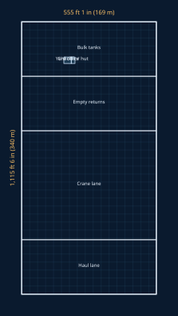

# P1-20 Quay Yard 4: plan

Footprint 555 ft 1 in (169 m) × 1,115 ft 6 in (340 m) · structural grid 32 ft 10 in (10 m)

## Levels

| Level | Floor above deck | Height | Floor area |
|---|---|---|---|
| Level 1 · Yard | 0 ft (0 mm) | 13 ft 1 in (4,000 mm) | 1,206 sq ft (112 m²) |

## Elements

| ID | Designation | Type | Name | Level(s) | Size / length | Area | Status |
|---|---|---|---|---|---|---|---|
| E001 | D5F4P1B9A2R1 | zone | Bulk tanks | L1 | 555 ft 1 in (169 m) × 223 ft 1 in (68 m) | 123,845 sq ft (11,506 m²) | proposed |
| E002 | D5F4P1B9A2R2 | room | Yard office | L1 | 30 ft 6 in (9,300 mm) × 26 ft 3 in (8,000 mm) | 801 sq ft (74 m²) | proposed |
| E003 | D5F4P1B9A2R3 | room | Checkers' hut | L1 | 15 ft 5 in (4,700 mm) × 26 ft 3 in (8,000 mm) | 405 sq ft (38 m²) | proposed |
| E004 | D5F4P1B9A2R4 | zone | Empty returns | L1 | 555 ft 1 in (169 m) × 223 ft 1 in (68 m) | 123,845 sq ft (11,506 m²) | proposed |
| E005 | D5F4P1B9A2R5 | zone | Crane lane | L1 | 555 ft 1 in (169 m) × 446 ft 2 in (136 m) | 247,691 sq ft (23,011 m²) | proposed |
| E006 | D5F4P1B9A2R6 | zone | Haul lane | L1 | 555 ft 1 in (169 m) × 223 ft 1 in (68 m) | 123,845 sq ft (11,506 m²) | proposed |

## Drawings

### Level 1 · Yard

