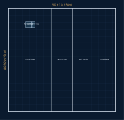

# P1-21 Quay Yard 5: plan

Footprint 506 ft 3 in (154 m) × 492 ft 2 in (150 m) · structural grid 32 ft 10 in (10 m)

## Levels

| Level | Floor above deck | Height | Floor area |
|---|---|---|---|
| Level 1 · Yard | 0 ft (0 mm) | 13 ft 1 in (4,000 mm) | 1,206 sq ft (112 m²) |

## Elements

| ID | Designation | Type | Name | Level(s) | Size / length | Area | Status |
|---|---|---|---|---|---|---|---|
| E001 | D5F4P1B11A2R1 | zone | Crane lane | L1 | 202 ft 5 in (62 m) × 492 ft 2 in (150 m) | 99,620 sq ft (9,255 m²) | proposed |
| E002 | D5F4P1B11A2R2 | room | Yard office | L1 | 30 ft 6 in (9,300 mm) × 26 ft 3 in (8,000 mm) | 801 sq ft (74 m²) | proposed |
| E003 | D5F4P1B11A2R3 | room | Checkers' hut | L1 | 15 ft 5 in (4,700 mm) × 26 ft 3 in (8,000 mm) | 405 sq ft (38 m²) | proposed |
| E004 | D5F4P1B11A2R4 | zone | Parts crates | L1 | 101 ft 5 in (31 m) × 492 ft 2 in (150 m) | 49,891 sq ft (4,635 m²) | proposed |
| E005 | D5F4P1B11A2R5 | zone | Bulk tanks | L1 | 101 ft 1 in (31 m) × 492 ft 2 in (150 m) | 49,729 sq ft (4,620 m²) | proposed |
| E006 | D5F4P1B11A2R6 | zone | Haul lane | L1 | 101 ft 5 in (31 m) × 492 ft 2 in (150 m) | 49,891 sq ft (4,635 m²) | proposed |

## Drawings

### Level 1 · Yard

