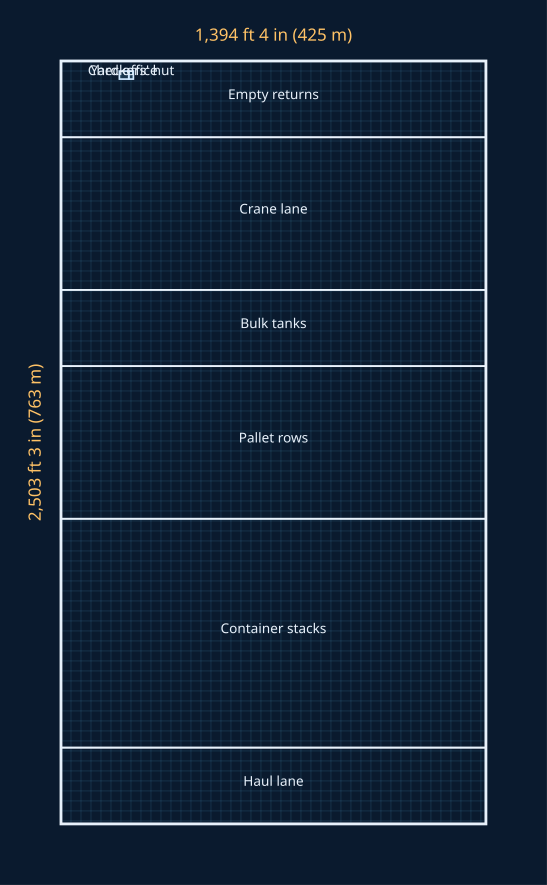

# P1-22 Quay Yard 6: plan

Footprint 1,394 ft 4 in (425 m) × 2,503 ft 3 in (763 m) · structural grid 32 ft 10 in (10 m)

## Levels

| Level | Floor above deck | Height | Floor area |
|---|---|---|---|
| Level 1 · Yard | 0 ft (0 mm) | 13 ft 1 in (4,000 mm) | 1,206 sq ft (112 m²) |

## Elements

| ID | Designation | Type | Name | Level(s) | Size / length | Area | Status |
|---|---|---|---|---|---|---|---|
| E001 | D5F4P1B12A1R1 | zone | Empty returns | L1 | 1,394 ft 4 in (425 m) × 250 ft 4 in (76 m) | 349,047 sq ft (32,428 m²) | proposed |
| E002 | D5F4P1B12A1R2 | room | Yard office | L1 | 30 ft 10 in (9,400 mm) × 26 ft 3 in (8,000 mm) | 809 sq ft (75 m²) | proposed |
| E003 | D5F4P1B12A1R3 | room | Checkers' hut | L1 | 15 ft 1 in (4,600 mm) × 26 ft 3 in (8,000 mm) | 396 sq ft (37 m²) | proposed |
| E004 | D5F4P1B12A1R4 | zone | Crane lane | L1 | 1,394 ft 4 in (425 m) × 500 ft 8 in (153 m) | 698,093 sq ft (64,855 m²) | proposed |
| E005 | D5F4P1B12A1R5 | zone | Bulk tanks | L1 | 1,394 ft 4 in (425 m) × 250 ft 4 in (76 m) | 349,047 sq ft (32,428 m²) | proposed |
| E006 | D5F4P1B12A1R6 | zone | Pallet rows | L1 | 1,394 ft 4 in (425 m) × 500 ft 8 in (153 m) | 698,093 sq ft (64,855 m²) | proposed |
| E007 | D5F4P1B12A1R7 | zone | Container stacks | L1 | 1,394 ft 4 in (425 m) × 751 ft (229 m) | 1,047,140 sq ft (97,282 m²) | proposed |
| E008 | D5F4P1B12A1R8 | zone | Haul lane | L1 | 1,394 ft 4 in (425 m) × 250 ft 4 in (76 m) | 349,047 sq ft (32,428 m²) | proposed |

## Drawings

### Level 1 · Yard

