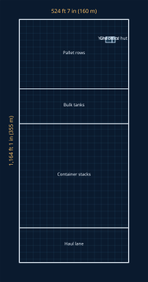

# P1-23 Quay Yard 7: plan

Footprint 524 ft 7 in (160 m) × 1,164 ft 1 in (355 m) · structural grid 32 ft 10 in (10 m)

## Levels

| Level | Floor above deck | Height | Floor area |
|---|---|---|---|
| Level 1 · Yard | 0 ft (0 mm) | 13 ft 1 in (4,000 mm) | 1,206 sq ft (112 m²) |

## Elements

| ID | Designation | Type | Name | Level(s) | Size / length | Area | Status |
|---|---|---|---|---|---|---|---|
| E001 | D5F4P1B14A2R1 | zone | Pallet rows | L1 | 524 ft 7 in (160 m) × 332 ft 8 in (101 m) | 174,525 sq ft (16,214 m²) | proposed |
| E002 | D5F4P1B14A2R2 | room | Yard office | L1 | 30 ft 10 in (9,400 mm) × 26 ft 3 in (8,000 mm) | 809 sq ft (75 m²) | proposed |
| E003 | D5F4P1B14A2R3 | room | Checkers' hut | L1 | 15 ft 1 in (4,600 mm) × 26 ft 3 in (8,000 mm) | 396 sq ft (37 m²) | proposed |
| E004 | D5F4P1B14A2R4 | zone | Bulk tanks | L1 | 524 ft 7 in (160 m) × 166 ft 4 in (51 m) | 87,262 sq ft (8,107 m²) | proposed |
| E005 | D5F4P1B14A2R5 | zone | Container stacks | L1 | 524 ft 7 in (160 m) × 498 ft 8 in (152 m) | 261,615 sq ft (24,305 m²) | proposed |
| E006 | D5F4P1B14A2R6 | zone | Haul lane | L1 | 524 ft 7 in (160 m) × 166 ft 4 in (51 m) | 87,262 sq ft (8,107 m²) | proposed |

## Drawings

### Level 1 · Yard

