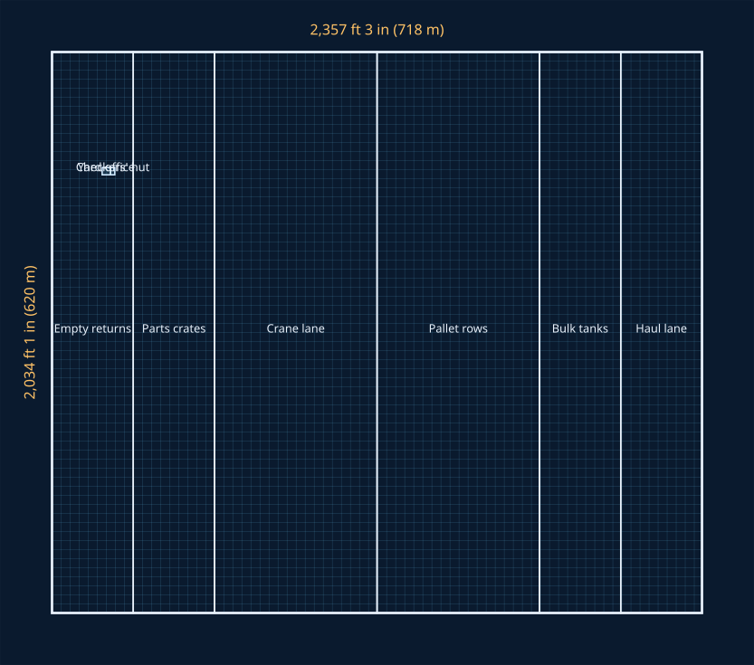

# P1-26 Quay Yard 10: plan

Footprint 2,357 ft 3 in (718 m) × 2,034 ft 1 in (620 m) · structural grid 32 ft 10 in (10 m)

## Levels

| Level | Floor above deck | Height | Floor area |
|---|---|---|---|
| Level 1 · Yard | 0 ft (0 mm) | 13 ft 1 in (4,000 mm) | 1,206 sq ft (112 m²) |

## Elements

| ID | Designation | Type | Name | Level(s) | Size / length | Area | Status |
|---|---|---|---|---|---|---|---|
| E001 | D5F4P1B5A2R1 | zone | Empty returns | L1 | 294 ft 7 in (90 m) × 2,034 ft 1 in (620 m) | 599,292 sq ft (55,676 m²) | proposed |
| E002 | D5F4P1B5A2R2 | room | Yard office | L1 | 30 ft 6 in (9,300 mm) × 26 ft 3 in (8,000 mm) | 801 sq ft (74 m²) | proposed |
| E003 | D5F4P1B5A2R3 | room | Checkers' hut | L1 | 15 ft 5 in (4,700 mm) × 26 ft 3 in (8,000 mm) | 405 sq ft (38 m²) | proposed |
| E004 | D5F4P1B5A2R4 | zone | Parts crates | L1 | 294 ft 7 in (90 m) × 2,034 ft 1 in (620 m) | 599,292 sq ft (55,676 m²) | proposed |
| E005 | D5F4P1B5A2R5 | zone | Crane lane | L1 | 589 ft 7 in (180 m) × 2,034 ft 1 in (620 m) | 1,199,250 sq ft (111,414 m²) | proposed |
| E006 | D5F4P1B5A2R6 | zone | Pallet rows | L1 | 589 ft 3 in (180 m) × 2,034 ft 1 in (620 m) | 1,198,583 sq ft (111,352 m²) | proposed |
| E007 | D5F4P1B5A2R7 | zone | Bulk tanks | L1 | 294 ft 7 in (90 m) × 2,034 ft 1 in (620 m) | 599,292 sq ft (55,676 m²) | proposed |
| E008 | D5F4P1B5A2R8 | zone | Haul lane | L1 | 294 ft 7 in (90 m) × 2,034 ft 1 in (620 m) | 599,292 sq ft (55,676 m²) | proposed |

## Drawings

### Level 1 · Yard

