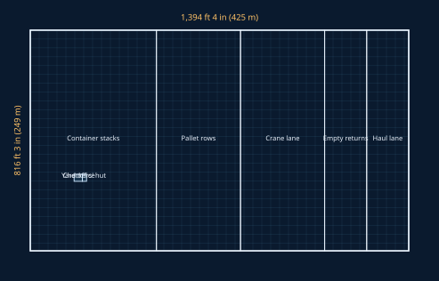

# P1-27 Quay Yard 11: plan

Footprint 1,394 ft 4 in (425 m) × 816 ft 3 in (249 m) · structural grid 32 ft 10 in (10 m)

## Levels

| Level | Floor above deck | Height | Floor area |
|---|---|---|---|
| Level 1 · Yard | 0 ft (0 mm) | 13 ft 1 in (4,000 mm) | 1,206 sq ft (112 m²) |

## Elements

| ID | Designation | Type | Name | Level(s) | Size / length | Area | Status |
|---|---|---|---|---|---|---|---|
| E001 | D5F4P1B7A2R1 | zone | Container stacks | L1 | 464 ft 11 in (142 m) × 816 ft 3 in (249 m) | 379,481 sq ft (35,255 m²) | proposed |
| E002 | D5F4P1B7A2R2 | room | Yard office | L1 | 30 ft 6 in (9,300 mm) × 26 ft 3 in (8,000 mm) | 801 sq ft (74 m²) | proposed |
| E003 | D5F4P1B7A2R3 | room | Checkers' hut | L1 | 15 ft 5 in (4,700 mm) × 26 ft 3 in (8,000 mm) | 405 sq ft (38 m²) | proposed |
| E004 | D5F4P1B7A2R4 | zone | Pallet rows | L1 | 309 ft 9 in (94 m) × 816 ft 3 in (249 m) | 252,809 sq ft (23,487 m²) | proposed |
| E005 | D5F4P1B7A2R5 | zone | Crane lane | L1 | 310 ft (95 m) × 816 ft 3 in (249 m) | 253,077 sq ft (23,512 m²) | proposed |
| E006 | D5F4P1B7A2R6 | zone | Empty returns | L1 | 154 ft 10 in (47 m) × 816 ft 3 in (249 m) | 126,404 sq ft (11,743 m²) | proposed |
| E007 | D5F4P1B7A2R7 | zone | Haul lane | L1 | 154 ft 10 in (47 m) × 816 ft 3 in (249 m) | 126,404 sq ft (11,743 m²) | proposed |

## Drawings

### Level 1 · Yard

