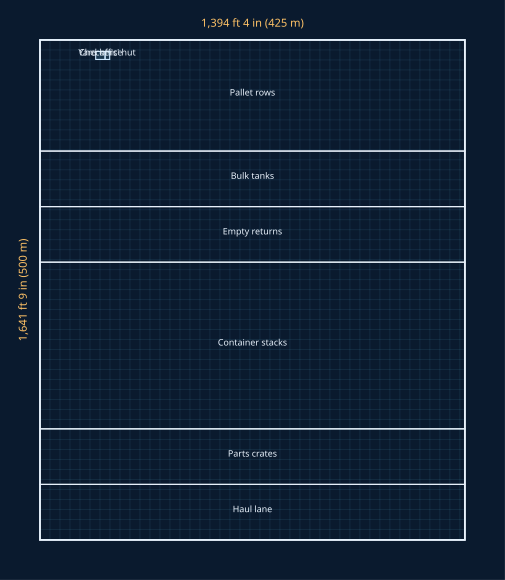

# P1-29 Quay Yard 13: plan

Footprint 1,394 ft 4 in (425 m) × 1,641 ft 9 in (500 m) · structural grid 32 ft 10 in (10 m)

## Levels

| Level | Floor above deck | Height | Floor area |
|---|---|---|---|
| Level 1 · Yard | 0 ft (0 mm) | 13 ft 1 in (4,000 mm) | 1,206 sq ft (112 m²) |

## Elements

| ID | Designation | Type | Name | Level(s) | Size / length | Area | Status |
|---|---|---|---|---|---|---|---|
| E001 | D5F4P1B10A2R1 | zone | Pallet rows | L1 | 1,394 ft 4 in (425 m) × 364 ft 10 in (111 m) | 508,702 sq ft (47,260 m²) | proposed |
| E002 | D5F4P1B10A2R2 | room | Yard office | L1 | 30 ft 10 in (9,400 mm) × 26 ft 3 in (8,000 mm) | 809 sq ft (75 m²) | proposed |
| E003 | D5F4P1B10A2R3 | room | Checkers' hut | L1 | 15 ft 1 in (4,600 mm) × 26 ft 3 in (8,000 mm) | 396 sq ft (37 m²) | proposed |
| E004 | D5F4P1B10A2R4 | zone | Bulk tanks | L1 | 1,394 ft 4 in (425 m) × 182 ft 5 in (56 m) | 254,351 sq ft (23,630 m²) | proposed |
| E005 | D5F4P1B10A2R5 | zone | Empty returns | L1 | 1,394 ft 4 in (425 m) × 182 ft 5 in (56 m) | 254,351 sq ft (23,630 m²) | proposed |
| E006 | D5F4P1B10A2R6 | zone | Container stacks | L1 | 1,394 ft 4 in (425 m) × 547 ft 3 in (167 m) | 763,054 sq ft (70,890 m²) | proposed |
| E007 | D5F4P1B10A2R7 | zone | Parts crates | L1 | 1,394 ft 4 in (425 m) × 182 ft 5 in (56 m) | 254,351 sq ft (23,630 m²) | proposed |
| E008 | D5F4P1B10A2R8 | zone | Haul lane | L1 | 1,394 ft 4 in (425 m) × 182 ft 5 in (56 m) | 254,351 sq ft (23,630 m²) | proposed |

## Drawings

### Level 1 · Yard

