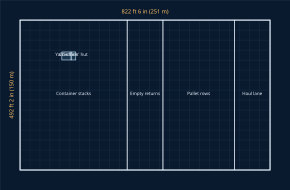

# P1-30 Quay Yard 14: plan

Footprint 822 ft 6 in (251 m) × 492 ft 2 in (150 m) · structural grid 32 ft 10 in (10 m)

## Levels

| Level | Floor above deck | Height | Floor area |
|---|---|---|---|
| Level 1 · Yard | 0 ft (0 mm) | 13 ft 1 in (4,000 mm) | 1,206 sq ft (112 m²) |

## Elements

| ID | Designation | Type | Name | Level(s) | Size / length | Area | Status |
|---|---|---|---|---|---|---|---|
| E001 | D5F4P1B11A3R1 | zone | Container stacks | L1 | 352 ft 4 in (107 m) × 492 ft 2 in (150 m) | 173,407 sq ft (16,110 m²) | proposed |
| E002 | D5F4P1B11A3R2 | room | Yard office | L1 | 30 ft 6 in (9,300 mm) × 26 ft 3 in (8,000 mm) | 801 sq ft (74 m²) | proposed |
| E003 | D5F4P1B11A3R3 | room | Checkers' hut | L1 | 15 ft 5 in (4,700 mm) × 26 ft 3 in (8,000 mm) | 405 sq ft (38 m²) | proposed |
| E004 | D5F4P1B11A3R4 | zone | Empty returns | L1 | 117 ft 9 in (36 m) × 492 ft 2 in (150 m) | 57,964 sq ft (5,385 m²) | proposed |
| E005 | D5F4P1B11A3R5 | zone | Pallet rows | L1 | 234 ft 11 in (72 m) × 492 ft 2 in (150 m) | 115,604 sq ft (10,740 m²) | proposed |
| E006 | D5F4P1B11A3R6 | zone | Haul lane | L1 | 117 ft 5 in (36 m) × 492 ft 2 in (150 m) | 57,802 sq ft (5,370 m²) | proposed |

## Drawings

### Level 1 · Yard

