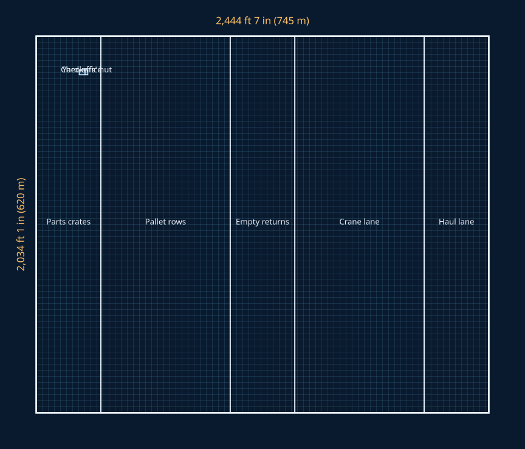

# P1-31 Quay Yard 15: plan

Footprint 2,444 ft 7 in (745 m) × 2,034 ft 1 in (620 m) · structural grid 32 ft 10 in (10 m)

## Levels

| Level | Floor above deck | Height | Floor area |
|---|---|---|---|
| Level 1 · Yard | 0 ft (0 mm) | 13 ft 1 in (4,000 mm) | 1,206 sq ft (112 m²) |

## Elements

| ID | Designation | Type | Name | Level(s) | Size / length | Area | Status |
|---|---|---|---|---|---|---|---|
| E001 | D5F4P1B14A3R1 | zone | Parts crates | L1 | 349 ft 1 in (106 m) × 2,034 ft 1 in (620 m) | 710,074 sq ft (65,968 m²) | proposed |
| E002 | D5F4P1B14A3R2 | room | Yard office | L1 | 30 ft 6 in (9,300 mm) × 26 ft 3 in (8,000 mm) | 801 sq ft (74 m²) | proposed |
| E003 | D5F4P1B14A3R3 | room | Checkers' hut | L1 | 15 ft 5 in (4,700 mm) × 26 ft 3 in (8,000 mm) | 405 sq ft (38 m²) | proposed |
| E004 | D5F4P1B14A3R4 | zone | Pallet rows | L1 | 698 ft 6 in (213 m) × 2,034 ft 1 in (620 m) | 1,420,815 sq ft (131,998 m²) | proposed |
| E005 | D5F4P1B14A3R5 | zone | Empty returns | L1 | 349 ft 5 in (106 m) × 2,034 ft 1 in (620 m) | 710,741 sq ft (66,030 m²) | proposed |
| E006 | D5F4P1B14A3R6 | zone | Crane lane | L1 | 698 ft 6 in (213 m) × 2,034 ft 1 in (620 m) | 1,420,815 sq ft (131,998 m²) | proposed |
| E007 | D5F4P1B14A3R7 | zone | Haul lane | L1 | 349 ft 1 in (106 m) × 2,034 ft 1 in (620 m) | 710,074 sq ft (65,968 m²) | proposed |

## Drawings

### Level 1 · Yard

