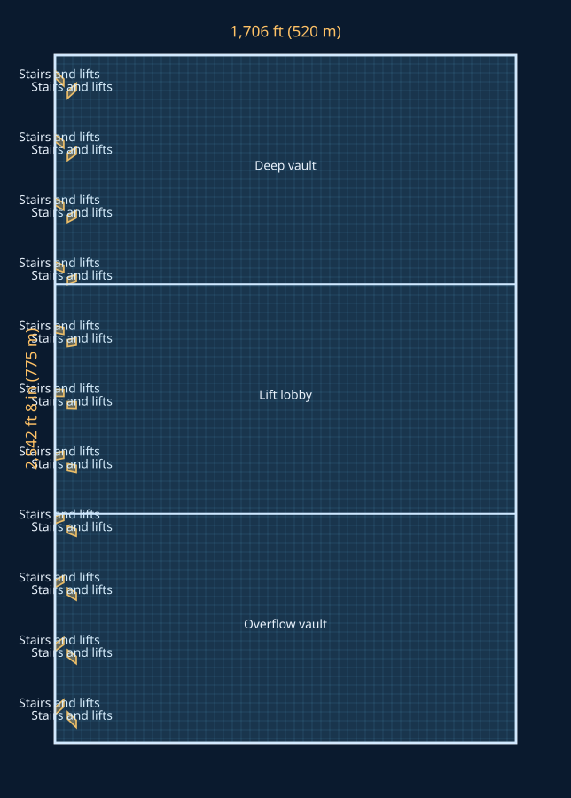
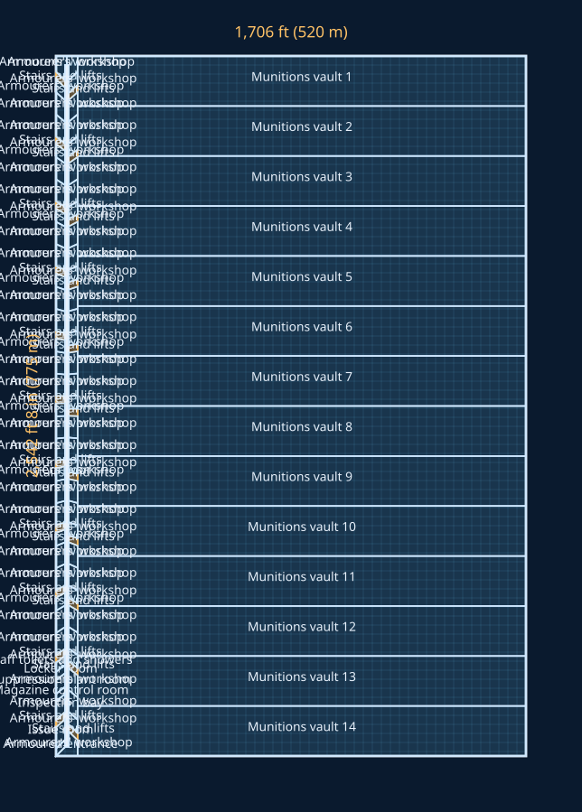

# P2-01 Cruiser Munitions Magazine: plan

Footprint 1,706 ft (520 m) × 2,542 ft 8 in (775 m) · structural grid 32 ft 10 in (10 m)

## Levels

| Level | Floor above deck | Height | Floor area |
|---|---|---|---|
| Level B1 · Deep magazine | −26 ft 3 in (8,000 mm) | 26 ft 3 in (8,000 mm) | 4,337,856 sq ft (403,000 m²) |
| Level 1 · Magazine floor | 0 ft (0 mm) | 32 ft 10 in (10 m) | 4,284,949 sq ft (398,085 m²) |

## Elements

| ID | Designation | Type | Name | Level(s) | Size / length | Area | Status |
|---|---|---|---|---|---|---|---|
| E001 | D5F4P2B2A1L1R1 | room | Munitions vault 1 | L1 | 1,627 ft 4 in (496 m) × 181 ft 9 in (55 m) | 295,775 sq ft (27,478 m²) | proposed |
| E002 | D5F4P2B2A1L1R2 | room | Munitions vault 2 | L1 | 1,627 ft 4 in (496 m) × 181 ft 5 in (55 m) | 295,241 sq ft (27,429 m²) | proposed |
| E003 | D5F4P2B2A1L1R3 | room | Munitions vault 3 | L1 | 1,627 ft 4 in (496 m) × 181 ft 9 in (55 m) | 295,775 sq ft (27,478 m²) | proposed |
| E004 | D5F4P2B2A1L1R4 | room | Munitions vault 4 | L1 | 1,627 ft 4 in (496 m) × 181 ft 5 in (55 m) | 295,241 sq ft (27,429 m²) | proposed |
| E005 | D5F4P2B2A1L1R5 | room | Munitions vault 5 | L1 | 1,627 ft 4 in (496 m) × 181 ft 9 in (55 m) | 295,775 sq ft (27,478 m²) | proposed |
| E006 | D5F4P2B2A1L1R6 | room | Munitions vault 6 | L1 | 1,627 ft 4 in (496 m) × 181 ft 5 in (55 m) | 295,241 sq ft (27,429 m²) | proposed |
| E007 | D5F4P2B2A1L1R7 | room | Munitions vault 7 | L1 | 1,627 ft 4 in (496 m) × 181 ft 9 in (55 m) | 295,775 sq ft (27,478 m²) | proposed |
| E008 | D5F4P2B2A1L1R8 | room | Munitions vault 8 | L1 | 1,627 ft 4 in (496 m) × 181 ft 9 in (55 m) | 295,775 sq ft (27,478 m²) | proposed |
| E009 | D5F4P2B2A1L1R9 | room | Munitions vault 9 | L1 | 1,627 ft 4 in (496 m) × 181 ft 5 in (55 m) | 295,241 sq ft (27,429 m²) | proposed |
| E010 | D5F4P2B2A1L1R10 | room | Munitions vault 10 | L1 | 1,627 ft 4 in (496 m) × 181 ft 9 in (55 m) | 295,775 sq ft (27,478 m²) | proposed |
| E011 | D5F4P2B2A1L1R11 | room | Munitions vault 11 | L1 | 1,627 ft 4 in (496 m) × 181 ft 5 in (55 m) | 295,241 sq ft (27,429 m²) | proposed |
| E012 | D5F4P2B2A1L1R12 | room | Munitions vault 12 | L1 | 1,627 ft 4 in (496 m) × 181 ft 9 in (55 m) | 295,775 sq ft (27,478 m²) | proposed |
| E013 | D5F4P2B2A1L1R13 | room | Munitions vault 13 | L1 | 1,627 ft 4 in (496 m) × 181 ft 5 in (55 m) | 295,241 sq ft (27,429 m²) | proposed |
| E014 | D5F4P2B2A1L1R14 | room | Munitions vault 14 | L1 | 1,627 ft 4 in (496 m) × 181 ft 9 in (55 m) | 295,775 sq ft (27,478 m²) | proposed |
| E015 | D5F4P2B2A1LB1R1, D5F4P2B2A1L1R15 | core | Stairs and lifts | LB1, L1 | 32 ft 6 in (9,900 mm) × 55 ft 9 in (17 m) | 853 sq ft (79 m²) | proposed |
| E016 | D5F4P2B2A1LB1R2, D5F4P2B2A1L1R16 | core | Stairs and lifts | LB1, L1 | 32 ft 6 in (9,900 mm) × 49 ft 6 in (15 m) | 853 sq ft (79 m²) | proposed |
| E017 | D5F4P2B2A1LB1R3, D5F4P2B2A1L1R17 | core | Stairs and lifts | LB1, L1 | 32 ft 6 in (9,900 mm) × 43 ft 8 in (13 m) | 853 sq ft (79 m²) | proposed |
| E018 | D5F4P2B2A1LB1R4, D5F4P2B2A1L1R18 | core | Stairs and lifts | LB1, L1 | 32 ft 6 in (9,900 mm) × 37 ft 9 in (12 m) | 853 sq ft (79 m²) | proposed |
| E019 | D5F4P2B2A1LB1R5, D5F4P2B2A1L1R19 | core | Stairs and lifts | LB1, L1 | 32 ft 6 in (9,900 mm) × 31 ft 10 in (9,700 mm) | 853 sq ft (79 m²) | proposed |
| E020 | D5F4P2B2A1LB1R6, D5F4P2B2A1L1R20 | core | Stairs and lifts | LB1, L1 | 32 ft 6 in (9,900 mm) × 26 ft 11 in (8,200 mm) | 853 sq ft (79 m²) | proposed |
| E021 | D5F4P2B2A1LB1R7, D5F4P2B2A1L1R21 | core | Stairs and lifts | LB1, L1 | 32 ft 6 in (9,900 mm) × 33 ft 2 in (10 m) | 858 sq ft (80 m²) | proposed |
| E022 | D5F4P2B2A1LB1R8, D5F4P2B2A1L1R22 | core | Stairs and lifts | LB1, L1 | 32 ft 6 in (9,900 mm) × 38 ft 9 in (12 m) | 853 sq ft (79 m²) | proposed |
| E023 | D5F4P2B2A1LB1R9, D5F4P2B2A1L1R23 | core | Stairs and lifts | LB1, L1 | 32 ft 6 in (9,900 mm) × 44 ft 11 in (14 m) | 853 sq ft (79 m²) | proposed |
| E024 | D5F4P2B2A1LB1R10, D5F4P2B2A1L1R24 | core | Stairs and lifts | LB1, L1 | 32 ft 6 in (9,900 mm) × 50 ft 10 in (16 m) | 853 sq ft (79 m²) | proposed |
| E025 | D5F4P2B2A1LB1R11, D5F4P2B2A1L1R25 | core | Stairs and lifts | LB1, L1 | 32 ft 6 in (9,900 mm) × 57 ft 1 in (17 m) | 853 sq ft (79 m²) | proposed |
| E026 | D5F4P2B2A1LB1R12, D5F4P2B2A1L1R26 | core | Stairs and lifts | LB1, L1 | 32 ft 6 in (9,900 mm) × 55 ft 9 in (17 m) | 853 sq ft (79 m²) | proposed |
| E027 | D5F4P2B2A1LB1R13, D5F4P2B2A1L1R27 | core | Stairs and lifts | LB1, L1 | 32 ft 6 in (9,900 mm) × 49 ft 6 in (15 m) | 853 sq ft (79 m²) | proposed |
| E028 | D5F4P2B2A1LB1R14, D5F4P2B2A1L1R28 | core | Stairs and lifts | LB1, L1 | 32 ft 6 in (9,900 mm) × 43 ft 8 in (13 m) | 853 sq ft (79 m²) | proposed |
| E029 | D5F4P2B2A1LB1R15, D5F4P2B2A1L1R29 | core | Stairs and lifts | LB1, L1 | 32 ft 6 in (9,900 mm) × 37 ft 9 in (12 m) | 853 sq ft (79 m²) | proposed |
| E030 | D5F4P2B2A1LB1R16, D5F4P2B2A1L1R30 | core | Stairs and lifts | LB1, L1 | 32 ft 6 in (9,900 mm) × 31 ft 10 in (9,700 mm) | 853 sq ft (79 m²) | proposed |
| E031 | D5F4P2B2A1LB1R17, D5F4P2B2A1L1R31 | core | Stairs and lifts | LB1, L1 | 32 ft 6 in (9,900 mm) × 26 ft 11 in (8,200 mm) | 853 sq ft (79 m²) | proposed |
| E032 | D5F4P2B2A1LB1R18, D5F4P2B2A1L1R32 | core | Stairs and lifts | LB1, L1 | 32 ft 6 in (9,900 mm) × 33 ft 2 in (10 m) | 858 sq ft (80 m²) | proposed |
| E033 | D5F4P2B2A1LB1R19, D5F4P2B2A1L1R33 | core | Stairs and lifts | LB1, L1 | 32 ft 6 in (9,900 mm) × 38 ft 9 in (12 m) | 853 sq ft (79 m²) | proposed |
| E034 | D5F4P2B2A1LB1R20, D5F4P2B2A1L1R34 | core | Stairs and lifts | LB1, L1 | 32 ft 6 in (9,900 mm) × 44 ft 11 in (14 m) | 853 sq ft (79 m²) | proposed |
| E035 | D5F4P2B2A1LB1R21, D5F4P2B2A1L1R35 | core | Stairs and lifts | LB1, L1 | 32 ft 6 in (9,900 mm) × 50 ft 10 in (16 m) | 853 sq ft (79 m²) | proposed |
| E036 | D5F4P2B2A1LB1R22, D5F4P2B2A1L1R36 | core | Stairs and lifts | LB1, L1 | 32 ft 6 in (9,900 mm) × 57 ft 1 in (17 m) | 853 sq ft (79 m²) | proposed |
| E037 | D5F4P2B2A1L1R37 | zone | Corridor | L1 | 13 ft 9 in (4,200 mm) × 2,477 ft 8 in (755 m) | 24,425 sq ft (2,269 m²) | proposed |
| E038 | D5F4P2B2A1L1R38 | room | Armoured entrance | L1 | 32 ft 6 in (9,900 mm) × 58 ft 9 in (18 m) | 863 sq ft (80 m²) | proposed |
| E039 | D5F4P2B2A1L1R39 | room | Issue room | L1 | 32 ft 6 in (9,900 mm) × 107 ft 3 in (33 m) | 2,483 sq ft (231 m²) | proposed |
| E040 | D5F4P2B2A1L1R40 | room | Inspection bay | L1 | 32 ft 6 in (9,900 mm) × 94 ft 10 in (29 m) | 2,158 sq ft (200 m²) | proposed |
| E041 | D5F4P2B2A1L1R41 | room | Magazine control room | L1 | 32 ft 6 in (9,900 mm) × 53 ft 6 in (16 m) | 858 sq ft (80 m²) | proposed |
| E042 | D5F4P2B2A1L1R42 | room | Suppression plant room | L1 | 32 ft 6 in (9,900 mm) × 75 ft 9 in (23 m) | 1,620 sq ft (150 m²) | proposed |
| E043 | D5F4P2B2A1L1R43 | room | Locker room | L1 | 32 ft 6 in (9,900 mm) × 54 ft 9 in (17 m) | 970 sq ft (90 m²) | proposed |
| E044 | D5F4P2B2A1L1R44 | room | Staff toilets and showers | L1 | 32 ft 6 in (9,900 mm) × 57 ft 9 in (18 m) | 1,092 sq ft (101 m²) | proposed |
| E045 | D5F4P2B2A1L1R45 | room | Armourers' workshop | L1 | 32 ft 6 in (9,900 mm) × 101 ft 8 in (31 m) | 2,589 sq ft (241 m²) | proposed |
| E046 | D5F4P2B2A1L1R46 | room | Armourers' workshop | L1 | 32 ft 6 in (9,900 mm) × 99 ft 5 in (30 m) | 2,584 sq ft (240 m²) | proposed |
| E047 | D5F4P2B2A1L1R47 | room | Armourers' workshop | L1 | 32 ft 6 in (9,900 mm) × 65 ft (20 m) | 1,519 sq ft (141 m²) | proposed |
| E048 | D5F4P2B2A1L1R48 | room | Armourers' workshop | L1 | 32 ft 6 in (9,900 mm) × 95 ft 10 in (29 m) | 2,589 sq ft (241 m²) | proposed |
| E049 | D5F4P2B2A1L1R49 | room | Armourers' workshop | L1 | 32 ft 6 in (9,900 mm) × 93 ft 10 in (29 m) | 2,589 sq ft (241 m²) | proposed |
| E050 | D5F4P2B2A1L1R50 | room | Armourers' workshop | L1 | 32 ft 6 in (9,900 mm) × 59 ft 5 in (18 m) | 1,524 sq ft (142 m²) | proposed |
| E051 | D5F4P2B2A1L1R51 | room | Armourers' workshop | L1 | 32 ft 6 in (9,900 mm) × 89 ft 7 in (27 m) | 2,584 sq ft (240 m²) | proposed |
| E052 | D5F4P2B2A1L1R52 | room | Armourers' workshop | L1 | 32 ft 6 in (9,900 mm) × 87 ft 7 in (27 m) | 2,589 sq ft (241 m²) | proposed |
| E053 | D5F4P2B2A1L1R53 | room | Armourers' workshop | L1 | 32 ft 6 in (9,900 mm) × 53 ft 2 in (16 m) | 1,519 sq ft (141 m²) | proposed |
| E054 | D5F4P2B2A1L1R54 | room | Armourers' workshop | L1 | 32 ft 6 in (9,900 mm) × 83 ft 8 in (26 m) | 2,584 sq ft (240 m²) | proposed |
| E055 | D5F4P2B2A1L1R55 | room | Armourers' workshop | L1 | 32 ft 6 in (9,900 mm) × 81 ft 8 in (25 m) | 2,589 sq ft (241 m²) | proposed |
| E056 | D5F4P2B2A1L1R56 | room | Armourers' workshop | L1 | 32 ft 6 in (9,900 mm) × 47 ft 7 in (14 m) | 1,524 sq ft (142 m²) | proposed |
| E057 | D5F4P2B2A1L1R57 | room | Armourers' workshop | L1 | 32 ft 6 in (9,900 mm) × 81 ft 8 in (25 m) | 2,589 sq ft (241 m²) | proposed |
| E058 | D5F4P2B2A1L1R58 | room | Armourers' workshop | L1 | 32 ft 6 in (9,900 mm) × 83 ft 8 in (26 m) | 2,584 sq ft (240 m²) | proposed |
| E059 | D5F4P2B2A1L1R59 | room | Armourers' workshop | L1 | 32 ft 6 in (9,900 mm) × 52 ft 6 in (16 m) | 1,519 sq ft (141 m²) | proposed |
| E060 | D5F4P2B2A1L1R60 | room | Armourers' workshop | L1 | 32 ft 6 in (9,900 mm) × 87 ft 7 in (27 m) | 2,584 sq ft (240 m²) | proposed |
| E061 | D5F4P2B2A1L1R61 | room | Armourers' workshop | L1 | 32 ft 6 in (9,900 mm) × 89 ft 7 in (27 m) | 2,584 sq ft (240 m²) | proposed |
| E062 | D5F4P2B2A1L1R62 | room | Armourers' workshop | L1 | 32 ft 6 in (9,900 mm) × 58 ft 9 in (18 m) | 1,529 sq ft (142 m²) | proposed |
| E063 | D5F4P2B2A1L1R63 | room | Armourers' workshop | L1 | 32 ft 6 in (9,900 mm) × 93 ft 6 in (28 m) | 2,584 sq ft (240 m²) | proposed |
| E064 | D5F4P2B2A1L1R64 | room | Armourers' workshop | L1 | 32 ft 6 in (9,900 mm) × 95 ft 10 in (29 m) | 2,589 sq ft (241 m²) | proposed |
| E065 | D5F4P2B2A1L1R65 | room | Armourers' workshop | L1 | 32 ft 6 in (9,900 mm) × 64 ft 8 in (20 m) | 1,524 sq ft (142 m²) | proposed |
| E066 | D5F4P2B2A1L1R66 | room | Armourers' workshop | L1 | 32 ft 6 in (9,900 mm) × 99 ft 5 in (30 m) | 2,579 sq ft (240 m²) | proposed |
| E067 | D5F4P2B2A1L1R67 | room | Armourers' workshop | L1 | 32 ft 6 in (9,900 mm) × 101 ft 8 in (31 m) | 2,589 sq ft (241 m²) | proposed |
| E068 | D5F4P2B2A1L1R68 | room | Armourers' workshop | L1 | 32 ft 6 in (9,900 mm) × 70 ft 6 in (22 m) | 1,524 sq ft (142 m²) | proposed |
| E069 | D5F4P2B2A1L1R69 | room | Armourers' workshop | L1 | 32 ft 6 in (9,900 mm) × 105 ft 8 in (32 m) | 2,589 sq ft (241 m²) | proposed |
| E070 | D5F4P2B2A1L1R70 | room | Armourers' workshop | L1 | 32 ft 6 in (9,900 mm) × 107 ft 7 in (33 m) | 2,584 sq ft (240 m²) | proposed |
| E071 | D5F4P2B2A1L1R71 | room | Armourers' workshop | L1 | 32 ft 6 in (9,900 mm) × 76 ft 9 in (23 m) | 1,524 sq ft (142 m²) | proposed |
| E072 | D5F4P2B2A1L1R72 | room | Armourers' workshop | L1 | 39 ft 4 in (12 m) × 88 ft 7 in (27 m) | 2,584 sq ft (240 m²) | proposed |
| E073 | D5F4P2B2A1L1R73 | room | Armourers' workshop | L1 | 40 ft (12 m) × 87 ft 11 in (27 m) | 2,584 sq ft (240 m²) | proposed |
| E074 | D5F4P2B2A1L1R74 | room | Armourers' workshop | L1 | 32 ft 6 in (9,900 mm) × 77 ft 5 in (24 m) | 1,524 sq ft (142 m²) | proposed |
| E075 | D5F4P2B2A1L1R75 | room | Armourers' workshop | L1 | 32 ft 6 in (9,900 mm) × 107 ft 11 in (33 m) | 2,589 sq ft (241 m²) | proposed |
| E076 | D5F4P2B2A1L1R76 | room | Armourers' workshop | L1 | 32 ft 6 in (9,900 mm) × 105 ft 8 in (32 m) | 2,584 sq ft (240 m²) | proposed |
| E077 | D5F4P2B2A1L1R77 | room | Armourers' workshop | L1 | 32 ft 6 in (9,900 mm) × 71 ft 2 in (22 m) | 1,524 sq ft (142 m²) | proposed |
| E078 | D5F4P2B2A1L1R78 | room | Armourers' workshop | L1 | 32 ft 6 in (9,900 mm) × 101 ft 8 in (31 m) | 2,589 sq ft (241 m²) | proposed |
| E079 | D5F4P2B2A1L1R79 | room | Armourers' workshop | L1 | 32 ft 6 in (9,900 mm) × 99 ft 5 in (30 m) | 2,584 sq ft (240 m²) | proposed |
| E080 | D5F4P2B2A1L1R80 | room | Armourers' workshop | L1 | 32 ft 6 in (9,900 mm) × 65 ft (20 m) | 1,519 sq ft (141 m²) | proposed |
| E081 | D5F4P2B2A1L1R81 | room | Armourers' workshop | L1 | 32 ft 6 in (9,900 mm) × 95 ft 10 in (29 m) | 2,589 sq ft (241 m²) | proposed |
| E082 | D5F4P2B2A1L1R82 | room | Armourers' workshop | L1 | 32 ft 6 in (9,900 mm) × 93 ft 10 in (29 m) | 2,589 sq ft (241 m²) | proposed |
| E083 | D5F4P2B2A1L1R83 | room | Armourers' workshop | L1 | 32 ft 6 in (9,900 mm) × 59 ft 5 in (18 m) | 1,524 sq ft (142 m²) | proposed |
| E084 | D5F4P2B2A1L1R84 | room | Armourers' workshop | L1 | 32 ft 6 in (9,900 mm) × 89 ft 7 in (27 m) | 2,584 sq ft (240 m²) | proposed |
| E085 | D5F4P2B2A1L1R85 | room | Armourers' workshop | L1 | 32 ft 6 in (9,900 mm) × 87 ft 7 in (27 m) | 2,589 sq ft (241 m²) | proposed |
| E086 | D5F4P2B2A1L1R86 | room | Armourers' workshop | L1 | 32 ft 6 in (9,900 mm) × 53 ft 2 in (16 m) | 1,519 sq ft (141 m²) | proposed |
| E087 | D5F4P2B2A1L1R87 | room | Armourers' workshop | L1 | 32 ft 6 in (9,900 mm) × 83 ft 8 in (26 m) | 2,584 sq ft (240 m²) | proposed |
| E088 | D5F4P2B2A1L1R88 | room | Armourers' workshop | L1 | 32 ft 6 in (9,900 mm) × 81 ft 8 in (25 m) | 2,589 sq ft (241 m²) | proposed |
| E089 | D5F4P2B2A1L1R89 | room | Armourers' workshop | L1 | 32 ft 6 in (9,900 mm) × 47 ft 7 in (14 m) | 1,524 sq ft (142 m²) | proposed |
| E090 | D5F4P2B2A1L1R90 | room | Armourers' workshop | L1 | 32 ft 6 in (9,900 mm) × 81 ft 8 in (25 m) | 2,589 sq ft (241 m²) | proposed |
| E091 | D5F4P2B2A1L1R91 | room | Armourers' workshop | L1 | 32 ft 6 in (9,900 mm) × 83 ft 8 in (26 m) | 2,584 sq ft (240 m²) | proposed |
| E092 | D5F4P2B2A1L1R92 | room | Armourers' workshop | L1 | 32 ft 6 in (9,900 mm) × 52 ft 6 in (16 m) | 1,519 sq ft (141 m²) | proposed |
| E093 | D5F4P2B2A1L1R93 | room | Armourers' workshop | L1 | 32 ft 6 in (9,900 mm) × 87 ft 7 in (27 m) | 2,584 sq ft (240 m²) | proposed |
| E094 | D5F4P2B2A1L1R94 | room | Armourers' workshop | L1 | 32 ft 6 in (9,900 mm) × 89 ft 7 in (27 m) | 2,584 sq ft (240 m²) | proposed |
| E095 | D5F4P2B2A1L1R95 | room | Armourers' workshop | L1 | 32 ft 6 in (9,900 mm) × 58 ft 9 in (18 m) | 1,529 sq ft (142 m²) | proposed |
| E096 | D5F4P2B2A1L1R96 | room | Armourers' workshop | L1 | 32 ft 6 in (9,900 mm) × 93 ft 6 in (28 m) | 2,584 sq ft (240 m²) | proposed |
| E097 | D5F4P2B2A1L1R97 | room | Armourers' workshop | L1 | 32 ft 6 in (9,900 mm) × 95 ft 10 in (29 m) | 2,589 sq ft (241 m²) | proposed |
| E098 | D5F4P2B2A1L1R98 | room | Armourers' workshop | L1 | 32 ft 6 in (9,900 mm) × 64 ft 8 in (20 m) | 1,524 sq ft (142 m²) | proposed |
| E099 | D5F4P2B2A1L1R99 | room | Armourers' workshop | L1 | 32 ft 6 in (9,900 mm) × 99 ft 5 in (30 m) | 2,579 sq ft (240 m²) | proposed |
| E100 | D5F4P2B2A1L1R100 | room | Armourers' workshop | L1 | 32 ft 6 in (9,900 mm) × 101 ft 8 in (31 m) | 2,589 sq ft (241 m²) | proposed |
| E101 | D5F4P2B2A1L1R101 | room | Armourers' workshop | L1 | 32 ft 6 in (9,900 mm) × 70 ft 6 in (22 m) | 1,524 sq ft (142 m²) | proposed |
| E102 | D5F4P2B2A1L1R102 | room | Armourers' workshop | L1 | 32 ft 6 in (9,900 mm) × 105 ft 8 in (32 m) | 2,589 sq ft (241 m²) | proposed |
| E103 | D5F4P2B2A1L1R103 | room | Armourers' workshop | L1 | 32 ft 6 in (9,900 mm) × 107 ft 7 in (33 m) | 2,584 sq ft (240 m²) | proposed |
| E104 | D5F4P2B2A1L1R104 | room | Armourers' workshop | L1 | 32 ft 6 in (9,900 mm) × 76 ft 9 in (23 m) | 1,524 sq ft (142 m²) | proposed |
| E105 | D5F4P2B2A1L1R105 | room | Armourers' workshop | L1 | 78 ft 9 in (24 m) × 88 ft 7 in (27 m) | 3,346 sq ft (311 m²) | proposed |
| E106 | D5F4P2B2A1LB1R23 | room | Deep vault | LB1 | 1,706 ft (520 m) × 847 ft 5 in (258 m) | 1,445,765 sq ft (134,316 m²) | proposed |
| E107 | D5F4P2B2A1LB1R24 | room | Lift lobby | LB1 | 1,706 ft (520 m) × 847 ft 9 in (258 m) | 1,446,325 sq ft (134,368 m²) | proposed |
| E108 | D5F4P2B2A1LB1R25 | room | Overflow vault | LB1 | 1,706 ft (520 m) × 847 ft 5 in (258 m) | 1,445,765 sq ft (134,316 m²) | proposed |

## Drawings

### Level B1 · Deep magazine

### Level 1 · Magazine floor

