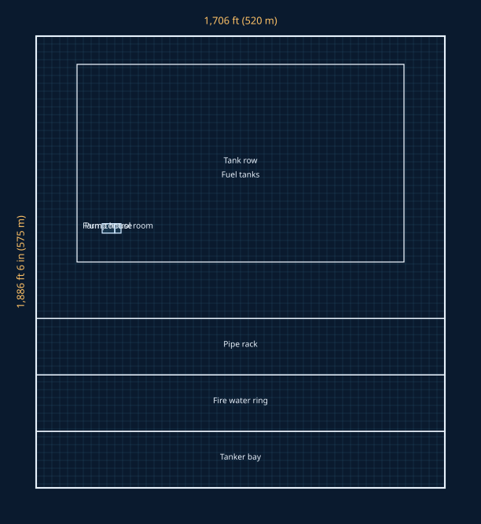

# P2-02 Cruiser Fuel Farm: plan

Footprint 1,706 ft (520 m) × 1,886 ft 6 in (575 m) · structural grid 32 ft 10 in (10 m)

## Levels

| Level | Floor above deck | Height | Floor area |
|---|---|---|---|
| Level 1 · Tank floor | 0 ft (0 mm) | 13 ft 1 in (4,000 mm) | 3,100 sq ft (288 m²) |

## Elements

| ID | Designation | Type | Name | Level(s) | Size / length | Area | Status |
|---|---|---|---|---|---|---|---|
| E001 | D5F4P2B3A1R1 | zone | Fuel tanks | L1 | 1,706 ft (520 m) × 1,179 ft 2 in (359 m) | 2,011,646 sq ft (186,888 m²) | proposed |
| E002 | D5F4P2B3A1R2 | room | Pump house | L1 | 52 ft 6 in (16 m) × 39 ft 4 in (12 m) | 2,067 sq ft (192 m²) | proposed |
| E003 | D5F4P2B3A1R3 | room | Farm control room | L1 | 26 ft 3 in (8,000 mm) × 39 ft 4 in (12 m) | 1,033 sq ft (96 m²) | proposed |
| E004 |  | fixture | Tank row | L1 | 1,364 ft 10 in (416 m) × 825 ft 6 in (252 m) | 1,126,611 sq ft (104,666 m²) | proposed |
| E005 | D5F4P2B3A1R4 | zone | Pipe rack | L1 | 1,706 ft (520 m) × 235 ft 11 in (72 m) | 402,441 sq ft (37,388 m²) | proposed |
| E006 | D5F4P2B3A1R5 | zone | Fire water ring | L1 | 1,706 ft (520 m) × 235 ft 7 in (72 m) | 401,881 sq ft (37,336 m²) | proposed |
| E007 | D5F4P2B3A1R6 | zone | Tanker bay | L1 | 1,706 ft (520 m) × 235 ft 11 in (72 m) | 402,441 sq ft (37,388 m²) | proposed |

## Drawings

### Level 1 · Tank floor

