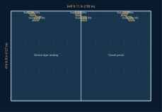
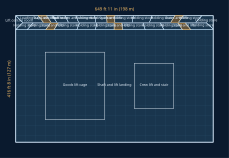
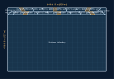

# P2-10 Fleet Stores Service Shaft: plan

Footprint 649 ft 11 in (198 m) × 416 ft 8 in (127 m) · structural grid 32 ft 10 in (10 m)

## Levels

| Level | Floor above deck | Height | Floor area |
|---|---|---|---|
| Level B1 · Service layer landing | −19 ft 8 in (6,000 mm) | 19 ft 8 in (6,000 mm) | 270,806 sq ft (25,159 m²) |
| Level 1 · Lift landing | 0 ft (0 mm) | 29 ft 6 in (9,000 mm) | 265,797 sq ft (24,693 m²) |
| Level 2 · Winding room | 29 ft 6 in (9,000 mm) | 19 ft 8 in (6,000 mm) | 265,701 sq ft (24,684 m²) |

## Elements

| ID | Designation | Type | Name | Level(s) | Size / length | Area | Status |
|---|---|---|---|---|---|---|---|
| E001 | D5F4P2B15A1L1R1, D5F4P2B15A1L2R1 | room | Shaft and lift landing | L1, L2 | 649 ft 11 in (198 m) × 370 ft 9 in (113 m) | 240,953 sq ft (22,385 m²) | proposed |
| E002 |  | fixture | Goods lift cage | L1 | 194 ft 11 in (59 m) × 222 ft 5 in (68 m) | 43,350 sq ft (4,027 m²) | proposed |
| E003 |  | fixture | Crew lift and stair | L1 | 129 ft 11 in (40 m) × 148 ft 4 in (45 m) | 19,267 sq ft (1,790 m²) | proposed |
| E004 | D5F4P2B15A1LB1R1, D5F4P2B15A1L1R2, D5F4P2B15A1L2R2 | core | Stairs and lifts | LB1, L1, L2 | 42 ft 4 in (13 m) × 21 ft 8 in (6,600 mm) | 568 sq ft (53 m²) | proposed |
| E005 | D5F4P2B15A1LB1R2, D5F4P2B15A1L1R3, D5F4P2B15A1L2R3 | core | Stairs and lifts | LB1, L1, L2 | 27 ft 3 in (8,300 mm) × 21 ft 8 in (6,600 mm) | 572 sq ft (53 m²) | proposed |
| E006 | D5F4P2B15A1LB1R3, D5F4P2B15A1L1R4, D5F4P2B15A1L2R4 | core | Stairs and lifts | LB1, L1, L2 | 40 ft 8 in (12 m) × 21 ft 8 in (6,600 mm) | 568 sq ft (53 m²) | proposed |
| E007 | D5F4P2B15A1LB1R4, D5F4P2B15A1L1R5, D5F4P2B15A1L2R5 | core | Stairs and lifts | LB1, L1, L2 | 42 ft 4 in (13 m) × 21 ft 8 in (6,600 mm) | 568 sq ft (53 m²) | proposed |
| E008 | D5F4P2B15A1LB1R5, D5F4P2B15A1L1R6, D5F4P2B15A1L2R6 | core | Stairs and lifts | LB1, L1, L2 | 27 ft 3 in (8,300 mm) × 21 ft 8 in (6,600 mm) | 572 sq ft (53 m²) | proposed |
| E009 | D5F4P2B15A1LB1R6, D5F4P2B15A1L1R7, D5F4P2B15A1L2R7 | core | Stairs and lifts | LB1, L1, L2 | 40 ft 8 in (12 m) × 21 ft 8 in (6,600 mm) | 568 sq ft (53 m²) | proposed |
| E010 | D5F4P2B15A1L1R8 | room | Lift control room | L1 | 22 ft 4 in (6,800 mm) × 45 ft 11 in (14 m) | 540 sq ft (50 m²) | proposed |
| E011 | D5F4P2B15A1L1R9 | room | Loading bay | L1 | 90 ft 3 in (28 m) × 21 ft 8 in (6,600 mm) | 1,535 sq ft (143 m²) | proposed |
| E012 | D5F4P2B15A1L1R10 | room | Crew check-in | L1 | 34 ft 1 in (10 m) × 21 ft 8 in (6,600 mm) | 426 sq ft (40 m²) | proposed |
| E013 | D5F4P2B15A1L1R11 | room | Tool store | L1 | 51 ft 10 in (16 m) × 21 ft 8 in (6,600 mm) | 856 sq ft (80 m²) | proposed |
| E014 | D5F4P2B15A1L1R12 | room | Staff toilets and showers | L1 | 44 ft 3 in (14 m) × 21 ft 8 in (6,600 mm) | 749 sq ft (70 m²) | proposed |
| E015 | D5F4P2B15A1L1R13 | room | Holding store | L1 | 65 ft 7 in (20 m) × 21 ft 8 in (6,600 mm) | 1,282 sq ft (119 m²) | proposed |
| E016 | D5F4P2B15A1L1R14 | room | Holding store | L1 | 41 ft (12 m) × 21 ft 8 in (6,600 mm) | 824 sq ft (77 m²) | proposed |
| E017 | D5F4P2B15A1L1R15 | room | Holding store | L1 | 61 ft 4 in (19 m) × 21 ft 8 in (6,600 mm) | 1,282 sq ft (119 m²) | proposed |
| E018 | D5F4P2B15A1L1R16 | room | Holding store | L1 | 65 ft 7 in (20 m) × 21 ft 8 in (6,600 mm) | 1,282 sq ft (119 m²) | proposed |
| E019 | D5F4P2B15A1L1R17 | room | Holding store | L1 | 83 ft 8 in (26 m) × 21 ft 8 in (6,600 mm) | 1,574 sq ft (146 m²) | proposed |
| E020 | D5F4P2B15A1L1R18 | room | Holding store | L1 | 76 ft 5 in (23 m) × 21 ft 8 in (6,600 mm) | 1,282 sq ft (119 m²) | proposed |
| E021 | D5F4P2B15A1L1R19 | room | Holding store | L1 | 56 ft 9 in (17 m) × 43 ft 8 in (13 m) | 1,286 sq ft (119 m²) | proposed |
| E022 | D5F4P2B15A1L1R20 | room | Holding store | L1 | 90 ft 11 in (28 m) × 22 ft (6,700 mm) | 1,577 sq ft (147 m²) | proposed |
| E023 | D5F4P2B15A1L1R21 | room | Holding store | L1 | 72 ft 2 in (22 m) × 21 ft 8 in (6,600 mm) | 1,282 sq ft (119 m²) | proposed |
| E024 | D5F4P2B15A1L1R22 | room | Holding store | L1 | 68 ft 3 in (21 m) × 21 ft 8 in (6,600 mm) | 1,286 sq ft (119 m²) | proposed |
| E025 | D5F4P2B15A1L1R23 | room | Holding store | L1 | 76 ft 9 in (23 m) × 21 ft 8 in (6,600 mm) | 1,570 sq ft (146 m²) | proposed |
| E026 | D5F4P2B15A1L1R24 | room | Holding store | L1 | 61 ft 4 in (19 m) × 21 ft 8 in (6,600 mm) | 1,282 sq ft (119 m²) | proposed |
| E027 | D5F4P2B15A1L1R25 | room | Holding store | L1 | 65 ft 7 in (20 m) × 21 ft 8 in (6,600 mm) | 1,282 sq ft (119 m²) | proposed |
| E028 | D5F4P2B15A1L1R26 | room | Holding store | L1 | 83 ft 8 in (26 m) × 21 ft 8 in (6,600 mm) | 1,574 sq ft (146 m²) | proposed |
| E029 | D5F4P2B15A1L1R27 | room | Holding store | L1 | 76 ft 5 in (23 m) × 21 ft 8 in (6,600 mm) | 1,282 sq ft (119 m²) | proposed |
| E030 | D5F4P2B15A1L1R28 | room | Holding store | L1 | 56 ft 9 in (17 m) × 21 ft 8 in (6,600 mm) | 789 sq ft (73 m²) | proposed |
| E031 | D5F4P2B15A1L2R8 | room | Winding machinery | L2 | 90 ft 11 in (28 m) × 45 ft 11 in (14 m) | 2,074 sq ft (193 m²) | proposed |
| E032 | D5F4P2B15A1L2R9 | room | Shaft ventilation fans | L2 | 72 ft 2 in (22 m) × 21 ft 8 in (6,600 mm) | 1,282 sq ft (119 m²) | proposed |
| E033 | D5F4P2B15A1L2R10 | room | Machine gallery | L2 | 72 ft 2 in (22 m) × 21 ft 8 in (6,600 mm) | 1,375 sq ft (128 m²) | proposed |
| E034 | D5F4P2B15A1L2R11 | room | Machine gallery | L2 | 72 ft 6 in (22 m) × 21 ft 8 in (6,600 mm) | 1,481 sq ft (138 m²) | proposed |
| E035 | D5F4P2B15A1L2R12 | room | Machine gallery | L2 | 65 ft 7 in (20 m) × 21 ft 8 in (6,600 mm) | 1,371 sq ft (127 m²) | proposed |
| E036 | D5F4P2B15A1L2R13 | room | Machine gallery | L2 | 69 ft 11 in (21 m) × 21 ft 8 in (6,600 mm) | 1,368 sq ft (127 m²) | proposed |
| E037 | D5F4P2B15A1L2R14 | room | Machine gallery | L2 | 74 ft 6 in (23 m) × 21 ft 8 in (6,600 mm) | 1,375 sq ft (128 m²) | proposed |
| E038 | D5F4P2B15A1L2R15 | room | Machine gallery | L2 | 80 ft 9 in (25 m) × 21 ft 8 in (6,600 mm) | 1,371 sq ft (127 m²) | proposed |
| E039 | D5F4P2B15A1L2R16 | room | Machine gallery | L2 | 52 ft 10 in (16 m) × 45 ft 11 in (14 m) | 1,378 sq ft (128 m²) | proposed |
| E040 | D5F4P2B15A1L2R17 | room | Machine gallery | L2 | 82 ft 4 in (25 m) × 21 ft 8 in (6,600 mm) | 1,371 sq ft (127 m²) | proposed |
| E041 | D5F4P2B15A1L2R18 | room | Machine gallery | L2 | 76 ft 1 in (23 m) × 21 ft 8 in (6,600 mm) | 1,371 sq ft (127 m²) | proposed |
| E042 | D5F4P2B15A1L2R19 | room | Machine gallery | L2 | 71 ft 10 in (22 m) × 21 ft 8 in (6,600 mm) | 1,375 sq ft (128 m²) | proposed |
| E043 | D5F4P2B15A1L2R20 | room | Machine gallery | L2 | 67 ft 3 in (20 m) × 21 ft 8 in (6,600 mm) | 1,371 sq ft (127 m²) | proposed |
| E044 | D5F4P2B15A1L2R21 | room | Machine gallery | L2 | 65 ft 7 in (20 m) × 21 ft 8 in (6,600 mm) | 1,371 sq ft (127 m²) | proposed |
| E045 | D5F4P2B15A1L2R22 | room | Machine gallery | L2 | 69 ft 11 in (21 m) × 21 ft 8 in (6,600 mm) | 1,368 sq ft (127 m²) | proposed |
| E046 | D5F4P2B15A1L2R23 | room | Machine gallery | L2 | 74 ft 6 in (23 m) × 21 ft 8 in (6,600 mm) | 1,375 sq ft (128 m²) | proposed |
| E047 | D5F4P2B15A1L2R24 | room | Machine gallery | L2 | 80 ft 9 in (25 m) × 21 ft 8 in (6,600 mm) | 1,371 sq ft (127 m²) | proposed |
| E048 | D5F4P2B15A1L2R25 | room | Machine gallery | L2 | 52 ft 10 in (16 m) × 21 ft 8 in (6,600 mm) | 700 sq ft (65 m²) | proposed |
| E049 | D5F4P2B15A1LB1R7 | room | Service layer landing | LB1 | 324 ft 10 in (99 m) × 416 ft 8 in (127 m) | 135,335 sq ft (12,573 m²) | proposed |
| E050 | D5F4P2B15A1LB1R8 | room | Tunnel portal | LB1 | 325 ft 2 in (99 m) × 416 ft 8 in (127 m) | 135,471 sq ft (12,586 m²) | proposed |

## Drawings

### Level B1 · Service layer landing

### Level 1 · Lift landing

### Level 2 · Winding room

