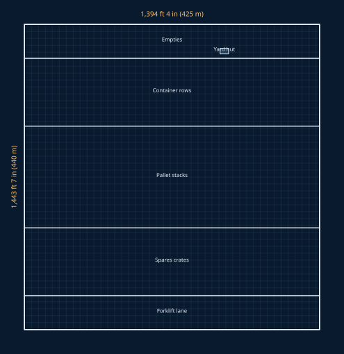

# P2-12 Stores Yard 1: plan

Footprint 1,394 ft 4 in (425 m) × 1,443 ft 7 in (440 m) · structural grid 32 ft 10 in (10 m)

## Levels

| Level | Floor above deck | Height | Floor area |
|---|---|---|---|
| Level 1 · Yard | 0 ft (0 mm) | 13 ft 1 in (4,000 mm) | 1,033 sq ft (96 m²) |

## Elements

| ID | Designation | Type | Name | Level(s) | Size / length | Area | Status |
|---|---|---|---|---|---|---|---|
| E001 | D5F4P2B5A1R1 | zone | Empties | L1 | 1,394 ft 4 in (425 m) × 160 ft 5 in (49 m) | 223,701 sq ft (20,782 m²) | proposed |
| E002 | D5F4P2B5A1R2 | room | Yard hut | L1 | 39 ft 4 in (12 m) × 26 ft 3 in (8,000 mm) | 1,033 sq ft (96 m²) | proposed |
| E003 | D5F4P2B5A1R3 | zone | Container rows | L1 | 1,394 ft 4 in (425 m) × 320 ft 10 in (98 m) | 447,402 sq ft (41,565 m²) | proposed |
| E004 | D5F4P2B5A1R4 | zone | Pallet stacks | L1 | 1,394 ft 4 in (425 m) × 481 ft (147 m) | 670,645 sq ft (62,305 m²) | proposed |
| E005 | D5F4P2B5A1R5 | zone | Spares crates | L1 | 1,394 ft 4 in (425 m) × 320 ft 10 in (98 m) | 447,402 sq ft (41,565 m²) | proposed |
| E006 | D5F4P2B5A1R6 | zone | Forklift lane | L1 | 1,394 ft 4 in (425 m) × 160 ft 5 in (49 m) | 223,701 sq ft (20,782 m²) | proposed |

## Drawings

### Level 1 · Yard

