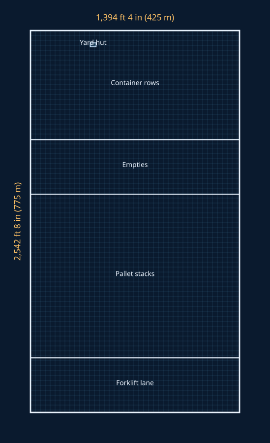

# P2-14 Stores Yard 2: plan

Footprint 1,394 ft 4 in (425 m) × 2,542 ft 8 in (775 m) · structural grid 32 ft 10 in (10 m)

## Levels

| Level | Floor above deck | Height | Floor area |
|---|---|---|---|
| Level 1 · Yard | 0 ft (0 mm) | 13 ft 1 in (4,000 mm) | 1,033 sq ft (96 m²) |

## Elements

| ID | Designation | Type | Name | Level(s) | Size / length | Area | Status |
|---|---|---|---|---|---|---|---|
| E001 | D5F4P2B11A1R1 | zone | Container rows | L1 | 1,394 ft 4 in (425 m) × 726 ft 5 in (221 m) | 1,012,830 sq ft (94,095 m²) | proposed |
| E002 | D5F4P2B11A1R2 | room | Yard hut | L1 | 39 ft 4 in (12 m) × 26 ft 3 in (8,000 mm) | 1,033 sq ft (96 m²) | proposed |
| E003 | D5F4P2B11A1R3 | zone | Empties | L1 | 1,394 ft 4 in (425 m) × 363 ft 2 in (111 m) | 506,415 sq ft (47,048 m²) | proposed |
| E004 | D5F4P2B11A1R4 | zone | Pallet stacks | L1 | 1,394 ft 4 in (425 m) × 1,089 ft 11 in (332 m) | 1,519,703 sq ft (141,185 m²) | proposed |
| E005 | D5F4P2B11A1R5 | zone | Forklift lane | L1 | 1,394 ft 4 in (425 m) × 363 ft 2 in (111 m) | 506,415 sq ft (47,048 m²) | proposed |

## Drawings

### Level 1 · Yard

