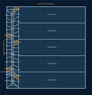
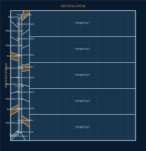

# P2-15 Stores Shed 3: plan

Footprint 522 ft 8 in (159 m) × 543 ft 8 in (166 m) · structural grid 32 ft 10 in (10 m)

## Levels

| Level | Floor above deck | Height | Floor area |
|---|---|---|---|
| Level 1 · Hall floor | 0 ft (0 mm) | 39 ft 4 in (12 m) | 273,271 sq ft (25,388 m²) |
| Level 2 · Gallery floor | 39 ft 4 in (12 m) | 14 ft 9 in (4,500 mm) | 273,271 sq ft (25,388 m²) |

## Elements

| ID | Designation | Type | Name | Level(s) | Size / length | Area | Status |
|---|---|---|---|---|---|---|---|
| E001 | D5F4P2B12A2L1R1, D5F4P2B12A2L2R1 | room | Storage bay 1 | L1, L2 | 443 ft 11 in (135 m) × 108 ft 7 in (33 m) | 48,205 sq ft (4,478 m²) | proposed |
| E002 | D5F4P2B12A2L1R2, D5F4P2B12A2L2R2 | room | Storage bay 2 | L1, L2 | 443 ft 11 in (135 m) × 108 ft 11 in (33 m) | 48,351 sq ft (4,492 m²) | proposed |
| E003 | D5F4P2B12A2L1R3, D5F4P2B12A2L2R3 | room | Storage bay 3 | L1, L2 | 443 ft 11 in (135 m) × 108 ft 7 in (33 m) | 48,205 sq ft (4,478 m²) | proposed |
| E004 | D5F4P2B12A2L1R4, D5F4P2B12A2L2R4 | room | Storage bay 4 | L1, L2 | 443 ft 11 in (135 m) × 108 ft 11 in (33 m) | 48,351 sq ft (4,492 m²) | proposed |
| E005 | D5F4P2B12A2L1R5, D5F4P2B12A2L2R5 | room | Storage bay 5 | L1, L2 | 443 ft 11 in (135 m) × 108 ft 7 in (33 m) | 48,205 sq ft (4,478 m²) | proposed |
| E006 | D5F4P2B12A2L1R6, D5F4P2B12A2L2R6 | core | Stairs and lifts | L1, L2 | 32 ft 6 in (9,900 mm) × 44 ft 7 in (14 m) | 853 sq ft (79 m²) | proposed |
| E007 | D5F4P2B12A2L1R7, D5F4P2B12A2L2R7 | core | Stairs and lifts | L1, L2 | 32 ft 6 in (9,900 mm) × 36 ft 5 in (11 m) | 853 sq ft (79 m²) | proposed |
| E008 | D5F4P2B12A2L1R8, D5F4P2B12A2L2R8 | core | Stairs and lifts | L1, L2 | 36 ft 5 in (11 m) × 44 ft 7 in (14 m) | 853 sq ft (79 m²) | proposed |
| E009 | D5F4P2B12A2L1R9, D5F4P2B12A2L2R9 | core | Stairs and lifts | L1, L2 | 32 ft 6 in (9,900 mm) × 30 ft 6 in (9,300 mm) | 853 sq ft (79 m²) | proposed |
| E010 | D5F4P2B12A2L1R10, D5F4P2B12A2L2R10 | core | Stairs and lifts | L1, L2 | 32 ft 6 in (9,900 mm) × 50 ft 2 in (15 m) | 847 sq ft (79 m²) | proposed |
| E011 | D5F4P2B12A2L1R11 | zone | Corridor | L1 | 13 ft 9 in (4,200 mm) × 478 ft 8 in (146 m) | 4,750 sq ft (441 m²) | proposed |
| E012 | D5F4P2B12A2L1R12 | room | Loading docks | L1 | 32 ft 6 in (9,900 mm) × 94 ft 6 in (29 m) | 2,153 sq ft (200 m²) | proposed |
| E013 | D5F4P2B12A2L1R13 | room | Shed office | L1 | 32 ft 6 in (9,900 mm) × 39 ft 8 in (12 m) | 543 sq ft (50 m²) | proposed |
| E014 | D5F4P2B12A2L1R14 | room | Staff toilets and showers | L1 | 32 ft 6 in (9,900 mm) × 36 ft 5 in (11 m) | 501 sq ft (47 m²) | proposed |
| E015 | D5F4P2B12A2L1R15 | room | Chilled room | L1 | 32 ft 6 in (9,900 mm) × 78 ft 9 in (24 m) | 2,153 sq ft (200 m²) | proposed |
| E016 | D5F4P2B12A2L1R16 | room | Clothing store | L1 | 32 ft 6 in (9,900 mm) × 54 ft 9 in (17 m) | 1,614 sq ft (150 m²) | proposed |
| E017 | D5F4P2B12A2L1R17 | room | Pallet store | L1 | 32 ft 6 in (9,900 mm) × 50 ft 10 in (16 m) | 1,550 sq ft (144 m²) | proposed |
| E018 | D5F4P2B12A2L1R18 | room | Pallet store | L1 | 32 ft 6 in (9,900 mm) × 39 ft 4 in (12 m) | 1,071 sq ft (99 m²) | proposed |
| E019 | D5F4P2B12A2L1R19 | room | Pallet store | L1 | 32 ft 6 in (9,900 mm) × 62 ft 4 in (19 m) | 1,545 sq ft (144 m²) | proposed |
| E020 | D5F4P2B12A2L1R20 | room | Pallet store | L1 | 32 ft 6 in (9,900 mm) × 68 ft 3 in (21 m) | 1,545 sq ft (144 m²) | proposed |
| E021 | D5F4P2B12A2L1R21 | room | Pallet store | L1 | 32 ft 6 in (9,900 mm) × 74 ft 6 in (23 m) | 1,550 sq ft (144 m²) | proposed |
| E022 | D5F4P2B12A2L1R22 | room | Pallet store | L1 | 56 ft 5 in (17 m) × 51 ft 10 in (16 m) | 1,748 sq ft (162 m²) | proposed |
| E023 | D5F4P2B12A2L1R23 | room | Pallet store | L1 | 32 ft 6 in (9,900 mm) × 75 ft 2 in (23 m) | 1,545 sq ft (144 m²) | proposed |
| E024 | D5F4P2B12A2L1R24 | room | Pallet store | L1 | 32 ft 6 in (9,900 mm) × 69 ft 3 in (21 m) | 1,545 sq ft (144 m²) | proposed |
| E025 | D5F4P2B12A2L1R25 | room | Pallet store | L1 | 32 ft 6 in (9,900 mm) × 63 ft 4 in (19 m) | 1,545 sq ft (144 m²) | proposed |
| E026 | D5F4P2B12A2L1R26 | room | Pallet store | L1 | 32 ft 6 in (9,900 mm) × 63 ft 4 in (19 m) | 1,753 sq ft (163 m²) | proposed |
| E027 | D5F4P2B12A2L1R27 | room | Pallet store | L1 | 32 ft 6 in (9,900 mm) × 50 ft 10 in (16 m) | 1,550 sq ft (144 m²) | proposed |
| E028 | D5F4P2B12A2L1R28 | room | Pallet store | L1 | 32 ft 6 in (9,900 mm) × 54 ft 2 in (16 m) | 1,545 sq ft (144 m²) | proposed |
| E029 | D5F4P2B12A2L1R29 | room | Pallet store | L1 | 32 ft 6 in (9,900 mm) × 60 ft (18 m) | 1,540 sq ft (143 m²) | proposed |
| E030 | D5F4P2B12A2L1R30 | room | Pallet store | L1 | 32 ft 6 in (9,900 mm) × 73 ft 2 in (22 m) | 1,758 sq ft (163 m²) | proposed |
| E031 | D5F4P2B12A2L1R31 | room | Pallet store | L1 | 32 ft 6 in (9,900 mm) × 76 ft 5 in (23 m) | 1,545 sq ft (144 m²) | proposed |
| E032 | D5F4P2B12A2L1R32 | room | Pallet store | L1 | 78 ft 9 in (24 m) × 36 ft 9 in (11 m) | 1,652 sq ft (153 m²) | proposed |
| E033 | D5F4P2B12A2L2R11 | zone | Corridor | L2 | 13 ft 9 in (4,200 mm) × 478 ft 8 in (146 m) | 4,750 sq ft (441 m²) | proposed |
| E034 | D5F4P2B12A2L2R12 | room | Tea point | L2 | 32 ft 6 in (9,900 mm) × 43 ft (13 m) | 368 sq ft (34 m²) | proposed |
| E035 | D5F4P2B12A2L2R13 | room | Mezzanine store | L2 | 32 ft 6 in (9,900 mm) × 112 ft 6 in (34 m) | 2,829 sq ft (263 m²) | proposed |
| E036 | D5F4P2B12A2L2R14 | room | Mezzanine store | L2 | 32 ft 6 in (9,900 mm) × 73 ft 10 in (22 m) | 1,982 sq ft (184 m²) | proposed |
| E037 | D5F4P2B12A2L2R15 | room | Mezzanine store | L2 | 32 ft 6 in (9,900 mm) × 65 ft 11 in (20 m) | 1,982 sq ft (184 m²) | proposed |
| E038 | D5F4P2B12A2L2R16 | room | Mezzanine store | L2 | 32 ft 6 in (9,900 mm) × 79 ft 5 in (24 m) | 2,424 sq ft (225 m²) | proposed |
| E039 | D5F4P2B12A2L2R17 | room | Mezzanine store | L2 | 32 ft 6 in (9,900 mm) × 76 ft 9 in (23 m) | 1,987 sq ft (185 m²) | proposed |
| E040 | D5F4P2B12A2L2R18 | room | Mezzanine store | L2 | 32 ft 6 in (9,900 mm) × 84 ft 4 in (26 m) | 1,982 sq ft (184 m²) | proposed |
| E041 | D5F4P2B12A2L2R19 | room | Mezzanine store | L2 | 56 ft 5 in (17 m) × 71 ft 2 in (22 m) | 2,419 sq ft (225 m²) | proposed |
| E042 | D5F4P2B12A2L2R20 | room | Mezzanine store | L2 | 32 ft 6 in (9,900 mm) × 87 ft 11 in (27 m) | 1,982 sq ft (184 m²) | proposed |
| E043 | D5F4P2B12A2L2R21 | room | Mezzanine store | L2 | 32 ft 6 in (9,900 mm) × 80 ft 5 in (24 m) | 1,982 sq ft (184 m²) | proposed |
| E044 | D5F4P2B12A2L2R22 | room | Mezzanine store | L2 | 32 ft 6 in (9,900 mm) × 85 ft 4 in (26 m) | 2,424 sq ft (225 m²) | proposed |
| E045 | D5F4P2B12A2L2R23 | room | Mezzanine store | L2 | 32 ft 6 in (9,900 mm) × 65 ft (20 m) | 1,982 sq ft (184 m²) | proposed |
| E046 | D5F4P2B12A2L2R24 | room | Mezzanine store | L2 | 32 ft 6 in (9,900 mm) × 70 ft 3 in (21 m) | 1,987 sq ft (185 m²) | proposed |
| E047 | D5F4P2B12A2L2R25 | room | Mezzanine store | L2 | 32 ft 6 in (9,900 mm) × 92 ft 2 in (28 m) | 2,424 sq ft (225 m²) | proposed |
| E048 | D5F4P2B12A2L2R26 | room | Mezzanine store | L2 | 35 ft 1 in (11 m) × 81 ft 4 in (25 m) | 1,987 sq ft (185 m²) | proposed |
| E049 | D5F4P2B12A2L2R27 | room | Mezzanine store | L2 | 63 ft 4 in (19 m) × 32 ft 6 in (9,900 mm) | 1,209 sq ft (112 m²) | proposed |

## Drawings

### Level 1 · Hall floor

### Level 2 · Gallery floor

