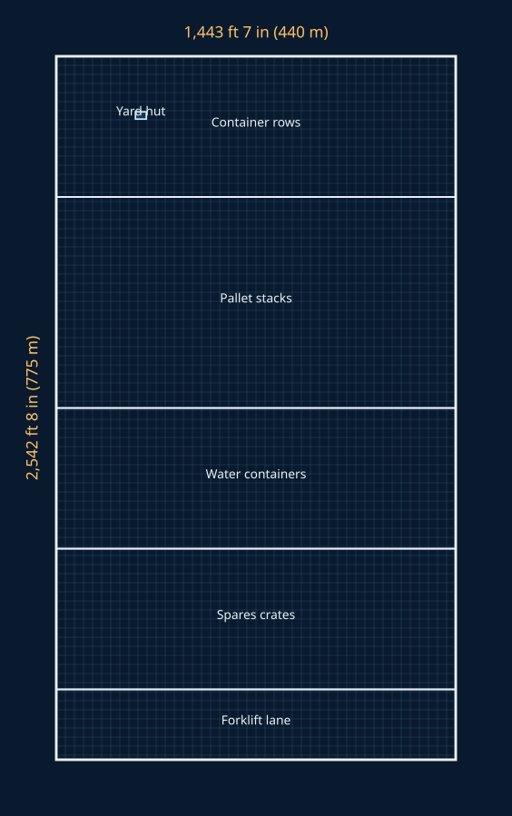

# P2-16 Stores Yard 3: plan

Footprint 1,443 ft 7 in (440 m) × 2,542 ft 8 in (775 m) · structural grid 32 ft 10 in (10 m)

## Levels

| Level | Floor above deck | Height | Floor area |
|---|---|---|---|
| Level 1 · Yard | 0 ft (0 mm) | 13 ft 1 in (4,000 mm) | 1,033 sq ft (96 m²) |

## Elements

| ID | Designation | Type | Name | Level(s) | Size / length | Area | Status |
|---|---|---|---|---|---|---|---|
| E001 | D5F4P2B14A1R1 | zone | Container rows | L1 | 1,443 ft 7 in (440 m) × 508 ft 6 in (155 m) | 734,099 sq ft (68,200 m²) | proposed |
| E002 | D5F4P2B14A1R2 | room | Yard hut | L1 | 39 ft 4 in (12 m) × 26 ft 3 in (8,000 mm) | 1,033 sq ft (96 m²) | proposed |
| E003 | D5F4P2B14A1R3 | zone | Pallet stacks | L1 | 1,443 ft 7 in (440 m) × 762 ft 10 in (232 m) | 1,101,148 sq ft (102,300 m²) | proposed |
| E004 | D5F4P2B14A1R4 | zone | Water containers | L1 | 1,443 ft 7 in (440 m) × 508 ft 6 in (155 m) | 734,099 sq ft (68,200 m²) | proposed |
| E005 | D5F4P2B14A1R5 | zone | Spares crates | L1 | 1,443 ft 7 in (440 m) × 508 ft 6 in (155 m) | 734,099 sq ft (68,200 m²) | proposed |
| E006 | D5F4P2B14A1R6 | zone | Forklift lane | L1 | 1,443 ft 7 in (440 m) × 254 ft 3 in (78 m) | 367,049 sq ft (34,100 m²) | proposed |

## Drawings

### Level 1 · Yard

