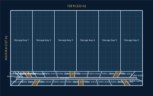
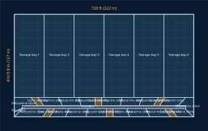

# P2-17 Stores Shed 4: plan

Footprint 728 ft (222 m) × 416 ft 8 in (127 m) · structural grid 32 ft 10 in (10 m)

## Levels

| Level | Floor above deck | Height | Floor area |
|---|---|---|---|
| Level 1 · Hall floor | 0 ft (0 mm) | 39 ft 4 in (12 m) | 289,100 sq ft (26,858 m²) |
| Level 2 · Gallery floor | 39 ft 4 in (12 m) | 14 ft 9 in (4,500 mm) | 289,100 sq ft (26,858 m²) |

## Elements

| ID | Designation | Type | Name | Level(s) | Size / length | Area | Status |
|---|---|---|---|---|---|---|---|
| E001 | D5F4P2B15A2L1R1, D5F4P2B15A2L2R1 | room | Storage bay 1 | L1, L2 | 121 ft 5 in (37 m) × 337 ft 11 in (103 m) | 41,021 sq ft (3,811 m²) | proposed |
| E002 | D5F4P2B15A2L1R2, D5F4P2B15A2L2R2 | room | Storage bay 2 | L1, L2 | 121 ft 5 in (37 m) × 337 ft 11 in (103 m) | 41,021 sq ft (3,811 m²) | proposed |
| E003 | D5F4P2B15A2L1R3, D5F4P2B15A2L2R3 | room | Storage bay 3 | L1, L2 | 121 ft 1 in (37 m) × 337 ft 11 in (103 m) | 40,910 sq ft (3,801 m²) | proposed |
| E004 | D5F4P2B15A2L1R4, D5F4P2B15A2L2R4 | room | Storage bay 4 | L1, L2 | 121 ft 5 in (37 m) × 337 ft 11 in (103 m) | 41,021 sq ft (3,811 m²) | proposed |
| E005 | D5F4P2B15A2L1R5, D5F4P2B15A2L2R5 | room | Storage bay 5 | L1, L2 | 121 ft 5 in (37 m) × 337 ft 11 in (103 m) | 41,021 sq ft (3,811 m²) | proposed |
| E006 | D5F4P2B15A2L1R6, D5F4P2B15A2L2R6 | room | Storage bay 6 | L1, L2 | 121 ft 5 in (37 m) × 337 ft 11 in (103 m) | 41,021 sq ft (3,811 m²) | proposed |
| E007 | D5F4P2B15A2L1R7, D5F4P2B15A2L2R7 | core | Stairs and lifts | L1, L2 | 51 ft 6 in (16 m) × 32 ft 6 in (9,900 mm) | 853 sq ft (79 m²) | proposed |
| E008 | D5F4P2B15A2L1R8, D5F4P2B15A2L2R8 | core | Stairs and lifts | L1, L2 | 28 ft 3 in (8,600 mm) × 32 ft 6 in (9,900 mm) | 853 sq ft (79 m²) | proposed |
| E009 | D5F4P2B15A2L1R9, D5F4P2B15A2L2R9 | core | Stairs and lifts | L1, L2 | 46 ft 11 in (14 m) × 32 ft 6 in (9,900 mm) | 847 sq ft (79 m²) | proposed |
| E010 | D5F4P2B15A2L1R10, D5F4P2B15A2L2R10 | core | Stairs and lifts | L1, L2 | 51 ft 6 in (16 m) × 32 ft 6 in (9,900 mm) | 853 sq ft (79 m²) | proposed |
| E011 | D5F4P2B15A2L1R11, D5F4P2B15A2L2R11 | core | Stairs and lifts | L1, L2 | 28 ft 3 in (8,600 mm) × 32 ft 6 in (9,900 mm) | 853 sq ft (79 m²) | proposed |
| E012 | D5F4P2B15A2L1R12, D5F4P2B15A2L2R12 | core | Stairs and lifts | L1, L2 | 46 ft 11 in (14 m) × 32 ft 6 in (9,900 mm) | 847 sq ft (79 m²) | proposed |
| E013 | D5F4P2B15A2L1R13 | zone | Corridor | L1 | 663 ft 1 in (202 m) × 13 ft 9 in (4,200 mm) | 6,565 sq ft (610 m²) | proposed |
| E014 | D5F4P2B15A2L1R14 | room | Loading docks | L1 | 51 ft 6 in (16 m) × 78 ft 9 in (24 m) | 2,153 sq ft (200 m²) | proposed |
| E015 | D5F4P2B15A2L1R15 | room | Shed office | L1 | 46 ft 3 in (14 m) × 32 ft 6 in (9,900 mm) | 538 sq ft (50 m²) | proposed |
| E016 | D5F4P2B15A2L1R16 | room | Staff toilets and showers | L1 | 55 ft 5 in (17 m) × 32 ft 6 in (9,900 mm) | 900 sq ft (84 m²) | proposed |
| E017 | D5F4P2B15A2L1R17 | room | Spirits and stores cage | L1 | 49 ft 3 in (15 m) × 32 ft 6 in (9,900 mm) | 858 sq ft (80 m²) | proposed |
| E018 | D5F4P2B15A2L1R18 | room | Clothing store | L1 | 69 ft 3 in (21 m) × 32 ft 6 in (9,900 mm) | 1,620 sq ft (150 m²) | proposed |
| E019 | D5F4P2B15A2L1R19 | room | Pallet store | L1 | 85 ft (26 m) × 32 ft 6 in (9,900 mm) | 2,318 sq ft (215 m²) | proposed |
| E020 | D5F4P2B15A2L1R20 | room | Pallet store | L1 | 80 ft 1 in (24 m) × 32 ft 6 in (9,900 mm) | 2,382 sq ft (221 m²) | proposed |
| E021 | D5F4P2B15A2L1R21 | room | Pallet store | L1 | 74 ft 10 in (23 m) × 32 ft 6 in (9,900 mm) | 2,323 sq ft (216 m²) | proposed |
| E022 | D5F4P2B15A2L1R22 | room | Pallet store | L1 | 80 ft 9 in (25 m) × 32 ft 6 in (9,900 mm) | 2,323 sq ft (216 m²) | proposed |
| E023 | D5F4P2B15A2L1R23 | room | Pallet store | L1 | 94 ft 2 in (29 m) × 32 ft 6 in (9,900 mm) | 2,536 sq ft (236 m²) | proposed |
| E024 | D5F4P2B15A2L1R24 | room | Pallet store | L1 | 96 ft 9 in (30 m) × 32 ft 6 in (9,900 mm) | 2,323 sq ft (216 m²) | proposed |
| E025 | D5F4P2B15A2L1R25 | room | Pallet store | L1 | 69 ft 7 in (21 m) × 55 ft 1 in (17 m) | 2,318 sq ft (215 m²) | proposed |
| E026 | D5F4P2B15A2L1R26 | room | Pallet store | L1 | 93 ft 10 in (29 m) × 36 ft 9 in (11 m) | 2,542 sq ft (236 m²) | proposed |
| E027 | D5F4P2B15A2L1R27 | room | Pallet store | L1 | 92 ft 2 in (28 m) × 32 ft 6 in (9,900 mm) | 2,323 sq ft (216 m²) | proposed |
| E028 | D5F4P2B15A2L1R28 | room | Pallet store | L1 | 85 ft 4 in (26 m) × 32 ft 6 in (9,900 mm) | 2,318 sq ft (215 m²) | proposed |
| E029 | D5F4P2B15A2L1R29 | room | Pallet store | L1 | 85 ft (26 m) × 32 ft 6 in (9,900 mm) | 2,536 sq ft (236 m²) | proposed |
| E030 | D5F4P2B15A2L1R30 | room | Pallet store | L1 | 74 ft 10 in (23 m) × 32 ft 6 in (9,900 mm) | 2,323 sq ft (216 m²) | proposed |
| E031 | D5F4P2B15A2L1R31 | room | Pallet store | L1 | 80 ft 9 in (25 m) × 32 ft 6 in (9,900 mm) | 2,323 sq ft (216 m²) | proposed |
| E032 | D5F4P2B15A2L1R32 | room | Pallet store | L1 | 94 ft 2 in (29 m) × 32 ft 6 in (9,900 mm) | 2,536 sq ft (236 m²) | proposed |
| E033 | D5F4P2B15A2L1R33 | room | Pallet store | L1 | 96 ft 9 in (30 m) × 32 ft 6 in (9,900 mm) | 2,323 sq ft (216 m²) | proposed |
| E034 | D5F4P2B15A2L1R34 | room | Pallet store | L1 | 69 ft 7 in (21 m) × 32 ft 6 in (9,900 mm) | 1,268 sq ft (118 m²) | proposed |
| E035 | D5F4P2B15A2L2R13 | zone | Corridor | L2 | 663 ft 1 in (202 m) × 13 ft 9 in (4,200 mm) | 6,565 sq ft (610 m²) | proposed |
| E036 | D5F4P2B15A2L2R14 | room | Tea point | L2 | 32 ft 6 in (9,900 mm) × 35 ft 9 in (11 m) | 368 sq ft (34 m²) | proposed |
| E037 | D5F4P2B15A2L2R15 | room | Mezzanine store | L2 | 93 ft 10 in (29 m) × 59 ft 5 in (18 m) | 3,224 sq ft (299 m²) | proposed |
| E038 | D5F4P2B15A2L2R16 | room | Mezzanine store | L2 | 99 ft 9 in (30 m) × 32 ft 6 in (9,900 mm) | 2,584 sq ft (240 m²) | proposed |
| E039 | D5F4P2B15A2L2R17 | room | Mezzanine store | L2 | 92 ft 6 in (28 m) × 32 ft 6 in (9,900 mm) | 2,589 sq ft (241 m²) | proposed |
| E040 | D5F4P2B15A2L2R18 | room | Mezzanine store | L2 | 67 ft 11 in (21 m) × 32 ft 6 in (9,900 mm) | 2,003 sq ft (186 m²) | proposed |
| E041 | D5F4P2B15A2L2R19 | room | Mezzanine store | L2 | 83 ft 4 in (25 m) × 32 ft 6 in (9,900 mm) | 2,589 sq ft (241 m²) | proposed |
| E042 | D5F4P2B15A2L2R20 | room | Mezzanine store | L2 | 89 ft 11 in (27 m) × 32 ft 6 in (9,900 mm) | 2,584 sq ft (240 m²) | proposed |
| E043 | D5F4P2B15A2L2R21 | room | Mezzanine store | L2 | 78 ft 9 in (24 m) × 32 ft 6 in (9,900 mm) | 2,009 sq ft (187 m²) | proposed |
| E044 | D5F4P2B15A2L2R22 | room | Mezzanine store | L2 | 105 ft 4 in (32 m) × 32 ft 6 in (9,900 mm) | 2,584 sq ft (240 m²) | proposed |
| E045 | D5F4P2B15A2L2R23 | room | Mezzanine store | L2 | 62 ft (19 m) × 78 ft 9 in (24 m) | 2,589 sq ft (241 m²) | proposed |
| E046 | D5F4P2B15A2L2R24 | room | Mezzanine store | L2 | 91 ft 2 in (28 m) × 32 ft 6 in (9,900 mm) | 2,009 sq ft (187 m²) | proposed |
| E047 | D5F4P2B15A2L2R25 | room | Mezzanine store | L2 | 99 ft 9 in (30 m) × 32 ft 6 in (9,900 mm) | 2,584 sq ft (240 m²) | proposed |
| E048 | D5F4P2B15A2L2R26 | room | Mezzanine store | L2 | 92 ft 6 in (28 m) × 32 ft 6 in (9,900 mm) | 2,589 sq ft (241 m²) | proposed |
| E049 | D5F4P2B15A2L2R27 | room | Mezzanine store | L2 | 67 ft 11 in (21 m) × 32 ft 6 in (9,900 mm) | 2,003 sq ft (186 m²) | proposed |
| E050 | D5F4P2B15A2L2R28 | room | Mezzanine store | L2 | 83 ft 4 in (25 m) × 32 ft 6 in (9,900 mm) | 2,589 sq ft (241 m²) | proposed |
| E051 | D5F4P2B15A2L2R29 | room | Mezzanine store | L2 | 89 ft 11 in (27 m) × 32 ft 6 in (9,900 mm) | 2,584 sq ft (240 m²) | proposed |
| E052 | D5F4P2B15A2L2R30 | room | Mezzanine store | L2 | 78 ft 9 in (24 m) × 32 ft 6 in (9,900 mm) | 2,009 sq ft (187 m²) | proposed |
| E053 | D5F4P2B15A2L2R31 | room | Mezzanine store | L2 | 137 ft 10 in (42 m) × 32 ft 6 in (9,900 mm) | 3,591 sq ft (334 m²) | proposed |

## Drawings

### Level 1 · Hall floor

### Level 2 · Gallery floor

