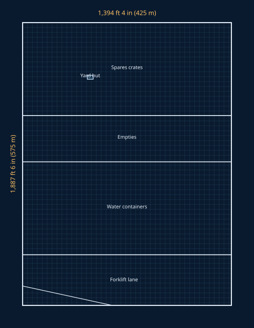

# P2-20 Stores Yard 5: plan

Footprint 1,394 ft 4 in (425 m) × 1,887 ft 6 in (575 m) · structural grid 32 ft 10 in (10 m)

## Levels

| Level | Floor above deck | Height | Floor area |
|---|---|---|---|
| Level 1 · Yard | 0 ft (0 mm) | 13 ft 1 in (4,000 mm) | 1,033 sq ft (96 m²) |

## Elements

| ID | Designation | Type | Name | Level(s) | Size / length | Area | Status |
|---|---|---|---|---|---|---|---|
| E001 | D5F4P2B10A2R1 | zone | Spares crates | L1 | 1,394 ft 4 in (425 m) × 620 ft 1 in (189 m) | 864,611 sq ft (80,325 m²) | proposed |
| E002 | D5F4P2B10A2R2 | room | Yard hut | L1 | 39 ft 4 in (12 m) × 26 ft 3 in (8,000 mm) | 1,033 sq ft (96 m²) | proposed |
| E003 | D5F4P2B10A2R3 | zone | Empties | L1 | 1,394 ft 4 in (425 m) × 309 ft 9 in (94 m) | 431,848 sq ft (40,120 m²) | proposed |
| E004 | D5F4P2B10A2R4 | zone | Water containers | L1 | 1,394 ft 4 in (425 m) × 620 ft 1 in (189 m) | 864,611 sq ft (80,325 m²) | proposed |
| E005 | D5F4P2B10A2R5 | zone | Forklift lane | L1 | 1,394 ft 4 in (425 m) × 337 ft 7 in (103 m) | 432,097 sq ft (40,143 m²) | proposed |

## Drawings

### Level 1 · Yard

