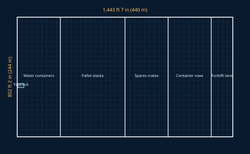

# P2-22 Stores Yard 6: plan

Footprint 1,443 ft 7 in (440 m) × 802 ft 2 in (244 m) · structural grid 32 ft 10 in (10 m)

## Levels

| Level | Floor above deck | Height | Floor area |
|---|---|---|---|
| Level 1 · Yard | 0 ft (0 mm) | 13 ft 1 in (4,000 mm) | 1,033 sq ft (96 m²) |

## Elements

| ID | Designation | Type | Name | Level(s) | Size / length | Area | Status |
|---|---|---|---|---|---|---|---|
| E001 | D5F4P2B13A2R1 | zone | Water containers | L1 | 288 ft 9 in (88 m) × 802 ft 2 in (244 m) | 231,596 sq ft (21,516 m²) | proposed |
| E002 | D5F4P2B13A2R2 | room | Yard hut | L1 | 39 ft 4 in (12 m) × 26 ft 3 in (8,000 mm) | 1,033 sq ft (96 m²) | proposed |
| E003 | D5F4P2B13A2R3 | zone | Pallet stacks | L1 | 433 ft 1 in (132 m) × 802 ft 2 in (244 m) | 347,394 sq ft (32,274 m²) | proposed |
| E004 | D5F4P2B13A2R4 | zone | Spares crates | L1 | 288 ft 9 in (88 m) × 802 ft 2 in (244 m) | 231,596 sq ft (21,516 m²) | proposed |
| E005 | D5F4P2B13A2R5 | zone | Container rows | L1 | 288 ft 9 in (88 m) × 802 ft 2 in (244 m) | 231,596 sq ft (21,516 m²) | proposed |
| E006 | D5F4P2B13A2R6 | zone | Forklift lane | L1 | 144 ft 4 in (44 m) × 802 ft 2 in (244 m) | 115,798 sq ft (10,758 m²) | proposed |

## Drawings

### Level 1 · Yard

