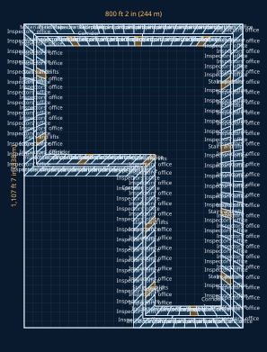
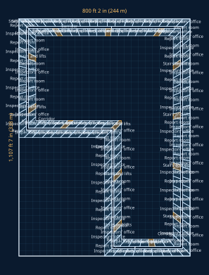

# P3-09 Inspectors' Hall: plan

Footprint 800 ft 2 in (244 m) × 1,107 ft 7 in (338 m) · structural grid 32 ft 10 in (10 m)

## Levels

| Level | Floor above deck | Height | Floor area |
|---|---|---|---|
| Level 1 · Ground floor | 0 ft (0 mm) | 15 ft 9 in (4,800 mm) | 228,534 sq ft (21,232 m²) |
| Level 2 · Office floor | 15 ft 9 in (4,800 mm) | 13 ft 9 in (4,200 mm) | 228,534 sq ft (21,232 m²) |

## Elements

| ID | Designation | Type | Name | Level(s) | Size / length | Area | Status |
|---|---|---|---|---|---|---|---|
| E001 | D5F4P3B13A1L1R1 | zone | Light court | L1 | 642 ft 9 in (196 m) × 950 ft 2 in (290 m) | 389,179 sq ft (36,156 m²) | proposed |
| E002 | D5F4P3B13A1L1R2 | zone | Corridor | L1 | 398 ft 11 in (122 m) × 9 ft 10 in (3,000 mm) | 3,875 sq ft (360 m²) | proposed |
| E003 | D5F4P3B13A1L1R3 | zone | Corridor | L1 | 333 ft (102 m) × 75 ft 2 in (23 m) | 3,875 sq ft (360 m²) | proposed |
| E004 | D5F4P3B13A1L1R4 | zone | Corridor | L1 | 9 ft 10 in (3,000 mm) × 398 ft 7 in (122 m) | 3,875 sq ft (360 m²) | proposed |
| E005 | D5F4P3B13A1L1R5 | zone | Corridor | L1 | 9 ft 10 in (3,000 mm) × 397 ft 8 in (121 m) | 3,875 sq ft (360 m²) | proposed |
| E006 | D5F4P3B13A1L1R6 | zone | Corridor | L1 | 224 ft 9 in (68 m) × 183 ft 9 in (56 m) | 3,875 sq ft (360 m²) | proposed |
| E007 | D5F4P3B13A1L1R7 | zone | Corridor | L1 | 109 ft 11 in (34 m) × 300 ft 2 in (92 m) | 3,875 sq ft (360 m²) | proposed |
| E008 | D5F4P3B13A1L1R8 | zone | Corridor | L1 | 140 ft 1 in (43 m) × 273 ft 4 in (83 m) | 3,875 sq ft (360 m²) | proposed |
| E009 | D5F4P3B13A1L1R9 | zone | Corridor | L1 | 279 ft 6 in (85 m) × 131 ft 3 in (40 m) | 3,875 sq ft (360 m²) | proposed |
| E010 | D5F4P3B13A1L1R10 | zone | Corridor | L1 | 9 ft 10 in (3,000 mm) × 358 ft 3 in (109 m) | 3,455 sq ft (321 m²) | proposed |
| E011 | D5F4P3B13A1L1R11, D5F4P3B13A1L2R1 | core | Stairs and lifts | L1, L2 | 48 ft 7 in (15 m) × 34 ft 5 in (10 m) | 904 sq ft (84 m²) | proposed |
| E012 | D5F4P3B13A1L1R12, D5F4P3B13A1L2R2 | core | Stairs and lifts | L1, L2 | 28 ft 3 in (8,600 mm) × 34 ft 5 in (10 m) | 904 sq ft (84 m²) | proposed |
| E013 | D5F4P3B13A1L1R13, D5F4P3B13A1L2R3 | core | Stairs and lifts | L1, L2 | 52 ft 2 in (16 m) × 34 ft 5 in (10 m) | 904 sq ft (84 m²) | proposed |
| E014 | D5F4P3B13A1L1R14, D5F4P3B13A1L2R4 | core | Stairs and lifts | L1, L2 | 34 ft 5 in (10 m) × 50 ft 2 in (15 m) | 904 sq ft (84 m²) | proposed |
| E015 | D5F4P3B13A1L1R15, D5F4P3B13A1L2R5 | core | Stairs and lifts | L1, L2 | 34 ft 5 in (10 m) × 33 ft 6 in (10 m) | 904 sq ft (84 m²) | proposed |
| E016 | D5F4P3B13A1L1R16, D5F4P3B13A1L2R6 | core | Stairs and lifts | L1, L2 | 34 ft 5 in (10 m) × 35 ft 9 in (11 m) | 904 sq ft (84 m²) | proposed |
| E017 | D5F4P3B13A1L1R17, D5F4P3B13A1L2R7 | core | Stairs and lifts | L1, L2 | 34 ft 5 in (10 m) × 52 ft 6 in (16 m) | 904 sq ft (84 m²) | proposed |
| E018 | D5F4P3B13A1L1R18, D5F4P3B13A1L2R8 | core | Stairs and lifts | L1, L2 | 31 ft 2 in (9,500 mm) × 34 ft 5 in (10 m) | 904 sq ft (84 m²) | proposed |
| E019 | D5F4P3B13A1L1R19, D5F4P3B13A1L2R9 | core | Stairs and lifts | L1, L2 | 34 ft 5 in (10 m) × 60 ft 8 in (18 m) | 904 sq ft (84 m²) | proposed |
| E020 | D5F4P3B13A1L1R20, D5F4P3B13A1L2R10 | core | Stairs and lifts | L1, L2 | 34 ft 5 in (10 m) × 60 ft 8 in (18 m) | 904 sq ft (84 m²) | proposed |
| E021 | D5F4P3B13A1L1R21, D5F4P3B13A1L2R11 | core | Stairs and lifts | L1, L2 | 47 ft 3 in (14 m) × 47 ft 11 in (15 m) | 904 sq ft (84 m²) | proposed |
| E022 | D5F4P3B13A1L1R22, D5F4P3B13A1L2R12 | core | Stairs and lifts | L1, L2 | 60 ft 8 in (18 m) × 34 ft 5 in (10 m) | 904 sq ft (84 m²) | proposed |
| E023 | D5F4P3B13A1L1R23, D5F4P3B13A1L2R13 | core | Stairs and lifts | L1, L2 | 34 ft 5 in (10 m) × 48 ft 7 in (15 m) | 899 sq ft (83 m²) | proposed |
| E024 | D5F4P3B13A1L1R24, D5F4P3B13A1L2R14 | core | Stairs and lifts | L1, L2 | 34 ft 5 in (10 m) × 41 ft 8 in (13 m) | 904 sq ft (84 m²) | proposed |
| E025 | D5F4P3B13A1L1R25 | room | Materials test lab | L1 | 124 ft (38 m) × 34 ft 5 in (10 m) | 3,232 sq ft (300 m²) | proposed |
| E026 | D5F4P3B13A1L1R26 | room | Weld inspection lab | L1 | 85 ft 8 in (26 m) × 34 ft 5 in (10 m) | 2,153 sq ft (200 m²) | proposed |
| E027 | D5F4P3B13A1L1R27 | room | Pressure test room | L1 | 65 ft (20 m) × 34 ft 5 in (10 m) | 1,611 sq ft (150 m²) | proposed |
| E028 | D5F4P3B13A1L1R28 | room | Reception | L1 | 64 ft (20 m) × 34 ft 5 in (10 m) | 1,724 sq ft (160 m²) | proposed |
| E029 | D5F4P3B13A1L1R29 | room | Toilets | L1 | 29 ft 6 in (9,000 mm) × 34 ft 5 in (10 m) | 644 sq ft (60 m²) | proposed |
| E030 | D5F4P3B13A1L1R30 | room | Inspectors' office | L1 | 45 ft 7 in (14 m) × 34 ft 5 in (10 m) | 1,288 sq ft (120 m²) | proposed |
| E031 | D5F4P3B13A1L1R31 | room | Inspectors' office | L1 | 42 ft 8 in (13 m) × 34 ft 5 in (10 m) | 1,300 sq ft (121 m²) | proposed |
| E032 | D5F4P3B13A1L1R32 | room | Inspectors' office | L1 | 39 ft 1 in (12 m) × 34 ft 5 in (10 m) | 1,288 sq ft (120 m²) | proposed |
| E033 | D5F4P3B13A1L1R33 | room | Inspectors' office | L1 | 39 ft 4 in (12 m) × 34 ft 5 in (10 m) | 1,294 sq ft (120 m²) | proposed |
| E034 | D5F4P3B13A1L1R34 | room | Inspectors' office | L1 | 42 ft 8 in (13 m) × 34 ft 5 in (10 m) | 1,288 sq ft (120 m²) | proposed |
| E035 | D5F4P3B13A1L1R35 | room | Inspectors' office | L1 | 45 ft 11 in (14 m) × 34 ft 5 in (10 m) | 1,288 sq ft (120 m²) | proposed |
| E036 | D5F4P3B13A1L1R36 | room | Inspectors' office | L1 | 49 ft 6 in (15 m) × 34 ft 5 in (10 m) | 1,294 sq ft (120 m²) | proposed |
| E037 | D5F4P3B13A1L1R37 | room | Inspectors' office | L1 | 52 ft 10 in (16 m) × 34 ft 5 in (10 m) | 1,288 sq ft (120 m²) | proposed |
| E038 | D5F4P3B13A1L1R38 | room | Inspectors' office | L1 | 56 ft 5 in (17 m) × 34 ft 5 in (10 m) | 1,300 sq ft (121 m²) | proposed |
| E039 | D5F4P3B13A1L1R39 | room | Inspectors' office | L1 | 59 ft 5 in (18 m) × 34 ft 5 in (10 m) | 1,288 sq ft (120 m²) | proposed |
| E040 | D5F4P3B13A1L1R40 | room | Inspectors' office | L1 | 63 ft (19 m) × 34 ft 5 in (10 m) | 1,294 sq ft (120 m²) | proposed |
| E041 | D5F4P3B13A1L1R41 | room | Inspectors' office | L1 | 66 ft 3 in (20 m) × 34 ft 5 in (10 m) | 1,288 sq ft (120 m²) | proposed |
| E042 | D5F4P3B13A1L1R42 | room | Inspectors' office | L1 | 69 ft 7 in (21 m) × 34 ft 5 in (10 m) | 1,288 sq ft (120 m²) | proposed |
| E043 | D5F4P3B13A1L1R43 | room | Inspectors' office | L1 | 40 ft 8 in (12 m) × 64 ft 8 in (20 m) | 1,300 sq ft (121 m²) | proposed |
| E044 | D5F4P3B13A1L1R44 | room | Inspectors' office | L1 | 34 ft 5 in (10 m) × 68 ft 7 in (21 m) | 1,288 sq ft (120 m²) | proposed |
| E045 | D5F4P3B13A1L1R45 | room | Inspectors' office | L1 | 34 ft 5 in (10 m) × 66 ft 3 in (20 m) | 1,294 sq ft (120 m²) | proposed |
| E046 | D5F4P3B13A1L1R46 | room | Inspectors' office | L1 | 34 ft 5 in (10 m) × 63 ft 8 in (19 m) | 1,283 sq ft (119 m²) | proposed |
| E047 | D5F4P3B13A1L1R47 | room | Inspectors' office | L1 | 34 ft 5 in (10 m) × 61 ft 8 in (19 m) | 1,294 sq ft (120 m²) | proposed |
| E048 | D5F4P3B13A1L1R48 | room | Inspectors' office | L1 | 34 ft 5 in (10 m) × 59 ft 5 in (18 m) | 1,294 sq ft (120 m²) | proposed |
| E049 | D5F4P3B13A1L1R49 | room | Inspectors' office | L1 | 34 ft 5 in (10 m) × 56 ft 9 in (17 m) | 1,288 sq ft (120 m²) | proposed |
| E050 | D5F4P3B13A1L1R50 | room | Inspectors' office | L1 | 34 ft 5 in (10 m) × 54 ft 6 in (17 m) | 1,294 sq ft (120 m²) | proposed |
| E051 | D5F4P3B13A1L1R51 | room | Inspectors' office | L1 | 34 ft 5 in (10 m) × 51 ft 10 in (16 m) | 1,288 sq ft (120 m²) | proposed |
| E052 | D5F4P3B13A1L1R52 | room | Inspectors' office | L1 | 34 ft 5 in (10 m) × 49 ft 6 in (15 m) | 1,294 sq ft (120 m²) | proposed |
| E053 | D5F4P3B13A1L1R53 | room | Inspectors' office | L1 | 34 ft 5 in (10 m) × 47 ft 3 in (14 m) | 1,294 sq ft (120 m²) | proposed |
| E054 | D5F4P3B13A1L1R54 | room | Inspectors' office | L1 | 34 ft 5 in (10 m) × 44 ft 7 in (14 m) | 1,288 sq ft (120 m²) | proposed |
| E055 | D5F4P3B13A1L1R55 | room | Inspectors' office | L1 | 34 ft 5 in (10 m) × 42 ft 4 in (13 m) | 1,294 sq ft (120 m²) | proposed |
| E056 | D5F4P3B13A1L1R56 | room | Inspectors' office | L1 | 34 ft 5 in (10 m) × 40 ft (12 m) | 1,294 sq ft (120 m²) | proposed |
| E057 | D5F4P3B13A1L1R57 | room | Inspectors' office | L1 | 34 ft 5 in (10 m) × 38 ft 9 in (12 m) | 1,288 sq ft (120 m²) | proposed |
| E058 | D5F4P3B13A1L1R58 | room | Inspectors' office | L1 | 34 ft 5 in (10 m) × 40 ft (12 m) | 1,294 sq ft (120 m²) | proposed |
| E059 | D5F4P3B13A1L1R59 | room | Inspectors' office | L1 | 34 ft 5 in (10 m) × 42 ft 4 in (13 m) | 1,288 sq ft (120 m²) | proposed |
| E060 | D5F4P3B13A1L1R60 | room | Inspectors' office | L1 | 34 ft 5 in (10 m) × 44 ft 11 in (14 m) | 1,294 sq ft (120 m²) | proposed |
| E061 | D5F4P3B13A1L1R61 | room | Inspectors' office | L1 | 34 ft 5 in (10 m) × 47 ft 3 in (14 m) | 1,294 sq ft (120 m²) | proposed |
| E062 | D5F4P3B13A1L1R62 | room | Inspectors' office | L1 | 34 ft 5 in (10 m) × 49 ft 6 in (15 m) | 1,288 sq ft (120 m²) | proposed |
| E063 | D5F4P3B13A1L1R63 | room | Inspectors' office | L1 | 34 ft 5 in (10 m) × 52 ft 2 in (16 m) | 1,294 sq ft (120 m²) | proposed |
| E064 | D5F4P3B13A1L1R64 | room | Inspectors' office | L1 | 34 ft 5 in (10 m) × 54 ft 6 in (17 m) | 1,288 sq ft (120 m²) | proposed |
| E065 | D5F4P3B13A1L1R65 | room | Inspectors' office | L1 | 34 ft 5 in (10 m) × 57 ft 1 in (17 m) | 1,294 sq ft (120 m²) | proposed |
| E066 | D5F4P3B13A1L1R66 | room | Inspectors' office | L1 | 34 ft 5 in (10 m) × 59 ft 5 in (18 m) | 1,294 sq ft (120 m²) | proposed |
| E067 | D5F4P3B13A1L1R67 | room | Inspectors' office | L1 | 34 ft 5 in (10 m) × 61 ft 8 in (19 m) | 1,288 sq ft (120 m²) | proposed |
| E068 | D5F4P3B13A1L1R68 | room | Inspectors' office | L1 | 34 ft 5 in (10 m) × 64 ft (20 m) | 1,288 sq ft (120 m²) | proposed |
| E069 | D5F4P3B13A1L1R69 | room | Inspectors' office | L1 | 34 ft 5 in (10 m) × 66 ft 3 in (20 m) | 1,294 sq ft (120 m²) | proposed |
| E070 | D5F4P3B13A1L1R70 | room | Inspectors' office | L1 | 34 ft 5 in (10 m) × 68 ft 7 in (21 m) | 1,288 sq ft (120 m²) | proposed |
| E071 | D5F4P3B13A1L1R71 | room | Inspectors' office | L1 | 41 ft 4 in (13 m) × 63 ft 4 in (19 m) | 1,294 sq ft (120 m²) | proposed |
| E072 | D5F4P3B13A1L1R72 | room | Inspectors' office | L1 | 66 ft 11 in (20 m) × 34 ft 5 in (10 m) | 1,294 sq ft (120 m²) | proposed |
| E073 | D5F4P3B13A1L1R73 | room | Inspectors' office | L1 | 59 ft 9 in (18 m) × 34 ft 5 in (10 m) | 1,288 sq ft (120 m²) | proposed |
| E074 | D5F4P3B13A1L1R74 | room | Inspectors' office | L1 | 52 ft 10 in (16 m) × 34 ft 5 in (10 m) | 1,294 sq ft (120 m²) | proposed |
| E075 | D5F4P3B13A1L1R75 | room | Inspectors' office | L1 | 45 ft 7 in (14 m) × 34 ft 5 in (10 m) | 1,288 sq ft (120 m²) | proposed |
| E076 | D5F4P3B13A1L1R76 | room | Inspectors' office | L1 | 41 ft (12 m) × 34 ft 5 in (10 m) | 1,294 sq ft (120 m²) | proposed |
| E077 | D5F4P3B13A1L1R77 | room | Inspectors' office | L1 | 43 ft 4 in (13 m) × 34 ft 5 in (10 m) | 1,288 sq ft (120 m²) | proposed |
| E078 | D5F4P3B13A1L1R78 | room | Inspectors' office | L1 | 50 ft 6 in (15 m) × 34 ft 5 in (10 m) | 1,294 sq ft (120 m²) | proposed |
| E079 | D5F4P3B13A1L1R79 | room | Inspectors' office | L1 | 57 ft 5 in (18 m) × 34 ft 5 in (10 m) | 1,294 sq ft (120 m²) | proposed |
| E080 | D5F4P3B13A1L1R80 | room | Inspectors' office | L1 | 64 ft 4 in (20 m) × 34 ft 5 in (10 m) | 1,288 sq ft (120 m²) | proposed |
| E081 | D5F4P3B13A1L1R81 | room | Inspectors' office | L1 | 53 ft 2 in (16 m) × 51 ft 2 in (16 m) | 1,288 sq ft (120 m²) | proposed |
| E082 | D5F4P3B13A1L1R82 | room | Inspectors' office | L1 | 34 ft 5 in (10 m) × 72 ft 2 in (22 m) | 1,300 sq ft (121 m²) | proposed |
| E083 | D5F4P3B13A1L1R83 | room | Inspectors' office | L1 | 34 ft 5 in (10 m) × 71 ft 10 in (22 m) | 1,288 sq ft (120 m²) | proposed |
| E084 | D5F4P3B13A1L1R84 | room | Inspectors' office | L1 | 34 ft 5 in (10 m) × 71 ft 10 in (22 m) | 1,288 sq ft (120 m²) | proposed |
| E085 | D5F4P3B13A1L1R85 | room | Inspectors' office | L1 | 34 ft 5 in (10 m) × 72 ft 2 in (22 m) | 1,300 sq ft (121 m²) | proposed |
| E086 | D5F4P3B13A1L1R86 | room | Inspectors' office | L1 | 34 ft 5 in (10 m) × 71 ft 10 in (22 m) | 1,288 sq ft (120 m²) | proposed |
| E087 | D5F4P3B13A1L1R87 | room | Inspectors' office | L1 | 34 ft 5 in (10 m) × 71 ft 10 in (22 m) | 1,288 sq ft (120 m²) | proposed |
| E088 | D5F4P3B13A1L1R88 | room | Inspectors' office | L1 | 34 ft 5 in (10 m) × 71 ft 10 in (22 m) | 1,288 sq ft (120 m²) | proposed |
| E089 | D5F4P3B13A1L1R89 | room | Inspectors' office | L1 | 34 ft 5 in (10 m) × 72 ft 2 in (22 m) | 1,300 sq ft (121 m²) | proposed |
| E090 | D5F4P3B13A1L1R90 | room | Inspectors' office | L1 | 34 ft 5 in (10 m) × 71 ft 10 in (22 m) | 1,288 sq ft (120 m²) | proposed |
| E091 | D5F4P3B13A1L1R91 | room | Inspectors' office | L1 | 34 ft 5 in (10 m) × 71 ft 10 in (22 m) | 1,288 sq ft (120 m²) | proposed |
| E092 | D5F4P3B13A1L1R92 | room | Inspectors' office | L1 | 34 ft 5 in (10 m) × 72 ft 2 in (22 m) | 1,300 sq ft (121 m²) | proposed |
| E093 | D5F4P3B13A1L1R93 | room | Inspectors' office | L1 | 34 ft 5 in (10 m) × 71 ft 10 in (22 m) | 1,288 sq ft (120 m²) | proposed |
| E094 | D5F4P3B13A1L1R94 | room | Inspectors' office | L1 | 34 ft 5 in (10 m) × 71 ft 10 in (22 m) | 1,288 sq ft (120 m²) | proposed |
| E095 | D5F4P3B13A1L1R95 | room | Inspectors' office | L1 | 34 ft 5 in (10 m) × 71 ft 10 in (22 m) | 1,288 sq ft (120 m²) | proposed |
| E096 | D5F4P3B13A1L1R96 | room | Inspectors' office | L1 | 60 ft (18 m) × 46 ft 7 in (14 m) | 1,300 sq ft (121 m²) | proposed |
| E097 | D5F4P3B13A1L1R97 | room | Inspectors' office | L1 | 71 ft 10 in (22 m) × 34 ft 5 in (10 m) | 1,288 sq ft (120 m²) | proposed |
| E098 | D5F4P3B13A1L1R98 | room | Inspectors' office | L1 | 71 ft 10 in (22 m) × 34 ft 5 in (10 m) | 1,288 sq ft (120 m²) | proposed |
| E099 | D5F4P3B13A1L1R99 | room | Inspectors' office | L1 | 72 ft 2 in (22 m) × 34 ft 5 in (10 m) | 1,300 sq ft (121 m²) | proposed |
| E100 | D5F4P3B13A1L1R100 | room | Inspectors' office | L1 | 71 ft 10 in (22 m) × 34 ft 5 in (10 m) | 1,288 sq ft (120 m²) | proposed |
| E101 | D5F4P3B13A1L1R101 | room | Inspectors' office | L1 | 71 ft 10 in (22 m) × 34 ft 5 in (10 m) | 1,288 sq ft (120 m²) | proposed |
| E102 | D5F4P3B13A1L1R102 | room | Inspectors' office | L1 | 71 ft 10 in (22 m) × 34 ft 5 in (10 m) | 1,288 sq ft (120 m²) | proposed |
| E103 | D5F4P3B13A1L1R103 | room | Inspectors' office | L1 | 72 ft 2 in (22 m) × 34 ft 5 in (10 m) | 1,300 sq ft (121 m²) | proposed |
| E104 | D5F4P3B13A1L1R104 | room | Inspectors' office | L1 | 71 ft 10 in (22 m) × 34 ft 5 in (10 m) | 1,288 sq ft (120 m²) | proposed |
| E105 | D5F4P3B13A1L1R105 | room | Inspectors' office | L1 | 71 ft 10 in (22 m) × 34 ft 5 in (10 m) | 1,288 sq ft (120 m²) | proposed |
| E106 | D5F4P3B13A1L1R106 | room | Inspectors' office | L1 | 71 ft 6 in (22 m) × 34 ft 9 in (11 m) | 1,294 sq ft (120 m²) | proposed |
| E107 | D5F4P3B13A1L1R107 | room | Inspectors' office | L1 | 34 ft 5 in (10 m) × 69 ft 3 in (21 m) | 1,294 sq ft (120 m²) | proposed |
| E108 | D5F4P3B13A1L1R108 | room | Inspectors' office | L1 | 34 ft 5 in (10 m) × 64 ft 4 in (20 m) | 1,288 sq ft (120 m²) | proposed |
| E109 | D5F4P3B13A1L1R109 | room | Inspectors' office | L1 | 34 ft 5 in (10 m) × 59 ft 9 in (18 m) | 1,294 sq ft (120 m²) | proposed |
| E110 | D5F4P3B13A1L1R110 | room | Inspectors' office | L1 | 34 ft 5 in (10 m) × 54 ft 6 in (17 m) | 1,288 sq ft (120 m²) | proposed |
| E111 | D5F4P3B13A1L1R111 | room | Inspectors' office | L1 | 34 ft 5 in (10 m) × 49 ft 6 in (15 m) | 1,294 sq ft (120 m²) | proposed |
| E112 | D5F4P3B13A1L1R112 | room | Inspectors' office | L1 | 34 ft 5 in (10 m) × 44 ft 7 in (14 m) | 1,294 sq ft (120 m²) | proposed |
| E113 | D5F4P3B13A1L1R113 | room | Inspectors' office | L1 | 34 ft 5 in (10 m) × 40 ft (12 m) | 1,288 sq ft (120 m²) | proposed |
| E114 | D5F4P3B13A1L1R114 | room | Inspectors' office | L1 | 34 ft 5 in (10 m) × 40 ft 8 in (12 m) | 1,294 sq ft (120 m²) | proposed |
| E115 | D5F4P3B13A1L1R115 | room | Inspectors' office | L1 | 34 ft 5 in (10 m) × 45 ft 3 in (14 m) | 1,288 sq ft (120 m²) | proposed |
| E116 | D5F4P3B13A1L1R116 | room | Inspectors' office | L1 | 34 ft 5 in (10 m) × 50 ft 2 in (15 m) | 1,294 sq ft (120 m²) | proposed |
| E117 | D5F4P3B13A1L1R117 | room | Inspectors' office | L1 | 34 ft 5 in (10 m) × 55 ft 1 in (17 m) | 1,288 sq ft (120 m²) | proposed |
| E118 | D5F4P3B13A1L1R118 | room | Inspectors' office | L1 | 34 ft 5 in (10 m) × 60 ft 4 in (18 m) | 1,294 sq ft (120 m²) | proposed |
| E119 | D5F4P3B13A1L1R119 | room | Inspectors' office | L1 | 34 ft 5 in (10 m) × 65 ft 3 in (20 m) | 1,294 sq ft (120 m²) | proposed |
| E120 | D5F4P3B13A1L1R120 | room | Inspectors' office | L1 | 34 ft 5 in (10 m) × 63 ft 8 in (19 m) | 1,079 sq ft (100 m²) | proposed |
| E121 | D5F4P3B13A1L1R121 | room | Inspectors' office | L1 | 69 ft 11 in (21 m) × 34 ft 5 in (10 m) | 1,288 sq ft (120 m²) | proposed |
| E122 | D5F4P3B13A1L1R122 | room | Inspectors' office | L1 | 66 ft 3 in (20 m) × 34 ft 5 in (10 m) | 1,294 sq ft (120 m²) | proposed |
| E123 | D5F4P3B13A1L1R123 | room | Inspectors' office | L1 | 55 ft 9 in (17 m) × 34 ft 5 in (10 m) | 1,051 sq ft (98 m²) | proposed |
| E124 | D5F4P3B13A1L1R124 | room | Inspectors' office | L1 | 56 ft 9 in (17 m) × 34 ft 5 in (10 m) | 1,294 sq ft (120 m²) | proposed |
| E125 | D5F4P3B13A1L1R125 | room | Inspectors' office | L1 | 52 ft 10 in (16 m) × 34 ft 5 in (10 m) | 1,288 sq ft (120 m²) | proposed |
| E126 | D5F4P3B13A1L1R126 | room | Inspectors' office | L1 | 49 ft 3 in (15 m) × 34 ft 5 in (10 m) | 1,300 sq ft (121 m²) | proposed |
| E127 | D5F4P3B13A1L1R127 | room | Inspectors' office | L1 | 44 ft 11 in (14 m) × 34 ft 5 in (10 m) | 1,288 sq ft (120 m²) | proposed |
| E128 | D5F4P3B13A1L1R128 | room | Inspectors' office | L1 | 41 ft 4 in (13 m) × 34 ft 5 in (10 m) | 1,294 sq ft (120 m²) | proposed |
| E129 | D5F4P3B13A1L1R129 | room | Inspectors' office | L1 | 24 ft 11 in (7,600 mm) × 34 ft 5 in (10 m) | 814 sq ft (76 m²) | proposed |
| E130 | D5F4P3B13A1L1R130 | room | Inspectors' office | L1 | 42 ft 8 in (13 m) × 34 ft 5 in (10 m) | 1,294 sq ft (120 m²) | proposed |
| E131 | D5F4P3B13A1L1R131 | room | Inspectors' office | L1 | 46 ft 3 in (14 m) × 34 ft 5 in (10 m) | 1,288 sq ft (120 m²) | proposed |
| E132 | D5F4P3B13A1L1R132 | room | Inspectors' office | L1 | 50 ft 2 in (15 m) × 34 ft 5 in (10 m) | 1,294 sq ft (120 m²) | proposed |
| E133 | D5F4P3B13A1L1R133 | room | Inspectors' office | L1 | 53 ft 10 in (16 m) × 34 ft 5 in (10 m) | 1,288 sq ft (120 m²) | proposed |
| E134 | D5F4P3B13A1L1R134 | room | Inspectors' office | L1 | 57 ft 9 in (18 m) × 34 ft 5 in (10 m) | 1,288 sq ft (120 m²) | proposed |
| E135 | D5F4P3B13A1L1R135 | room | Inspectors' office | L1 | 47 ft 3 in (14 m) × 34 ft 5 in (10 m) | 819 sq ft (76 m²) | proposed |
| E136 | D5F4P3B13A1L1R136 | room | Inspectors' office | L1 | 66 ft 7 in (20 m) × 34 ft 5 in (10 m) | 1,288 sq ft (120 m²) | proposed |
| E137 | D5F4P3B13A1L1R137 | room | Inspectors' office | L1 | 65 ft 11 in (20 m) × 38 ft 9 in (12 m) | 1,294 sq ft (120 m²) | proposed |
| E138 | D5F4P3B13A1L1R138 | room | Inspectors' office | L1 | 34 ft 5 in (10 m) × 70 ft 3 in (21 m) | 1,288 sq ft (120 m²) | proposed |
| E139 | D5F4P3B13A1L1R139 | room | Inspectors' office | L1 | 34 ft 5 in (10 m) × 67 ft 11 in (21 m) | 1,300 sq ft (121 m²) | proposed |
| E140 | D5F4P3B13A1L1R140 | room | Inspectors' office | L1 | 34 ft 5 in (10 m) × 65 ft (20 m) | 1,288 sq ft (120 m²) | proposed |
| E141 | D5F4P3B13A1L1R141 | room | Inspectors' office | L1 | 34 ft 5 in (10 m) × 49 ft 3 in (15 m) | 814 sq ft (76 m²) | proposed |
| E142 | D5F4P3B13A1L1R142 | room | Inspectors' office | L1 | 34 ft 5 in (10 m) × 59 ft 1 in (18 m) | 1,294 sq ft (120 m²) | proposed |
| E143 | D5F4P3B13A1L1R143 | room | Inspectors' office | L1 | 34 ft 5 in (10 m) × 56 ft 1 in (17 m) | 1,288 sq ft (120 m²) | proposed |
| E144 | D5F4P3B13A1L1R144 | room | Inspectors' office | L1 | 34 ft 5 in (10 m) × 53 ft 10 in (16 m) | 1,294 sq ft (120 m²) | proposed |
| E145 | D5F4P3B13A1L1R145 | room | Inspectors' office | L1 | 34 ft 5 in (10 m) × 51 ft 2 in (16 m) | 1,288 sq ft (120 m²) | proposed |
| E146 | D5F4P3B13A1L1R146 | room | Inspectors' office | L1 | 34 ft 5 in (10 m) × 48 ft 7 in (15 m) | 1,294 sq ft (120 m²) | proposed |
| E147 | D5F4P3B13A1L1R147 | room | Inspectors' office | L1 | 34 ft 5 in (10 m) × 32 ft 6 in (9,900 mm) | 814 sq ft (76 m²) | proposed |
| E148 | D5F4P3B13A1L1R148 | room | Inspectors' office | L1 | 34 ft 5 in (10 m) × 42 ft 4 in (13 m) | 1,288 sq ft (120 m²) | proposed |
| E149 | D5F4P3B13A1L1R149 | room | Inspectors' office | L1 | 34 ft 5 in (10 m) × 40 ft (12 m) | 1,300 sq ft (121 m²) | proposed |
| E150 | D5F4P3B13A1L1R150 | room | Inspectors' office | L1 | 34 ft 5 in (10 m) × 38 ft 9 in (12 m) | 1,288 sq ft (120 m²) | proposed |
| E151 | D5F4P3B13A1L1R151 | room | Inspectors' office | L1 | 34 ft 5 in (10 m) × 40 ft 4 in (12 m) | 1,288 sq ft (120 m²) | proposed |
| E152 | D5F4P3B13A1L1R152 | room | Inspectors' office | L1 | 34 ft 5 in (10 m) × 43 ft 4 in (13 m) | 1,294 sq ft (120 m²) | proposed |
| E153 | D5F4P3B13A1L1R153 | room | Inspectors' office | L1 | 34 ft 5 in (10 m) × 31 ft 6 in (9,600 mm) | 814 sq ft (76 m²) | proposed |
| E154 | D5F4P3B13A1L1R154 | room | Inspectors' office | L1 | 34 ft 5 in (10 m) × 49 ft 3 in (15 m) | 1,294 sq ft (120 m²) | proposed |
| E155 | D5F4P3B13A1L1R155 | room | Inspectors' office | L1 | 34 ft 5 in (10 m) × 51 ft 10 in (16 m) | 1,294 sq ft (120 m²) | proposed |
| E156 | D5F4P3B13A1L1R156 | room | Inspectors' office | L1 | 34 ft 5 in (10 m) × 54 ft 6 in (17 m) | 1,288 sq ft (120 m²) | proposed |
| E157 | D5F4P3B13A1L1R157 | room | Inspectors' office | L1 | 34 ft 5 in (10 m) × 57 ft 1 in (17 m) | 1,288 sq ft (120 m²) | proposed |
| E158 | D5F4P3B13A1L1R158 | room | Inspectors' office | L1 | 34 ft 5 in (10 m) × 59 ft 9 in (18 m) | 1,294 sq ft (120 m²) | proposed |
| E159 | D5F4P3B13A1L1R159 | room | Inspectors' office | L1 | 34 ft 5 in (10 m) × 47 ft 11 in (15 m) | 814 sq ft (76 m²) | proposed |
| E160 | D5F4P3B13A1L1R160 | room | Inspectors' office | L1 | 34 ft 5 in (10 m) × 65 ft 11 in (20 m) | 1,294 sq ft (120 m²) | proposed |
| E161 | D5F4P3B13A1L1R161 | room | Inspectors' office | L1 | 34 ft 5 in (10 m) × 68 ft 7 in (21 m) | 1,294 sq ft (120 m²) | proposed |
| E162 | D5F4P3B13A1L1R162 | room | Inspectors' office | L1 | 40 ft 4 in (12 m) × 64 ft (20 m) | 1,288 sq ft (120 m²) | proposed |
| E163 | D5F4P3B13A1L1R163 | room | Inspectors' office | L1 | 65 ft 7 in (20 m) × 34 ft 5 in (10 m) | 1,294 sq ft (120 m²) | proposed |
| E164 | D5F4P3B13A1L1R164 | room | Inspectors' office | L1 | 56 ft 5 in (17 m) × 34 ft 5 in (10 m) | 1,294 sq ft (120 m²) | proposed |
| E165 | D5F4P3B13A1L1R165 | room | Inspectors' office | L1 | 34 ft 9 in (11 m) × 34 ft 5 in (10 m) | 814 sq ft (76 m²) | proposed |
| E166 | D5F4P3B13A1L1R166 | room | Inspectors' office | L1 | 42 ft (13 m) × 34 ft 5 in (10 m) | 1,288 sq ft (120 m²) | proposed |
| E167 | D5F4P3B13A1L1R167 | room | Inspectors' office | L1 | 49 ft 10 in (15 m) × 34 ft 5 in (10 m) | 1,294 sq ft (120 m²) | proposed |
| E168 | D5F4P3B13A1L1R168 | room | Inspectors' office | L1 | 59 ft 1 in (18 m) × 34 ft 5 in (10 m) | 1,288 sq ft (120 m²) | proposed |
| E169 | D5F4P3B13A1L1R169 | room | Inspectors' office | L1 | 63 ft 4 in (19 m) × 39 ft 1 in (12 m) | 1,294 sq ft (120 m²) | proposed |
| E170 | D5F4P3B13A1L1R170 | room | Inspectors' office | L1 | 34 ft 5 in (10 m) × 71 ft 10 in (22 m) | 1,288 sq ft (120 m²) | proposed |
| E171 | D5F4P3B13A1L1R171 | room | Inspectors' office | L1 | 34 ft 5 in (10 m) × 58 ft 1 in (18 m) | 814 sq ft (76 m²) | proposed |
| E172 | D5F4P3B13A1L1R172 | room | Inspectors' office | L1 | 34 ft 5 in (10 m) × 72 ft 2 in (22 m) | 1,300 sq ft (121 m²) | proposed |
| E173 | D5F4P3B13A1L1R173 | room | Inspectors' office | L1 | 34 ft 5 in (10 m) × 71 ft 10 in (22 m) | 1,288 sq ft (120 m²) | proposed |
| E174 | D5F4P3B13A1L1R174 | room | Inspectors' office | L1 | 34 ft 5 in (10 m) × 71 ft 10 in (22 m) | 1,288 sq ft (120 m²) | proposed |
| E175 | D5F4P3B13A1L1R175 | room | Inspectors' office | L1 | 34 ft 5 in (10 m) × 72 ft 2 in (22 m) | 1,300 sq ft (121 m²) | proposed |
| E176 | D5F4P3B13A1L1R176 | room | Inspectors' office | L1 | 34 ft 5 in (10 m) × 71 ft 10 in (22 m) | 1,288 sq ft (120 m²) | proposed |
| E177 | D5F4P3B13A1L1R177 | room | Inspectors' office | L1 | 34 ft 5 in (10 m) × 58 ft 1 in (18 m) | 814 sq ft (76 m²) | proposed |
| E178 | D5F4P3B13A1L1R178 | room | Inspectors' office | L1 | 34 ft 5 in (10 m) × 71 ft 10 in (22 m) | 1,288 sq ft (120 m²) | proposed |
| E179 | D5F4P3B13A1L1R179 | room | Inspectors' office | L1 | 34 ft 5 in (10 m) × 71 ft 10 in (22 m) | 1,288 sq ft (120 m²) | proposed |
| E180 | D5F4P3B13A1L1R180 | room | Inspectors' office | L1 | 34 ft 5 in (10 m) × 72 ft 2 in (22 m) | 1,300 sq ft (121 m²) | proposed |
| E181 | D5F4P3B13A1L1R181 | room | Inspectors' office | L1 | 34 ft 5 in (10 m) × 71 ft 10 in (22 m) | 1,288 sq ft (120 m²) | proposed |
| E182 | D5F4P3B13A1L1R182 | room | Inspectors' office | L1 | 34 ft 5 in (10 m) × 71 ft 10 in (22 m) | 1,288 sq ft (120 m²) | proposed |
| E183 | D5F4P3B13A1L1R183 | room | Inspectors' office | L1 | 34 ft 5 in (10 m) × 58 ft 1 in (18 m) | 814 sq ft (76 m²) | proposed |
| E184 | D5F4P3B13A1L1R184 | room | Inspectors' office | L1 | 72 ft 2 in (22 m) × 34 ft 5 in (10 m) | 1,300 sq ft (121 m²) | proposed |
| E185 | D5F4P3B13A1L1R185 | room | Inspectors' office | L1 | 71 ft 10 in (22 m) × 34 ft 5 in (10 m) | 1,288 sq ft (120 m²) | proposed |
| E186 | D5F4P3B13A1L1R186 | room | Inspectors' office | L1 | 71 ft 10 in (22 m) × 34 ft 5 in (10 m) | 1,288 sq ft (120 m²) | proposed |
| E187 | D5F4P3B13A1L1R187 | room | Inspectors' office | L1 | 72 ft 2 in (22 m) × 34 ft 5 in (10 m) | 1,300 sq ft (121 m²) | proposed |
| E188 | D5F4P3B13A1L1R188 | room | Inspectors' office | L1 | 71 ft 10 in (22 m) × 34 ft 5 in (10 m) | 1,288 sq ft (120 m²) | proposed |
| E189 | D5F4P3B13A1L1R189 | room | Inspectors' office | L1 | 58 ft 1 in (18 m) × 34 ft 5 in (10 m) | 814 sq ft (76 m²) | proposed |
| E190 | D5F4P3B13A1L1R190 | room | Inspectors' office | L1 | 71 ft 10 in (22 m) × 34 ft 5 in (10 m) | 1,288 sq ft (120 m²) | proposed |
| E191 | D5F4P3B13A1L1R191 | room | Inspectors' office | L1 | 72 ft 2 in (22 m) × 34 ft 5 in (10 m) | 1,300 sq ft (121 m²) | proposed |
| E192 | D5F4P3B13A1L1R192 | room | Inspectors' office | L1 | 71 ft 10 in (22 m) × 34 ft 5 in (10 m) | 1,288 sq ft (120 m²) | proposed |
| E193 | D5F4P3B13A1L1R193 | room | Inspectors' office | L1 | 71 ft 6 in (22 m) × 34 ft 9 in (11 m) | 1,288 sq ft (120 m²) | proposed |
| E194 | D5F4P3B13A1L1R194 | room | Inspectors' office | L1 | 34 ft 5 in (10 m) × 68 ft 11 in (21 m) | 1,294 sq ft (120 m²) | proposed |
| E195 | D5F4P3B13A1L1R195 | room | Inspectors' office | L1 | 34 ft 5 in (10 m) × 50 ft 2 in (15 m) | 819 sq ft (76 m²) | proposed |
| E196 | D5F4P3B13A1L1R196 | room | Inspectors' office | L1 | 34 ft 5 in (10 m) × 54 ft 9 in (17 m) | 1,288 sq ft (120 m²) | proposed |
| E197 | D5F4P3B13A1L1R197 | room | Inspectors' office | L1 | 34 ft 5 in (10 m) × 49 ft 3 in (15 m) | 1,300 sq ft (121 m²) | proposed |
| E198 | D5F4P3B13A1L1R198 | room | Inspectors' office | L1 | 34 ft 5 in (10 m) × 43 ft (13 m) | 1,288 sq ft (120 m²) | proposed |
| E199 | D5F4P3B13A1L1R199 | room | Inspectors' office | L1 | 34 ft 5 in (10 m) × 40 ft 8 in (12 m) | 1,294 sq ft (120 m²) | proposed |
| E200 | D5F4P3B13A1L1R200 | room | Inspectors' office | L1 | 34 ft 5 in (10 m) × 44 ft (13 m) | 1,288 sq ft (120 m²) | proposed |
| E201 | D5F4P3B13A1L1R201 | room | Inspectors' office | L1 | 34 ft 5 in (10 m) × 35 ft 1 in (11 m) | 814 sq ft (76 m²) | proposed |
| E202 | D5F4P3B13A1L1R202 | room | Inspectors' office | L1 | 34 ft 5 in (10 m) × 58 ft 1 in (18 m) | 1,294 sq ft (120 m²) | proposed |
| E203 | D5F4P3B13A1L1R203 | room | Inspectors' office | L1 | 34 ft 5 in (10 m) × 64 ft (20 m) | 1,288 sq ft (120 m²) | proposed |
| E204 | D5F4P3B13A1L1R204 | room | Inspectors' office | L1 | 34 ft 5 in (10 m) × 62 ft 8 in (19 m) | 1,057 sq ft (98 m²) | proposed |
| E205 | D5F4P3B13A1L2R15 | zone | Corridor | L2 | 398 ft 11 in (122 m) × 9 ft 10 in (3,000 mm) | 3,875 sq ft (360 m²) | proposed |
| E206 | D5F4P3B13A1L2R16 | zone | Corridor | L2 | 333 ft (102 m) × 75 ft 2 in (23 m) | 3,875 sq ft (360 m²) | proposed |
| E207 | D5F4P3B13A1L2R17 | zone | Corridor | L2 | 9 ft 10 in (3,000 mm) × 398 ft 7 in (122 m) | 3,875 sq ft (360 m²) | proposed |
| E208 | D5F4P3B13A1L2R18 | zone | Corridor | L2 | 9 ft 10 in (3,000 mm) × 397 ft 8 in (121 m) | 3,875 sq ft (360 m²) | proposed |
| E209 | D5F4P3B13A1L2R19 | zone | Corridor | L2 | 224 ft 9 in (68 m) × 183 ft 9 in (56 m) | 3,875 sq ft (360 m²) | proposed |
| E210 | D5F4P3B13A1L2R20 | zone | Corridor | L2 | 109 ft 11 in (34 m) × 300 ft 2 in (92 m) | 3,875 sq ft (360 m²) | proposed |
| E211 | D5F4P3B13A1L2R21 | zone | Corridor | L2 | 140 ft 1 in (43 m) × 273 ft 4 in (83 m) | 3,875 sq ft (360 m²) | proposed |
| E212 | D5F4P3B13A1L2R22 | zone | Corridor | L2 | 279 ft 6 in (85 m) × 131 ft 3 in (40 m) | 3,875 sq ft (360 m²) | proposed |
| E213 | D5F4P3B13A1L2R23 | zone | Corridor | L2 | 9 ft 10 in (3,000 mm) × 358 ft 3 in (109 m) | 3,455 sq ft (321 m²) | proposed |
| E214 | D5F4P3B13A1L2R24 | room | Sign-off office | L2 | 58 ft 5 in (18 m) × 34 ft 5 in (10 m) | 865 sq ft (80 m²) | proposed |
| E215 | D5F4P3B13A1L2R25 | room | Tea point | L2 | 43 ft 8 in (13 m) × 34 ft 5 in (10 m) | 413 sq ft (38 m²) | proposed |
| E216 | D5F4P3B13A1L2R26 | room | Staff toilets and showers | L2 | 52 ft 2 in (16 m) × 34 ft 5 in (10 m) | 757 sq ft (70 m²) | proposed |
| E217 | D5F4P3B13A1L2R27 | room | Inspectors' office | L2 | 65 ft (20 m) × 34 ft 5 in (10 m) | 1,288 sq ft (120 m²) | proposed |
| E218 | D5F4P3B13A1L2R28 | room | Report room | L2 | 70 ft 6 in (22 m) × 34 ft 5 in (10 m) | 1,611 sq ft (150 m²) | proposed |
| E219 | D5F4P3B13A1L2R29 | room | Inspectors' office | L2 | 57 ft 5 in (18 m) × 34 ft 5 in (10 m) | 1,294 sq ft (120 m²) | proposed |
| E220 | D5F4P3B13A1L2R30 | room | Report room | L2 | 63 ft (19 m) × 34 ft 5 in (10 m) | 1,616 sq ft (150 m²) | proposed |
| E221 | D5F4P3B13A1L2R31 | room | Inspectors' office | L2 | 49 ft 10 in (15 m) × 34 ft 5 in (10 m) | 1,294 sq ft (120 m²) | proposed |
| E222 | D5F4P3B13A1L2R32 | room | Report room | L2 | 55 ft 1 in (17 m) × 34 ft 5 in (10 m) | 1,611 sq ft (150 m²) | proposed |
| E223 | D5F4P3B13A1L2R33 | room | Inspectors' office | L2 | 42 ft (13 m) × 34 ft 5 in (10 m) | 1,288 sq ft (120 m²) | proposed |
| E224 | D5F4P3B13A1L2R34 | room | Report room | L2 | 49 ft 3 in (15 m) × 34 ft 5 in (10 m) | 1,622 sq ft (151 m²) | proposed |
| E225 | D5F4P3B13A1L2R35 | room | Inspectors' office | L2 | 40 ft 4 in (12 m) × 34 ft 5 in (10 m) | 1,288 sq ft (120 m²) | proposed |
| E226 | D5F4P3B13A1L2R36 | room | Report room | L2 | 53 ft 6 in (16 m) × 34 ft 5 in (10 m) | 1,611 sq ft (150 m²) | proposed |
| E227 | D5F4P3B13A1L2R37 | room | Inspectors' office | L2 | 48 ft 3 in (15 m) × 34 ft 5 in (10 m) | 1,300 sq ft (121 m²) | proposed |
| E228 | D5F4P3B13A1L2R38 | room | Report room | L2 | 61 ft (19 m) × 34 ft 5 in (10 m) | 1,611 sq ft (150 m²) | proposed |
| E229 | D5F4P3B13A1L2R39 | room | Inspectors' office | L2 | 55 ft 5 in (17 m) × 34 ft 5 in (10 m) | 1,288 sq ft (120 m²) | proposed |
| E230 | D5F4P3B13A1L2R40 | room | Report room | L2 | 68 ft 11 in (21 m) × 34 ft 5 in (10 m) | 1,622 sq ft (151 m²) | proposed |
| E231 | D5F4P3B13A1L2R41 | room | Inspectors' office | L2 | 63 ft (19 m) × 34 ft 5 in (10 m) | 1,288 sq ft (120 m²) | proposed |
| E232 | D5F4P3B13A1L2R42 | room | Report room | L2 | 76 ft 1 in (23 m) × 34 ft 5 in (10 m) | 1,611 sq ft (150 m²) | proposed |
| E233 | D5F4P3B13A1L2R43 | room | Inspectors' office | L2 | 65 ft (20 m) × 39 ft 8 in (12 m) | 1,294 sq ft (120 m²) | proposed |
| E234 | D5F4P3B13A1L2R44 | room | Report room | L2 | 34 ft 5 in (10 m) × 79 ft 5 in (24 m) | 1,616 sq ft (150 m²) | proposed |
| E235 | D5F4P3B13A1L2R45 | room | Inspectors' office | L2 | 34 ft 5 in (10 m) × 67 ft 3 in (20 m) | 1,288 sq ft (120 m²) | proposed |
| E236 | D5F4P3B13A1L2R46 | room | Report room | L2 | 34 ft 5 in (10 m) × 74 ft 2 in (23 m) | 1,616 sq ft (150 m²) | proposed |
| E237 | D5F4P3B13A1L2R47 | room | Inspectors' office | L2 | 34 ft 5 in (10 m) × 62 ft (19 m) | 1,288 sq ft (120 m²) | proposed |
| E238 | D5F4P3B13A1L2R48 | room | Report room | L2 | 34 ft 5 in (10 m) × 68 ft 11 in (21 m) | 1,622 sq ft (151 m²) | proposed |
| E239 | D5F4P3B13A1L2R49 | room | Inspectors' office | L2 | 34 ft 5 in (10 m) × 56 ft 5 in (17 m) | 1,288 sq ft (120 m²) | proposed |
| E240 | D5F4P3B13A1L2R50 | room | Report room | L2 | 34 ft 5 in (10 m) × 63 ft (19 m) | 1,611 sq ft (150 m²) | proposed |
| E241 | D5F4P3B13A1L2R51 | room | Inspectors' office | L2 | 34 ft 5 in (10 m) × 51 ft 2 in (16 m) | 1,294 sq ft (120 m²) | proposed |
| E242 | D5F4P3B13A1L2R52 | room | Report room | L2 | 34 ft 5 in (10 m) × 57 ft 9 in (18 m) | 1,616 sq ft (150 m²) | proposed |
| E243 | D5F4P3B13A1L2R53 | room | Inspectors' office | L2 | 34 ft 5 in (10 m) × 45 ft 7 in (14 m) | 1,294 sq ft (120 m²) | proposed |
| E244 | D5F4P3B13A1L2R54 | room | Report room | L2 | 34 ft 5 in (10 m) × 52 ft 2 in (16 m) | 1,611 sq ft (150 m²) | proposed |
| E245 | D5F4P3B13A1L2R55 | room | Inspectors' office | L2 | 34 ft 5 in (10 m) × 40 ft 4 in (12 m) | 1,294 sq ft (120 m²) | proposed |
| E246 | D5F4P3B13A1L2R56 | room | Report room | L2 | 34 ft 5 in (10 m) × 48 ft 3 in (15 m) | 1,611 sq ft (150 m²) | proposed |
| E247 | D5F4P3B13A1L2R57 | room | Inspectors' office | L2 | 34 ft 5 in (10 m) × 40 ft (12 m) | 1,294 sq ft (120 m²) | proposed |
| E248 | D5F4P3B13A1L2R58 | room | Report room | L2 | 34 ft 5 in (10 m) × 52 ft 2 in (16 m) | 1,616 sq ft (150 m²) | proposed |
| E249 | D5F4P3B13A1L2R59 | room | Inspectors' office | L2 | 34 ft 5 in (10 m) × 45 ft 7 in (14 m) | 1,294 sq ft (120 m²) | proposed |
| E250 | D5F4P3B13A1L2R60 | room | Report room | L2 | 34 ft 5 in (10 m) × 57 ft 5 in (18 m) | 1,611 sq ft (150 m²) | proposed |
| E251 | D5F4P3B13A1L2R61 | room | Inspectors' office | L2 | 34 ft 5 in (10 m) × 50 ft 10 in (16 m) | 1,288 sq ft (120 m²) | proposed |
| E252 | D5F4P3B13A1L2R62 | room | Report room | L2 | 34 ft 5 in (10 m) × 63 ft 4 in (19 m) | 1,622 sq ft (151 m²) | proposed |
| E253 | D5F4P3B13A1L2R63 | room | Inspectors' office | L2 | 34 ft 5 in (10 m) × 56 ft 5 in (17 m) | 1,288 sq ft (120 m²) | proposed |
| E254 | D5F4P3B13A1L2R64 | room | Report room | L2 | 34 ft 5 in (10 m) × 68 ft 7 in (21 m) | 1,616 sq ft (150 m²) | proposed |
| E255 | D5F4P3B13A1L2R65 | room | Inspectors' office | L2 | 34 ft 5 in (10 m) × 61 ft 8 in (19 m) | 1,288 sq ft (120 m²) | proposed |
| E256 | D5F4P3B13A1L2R66 | room | Report room | L2 | 34 ft 5 in (10 m) × 73 ft 10 in (22 m) | 1,616 sq ft (150 m²) | proposed |
| E257 | D5F4P3B13A1L2R67 | room | Inspectors' office | L2 | 34 ft 5 in (10 m) × 66 ft 11 in (20 m) | 1,288 sq ft (120 m²) | proposed |
| E258 | D5F4P3B13A1L2R68 | room | Report room | L2 | 34 ft 5 in (10 m) × 79 ft 5 in (24 m) | 1,616 sq ft (150 m²) | proposed |
| E259 | D5F4P3B13A1L2R69 | room | Inspectors' office | L2 | 61 ft (19 m) × 42 ft 8 in (13 m) | 1,294 sq ft (120 m²) | proposed |
| E260 | D5F4P3B13A1L2R70 | room | Report room | L2 | 71 ft 6 in (22 m) × 34 ft 5 in (10 m) | 1,616 sq ft (150 m²) | proposed |
| E261 | D5F4P3B13A1L2R71 | room | Inspectors' office | L2 | 53 ft 10 in (16 m) × 34 ft 5 in (10 m) | 1,288 sq ft (120 m²) | proposed |
| E262 | D5F4P3B13A1L2R72 | room | Report room | L2 | 55 ft 5 in (17 m) × 34 ft 5 in (10 m) | 1,616 sq ft (150 m²) | proposed |
| E263 | D5F4P3B13A1L2R73 | room | Inspectors' office | L2 | 41 ft (12 m) × 34 ft 5 in (10 m) | 1,288 sq ft (120 m²) | proposed |
| E264 | D5F4P3B13A1L2R74 | room | Report room | L2 | 54 ft 2 in (16 m) × 34 ft 5 in (10 m) | 1,616 sq ft (150 m²) | proposed |
| E265 | D5F4P3B13A1L2R75 | room | Inspectors' office | L2 | 52 ft 6 in (16 m) × 34 ft 5 in (10 m) | 1,288 sq ft (120 m²) | proposed |
| E266 | D5F4P3B13A1L2R76 | room | Report room | L2 | 70 ft 3 in (21 m) × 34 ft 5 in (10 m) | 1,622 sq ft (151 m²) | proposed |
| E267 | D5F4P3B13A1L2R77 | room | Inspectors' office | L2 | 67 ft 7 in (21 m) × 35 ft 1 in (11 m) | 1,283 sq ft (119 m²) | proposed |
| E268 | D5F4P3B13A1L2R78 | room | Report room | L2 | 34 ft 5 in (10 m) × 81 ft 4 in (25 m) | 1,616 sq ft (150 m²) | proposed |
| E269 | D5F4P3B13A1L2R79 | room | Inspectors' office | L2 | 34 ft 5 in (10 m) × 72 ft 2 in (22 m) | 1,300 sq ft (121 m²) | proposed |
| E270 | D5F4P3B13A1L2R80 | room | Report room | L2 | 34 ft 5 in (10 m) × 81 ft (25 m) | 1,605 sq ft (149 m²) | proposed |
| E271 | D5F4P3B13A1L2R81 | room | Inspectors' office | L2 | 34 ft 5 in (10 m) × 72 ft 2 in (22 m) | 1,300 sq ft (121 m²) | proposed |
| E272 | D5F4P3B13A1L2R82 | room | Report room | L2 | 34 ft 5 in (10 m) × 81 ft 4 in (25 m) | 1,616 sq ft (150 m²) | proposed |
| E273 | D5F4P3B13A1L2R83 | room | Inspectors' office | L2 | 34 ft 5 in (10 m) × 71 ft 10 in (22 m) | 1,288 sq ft (120 m²) | proposed |
| E274 | D5F4P3B13A1L2R84 | room | Report room | L2 | 34 ft 5 in (10 m) × 81 ft 4 in (25 m) | 1,616 sq ft (150 m²) | proposed |
| E275 | D5F4P3B13A1L2R85 | room | Inspectors' office | L2 | 34 ft 5 in (10 m) × 71 ft 10 in (22 m) | 1,288 sq ft (120 m²) | proposed |
| E276 | D5F4P3B13A1L2R86 | room | Report room | L2 | 34 ft 5 in (10 m) × 81 ft 4 in (25 m) | 1,616 sq ft (150 m²) | proposed |
| E277 | D5F4P3B13A1L2R87 | room | Inspectors' office | L2 | 34 ft 5 in (10 m) × 71 ft 10 in (22 m) | 1,288 sq ft (120 m²) | proposed |
| E278 | D5F4P3B13A1L2R88 | room | Report room | L2 | 34 ft 5 in (10 m) × 81 ft 4 in (25 m) | 1,616 sq ft (150 m²) | proposed |
| E279 | D5F4P3B13A1L2R89 | room | Inspectors' office | L2 | 34 ft 5 in (10 m) × 71 ft 10 in (22 m) | 1,288 sq ft (120 m²) | proposed |
| E280 | D5F4P3B13A1L2R90 | room | Report room | L2 | 34 ft 5 in (10 m) × 81 ft 4 in (25 m) | 1,616 sq ft (150 m²) | proposed |
| E281 | D5F4P3B13A1L2R91 | room | Inspectors' office | L2 | 71 ft 10 in (22 m) × 34 ft 5 in (10 m) | 1,288 sq ft (120 m²) | proposed |
| E282 | D5F4P3B13A1L2R92 | room | Report room | L2 | 81 ft 4 in (25 m) × 34 ft 5 in (10 m) | 1,616 sq ft (150 m²) | proposed |
| E283 | D5F4P3B13A1L2R93 | room | Inspectors' office | L2 | 72 ft 2 in (22 m) × 34 ft 5 in (10 m) | 1,300 sq ft (121 m²) | proposed |
| E284 | D5F4P3B13A1L2R94 | room | Report room | L2 | 81 ft (25 m) × 34 ft 5 in (10 m) | 1,605 sq ft (149 m²) | proposed |
| E285 | D5F4P3B13A1L2R95 | room | Inspectors' office | L2 | 72 ft 2 in (22 m) × 34 ft 5 in (10 m) | 1,300 sq ft (121 m²) | proposed |
| E286 | D5F4P3B13A1L2R96 | room | Report room | L2 | 81 ft 4 in (25 m) × 34 ft 5 in (10 m) | 1,616 sq ft (150 m²) | proposed |
| E287 | D5F4P3B13A1L2R97 | room | Inspectors' office | L2 | 71 ft 10 in (22 m) × 34 ft 5 in (10 m) | 1,288 sq ft (120 m²) | proposed |
| E288 | D5F4P3B13A1L2R98 | room | Report room | L2 | 81 ft 4 in (25 m) × 34 ft 5 in (10 m) | 1,616 sq ft (150 m²) | proposed |
| E289 | D5F4P3B13A1L2R99 | room | Inspectors' office | L2 | 71 ft 10 in (22 m) × 34 ft 5 in (10 m) | 1,288 sq ft (120 m²) | proposed |
| E290 | D5F4P3B13A1L2R100 | room | Report room | L2 | 59 ft 5 in (18 m) × 54 ft 9 in (17 m) | 1,611 sq ft (150 m²) | proposed |
| E291 | D5F4P3B13A1L2R101 | room | Inspectors' office | L2 | 34 ft 5 in (10 m) × 66 ft 7 in (20 m) | 1,294 sq ft (120 m²) | proposed |
| E292 | D5F4P3B13A1L2R102 | room | Report room | L2 | 34 ft 5 in (10 m) × 70 ft 6 in (22 m) | 1,622 sq ft (151 m²) | proposed |
| E293 | D5F4P3B13A1L2R103 | room | Inspectors' office | L2 | 34 ft 5 in (10 m) × 55 ft 1 in (17 m) | 1,283 sq ft (119 m²) | proposed |
| E294 | D5F4P3B13A1L2R104 | room | Report room | L2 | 34 ft 5 in (10 m) × 59 ft 5 in (18 m) | 1,622 sq ft (151 m²) | proposed |
| E295 | D5F4P3B13A1L2R105 | room | Inspectors' office | L2 | 34 ft 5 in (10 m) × 44 ft (13 m) | 1,288 sq ft (120 m²) | proposed |
| E296 | D5F4P3B13A1L2R106 | room | Report room | L2 | 34 ft 5 in (10 m) × 49 ft 10 in (15 m) | 1,616 sq ft (150 m²) | proposed |
| E297 | D5F4P3B13A1L2R107 | room | Inspectors' office | L2 | 34 ft 5 in (10 m) × 42 ft (13 m) | 1,288 sq ft (120 m²) | proposed |
| E298 | D5F4P3B13A1L2R108 | room | Report room | L2 | 34 ft 5 in (10 m) × 57 ft 1 in (17 m) | 1,616 sq ft (150 m²) | proposed |
| E299 | D5F4P3B13A1L2R109 | room | Inspectors' office | L2 | 34 ft 5 in (10 m) × 53 ft 2 in (16 m) | 1,294 sq ft (120 m²) | proposed |
| E300 | D5F4P3B13A1L2R110 | room | Report room | L2 | 34 ft 5 in (10 m) × 67 ft 11 in (21 m) | 1,611 sq ft (150 m²) | proposed |
| E301 | D5F4P3B13A1L2R111 | room | Inspectors' office | L2 | 34 ft 5 in (10 m) × 64 ft 4 in (20 m) | 1,294 sq ft (120 m²) | proposed |
| E302 | D5F4P3B13A1L2R112 | room | Report room | L2 | 34 ft 5 in (10 m) × 69 ft 11 in (21 m) | 1,311 sq ft (122 m²) | proposed |
| E303 | D5F4P3B13A1L2R113 | room | Inspectors' office | L2 | 69 ft 11 in (21 m) × 34 ft 5 in (10 m) | 1,288 sq ft (120 m²) | proposed |
| E304 | D5F4P3B13A1L2R114 | room | Report room | L2 | 75 ft 2 in (23 m) × 34 ft 5 in (10 m) | 1,616 sq ft (150 m²) | proposed |
| E305 | D5F4P3B13A1L2R115 | room | Inspectors' office | L2 | 45 ft 11 in (14 m) × 34 ft 5 in (10 m) | 729 sq ft (68 m²) | proposed |
| E306 | D5F4P3B13A1L2R116 | room | Report room | L2 | 65 ft 7 in (20 m) × 34 ft 5 in (10 m) | 1,616 sq ft (150 m²) | proposed |
| E307 | D5F4P3B13A1L2R117 | room | Inspectors' office | L2 | 51 ft 10 in (16 m) × 34 ft 5 in (10 m) | 1,288 sq ft (120 m²) | proposed |
| E308 | D5F4P3B13A1L2R118 | room | Report room | L2 | 57 ft 1 in (17 m) × 34 ft 5 in (10 m) | 1,622 sq ft (151 m²) | proposed |
| E309 | D5F4P3B13A1L2R119 | room | Inspectors' office | L2 | 43 ft (13 m) × 34 ft 5 in (10 m) | 1,288 sq ft (120 m²) | proposed |
| E310 | D5F4P3B13A1L2R120 | room | Report room | L2 | 44 ft 7 in (14 m) × 34 ft 5 in (10 m) | 1,464 sq ft (136 m²) | proposed |
| E311 | D5F4P3B13A1L2R121 | room | Inspectors' office | L2 | 42 ft 8 in (13 m) × 34 ft 5 in (10 m) | 1,294 sq ft (120 m²) | proposed |
| E312 | D5F4P3B13A1L2R122 | room | Report room | L2 | 56 ft 1 in (17 m) × 34 ft 5 in (10 m) | 1,611 sq ft (150 m²) | proposed |
| E313 | D5F4P3B13A1L2R123 | room | Inspectors' office | L2 | 51 ft 2 in (16 m) × 34 ft 5 in (10 m) | 1,294 sq ft (120 m²) | proposed |
| E314 | D5F4P3B13A1L2R124 | room | Report room | L2 | 64 ft 8 in (20 m) × 34 ft 5 in (10 m) | 1,611 sq ft (150 m²) | proposed |
| E315 | D5F4P3B13A1L2R125 | room | Inspectors' office | L2 | 65 ft (20 m) × 34 ft 5 in (10 m) | 1,464 sq ft (136 m²) | proposed |
| E316 | D5F4P3B13A1L2R126 | room | Report room | L2 | 76 ft 5 in (23 m) × 34 ft 5 in (10 m) | 1,611 sq ft (150 m²) | proposed |
| E317 | D5F4P3B13A1L2R127 | room | Inspectors' office | L2 | 57 ft 1 in (17 m) × 47 ft 11 in (15 m) | 1,300 sq ft (121 m²) | proposed |
| E318 | D5F4P3B13A1L2R128 | room | Report room | L2 | 34 ft 5 in (10 m) × 78 ft 5 in (24 m) | 1,605 sq ft (149 m²) | proposed |
| E319 | D5F4P3B13A1L2R129 | room | Inspectors' office | L2 | 34 ft 5 in (10 m) × 66 ft 7 in (20 m) | 1,300 sq ft (121 m²) | proposed |
| E320 | D5F4P3B13A1L2R130 | room | Report room | L2 | 34 ft 5 in (10 m) × 68 ft 7 in (21 m) | 1,458 sq ft (135 m²) | proposed |
| E321 | D5F4P3B13A1L2R131 | room | Inspectors' office | L2 | 34 ft 5 in (10 m) × 59 ft 1 in (18 m) | 1,294 sq ft (120 m²) | proposed |
| E322 | D5F4P3B13A1L2R132 | room | Report room | L2 | 34 ft 5 in (10 m) × 65 ft 3 in (20 m) | 1,611 sq ft (150 m²) | proposed |
| E323 | D5F4P3B13A1L2R133 | room | Inspectors' office | L2 | 34 ft 5 in (10 m) × 53 ft 2 in (16 m) | 1,294 sq ft (120 m²) | proposed |
| E324 | D5F4P3B13A1L2R134 | room | Report room | L2 | 34 ft 5 in (10 m) × 59 ft 5 in (18 m) | 1,616 sq ft (150 m²) | proposed |
| E325 | D5F4P3B13A1L2R135 | room | Inspectors' office | L2 | 34 ft 5 in (10 m) × 51 ft 10 in (16 m) | 1,458 sq ft (135 m²) | proposed |
| E326 | D5F4P3B13A1L2R136 | room | Report room | L2 | 34 ft 5 in (10 m) × 51 ft 6 in (16 m) | 1,616 sq ft (150 m²) | proposed |
| E327 | D5F4P3B13A1L2R137 | room | Inspectors' office | L2 | 34 ft 5 in (10 m) × 39 ft 1 in (12 m) | 1,288 sq ft (120 m²) | proposed |
| E328 | D5F4P3B13A1L2R138 | room | Report room | L2 | 34 ft 5 in (10 m) × 48 ft 7 in (15 m) | 1,616 sq ft (150 m²) | proposed |
| E329 | D5F4P3B13A1L2R139 | room | Inspectors' office | L2 | 34 ft 5 in (10 m) × 41 ft 8 in (13 m) | 1,288 sq ft (120 m²) | proposed |
| E330 | D5F4P3B13A1L2R140 | room | Report room | L2 | 34 ft 5 in (10 m) × 49 ft 6 in (15 m) | 1,464 sq ft (136 m²) | proposed |
| E331 | D5F4P3B13A1L2R141 | room | Inspectors' office | L2 | 34 ft 5 in (10 m) × 49 ft 3 in (15 m) | 1,294 sq ft (120 m²) | proposed |
| E332 | D5F4P3B13A1L2R142 | room | Report room | L2 | 34 ft 5 in (10 m) × 61 ft 4 in (19 m) | 1,611 sq ft (150 m²) | proposed |
| E333 | D5F4P3B13A1L2R143 | room | Inspectors' office | L2 | 34 ft 5 in (10 m) × 55 ft 1 in (17 m) | 1,294 sq ft (120 m²) | proposed |
| E334 | D5F4P3B13A1L2R144 | room | Report room | L2 | 34 ft 5 in (10 m) × 67 ft 3 in (21 m) | 1,616 sq ft (150 m²) | proposed |
| E335 | D5F4P3B13A1L2R145 | room | Inspectors' office | L2 | 34 ft 5 in (10 m) × 65 ft 11 in (20 m) | 1,458 sq ft (135 m²) | proposed |
| E336 | D5F4P3B13A1L2R146 | room | Report room | L2 | 34 ft 5 in (10 m) × 75 ft 9 in (23 m) | 1,616 sq ft (150 m²) | proposed |
| E337 | D5F4P3B13A1L2R147 | room | Inspectors' office | L2 | 34 ft 5 in (10 m) × 69 ft 3 in (21 m) | 1,294 sq ft (120 m²) | proposed |
| E338 | D5F4P3B13A1L2R148 | room | Report room | L2 | 56 ft 9 in (17 m) × 54 ft 9 in (17 m) | 1,611 sq ft (150 m²) | proposed |
| E339 | D5F4P3B13A1L2R149 | room | Inspectors' office | L2 | 61 ft (19 m) × 34 ft 5 in (10 m) | 1,294 sq ft (120 m²) | proposed |
| E340 | D5F4P3B13A1L2R150 | room | Report room | L2 | 56 ft 1 in (17 m) × 34 ft 5 in (10 m) | 1,464 sq ft (136 m²) | proposed |
| E341 | D5F4P3B13A1L2R151 | room | Inspectors' office | L2 | 42 ft (13 m) × 34 ft 5 in (10 m) | 1,288 sq ft (120 m²) | proposed |
| E342 | D5F4P3B13A1L2R152 | room | Report room | L2 | 60 ft 4 in (18 m) × 34 ft 5 in (10 m) | 1,616 sq ft (150 m²) | proposed |
| E343 | D5F4P3B13A1L2R153 | room | Inspectors' office | L2 | 61 ft 4 in (19 m) × 34 ft 5 in (10 m) | 1,288 sq ft (120 m²) | proposed |
| E344 | D5F4P3B13A1L2R154 | room | Report room | L2 | 55 ft 1 in (17 m) × 57 ft 9 in (18 m) | 1,616 sq ft (150 m²) | proposed |
| E345 | D5F4P3B13A1L2R155 | room | Inspectors' office | L2 | 34 ft 5 in (10 m) × 76 ft 9 in (23 m) | 1,458 sq ft (135 m²) | proposed |
| E346 | D5F4P3B13A1L2R156 | room | Report room | L2 | 34 ft 5 in (10 m) × 81 ft 4 in (25 m) | 1,616 sq ft (150 m²) | proposed |
| E347 | D5F4P3B13A1L2R157 | room | Inspectors' office | L2 | 34 ft 5 in (10 m) × 72 ft 2 in (22 m) | 1,300 sq ft (121 m²) | proposed |
| E348 | D5F4P3B13A1L2R158 | room | Report room | L2 | 34 ft 5 in (10 m) × 81 ft (25 m) | 1,605 sq ft (149 m²) | proposed |
| E349 | D5F4P3B13A1L2R159 | room | Inspectors' office | L2 | 34 ft 5 in (10 m) × 72 ft 2 in (22 m) | 1,300 sq ft (121 m²) | proposed |
| E350 | D5F4P3B13A1L2R160 | room | Report room | L2 | 34 ft 5 in (10 m) × 76 ft 9 in (23 m) | 1,458 sq ft (135 m²) | proposed |
| E351 | D5F4P3B13A1L2R161 | room | Inspectors' office | L2 | 34 ft 5 in (10 m) × 71 ft 10 in (22 m) | 1,288 sq ft (120 m²) | proposed |
| E352 | D5F4P3B13A1L2R162 | room | Report room | L2 | 34 ft 5 in (10 m) × 81 ft 4 in (25 m) | 1,616 sq ft (150 m²) | proposed |
| E353 | D5F4P3B13A1L2R163 | room | Inspectors' office | L2 | 34 ft 5 in (10 m) × 71 ft 10 in (22 m) | 1,288 sq ft (120 m²) | proposed |
| E354 | D5F4P3B13A1L2R164 | room | Report room | L2 | 34 ft 5 in (10 m) × 81 ft 4 in (25 m) | 1,616 sq ft (150 m²) | proposed |
| E355 | D5F4P3B13A1L2R165 | room | Inspectors' office | L2 | 34 ft 5 in (10 m) × 76 ft 9 in (23 m) | 1,458 sq ft (135 m²) | proposed |
| E356 | D5F4P3B13A1L2R166 | room | Report room | L2 | 81 ft 4 in (25 m) × 34 ft 5 in (10 m) | 1,616 sq ft (150 m²) | proposed |
| E357 | D5F4P3B13A1L2R167 | room | Inspectors' office | L2 | 72 ft 2 in (22 m) × 34 ft 5 in (10 m) | 1,300 sq ft (121 m²) | proposed |
| E358 | D5F4P3B13A1L2R168 | room | Report room | L2 | 81 ft 4 in (25 m) × 34 ft 5 in (10 m) | 1,616 sq ft (150 m²) | proposed |
| E359 | D5F4P3B13A1L2R169 | room | Inspectors' office | L2 | 71 ft 10 in (22 m) × 34 ft 5 in (10 m) | 1,288 sq ft (120 m²) | proposed |
| E360 | D5F4P3B13A1L2R170 | room | Report room | L2 | 76 ft 9 in (23 m) × 34 ft 5 in (10 m) | 1,458 sq ft (135 m²) | proposed |
| E361 | D5F4P3B13A1L2R171 | room | Inspectors' office | L2 | 71 ft 10 in (22 m) × 34 ft 5 in (10 m) | 1,288 sq ft (120 m²) | proposed |
| E362 | D5F4P3B13A1L2R172 | room | Report room | L2 | 81 ft 4 in (25 m) × 34 ft 5 in (10 m) | 1,616 sq ft (150 m²) | proposed |
| E363 | D5F4P3B13A1L2R173 | room | Inspectors' office | L2 | 72 ft 2 in (22 m) × 34 ft 5 in (10 m) | 1,300 sq ft (121 m²) | proposed |
| E364 | D5F4P3B13A1L2R174 | room | Report room | L2 | 62 ft (19 m) × 52 ft 2 in (16 m) | 1,611 sq ft (150 m²) | proposed |
| E365 | D5F4P3B13A1L2R175 | room | Inspectors' office | L2 | 34 ft 5 in (10 m) × 70 ft 6 in (22 m) | 1,464 sq ft (136 m²) | proposed |
| E366 | D5F4P3B13A1L2R176 | room | Report room | L2 | 34 ft 5 in (10 m) × 63 ft 8 in (19 m) | 1,616 sq ft (150 m²) | proposed |
| E367 | D5F4P3B13A1L2R177 | room | Inspectors' office | L2 | 34 ft 5 in (10 m) × 47 ft 7 in (14 m) | 1,294 sq ft (120 m²) | proposed |
| E368 | D5F4P3B13A1L2R178 | room | Report room | L2 | 34 ft 5 in (10 m) × 50 ft 6 in (15 m) | 1,611 sq ft (150 m²) | proposed |
| E369 | D5F4P3B13A1L2R179 | room | Inspectors' office | L2 | 34 ft 5 in (10 m) × 41 ft (12 m) | 1,288 sq ft (120 m²) | proposed |
| E370 | D5F4P3B13A1L2R180 | room | Report room | L2 | 34 ft 5 in (10 m) × 52 ft 6 in (16 m) | 1,464 sq ft (136 m²) | proposed |
| E371 | D5F4P3B13A1L2R181 | room | Inspectors' office | L2 | 34 ft 5 in (10 m) × 58 ft 1 in (18 m) | 1,294 sq ft (120 m²) | proposed |
| E372 | D5F4P3B13A1L2R182 | room | Report room | L2 | 34 ft 5 in (10 m) × 74 ft 2 in (23 m) | 1,616 sq ft (150 m²) | proposed |
| E373 | D5F4P3B13A1L2R183 | room | Inspectors' office | L2 | 34 ft 5 in (10 m) × 53 ft 10 in (16 m) | 729 sq ft (68 m²) | proposed |

## Drawings

### Level 1 · Ground floor

### Level 2 · Office floor

