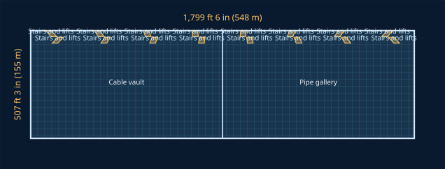
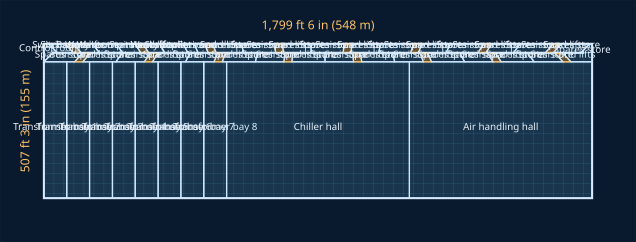
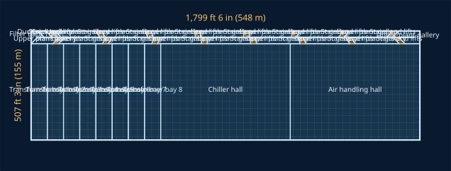

# P3-12 Repair Yards Utility Plant: plan

Footprint 1,799 ft 6 in (548 m) × 507 ft 3 in (155 m) · structural grid 32 ft 10 in (10 m)

## Levels

| Level | Floor above deck | Height | Floor area |
|---|---|---|---|
| Level B1 · Pipe and cable basement | −16 ft 5 in (5,000 mm) | 16 ft 5 in (5,000 mm) | 912,759 sq ft (84,798 m²) |
| Level 1 · Plant floor | 0 ft (0 mm) | 26 ft 3 in (8,000 mm) | 895,336 sq ft (83,179 m²) |
| Level 2 · Upper plant deck | 26 ft 3 in (8,000 mm) | 19 ft 8 in (6,000 mm) | 895,336 sq ft (83,179 m²) |

## Elements

| ID | Designation | Type | Name | Level(s) | Size / length | Area | Status |
|---|---|---|---|---|---|---|---|
| E001 | D5F4P3B18A1L1R1, D5F4P3B18A1L2R1 | room | Transformer bay 1 | L1, L2 | 75 ft 2 in (23 m) × 448 ft 2 in (137 m) | 33,671 sq ft (3,128 m²) | proposed |
| E002 | D5F4P3B18A1L1R2, D5F4P3B18A1L2R2 | room | Transformer bay 2 | L1, L2 | 74 ft 10 in (23 m) × 448 ft 2 in (137 m) | 33,524 sq ft (3,114 m²) | proposed |
| E003 | D5F4P3B18A1L1R3, D5F4P3B18A1L2R3 | room | Transformer bay 3 | L1, L2 | 75 ft 2 in (23 m) × 448 ft 2 in (137 m) | 33,671 sq ft (3,128 m²) | proposed |
| E004 | D5F4P3B18A1L1R4, D5F4P3B18A1L2R4 | room | Transformer bay 4 | L1, L2 | 74 ft 10 in (23 m) × 448 ft 2 in (137 m) | 33,524 sq ft (3,114 m²) | proposed |
| E005 | D5F4P3B18A1L1R5, D5F4P3B18A1L2R5 | room | Transformer bay 5 | L1, L2 | 75 ft 2 in (23 m) × 448 ft 2 in (137 m) | 33,671 sq ft (3,128 m²) | proposed |
| E006 | D5F4P3B18A1L1R6, D5F4P3B18A1L2R6 | room | Transformer bay 6 | L1, L2 | 74 ft 10 in (23 m) × 448 ft 2 in (137 m) | 33,524 sq ft (3,114 m²) | proposed |
| E007 | D5F4P3B18A1L1R7, D5F4P3B18A1L2R7 | room | Transformer bay 7 | L1, L2 | 75 ft 2 in (23 m) × 448 ft 2 in (137 m) | 33,671 sq ft (3,128 m²) | proposed |
| E008 | D5F4P3B18A1L1R8, D5F4P3B18A1L2R8 | room | Transformer bay 8 | L1, L2 | 74 ft 10 in (23 m) × 448 ft 2 in (137 m) | 33,524 sq ft (3,114 m²) | proposed |
| E009 | D5F4P3B18A1L1R9, D5F4P3B18A1L2R9 | room | Chiller hall | L1, L2 | 600 ft 1 in (183 m) × 448 ft 2 in (137 m) | 268,927 sq ft (24,984 m²) | proposed |
| E010 | D5F4P3B18A1L1R10, D5F4P3B18A1L2R10 | room | Air handling hall | L1, L2 | 599 ft 9 in (183 m) × 448 ft 2 in (137 m) | 268,780 sq ft (24,970 m²) | proposed |
| E011 | D5F4P3B18A1LB1R1, D5F4P3B18A1L1R11, D5F4P3B18A1L2R11 | core | Stairs and lifts | LB1, L1, L2 | 51 ft 10 in (16 m) × 27 ft 11 in (8,500 mm) | 732 sq ft (68 m²) | proposed |
| E012 | D5F4P3B18A1LB1R2, D5F4P3B18A1L1R12, D5F4P3B18A1L2R12 | core | Stairs and lifts | LB1, L1, L2 | 44 ft 7 in (14 m) × 27 ft 11 in (8,500 mm) | 732 sq ft (68 m²) | proposed |
| E013 | D5F4P3B18A1LB1R3, D5F4P3B18A1L1R13, D5F4P3B18A1L2R13 | core | Stairs and lifts | LB1, L1, L2 | 37 ft 5 in (11 m) × 27 ft 11 in (8,500 mm) | 732 sq ft (68 m²) | proposed |
| E014 | D5F4P3B18A1LB1R4, D5F4P3B18A1L1R14, D5F4P3B18A1L2R14 | core | Stairs and lifts | LB1, L1, L2 | 30 ft 2 in (9,200 mm) × 27 ft 11 in (8,500 mm) | 727 sq ft (68 m²) | proposed |
| E015 | D5F4P3B18A1LB1R5, D5F4P3B18A1L1R15, D5F4P3B18A1L2R15 | core | Stairs and lifts | LB1, L1, L2 | 29 ft 2 in (8,900 mm) × 27 ft 11 in (8,500 mm) | 727 sq ft (68 m²) | proposed |
| E016 | D5F4P3B18A1LB1R6, D5F4P3B18A1L1R16, D5F4P3B18A1L2R16 | core | Stairs and lifts | LB1, L1, L2 | 36 ft 9 in (11 m) × 27 ft 11 in (8,500 mm) | 737 sq ft (68 m²) | proposed |
| E017 | D5F4P3B18A1LB1R7, D5F4P3B18A1L1R17, D5F4P3B18A1L2R17 | core | Stairs and lifts | LB1, L1, L2 | 43 ft 8 in (13 m) × 27 ft 11 in (8,500 mm) | 732 sq ft (68 m²) | proposed |
| E018 | D5F4P3B18A1LB1R8, D5F4P3B18A1L1R18, D5F4P3B18A1L2R18 | core | Stairs and lifts | LB1, L1, L2 | 50 ft 10 in (16 m) × 27 ft 11 in (8,500 mm) | 732 sq ft (68 m²) | proposed |
| E019 | D5F4P3B18A1LB1R9, D5F4P3B18A1L1R19, D5F4P3B18A1L2R19 | core | Stairs and lifts | LB1, L1, L2 | 51 ft 10 in (16 m) × 27 ft 11 in (8,500 mm) | 732 sq ft (68 m²) | proposed |
| E020 | D5F4P3B18A1LB1R10, D5F4P3B18A1L1R20, D5F4P3B18A1L2R20 | core | Stairs and lifts | LB1, L1, L2 | 44 ft 7 in (14 m) × 27 ft 11 in (8,500 mm) | 732 sq ft (68 m²) | proposed |
| E021 | D5F4P3B18A1LB1R11, D5F4P3B18A1L1R21, D5F4P3B18A1L2R21 | core | Stairs and lifts | LB1, L1, L2 | 37 ft 5 in (11 m) × 27 ft 11 in (8,500 mm) | 732 sq ft (68 m²) | proposed |
| E022 | D5F4P3B18A1LB1R12, D5F4P3B18A1L1R22, D5F4P3B18A1L2R22 | core | Stairs and lifts | LB1, L1, L2 | 30 ft 2 in (9,200 mm) × 27 ft 11 in (8,500 mm) | 727 sq ft (68 m²) | proposed |
| E023 | D5F4P3B18A1LB1R13, D5F4P3B18A1L1R23, D5F4P3B18A1L2R23 | core | Stairs and lifts | LB1, L1, L2 | 29 ft 2 in (8,900 mm) × 27 ft 11 in (8,500 mm) | 727 sq ft (68 m²) | proposed |
| E024 | D5F4P3B18A1LB1R14, D5F4P3B18A1L1R24, D5F4P3B18A1L2R24 | core | Stairs and lifts | LB1, L1, L2 | 36 ft 9 in (11 m) × 27 ft 11 in (8,500 mm) | 737 sq ft (68 m²) | proposed |
| E025 | D5F4P3B18A1LB1R15, D5F4P3B18A1L1R25, D5F4P3B18A1L2R25 | core | Stairs and lifts | LB1, L1, L2 | 43 ft 8 in (13 m) × 27 ft 11 in (8,500 mm) | 732 sq ft (68 m²) | proposed |
| E026 | D5F4P3B18A1LB1R16, D5F4P3B18A1L1R26, D5F4P3B18A1L2R26 | core | Stairs and lifts | LB1, L1, L2 | 50 ft 10 in (15 m) × 27 ft 11 in (8,500 mm) | 732 sq ft (68 m²) | proposed |
| E027 | D5F4P3B18A1L1R27 | room | Control room | L1 | 43 ft (13 m) × 59 ft 1 in (18 m) | 1,295 sq ft (120 m²) | proposed |
| E028 | D5F4P3B18A1L1R28 | room | Switch room | L1 | 80 ft 1 in (24 m) × 27 ft 11 in (8,500 mm) | 1,487 sq ft (138 m²) | proposed |
| E029 | D5F4P3B18A1L1R29 | room | Battery room | L1 | 85 ft 8 in (26 m) × 27 ft 11 in (8,500 mm) | 1,715 sq ft (159 m²) | proposed |
| E030 | D5F4P3B18A1L1R30 | room | Water pump room | L1 | 98 ft 5 in (30 m) × 27 ft 11 in (8,500 mm) | 2,141 sq ft (199 m²) | proposed |
| E031 | D5F4P3B18A1L1R31 | room | Water treatment room | L1 | 80 ft 5 in (24 m) × 27 ft 11 in (8,500 mm) | 1,697 sq ft (158 m²) | proposed |
| E032 | D5F4P3B18A1L1R32 | room | Workshop | L1 | 70 ft 10 in (22 m) × 27 ft 11 in (8,500 mm) | 1,500 sq ft (139 m²) | proposed |
| E033 | D5F4P3B18A1L1R33 | room | Heavy power room | L1 | 91 ft 6 in (28 m) × 27 ft 11 in (8,500 mm) | 2,136 sq ft (198 m²) | proposed |
| E034 | D5F4P3B18A1L1R34 | room | Locker room | L1 | 47 ft 11 in (15 m) × 27 ft 11 in (8,500 mm) | 965 sq ft (90 m²) | proposed |
| E035 | D5F4P3B18A1L1R35 | room | Staff toilets and showers | L1 | 46 ft 3 in (14 m) × 27 ft 11 in (8,500 mm) | 947 sq ft (88 m²) | proposed |
| E036 | D5F4P3B18A1L1R36 | room | Spares store | L1 | 101 ft 5 in (31 m) × 27 ft 11 in (8,500 mm) | 2,571 sq ft (239 m²) | proposed |
| E037 | D5F4P3B18A1L1R37 | room | Spares store | L1 | 113 ft 2 in (34 m) × 27 ft 11 in (8,500 mm) | 2,983 sq ft (277 m²) | proposed |
| E038 | D5F4P3B18A1L1R38 | room | Spares store | L1 | 94 ft 6 in (29 m) × 27 ft 11 in (8,500 mm) | 2,576 sq ft (239 m²) | proposed |
| E039 | D5F4P3B18A1L1R39 | room | Spares store | L1 | 108 ft 7 in (33 m) × 27 ft 11 in (8,500 mm) | 2,983 sq ft (277 m²) | proposed |
| E040 | D5F4P3B18A1L1R40 | room | Spares store | L1 | 97 ft 1 in (30 m) × 27 ft 11 in (8,500 mm) | 2,571 sq ft (239 m²) | proposed |
| E041 | D5F4P3B18A1L1R41 | room | Spares store | L1 | 114 ft 10 in (35 m) × 27 ft 11 in (8,500 mm) | 2,978 sq ft (277 m²) | proposed |
| E042 | D5F4P3B18A1L1R42 | room | Spares store | L1 | 104 ft 4 in (32 m) × 27 ft 11 in (8,500 mm) | 2,571 sq ft (239 m²) | proposed |
| E043 | D5F4P3B18A1L1R43 | room | Spares store | L1 | 122 ft 1 in (37 m) × 27 ft 11 in (8,500 mm) | 2,978 sq ft (277 m²) | proposed |
| E044 | D5F4P3B18A1L1R44 | room | Spares store | L1 | 111 ft 7 in (34 m) × 27 ft 11 in (8,500 mm) | 2,576 sq ft (239 m²) | proposed |
| E045 | D5F4P3B18A1L1R45 | room | Spares store | L1 | 129 ft 3 in (39 m) × 27 ft 11 in (8,500 mm) | 2,978 sq ft (277 m²) | proposed |
| E046 | D5F4P3B18A1L1R46 | room | Spares store | L1 | 118 ft 5 in (36 m) × 27 ft 11 in (8,500 mm) | 2,571 sq ft (239 m²) | proposed |
| E047 | D5F4P3B18A1L1R47 | room | Spares store | L1 | 95 ft 6 in (29 m) × 59 ft 1 in (18 m) | 2,987 sq ft (278 m²) | proposed |
| E048 | D5F4P3B18A1L1R48 | room | Spares store | L1 | 115 ft 10 in (35 m) × 27 ft 11 in (8,500 mm) | 2,571 sq ft (239 m²) | proposed |
| E049 | D5F4P3B18A1L1R49 | room | Spares store | L1 | 127 ft 4 in (39 m) × 27 ft 11 in (8,500 mm) | 2,983 sq ft (277 m²) | proposed |
| E050 | D5F4P3B18A1L1R50 | room | Spares store | L1 | 108 ft 7 in (33 m) × 27 ft 11 in (8,500 mm) | 2,566 sq ft (238 m²) | proposed |
| E051 | D5F4P3B18A1L1R51 | room | Spares store | L1 | 120 ft 5 in (37 m) × 27 ft 11 in (8,500 mm) | 2,983 sq ft (277 m²) | proposed |
| E052 | D5F4P3B18A1L1R52 | room | Spares store | L1 | 101 ft 5 in (31 m) × 27 ft 11 in (8,500 mm) | 2,571 sq ft (239 m²) | proposed |
| E053 | D5F4P3B18A1L1R53 | room | Spares store | L1 | 113 ft 2 in (34 m) × 27 ft 11 in (8,500 mm) | 2,983 sq ft (277 m²) | proposed |
| E054 | D5F4P3B18A1L1R54 | room | Spares store | L1 | 94 ft 6 in (29 m) × 27 ft 11 in (8,500 mm) | 2,576 sq ft (239 m²) | proposed |
| E055 | D5F4P3B18A1L1R55 | room | Spares store | L1 | 108 ft 7 in (33 m) × 27 ft 11 in (8,500 mm) | 2,983 sq ft (277 m²) | proposed |
| E056 | D5F4P3B18A1L1R56 | room | Spares store | L1 | 97 ft 1 in (30 m) × 27 ft 11 in (8,500 mm) | 2,571 sq ft (239 m²) | proposed |
| E057 | D5F4P3B18A1L1R57 | room | Spares store | L1 | 114 ft 10 in (35 m) × 27 ft 11 in (8,500 mm) | 2,978 sq ft (277 m²) | proposed |
| E058 | D5F4P3B18A1L1R58 | room | Spares store | L1 | 104 ft 4 in (32 m) × 27 ft 11 in (8,500 mm) | 2,571 sq ft (239 m²) | proposed |
| E059 | D5F4P3B18A1L1R59 | room | Spares store | L1 | 122 ft 1 in (37 m) × 27 ft 11 in (8,500 mm) | 2,978 sq ft (277 m²) | proposed |
| E060 | D5F4P3B18A1L1R60 | room | Spares store | L1 | 111 ft 7 in (34 m) × 27 ft 11 in (8,500 mm) | 2,576 sq ft (239 m²) | proposed |
| E061 | D5F4P3B18A1L1R61 | room | Spares store | L1 | 129 ft 3 in (39 m) × 27 ft 11 in (8,500 mm) | 2,978 sq ft (277 m²) | proposed |
| E062 | D5F4P3B18A1L1R62 | room | Spares store | L1 | 126 ft (38 m) × 27 ft 11 in (8,500 mm) | 2,777 sq ft (258 m²) | proposed |
| E063 | D5F4P3B18A1L2R27 | room | Filter bank room | L2 | 58 ft 1 in (18 m) × 59 ft 1 in (18 m) | 1,720 sq ft (160 m²) | proposed |
| E064 | D5F4P3B18A1L2R28 | room | Ductwork gallery | L2 | 64 ft 8 in (20 m) × 27 ft 11 in (8,500 mm) | 1,061 sq ft (99 m²) | proposed |
| E065 | D5F4P3B18A1L2R29 | room | Crew rest room | L2 | 40 ft 4 in (12 m) × 27 ft 11 in (8,500 mm) | 430 sq ft (40 m²) | proposed |
| E066 | D5F4P3B18A1L2R30 | room | Upper plant gallery | L2 | 205 ft 5 in (63 m) × 27 ft 11 in (8,500 mm) | 5,124 sq ft (476 m²) | proposed |
| E067 | D5F4P3B18A1L2R31 | room | Upper plant gallery | L2 | 213 ft 11 in (65 m) × 27 ft 11 in (8,500 mm) | 5,549 sq ft (516 m²) | proposed |
| E068 | D5F4P3B18A1L2R32 | room | Upper plant gallery | L2 | 206 ft 8 in (63 m) × 27 ft 11 in (8,500 mm) | 5,554 sq ft (516 m²) | proposed |
| E069 | D5F4P3B18A1L2R33 | room | Upper plant gallery | L2 | 202 ft 5 in (62 m) × 27 ft 11 in (8,500 mm) | 5,558 sq ft (516 m²) | proposed |
| E070 | D5F4P3B18A1L2R34 | room | Upper plant gallery | L2 | 205 ft 9 in (63 m) × 27 ft 11 in (8,500 mm) | 5,549 sq ft (516 m²) | proposed |
| E071 | D5F4P3B18A1L2R35 | room | Upper plant gallery | L2 | 212 ft 11 in (65 m) × 27 ft 11 in (8,500 mm) | 5,549 sq ft (516 m²) | proposed |
| E072 | D5F4P3B18A1L2R36 | room | Upper plant gallery | L2 | 220 ft 2 in (67 m) × 27 ft 11 in (8,500 mm) | 5,554 sq ft (516 m²) | proposed |
| E073 | D5F4P3B18A1L2R37 | room | Upper plant gallery | L2 | 126 ft (38 m) × 59 ft 1 in (18 m) | 5,558 sq ft (516 m²) | proposed |
| E074 | D5F4P3B18A1L2R38 | room | Upper plant gallery | L2 | 221 ft 2 in (67 m) × 27 ft 11 in (8,500 mm) | 5,554 sq ft (516 m²) | proposed |
| E075 | D5F4P3B18A1L2R39 | room | Upper plant gallery | L2 | 213 ft 11 in (65 m) × 27 ft 11 in (8,500 mm) | 5,549 sq ft (516 m²) | proposed |
| E076 | D5F4P3B18A1L2R40 | room | Upper plant gallery | L2 | 206 ft 8 in (63 m) × 27 ft 11 in (8,500 mm) | 5,554 sq ft (516 m²) | proposed |
| E077 | D5F4P3B18A1L2R41 | room | Upper plant gallery | L2 | 202 ft 5 in (62 m) × 27 ft 11 in (8,500 mm) | 5,558 sq ft (516 m²) | proposed |
| E078 | D5F4P3B18A1L2R42 | room | Upper plant gallery | L2 | 205 ft 9 in (63 m) × 27 ft 11 in (8,500 mm) | 5,549 sq ft (516 m²) | proposed |
| E079 | D5F4P3B18A1L2R43 | room | Upper plant gallery | L2 | 212 ft 11 in (65 m) × 27 ft 11 in (8,500 mm) | 5,549 sq ft (516 m²) | proposed |
| E080 | D5F4P3B18A1L2R44 | room | Upper plant gallery | L2 | 220 ft 2 in (67 m) × 27 ft 11 in (8,500 mm) | 5,554 sq ft (516 m²) | proposed |
| E081 | D5F4P3B18A1L2R45 | room | Upper plant gallery | L2 | 126 ft (38 m) × 27 ft 11 in (8,500 mm) | 2,777 sq ft (258 m²) | proposed |
| E082 | D5F4P3B18A1LB1R17 | room | Cable vault | LB1 | 899 ft 7 in (274 m) × 507 ft 3 in (155 m) | 456,296 sq ft (42,391 m²) | proposed |
| E083 | D5F4P3B18A1LB1R18 | room | Pipe gallery | LB1 | 899 ft 11 in (274 m) × 507 ft 3 in (155 m) | 456,463 sq ft (42,407 m²) | proposed |

## Drawings

### Level B1 · Pipe and cable basement

### Level 1 · Plant floor

### Level 2 · Upper plant deck

