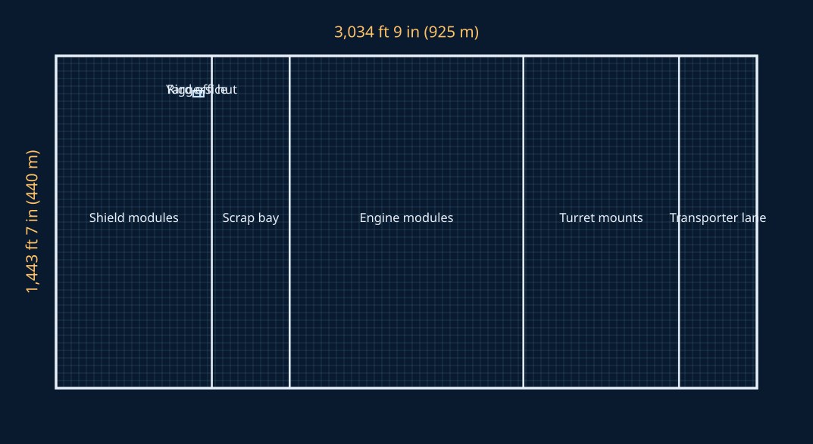

# P3-14 Module Yard 1: plan

Footprint 3,034 ft 9 in (925 m) × 1,443 ft 7 in (440 m) · structural grid 32 ft 10 in (10 m)

## Levels

| Level | Floor above deck | Height | Floor area |
|---|---|---|---|
| Level 1 · Yard | 0 ft (0 mm) | 13 ft 1 in (4,000 mm) | 1,206 sq ft (112 m²) |

## Elements

| ID | Designation | Type | Name | Level(s) | Size / length | Area | Status |
|---|---|---|---|---|---|---|---|
| E001 | D5F4P3B3A1R1 | zone | Shield modules | L1 | 674 ft 6 in (206 m) × 1,443 ft 7 in (440 m) | 973,746 sq ft (90,464 m²) | proposed |
| E002 | D5F4P3B3A1R2 | room | Yard office | L1 | 30 ft 6 in (9,300 mm) × 26 ft 3 in (8,000 mm) | 801 sq ft (74 m²) | proposed |
| E003 | D5F4P3B3A1R3 | room | Riggers' hut | L1 | 15 ft 5 in (4,700 mm) × 26 ft 3 in (8,000 mm) | 405 sq ft (38 m²) | proposed |
| E004 | D5F4P3B3A1R4 | zone | Scrap bay | L1 | 336 ft 11 in (103 m) × 1,443 ft 7 in (440 m) | 486,400 sq ft (45,188 m²) | proposed |
| E005 | D5F4P3B3A1R5 | zone | Engine modules | L1 | 1,011 ft 10 in (308 m) × 1,443 ft 7 in (440 m) | 1,460,620 sq ft (135,696 m²) | proposed |
| E006 | D5F4P3B3A1R6 | zone | Turret mounts | L1 | 674 ft 3 in (206 m) × 1,443 ft 7 in (440 m) | 973,273 sq ft (90,420 m²) | proposed |
| E007 | D5F4P3B3A1R7 | zone | Transporter lane | L1 | 337 ft 3 in (103 m) × 1,443 ft 7 in (440 m) | 486,873 sq ft (45,232 m²) | proposed |

## Drawings

### Level 1 · Yard

