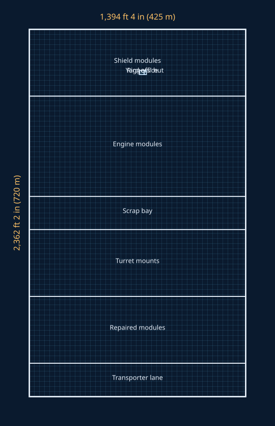

# P3-16 Module Yard 2: plan

Footprint 1,394 ft 4 in (425 m) × 2,362 ft 2 in (720 m) · structural grid 32 ft 10 in (10 m)

## Levels

| Level | Floor above deck | Height | Floor area |
|---|---|---|---|
| Level 1 · Yard | 0 ft (0 mm) | 13 ft 1 in (4,000 mm) | 1,206 sq ft (112 m²) |

## Elements

| ID | Designation | Type | Name | Level(s) | Size / length | Area | Status |
|---|---|---|---|---|---|---|---|
| E001 | D5F4P3B7A1R1 | zone | Shield modules | L1 | 1,394 ft 4 in (425 m) × 429 ft 6 in (131 m) | 598,823 sq ft (55,632 m²) | proposed |
| E002 | D5F4P3B7A1R2 | room | Yard office | L1 | 30 ft 10 in (9,400 mm) × 26 ft 3 in (8,000 mm) | 809 sq ft (75 m²) | proposed |
| E003 | D5F4P3B7A1R3 | room | Riggers' hut | L1 | 15 ft 1 in (4,600 mm) × 26 ft 3 in (8,000 mm) | 396 sq ft (37 m²) | proposed |
| E004 | D5F4P3B7A1R4 | zone | Engine modules | L1 | 1,394 ft 4 in (425 m) × 644 ft 4 in (196 m) | 898,464 sq ft (83,470 m²) | proposed |
| E005 | D5F4P3B7A1R5 | zone | Scrap bay | L1 | 1,394 ft 4 in (425 m) × 214 ft 7 in (65 m) | 299,183 sq ft (27,795 m²) | proposed |
| E006 | D5F4P3B7A1R6 | zone | Turret mounts | L1 | 1,394 ft 4 in (425 m) × 429 ft 6 in (131 m) | 598,823 sq ft (55,632 m²) | proposed |
| E007 | D5F4P3B7A1R7 | zone | Repaired modules | L1 | 1,394 ft 4 in (425 m) × 429 ft 6 in (131 m) | 598,823 sq ft (55,632 m²) | proposed |
| E008 | D5F4P3B7A1R8 | zone | Transporter lane | L1 | 1,394 ft 4 in (425 m) × 214 ft 11 in (66 m) | 299,640 sq ft (27,838 m²) | proposed |

## Drawings

### Level 1 · Yard

