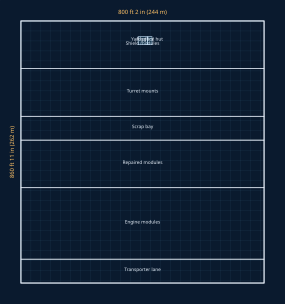

# P3-18 Module Yard 3: plan

Footprint 800 ft 2 in (244 m) × 860 ft 11 in (262 m) · structural grid 32 ft 10 in (10 m)

## Levels

| Level | Floor above deck | Height | Floor area |
|---|---|---|---|
| Level 1 · Yard | 0 ft (0 mm) | 13 ft 1 in (4,000 mm) | 1,206 sq ft (112 m²) |

## Elements

| ID | Designation | Type | Name | Level(s) | Size / length | Area | Status |
|---|---|---|---|---|---|---|---|
| E001 | D5F4P3B13A2R1 | zone | Shield modules | L1 | 800 ft 2 in (244 m) × 156 ft 6 in (48 m) | 125,228 sq ft (11,634 m²) | proposed |
| E002 | D5F4P3B13A2R2 | room | Yard office | L1 | 30 ft 6 in (9,300 mm) × 26 ft 3 in (8,000 mm) | 801 sq ft (74 m²) | proposed |
| E003 | D5F4P3B13A2R3 | room | Riggers' hut | L1 | 15 ft 5 in (4,700 mm) × 26 ft 3 in (8,000 mm) | 405 sq ft (38 m²) | proposed |
| E004 | D5F4P3B13A2R4 | zone | Turret mounts | L1 | 800 ft 2 in (244 m) × 156 ft 6 in (48 m) | 125,228 sq ft (11,634 m²) | proposed |
| E005 | D5F4P3B13A2R5 | zone | Scrap bay | L1 | 800 ft 2 in (244 m) × 78 ft 5 in (24 m) | 62,745 sq ft (5,829 m²) | proposed |
| E006 | D5F4P3B13A2R6 | zone | Repaired modules | L1 | 800 ft 2 in (244 m) × 156 ft 6 in (48 m) | 125,228 sq ft (11,634 m²) | proposed |
| E007 | D5F4P3B13A2R7 | zone | Engine modules | L1 | 800 ft 2 in (244 m) × 234 ft 7 in (72 m) | 187,710 sq ft (17,439 m²) | proposed |
| E008 | D5F4P3B13A2R8 | zone | Transporter lane | L1 | 800 ft 2 in (244 m) × 78 ft 5 in (24 m) | 62,745 sq ft (5,829 m²) | proposed |

## Drawings

### Level 1 · Yard

