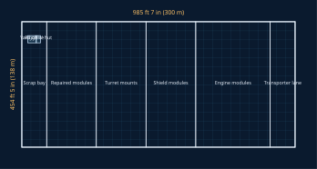

# P3-22 Module Yard 5: plan

Footprint 985 ft 7 in (300 m) × 454 ft 5 in (138 m) · structural grid 32 ft 10 in (10 m)

## Levels

| Level | Floor above deck | Height | Floor area |
|---|---|---|---|
| Level 1 · Yard | 0 ft (0 mm) | 13 ft 1 in (4,000 mm) | 1,206 sq ft (112 m²) |

## Elements

| ID | Designation | Type | Name | Level(s) | Size / length | Area | Status |
|---|---|---|---|---|---|---|---|
| E001 | D5F4P3B20A2R1 | zone | Scrap bay | L1 | 89 ft 7 in (27 m) × 454 ft 5 in (138 m) | 40,699 sq ft (3,781 m²) | proposed |
| E002 | D5F4P3B20A2R2 | room | Yard office | L1 | 30 ft 10 in (9,400 mm) × 26 ft 3 in (8,000 mm) | 809 sq ft (75 m²) | proposed |
| E003 | D5F4P3B20A2R3 | room | Riggers' hut | L1 | 15 ft 1 in (4,600 mm) × 26 ft 3 in (8,000 mm) | 396 sq ft (37 m²) | proposed |
| E004 | D5F4P3B20A2R4 | zone | Repaired modules | L1 | 179 ft 2 in (55 m) × 454 ft 5 in (138 m) | 81,398 sq ft (7,562 m²) | proposed |
| E005 | D5F4P3B20A2R5 | zone | Turret mounts | L1 | 179 ft 2 in (55 m) × 454 ft 5 in (138 m) | 81,398 sq ft (7,562 m²) | proposed |
| E006 | D5F4P3B20A2R6 | zone | Shield modules | L1 | 179 ft 6 in (55 m) × 454 ft 5 in (138 m) | 81,547 sq ft (7,576 m²) | proposed |
| E007 | D5F4P3B20A2R7 | zone | Engine modules | L1 | 268 ft 8 in (82 m) × 454 ft 5 in (138 m) | 122,097 sq ft (11,343 m²) | proposed |
| E008 | D5F4P3B20A2R8 | zone | Transporter lane | L1 | 89 ft 7 in (27 m) × 454 ft 5 in (138 m) | 40,699 sq ft (3,781 m²) | proposed |

## Drawings

### Level 1 · Yard

