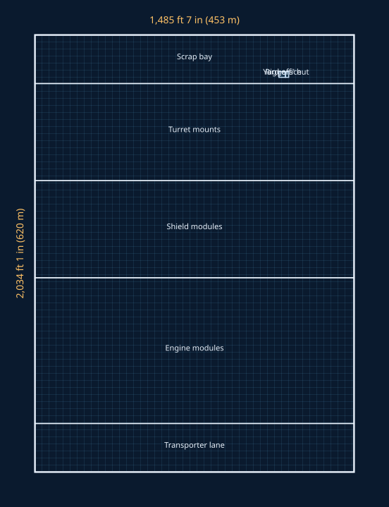

# P3-26 Module Yard 7: plan

Footprint 1,485 ft 7 in (453 m) × 2,034 ft 1 in (620 m) · structural grid 32 ft 10 in (10 m)

## Levels

| Level | Floor above deck | Height | Floor area |
|---|---|---|---|
| Level 1 · Yard | 0 ft (0 mm) | 13 ft 1 in (4,000 mm) | 1,206 sq ft (112 m²) |

## Elements

| ID | Designation | Type | Name | Level(s) | Size / length | Area | Status |
|---|---|---|---|---|---|---|---|
| E001 | D5F4P3B6A2R1 | zone | Scrap bay | L1 | 1,485 ft 7 in (453 m) × 226 ft 1 in (69 m) | 335,812 sq ft (31,198 m²) | proposed |
| E002 | D5F4P3B6A2R2 | room | Yard office | L1 | 30 ft 6 in (9,300 mm) × 26 ft 3 in (8,000 mm) | 801 sq ft (74 m²) | proposed |
| E003 | D5F4P3B6A2R3 | room | Riggers' hut | L1 | 15 ft 5 in (4,700 mm) × 26 ft 3 in (8,000 mm) | 405 sq ft (38 m²) | proposed |
| E004 | D5F4P3B6A2R4 | zone | Turret mounts | L1 | 1,485 ft 7 in (453 m) × 452 ft 1 in (138 m) | 671,623 sq ft (62,396 m²) | proposed |
| E005 | D5F4P3B6A2R5 | zone | Shield modules | L1 | 1,485 ft 7 in (453 m) × 451 ft 9 in (138 m) | 671,136 sq ft (62,351 m²) | proposed |
| E006 | D5F4P3B6A2R6 | zone | Engine modules | L1 | 1,485 ft 7 in (453 m) × 678 ft 2 in (207 m) | 1,007,435 sq ft (93,594 m²) | proposed |
| E007 | D5F4P3B6A2R7 | zone | Transporter lane | L1 | 1,485 ft 7 in (453 m) × 226 ft 1 in (69 m) | 335,812 sq ft (31,198 m²) | proposed |

## Drawings

### Level 1 · Yard

