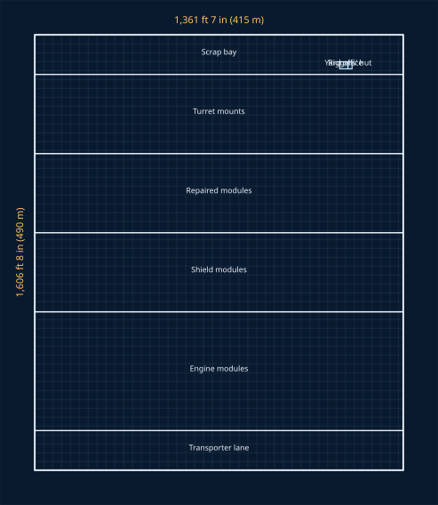

# P3-28 Module Yard 8: plan

Footprint 1,361 ft 7 in (415 m) × 1,606 ft 8 in (490 m) · structural grid 32 ft 10 in (10 m)

## Levels

| Level | Floor above deck | Height | Floor area |
|---|---|---|---|
| Level 1 · Yard | 0 ft (0 mm) | 13 ft 1 in (4,000 mm) | 1,206 sq ft (112 m²) |

## Elements

| ID | Designation | Type | Name | Level(s) | Size / length | Area | Status |
|---|---|---|---|---|---|---|---|
| E001 | D5F4P3B11A2R1 | zone | Scrap bay | L1 | 1,361 ft 7 in (415 m) × 146 ft (44 m) | 198,783 sq ft (18,468 m²) | proposed |
| E002 | D5F4P3B11A2R2 | room | Yard office | L1 | 30 ft 6 in (9,300 mm) × 26 ft 3 in (8,000 mm) | 801 sq ft (74 m²) | proposed |
| E003 | D5F4P3B11A2R3 | room | Riggers' hut | L1 | 15 ft 5 in (4,700 mm) × 26 ft 3 in (8,000 mm) | 405 sq ft (38 m²) | proposed |
| E004 | D5F4P3B11A2R4 | zone | Turret mounts | L1 | 1,361 ft 7 in (415 m) × 292 ft 4 in (89 m) | 398,012 sq ft (36,976 m²) | proposed |
| E005 | D5F4P3B11A2R5 | zone | Repaired modules | L1 | 1,361 ft 7 in (415 m) × 292 ft (89 m) | 397,565 sq ft (36,935 m²) | proposed |
| E006 | D5F4P3B11A2R6 | zone | Shield modules | L1 | 1,361 ft 7 in (415 m) × 292 ft (89 m) | 397,565 sq ft (36,935 m²) | proposed |
| E007 | D5F4P3B11A2R7 | zone | Engine modules | L1 | 1,361 ft 7 in (415 m) × 438 ft 4 in (134 m) | 596,794 sq ft (55,444 m²) | proposed |
| E008 | D5F4P3B11A2R8 | zone | Transporter lane | L1 | 1,361 ft 7 in (415 m) × 146 ft (44 m) | 198,783 sq ft (18,468 m²) | proposed |

## Drawings

### Level 1 · Yard

