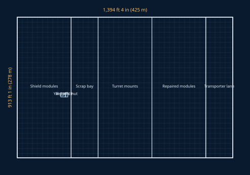

# P3-30 Module Yard 9: plan

Footprint 1,394 ft 4 in (425 m) × 913 ft 1 in (278 m) · structural grid 32 ft 10 in (10 m)

## Levels

| Level | Floor above deck | Height | Floor area |
|---|---|---|---|
| Level 1 · Yard | 0 ft (0 mm) | 13 ft 1 in (4,000 mm) | 1,206 sq ft (112 m²) |

## Elements

| ID | Designation | Type | Name | Level(s) | Size / length | Area | Status |
|---|---|---|---|---|---|---|---|
| E001 | D5F4P3B16A2R1 | zone | Shield modules | L1 | 348 ft 5 in (106 m) × 913 ft 1 in (278 m) | 318,132 sq ft (29,555 m²) | proposed |
| E002 | D5F4P3B16A2R2 | room | Yard office | L1 | 30 ft 6 in (9,300 mm) × 26 ft 3 in (8,000 mm) | 801 sq ft (74 m²) | proposed |
| E003 | D5F4P3B16A2R3 | room | Riggers' hut | L1 | 15 ft 5 in (4,700 mm) × 26 ft 3 in (8,000 mm) | 405 sq ft (38 m²) | proposed |
| E004 | D5F4P3B16A2R4 | zone | Scrap bay | L1 | 174 ft 6 in (53 m) × 913 ft 1 in (278 m) | 159,366 sq ft (14,806 m²) | proposed |
| E005 | D5F4P3B16A2R5 | zone | Turret mounts | L1 | 348 ft 5 in (106 m) × 913 ft 1 in (278 m) | 318,132 sq ft (29,555 m²) | proposed |
| E006 | D5F4P3B16A2R6 | zone | Repaired modules | L1 | 348 ft 9 in (106 m) × 913 ft 1 in (278 m) | 318,432 sq ft (29,583 m²) | proposed |
| E007 | D5F4P3B16A2R7 | zone | Transporter lane | L1 | 174 ft 3 in (53 m) × 913 ft 1 in (278 m) | 159,066 sq ft (14,778 m²) | proposed |

## Drawings

### Level 1 · Yard

