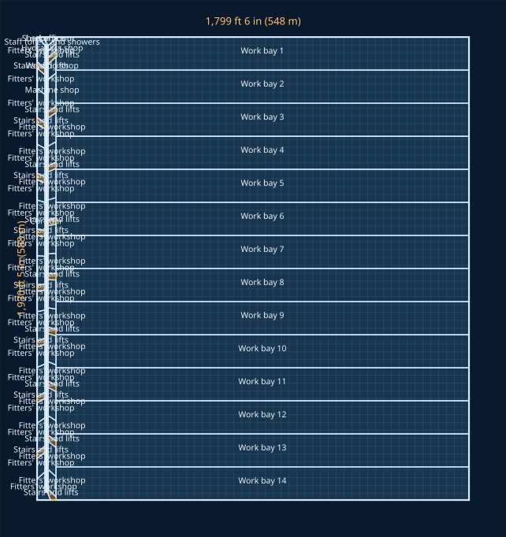
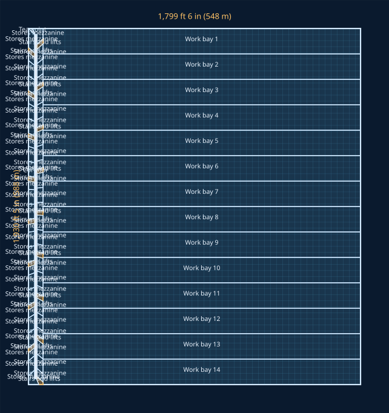

# P3-31 Repair Shed 9: plan

Footprint 1,799 ft 6 in (548 m) × 1,930 ft 5 in (588 m) · structural grid 32 ft 10 in (10 m)

## Levels

| Level | Floor above deck | Height | Floor area |
|---|---|---|---|
| Level 1 · Hall floor | 0 ft (0 mm) | 52 ft 6 in (16 m) | 3,433,719 sq ft (319,003 m²) |
| Level 2 · Gallery floor | 52 ft 6 in (16 m) | 14 ft 9 in (4,500 mm) | 3,433,719 sq ft (319,003 m²) |

## Elements

| ID | Designation | Type | Name | Level(s) | Size / length | Area | Status |
|---|---|---|---|---|---|---|---|
| E001 | D5F4P3B18A2L1R1, D5F4P3B18A2L2R1 | room | Work bay 1 | L1, L2 | 1,720 ft 10 in (524 m) × 137 ft 10 in (42 m) | 237,118 sq ft (22,029 m²) | proposed |
| E002 | D5F4P3B18A2L1R2, D5F4P3B18A2L2R2 | room | Work bay 2 | L1, L2 | 1,720 ft 10 in (524 m) × 138 ft 1 in (42 m) | 237,683 sq ft (22,081 m²) | proposed |
| E003 | D5F4P3B18A2L1R3, D5F4P3B18A2L2R3 | room | Work bay 3 | L1, L2 | 1,720 ft 10 in (524 m) × 137 ft 10 in (42 m) | 237,118 sq ft (22,029 m²) | proposed |
| E004 | D5F4P3B18A2L1R4, D5F4P3B18A2L2R4 | room | Work bay 4 | L1, L2 | 1,720 ft 10 in (524 m) × 137 ft 10 in (42 m) | 237,118 sq ft (22,029 m²) | proposed |
| E005 | D5F4P3B18A2L1R5, D5F4P3B18A2L2R5 | room | Work bay 5 | L1, L2 | 1,720 ft 10 in (524 m) × 137 ft 10 in (42 m) | 237,118 sq ft (22,029 m²) | proposed |
| E006 | D5F4P3B18A2L1R6, D5F4P3B18A2L2R6 | room | Work bay 6 | L1, L2 | 1,720 ft 10 in (524 m) × 138 ft 1 in (42 m) | 237,683 sq ft (22,081 m²) | proposed |
| E007 | D5F4P3B18A2L1R7, D5F4P3B18A2L2R7 | room | Work bay 7 | L1, L2 | 1,720 ft 10 in (524 m) × 137 ft 10 in (42 m) | 237,118 sq ft (22,029 m²) | proposed |
| E008 | D5F4P3B18A2L1R8, D5F4P3B18A2L2R8 | room | Work bay 8 | L1, L2 | 1,720 ft 10 in (524 m) × 137 ft 10 in (42 m) | 237,118 sq ft (22,029 m²) | proposed |
| E009 | D5F4P3B18A2L1R9, D5F4P3B18A2L2R9 | room | Work bay 9 | L1, L2 | 1,720 ft 10 in (524 m) × 138 ft 1 in (42 m) | 237,683 sq ft (22,081 m²) | proposed |
| E010 | D5F4P3B18A2L1R10, D5F4P3B18A2L2R10 | room | Work bay 10 | L1, L2 | 1,720 ft 10 in (524 m) × 137 ft 10 in (42 m) | 237,118 sq ft (22,029 m²) | proposed |
| E011 | D5F4P3B18A2L1R11, D5F4P3B18A2L2R11 | room | Work bay 11 | L1, L2 | 1,720 ft 10 in (524 m) × 137 ft 10 in (42 m) | 237,118 sq ft (22,029 m²) | proposed |
| E012 | D5F4P3B18A2L1R12, D5F4P3B18A2L2R12 | room | Work bay 12 | L1, L2 | 1,720 ft 10 in (524 m) × 137 ft 10 in (42 m) | 237,118 sq ft (22,029 m²) | proposed |
| E013 | D5F4P3B18A2L1R13, D5F4P3B18A2L2R13 | room | Work bay 13 | L1, L2 | 1,720 ft 10 in (524 m) × 138 ft 1 in (42 m) | 237,683 sq ft (22,081 m²) | proposed |
| E014 | D5F4P3B18A2L1R14, D5F4P3B18A2L2R14 | room | Work bay 14 | L1, L2 | 1,720 ft 10 in (524 m) × 137 ft 10 in (42 m) | 237,118 sq ft (22,029 m²) | proposed |
| E015 | D5F4P3B18A2L1R15, D5F4P3B18A2L2R15 | core | Stairs and lifts | L1, L2 | 32 ft 6 in (9,900 mm) × 56 ft 5 in (17 m) | 853 sq ft (79 m²) | proposed |
| E016 | D5F4P3B18A2L1R16, D5F4P3B18A2L2R16 | core | Stairs and lifts | L1, L2 | 32 ft 6 in (9,900 mm) × 48 ft 7 in (15 m) | 853 sq ft (79 m²) | proposed |
| E017 | D5F4P3B18A2L1R17, D5F4P3B18A2L2R17 | core | Stairs and lifts | L1, L2 | 32 ft 6 in (9,900 mm) × 40 ft 8 in (12 m) | 853 sq ft (79 m²) | proposed |
| E018 | D5F4P3B18A2L1R18, D5F4P3B18A2L2R18 | core | Stairs and lifts | L1, L2 | 32 ft 6 in (9,900 mm) × 32 ft 10 in (10 m) | 853 sq ft (79 m²) | proposed |
| E019 | D5F4P3B18A2L1R19, D5F4P3B18A2L2R19 | core | Stairs and lifts | L1, L2 | 32 ft 6 in (9,900 mm) × 27 ft 3 in (8,300 mm) | 847 sq ft (79 m²) | proposed |
| E020 | D5F4P3B18A2L1R20, D5F4P3B18A2L2R20 | core | Stairs and lifts | L1, L2 | 32 ft 6 in (9,900 mm) × 35 ft 1 in (11 m) | 853 sq ft (79 m²) | proposed |
| E021 | D5F4P3B18A2L1R21, D5F4P3B18A2L2R21 | core | Stairs and lifts | L1, L2 | 32 ft 6 in (9,900 mm) × 43 ft (13 m) | 853 sq ft (79 m²) | proposed |
| E022 | D5F4P3B18A2L1R22, D5F4P3B18A2L2R22 | core | Stairs and lifts | L1, L2 | 32 ft 6 in (9,900 mm) × 50 ft 10 in (16 m) | 853 sq ft (79 m²) | proposed |
| E023 | D5F4P3B18A2L1R23, D5F4P3B18A2L2R23 | core | Stairs and lifts | L1, L2 | 36 ft 5 in (11 m) × 45 ft 3 in (14 m) | 853 sq ft (79 m²) | proposed |
| E024 | D5F4P3B18A2L1R24, D5F4P3B18A2L2R24 | core | Stairs and lifts | L1, L2 | 32 ft 6 in (9,900 mm) × 52 ft 6 in (16 m) | 853 sq ft (79 m²) | proposed |
| E025 | D5F4P3B18A2L1R25, D5F4P3B18A2L2R25 | core | Stairs and lifts | L1, L2 | 32 ft 6 in (9,900 mm) × 44 ft 7 in (14 m) | 853 sq ft (79 m²) | proposed |
| E026 | D5F4P3B18A2L1R26, D5F4P3B18A2L2R26 | core | Stairs and lifts | L1, L2 | 32 ft 6 in (9,900 mm) × 36 ft 9 in (11 m) | 853 sq ft (79 m²) | proposed |
| E027 | D5F4P3B18A2L1R27, D5F4P3B18A2L2R27 | core | Stairs and lifts | L1, L2 | 32 ft 6 in (9,900 mm) × 29 ft 2 in (8,900 mm) | 858 sq ft (80 m²) | proposed |
| E028 | D5F4P3B18A2L1R28, D5F4P3B18A2L2R28 | core | Stairs and lifts | L1, L2 | 32 ft 6 in (9,900 mm) × 31 ft 6 in (9,600 mm) | 858 sq ft (80 m²) | proposed |
| E029 | D5F4P3B18A2L1R29, D5F4P3B18A2L2R29 | core | Stairs and lifts | L1, L2 | 32 ft 6 in (9,900 mm) × 39 ft 1 in (12 m) | 847 sq ft (79 m²) | proposed |
| E030 | D5F4P3B18A2L1R30, D5F4P3B18A2L2R30 | core | Stairs and lifts | L1, L2 | 32 ft 6 in (9,900 mm) × 46 ft 11 in (14 m) | 853 sq ft (79 m²) | proposed |
| E031 | D5F4P3B18A2L1R31, D5F4P3B18A2L2R31 | core | Stairs and lifts | L1, L2 | 32 ft 6 in (9,900 mm) × 54 ft 9 in (17 m) | 853 sq ft (79 m²) | proposed |
| E032 | D5F4P3B18A2L1R32 | zone | Corridor | L1 | 13 ft 9 in (4,200 mm) × 1,865 ft 6 in (569 m) | 18,400 sq ft (1,709 m²) | proposed |
| E033 | D5F4P3B18A2L1R33 | room | Shed office | L1 | 38 ft 5 in (12 m) × 32 ft 6 in (9,900 mm) | 645 sq ft (60 m²) | proposed |
| E034 | D5F4P3B18A2L1R34 | room | Locker room | L1 | 44 ft 11 in (14 m) × 35 ft 9 in (11 m) | 970 sq ft (90 m²) | proposed |
| E035 | D5F4P3B18A2L1R35 | room | Staff toilets and showers | L1 | 32 ft 6 in (9,900 mm) × 55 ft 1 in (17 m) | 757 sq ft (70 m²) | proposed |
| E036 | D5F4P3B18A2L1R36 | room | Hydraulics shop | L1 | 32 ft 6 in (9,900 mm) × 59 ft 5 in (18 m) | 916 sq ft (85 m²) | proposed |
| E037 | D5F4P3B18A2L1R37 | room | Welding shop | L1 | 32 ft 6 in (9,900 mm) × 94 ft 10 in (29 m) | 2,153 sq ft (200 m²) | proposed |
| E038 | D5F4P3B18A2L1R38 | room | Machine shop | L1 | 32 ft 6 in (9,900 mm) × 161 ft 5 in (49 m) | 4,422 sq ft (411 m²) | proposed |
| E039 | D5F4P3B18A2L1R39 | room | Fitters' workshop | L1 | 32 ft 6 in (9,900 mm) × 139 ft 1 in (42 m) | 3,879 sq ft (360 m²) | proposed |
| E040 | D5F4P3B18A2L1R40 | room | Fitters' workshop | L1 | 32 ft 6 in (9,900 mm) × 99 ft 5 in (30 m) | 2,701 sq ft (251 m²) | proposed |
| E041 | D5F4P3B18A2L1R41 | room | Fitters' workshop | L1 | 32 ft 6 in (9,900 mm) × 131 ft 7 in (40 m) | 3,879 sq ft (360 m²) | proposed |
| E042 | D5F4P3B18A2L1R42 | room | Fitters' workshop | L1 | 32 ft 6 in (9,900 mm) × 91 ft 6 in (28 m) | 2,696 sq ft (250 m²) | proposed |
| E043 | D5F4P3B18A2L1R43 | room | Fitters' workshop | L1 | 32 ft 6 in (9,900 mm) × 123 ft 8 in (38 m) | 3,879 sq ft (360 m²) | proposed |
| E044 | D5F4P3B18A2L1R44 | room | Fitters' workshop | L1 | 32 ft 6 in (9,900 mm) × 84 ft 8 in (26 m) | 2,701 sq ft (251 m²) | proposed |
| E045 | D5F4P3B18A2L1R45 | room | Fitters' workshop | L1 | 32 ft 6 in (9,900 mm) × 123 ft (38 m) | 3,879 sq ft (360 m²) | proposed |
| E046 | D5F4P3B18A2L1R46 | room | Fitters' workshop | L1 | 32 ft 6 in (9,900 mm) × 90 ft 3 in (28 m) | 2,701 sq ft (251 m²) | proposed |
| E047 | D5F4P3B18A2L1R47 | room | Fitters' workshop | L1 | 32 ft 6 in (9,900 mm) × 130 ft 11 in (40 m) | 3,879 sq ft (360 m²) | proposed |
| E048 | D5F4P3B18A2L1R48 | room | Fitters' workshop | L1 | 32 ft 6 in (9,900 mm) × 98 ft 1 in (30 m) | 2,696 sq ft (250 m²) | proposed |
| E049 | D5F4P3B18A2L1R49 | room | Fitters' workshop | L1 | 32 ft 6 in (9,900 mm) × 138 ft 9 in (42 m) | 3,884 sq ft (361 m²) | proposed |
| E050 | D5F4P3B18A2L1R50 | room | Fitters' workshop | L1 | 32 ft 6 in (9,900 mm) × 105 ft 8 in (32 m) | 2,696 sq ft (250 m²) | proposed |
| E051 | D5F4P3B18A2L1R51 | room | Fitters' workshop | L1 | 32 ft 6 in (9,900 mm) × 146 ft 8 in (45 m) | 3,879 sq ft (360 m²) | proposed |
| E052 | D5F4P3B18A2L1R52 | room | Fitters' workshop | L1 | 32 ft 6 in (9,900 mm) × 113 ft 6 in (35 m) | 2,696 sq ft (250 m²) | proposed |
| E053 | D5F4P3B18A2L1R53 | room | Fitters' workshop | L1 | 56 ft 5 in (17 m) × 117 ft 2 in (36 m) | 3,874 sq ft (360 m²) | proposed |
| E054 | D5F4P3B18A2L1R54 | room | Fitters' workshop | L1 | 32 ft 6 in (9,900 mm) × 111 ft 3 in (34 m) | 2,701 sq ft (251 m²) | proposed |
| E055 | D5F4P3B18A2L1R55 | room | Fitters' workshop | L1 | 32 ft 6 in (9,900 mm) × 143 ft 4 in (44 m) | 3,884 sq ft (361 m²) | proposed |
| E056 | D5F4P3B18A2L1R56 | room | Fitters' workshop | L1 | 32 ft 6 in (9,900 mm) × 103 ft (31 m) | 2,691 sq ft (250 m²) | proposed |
| E057 | D5F4P3B18A2L1R57 | room | Fitters' workshop | L1 | 32 ft 6 in (9,900 mm) × 135 ft 6 in (41 m) | 3,884 sq ft (361 m²) | proposed |
| E058 | D5F4P3B18A2L1R58 | room | Fitters' workshop | L1 | 32 ft 6 in (9,900 mm) × 95 ft 6 in (29 m) | 2,696 sq ft (250 m²) | proposed |
| E059 | D5F4P3B18A2L1R59 | room | Fitters' workshop | L1 | 32 ft 6 in (9,900 mm) × 127 ft 4 in (39 m) | 3,879 sq ft (360 m²) | proposed |
| E060 | D5F4P3B18A2L1R60 | room | Fitters' workshop | L1 | 32 ft 6 in (9,900 mm) × 87 ft 7 in (27 m) | 2,696 sq ft (250 m²) | proposed |
| E061 | D5F4P3B18A2L1R61 | room | Fitters' workshop | L1 | 32 ft 6 in (9,900 mm) × 121 ft 5 in (37 m) | 3,874 sq ft (360 m²) | proposed |
| E062 | D5F4P3B18A2L1R62 | room | Fitters' workshop | L1 | 32 ft 6 in (9,900 mm) × 86 ft 3 in (26 m) | 2,696 sq ft (250 m²) | proposed |
| E063 | D5F4P3B18A2L1R63 | room | Fitters' workshop | L1 | 32 ft 6 in (9,900 mm) × 127 ft (39 m) | 3,879 sq ft (360 m²) | proposed |
| E064 | D5F4P3B18A2L1R64 | room | Fitters' workshop | L1 | 32 ft 6 in (9,900 mm) × 94 ft 2 in (29 m) | 2,701 sq ft (251 m²) | proposed |
| E065 | D5F4P3B18A2L1R65 | room | Fitters' workshop | L1 | 32 ft 6 in (9,900 mm) × 134 ft 10 in (41 m) | 3,879 sq ft (360 m²) | proposed |
| E066 | D5F4P3B18A2L1R66 | room | Fitters' workshop | L1 | 32 ft 6 in (9,900 mm) × 102 ft (31 m) | 2,701 sq ft (251 m²) | proposed |
| E067 | D5F4P3B18A2L1R67 | room | Fitters' workshop | L1 | 32 ft 6 in (9,900 mm) × 142 ft 5 in (43 m) | 3,874 sq ft (360 m²) | proposed |
| E068 | D5F4P3B18A2L1R68 | room | Fitters' workshop | L1 | 32 ft 6 in (9,900 mm) × 109 ft 11 in (34 m) | 2,701 sq ft (251 m²) | proposed |
| E069 | D5F4P3B18A2L1R69 | room | Fitters' workshop | L1 | 32 ft 6 in (9,900 mm) × 131 ft 11 in (40 m) | 3,287 sq ft (305 m²) | proposed |
| E070 | D5F4P3B18A2L2R32 | zone | Corridor | L2 | 13 ft 9 in (4,200 mm) × 1,865 ft 6 in (569 m) | 18,400 sq ft (1,709 m²) | proposed |
| E071 | D5F4P3B18A2L2R33 | room | Tea point | L2 | 35 ft 9 in (11 m) × 32 ft 6 in (9,900 mm) | 368 sq ft (34 m²) | proposed |
| E072 | D5F4P3B18A2L2R34 | room | Stores mezzanine | L2 | 59 ft 5 in (18 m) × 86 ft 7 in (26 m) | 2,920 sq ft (271 m²) | proposed |
| E073 | D5F4P3B18A2L2R35 | room | Stores mezzanine | L2 | 32 ft 6 in (9,900 mm) × 107 ft 11 in (33 m) | 2,589 sq ft (241 m²) | proposed |
| E074 | D5F4P3B18A2L2R36 | room | Stores mezzanine | L2 | 32 ft 6 in (9,900 mm) × 105 ft (32 m) | 2,579 sq ft (240 m²) | proposed |
| E075 | D5F4P3B18A2L2R37 | room | Stores mezzanine | L2 | 32 ft 6 in (9,900 mm) × 66 ft 11 in (20 m) | 1,407 sq ft (131 m²) | proposed |
| E076 | D5F4P3B18A2L2R38 | room | Stores mezzanine | L2 | 32 ft 6 in (9,900 mm) × 100 ft 1 in (30 m) | 2,589 sq ft (241 m²) | proposed |
| E077 | D5F4P3B18A2L2R39 | room | Stores mezzanine | L2 | 32 ft 6 in (9,900 mm) × 97 ft 5 in (30 m) | 2,589 sq ft (241 m²) | proposed |
| E078 | D5F4P3B18A2L2R40 | room | Stores mezzanine | L2 | 32 ft 6 in (9,900 mm) × 58 ft 9 in (18 m) | 1,401 sq ft (130 m²) | proposed |
| E079 | D5F4P3B18A2L2R41 | room | Stores mezzanine | L2 | 32 ft 6 in (9,900 mm) × 92 ft 2 in (28 m) | 2,584 sq ft (240 m²) | proposed |
| E080 | D5F4P3B18A2L2R42 | room | Stores mezzanine | L2 | 32 ft 6 in (9,900 mm) × 89 ft 7 in (27 m) | 2,589 sq ft (241 m²) | proposed |
| E081 | D5F4P3B18A2L2R43 | room | Stores mezzanine | L2 | 32 ft 6 in (9,900 mm) × 50 ft 10 in (16 m) | 1,401 sq ft (130 m²) | proposed |
| E082 | D5F4P3B18A2L2R44 | room | Stores mezzanine | L2 | 32 ft 6 in (9,900 mm) × 84 ft 8 in (26 m) | 2,589 sq ft (241 m²) | proposed |
| E083 | D5F4P3B18A2L2R45 | room | Stores mezzanine | L2 | 32 ft 6 in (9,900 mm) × 81 ft 8 in (25 m) | 2,584 sq ft (240 m²) | proposed |
| E084 | D5F4P3B18A2L2R46 | room | Stores mezzanine | L2 | 32 ft 6 in (9,900 mm) × 44 ft (13 m) | 1,407 sq ft (131 m²) | proposed |
| E085 | D5F4P3B18A2L2R47 | room | Stores mezzanine | L2 | 32 ft 6 in (9,900 mm) × 82 ft 8 in (25 m) | 2,589 sq ft (241 m²) | proposed |
| E086 | D5F4P3B18A2L2R48 | room | Stores mezzanine | L2 | 32 ft 6 in (9,900 mm) × 85 ft 4 in (26 m) | 2,584 sq ft (240 m²) | proposed |
| E087 | D5F4P3B18A2L2R49 | room | Stores mezzanine | L2 | 32 ft 6 in (9,900 mm) × 51 ft 2 in (16 m) | 1,407 sq ft (131 m²) | proposed |
| E088 | D5F4P3B18A2L2R50 | room | Stores mezzanine | L2 | 32 ft 6 in (9,900 mm) × 90 ft 3 in (28 m) | 2,584 sq ft (240 m²) | proposed |
| E089 | D5F4P3B18A2L2R51 | room | Stores mezzanine | L2 | 32 ft 6 in (9,900 mm) × 93 ft 2 in (28 m) | 2,589 sq ft (241 m²) | proposed |
| E090 | D5F4P3B18A2L2R52 | room | Stores mezzanine | L2 | 32 ft 6 in (9,900 mm) × 58 ft 9 in (18 m) | 1,401 sq ft (130 m²) | proposed |
| E091 | D5F4P3B18A2L2R53 | room | Stores mezzanine | L2 | 32 ft 6 in (9,900 mm) × 98 ft 1 in (30 m) | 2,584 sq ft (240 m²) | proposed |
| E092 | D5F4P3B18A2L2R54 | room | Stores mezzanine | L2 | 32 ft 6 in (9,900 mm) × 101 ft 1 in (31 m) | 2,589 sq ft (241 m²) | proposed |
| E093 | D5F4P3B18A2L2R55 | room | Stores mezzanine | L2 | 32 ft 6 in (9,900 mm) × 66 ft 7 in (20 m) | 1,407 sq ft (131 m²) | proposed |
| E094 | D5F4P3B18A2L2R56 | room | Stores mezzanine | L2 | 32 ft 6 in (9,900 mm) × 106 ft (32 m) | 2,584 sq ft (240 m²) | proposed |
| E095 | D5F4P3B18A2L2R57 | room | Stores mezzanine | L2 | 32 ft 6 in (9,900 mm) × 108 ft 7 in (33 m) | 2,584 sq ft (240 m²) | proposed |
| E096 | D5F4P3B18A2L2R58 | room | Stores mezzanine | L2 | 32 ft 6 in (9,900 mm) × 74 ft 6 in (23 m) | 1,407 sq ft (131 m²) | proposed |
| E097 | D5F4P3B18A2L2R59 | room | Stores mezzanine | L2 | 56 ft 5 in (17 m) × 78 ft 1 in (24 m) | 2,584 sq ft (240 m²) | proposed |
| E098 | D5F4P3B18A2L2R60 | room | Stores mezzanine | L2 | 32 ft 6 in (9,900 mm) × 109 ft 3 in (33 m) | 2,589 sq ft (241 m²) | proposed |
| E099 | D5F4P3B18A2L2R61 | room | Stores mezzanine | L2 | 32 ft 6 in (9,900 mm) × 70 ft 6 in (22 m) | 1,401 sq ft (130 m²) | proposed |
| E100 | D5F4P3B18A2L2R62 | room | Stores mezzanine | L2 | 32 ft 6 in (9,900 mm) × 104 ft (32 m) | 2,584 sq ft (240 m²) | proposed |
| E101 | D5F4P3B18A2L2R63 | room | Stores mezzanine | L2 | 32 ft 6 in (9,900 mm) × 101 ft 5 in (31 m) | 2,589 sq ft (241 m²) | proposed |
| E102 | D5F4P3B18A2L2R64 | room | Stores mezzanine | L2 | 32 ft 6 in (9,900 mm) × 62 ft 8 in (19 m) | 1,401 sq ft (130 m²) | proposed |
| E103 | D5F4P3B18A2L2R65 | room | Stores mezzanine | L2 | 32 ft 6 in (9,900 mm) × 96 ft 5 in (29 m) | 2,589 sq ft (241 m²) | proposed |
| E104 | D5F4P3B18A2L2R66 | room | Stores mezzanine | L2 | 32 ft 6 in (9,900 mm) × 93 ft 6 in (28 m) | 2,584 sq ft (240 m²) | proposed |
| E105 | D5F4P3B18A2L2R67 | room | Stores mezzanine | L2 | 32 ft 6 in (9,900 mm) × 55 ft 1 in (17 m) | 1,407 sq ft (131 m²) | proposed |
| E106 | D5F4P3B18A2L2R68 | room | Stores mezzanine | L2 | 32 ft 6 in (9,900 mm) × 88 ft 3 in (27 m) | 2,584 sq ft (240 m²) | proposed |
| E107 | D5F4P3B18A2L2R69 | room | Stores mezzanine | L2 | 32 ft 6 in (9,900 mm) × 85 ft 8 in (26 m) | 2,584 sq ft (240 m²) | proposed |
| E108 | D5F4P3B18A2L2R70 | room | Stores mezzanine | L2 | 32 ft 6 in (9,900 mm) × 47 ft 3 in (14 m) | 1,407 sq ft (131 m²) | proposed |
| E109 | D5F4P3B18A2L2R71 | room | Stores mezzanine | L2 | 32 ft 6 in (9,900 mm) × 80 ft 9 in (25 m) | 2,579 sq ft (240 m²) | proposed |
| E110 | D5F4P3B18A2L2R72 | room | Stores mezzanine | L2 | 32 ft 6 in (9,900 mm) × 81 ft 4 in (25 m) | 2,589 sq ft (241 m²) | proposed |
| E111 | D5F4P3B18A2L2R73 | room | Stores mezzanine | L2 | 32 ft 6 in (9,900 mm) × 46 ft 11 in (14 m) | 1,401 sq ft (130 m²) | proposed |
| E112 | D5F4P3B18A2L2R74 | room | Stores mezzanine | L2 | 32 ft 6 in (9,900 mm) × 86 ft 7 in (26 m) | 2,584 sq ft (240 m²) | proposed |
| E113 | D5F4P3B18A2L2R75 | room | Stores mezzanine | L2 | 32 ft 6 in (9,900 mm) × 89 ft 3 in (27 m) | 2,584 sq ft (240 m²) | proposed |
| E114 | D5F4P3B18A2L2R76 | room | Stores mezzanine | L2 | 32 ft 6 in (9,900 mm) × 55 ft 1 in (17 m) | 1,412 sq ft (131 m²) | proposed |
| E115 | D5F4P3B18A2L2R77 | room | Stores mezzanine | L2 | 32 ft 6 in (9,900 mm) × 94 ft 6 in (29 m) | 2,589 sq ft (241 m²) | proposed |
| E116 | D5F4P3B18A2L2R78 | room | Stores mezzanine | L2 | 32 ft 6 in (9,900 mm) × 97 ft 1 in (30 m) | 2,584 sq ft (240 m²) | proposed |
| E117 | D5F4P3B18A2L2R79 | room | Stores mezzanine | L2 | 32 ft 6 in (9,900 mm) × 63 ft (19 m) | 1,407 sq ft (131 m²) | proposed |
| E118 | D5F4P3B18A2L2R80 | room | Stores mezzanine | L2 | 32 ft 6 in (9,900 mm) × 102 ft (31 m) | 2,584 sq ft (240 m²) | proposed |
| E119 | D5F4P3B18A2L2R81 | room | Stores mezzanine | L2 | 32 ft 6 in (9,900 mm) × 105 ft (32 m) | 2,589 sq ft (241 m²) | proposed |
| E120 | D5F4P3B18A2L2R82 | room | Stores mezzanine | L2 | 32 ft 6 in (9,900 mm) × 70 ft 6 in (22 m) | 1,401 sq ft (130 m²) | proposed |
| E121 | D5F4P3B18A2L2R83 | room | Stores mezzanine | L2 | 32 ft 6 in (9,900 mm) × 131 ft 11 in (40 m) | 3,287 sq ft (305 m²) | proposed |

## Drawings

### Level 1 · Hall floor

### Level 2 · Gallery floor

