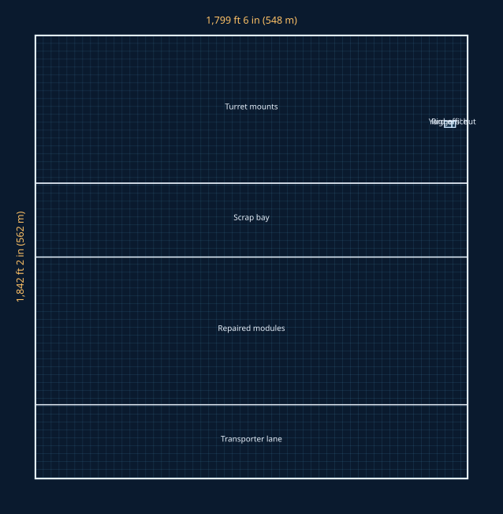

# P3-32 Module Yard 10: plan

Footprint 1,799 ft 6 in (548 m) × 1,842 ft 2 in (562 m) · structural grid 32 ft 10 in (10 m)

## Levels

| Level | Floor above deck | Height | Floor area |
|---|---|---|---|
| Level 1 · Yard | 0 ft (0 mm) | 13 ft 1 in (4,000 mm) | 1,206 sq ft (112 m²) |

## Elements

| ID | Designation | Type | Name | Level(s) | Size / length | Area | Status |
|---|---|---|---|---|---|---|---|
| E001 | D5F4P3B20A3R1 | zone | Turret mounts | L1 | 1,799 ft 6 in (548 m) × 614 ft 2 in (187 m) | 1,105,230 sq ft (102,679 m²) | proposed |
| E002 | D5F4P3B20A3R2 | room | Yard office | L1 | 30 ft 10 in (9,400 mm) × 26 ft 3 in (8,000 mm) | 809 sq ft (75 m²) | proposed |
| E003 | D5F4P3B20A3R3 | room | Riggers' hut | L1 | 15 ft 1 in (4,600 mm) × 26 ft 3 in (8,000 mm) | 396 sq ft (37 m²) | proposed |
| E004 | D5F4P3B20A3R4 | zone | Scrap bay | L1 | 1,799 ft 6 in (548 m) × 307 ft 1 in (94 m) | 552,615 sq ft (51,340 m²) | proposed |
| E005 | D5F4P3B20A3R5 | zone | Repaired modules | L1 | 1,799 ft 6 in (548 m) × 613 ft 10 in (187 m) | 1,104,639 sq ft (102,624 m²) | proposed |
| E006 | D5F4P3B20A3R6 | zone | Transporter lane | L1 | 1,799 ft 6 in (548 m) × 307 ft 1 in (94 m) | 552,615 sq ft (51,340 m²) | proposed |

## Drawings

### Level 1 · Yard

