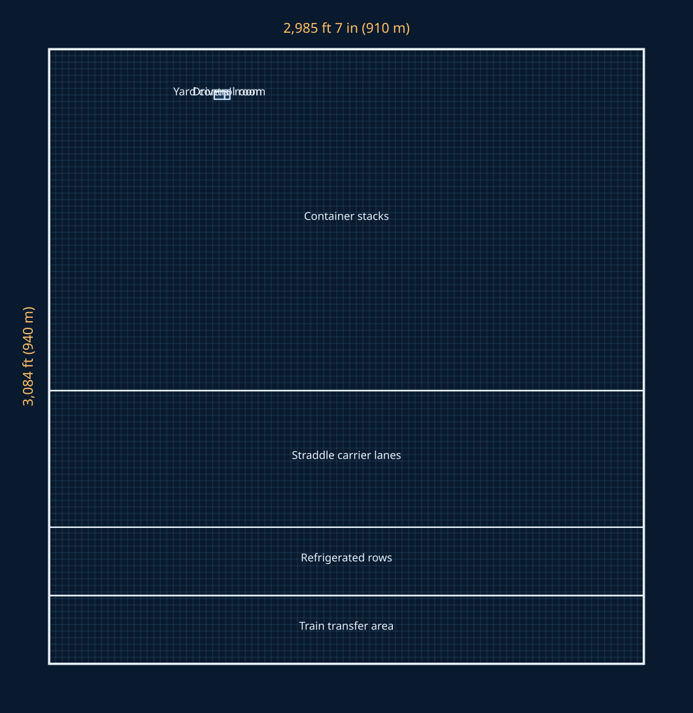

# P4-02 Container Yard: plan

Footprint 2,985 ft 7 in (910 m) × 3,084 ft (940 m) · structural grid 32 ft 10 in (10 m)

## Levels

| Level | Floor above deck | Height | Floor area |
|---|---|---|---|
| Level 1 · Yard | 0 ft (0 mm) | 13 ft 1 in (4,000 mm) | 3,100 sq ft (288 m²) |

## Elements

| ID | Designation | Type | Name | Level(s) | Size / length | Area | Status |
|---|---|---|---|---|---|---|---|
| E001 | D5F4P4B9A1R1 | zone | Container stacks | L1 | 2,985 ft 7 in (910 m) × 1,713 ft 3 in (522 m) | 5,115,032 sq ft (475,202 m²) | proposed |
| E002 | D5F4P4B9A1R2 | room | Yard control room | L1 | 52 ft 6 in (16 m) × 39 ft 4 in (12 m) | 2,067 sq ft (192 m²) | proposed |
| E003 | D5F4P4B9A1R3 | room | Drivers' room | L1 | 26 ft 3 in (8,000 mm) × 39 ft 4 in (12 m) | 1,033 sq ft (96 m²) | proposed |
| E004 | D5F4P4B9A1R4 | zone | Straddle carrier lanes | L1 | 2,985 ft 7 in (910 m) × 685 ft 4 in (209 m) | 2,046,209 sq ft (190,099 m²) | proposed |
| E005 | D5F4P4B9A1R5 | zone | Refrigerated rows | L1 | 2,985 ft 7 in (910 m) × 342 ft 10 in (104 m) | 1,023,594 sq ft (95,095 m²) | proposed |
| E006 | D5F4P4B9A1R6 | zone | Train transfer area | L1 | 2,985 ft 7 in (910 m) × 342 ft 6 in (104 m) | 1,022,615 sq ft (95,004 m²) | proposed |

## Drawings

### Level 1 · Yard

