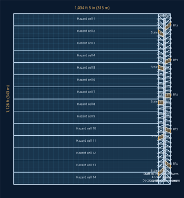
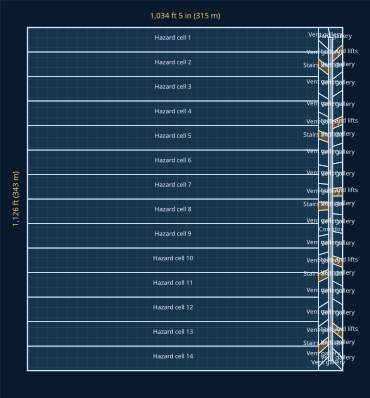

# P4-08 Hazardous Cargo Shed: plan

Footprint 1,034 ft 5 in (315 m) × 1,126 ft (343 m) · structural grid 32 ft 10 in (10 m)

## Levels

| Level | Floor above deck | Height | Floor area |
|---|---|---|---|
| Level 1 · Hall floor | 0 ft (0 mm) | 32 ft 10 in (10 m) | 1,141,617 sq ft (106,060 m²) |
| Level 2 · Gallery floor | 32 ft 10 in (10 m) | 14 ft 9 in (4,500 mm) | 1,141,617 sq ft (106,060 m²) |

## Elements

| ID | Designation | Type | Name | Level(s) | Size / length | Area | Status |
|---|---|---|---|---|---|---|---|
| E001 | D5F4P4B12A1L1R1, D5F4P4B12A1L2R1 | room | Hazard cell 1 | L1, L2 | 955 ft 9 in (291 m) × 80 ft 5 in (24 m) | 76,820 sq ft (7,137 m²) | proposed |
| E002 | D5F4P4B12A1L1R2, D5F4P4B12A1L2R2 | room | Hazard cell 2 | L1, L2 | 955 ft 9 in (291 m) × 80 ft 5 in (24 m) | 76,820 sq ft (7,137 m²) | proposed |
| E003 | D5F4P4B12A1L1R3, D5F4P4B12A1L2R3 | room | Hazard cell 3 | L1, L2 | 955 ft 9 in (291 m) × 80 ft 5 in (24 m) | 76,820 sq ft (7,137 m²) | proposed |
| E004 | D5F4P4B12A1L1R4, D5F4P4B12A1L2R4 | room | Hazard cell 4 | L1, L2 | 955 ft 9 in (291 m) × 80 ft 9 in (25 m) | 77,134 sq ft (7,166 m²) | proposed |
| E005 | D5F4P4B12A1L1R5, D5F4P4B12A1L2R5 | room | Hazard cell 5 | L1, L2 | 955 ft 9 in (291 m) × 80 ft 5 in (24 m) | 76,820 sq ft (7,137 m²) | proposed |
| E006 | D5F4P4B12A1L1R6, D5F4P4B12A1L2R6 | room | Hazard cell 6 | L1, L2 | 955 ft 9 in (291 m) × 80 ft 5 in (24 m) | 76,820 sq ft (7,137 m²) | proposed |
| E007 | D5F4P4B12A1L1R7, D5F4P4B12A1L2R7 | room | Hazard cell 7 | L1, L2 | 955 ft 9 in (291 m) × 80 ft 5 in (24 m) | 76,820 sq ft (7,137 m²) | proposed |
| E008 | D5F4P4B12A1L1R8, D5F4P4B12A1L2R8 | room | Hazard cell 8 | L1, L2 | 955 ft 9 in (291 m) × 80 ft 5 in (24 m) | 76,820 sq ft (7,137 m²) | proposed |
| E009 | D5F4P4B12A1L1R9, D5F4P4B12A1L2R9 | room | Hazard cell 9 | L1, L2 | 955 ft 9 in (291 m) × 80 ft 5 in (24 m) | 76,820 sq ft (7,137 m²) | proposed |
| E010 | D5F4P4B12A1L1R10, D5F4P4B12A1L2R10 | room | Hazard cell 10 | L1, L2 | 955 ft 9 in (291 m) × 80 ft 5 in (24 m) | 76,820 sq ft (7,137 m²) | proposed |
| E011 | D5F4P4B12A1L1R11, D5F4P4B12A1L2R11 | room | Hazard cell 11 | L1, L2 | 955 ft 9 in (291 m) × 80 ft 9 in (25 m) | 77,134 sq ft (7,166 m²) | proposed |
| E012 | D5F4P4B12A1L1R12, D5F4P4B12A1L2R12 | room | Hazard cell 12 | L1, L2 | 955 ft 9 in (291 m) × 80 ft 5 in (24 m) | 76,820 sq ft (7,137 m²) | proposed |
| E013 | D5F4P4B12A1L1R13, D5F4P4B12A1L2R13 | room | Hazard cell 13 | L1, L2 | 955 ft 9 in (291 m) × 80 ft 5 in (24 m) | 76,820 sq ft (7,137 m²) | proposed |
| E014 | D5F4P4B12A1L1R14, D5F4P4B12A1L2R14 | room | Hazard cell 14 | L1, L2 | 955 ft 9 in (291 m) × 80 ft 5 in (24 m) | 76,820 sq ft (7,137 m²) | proposed |
| E015 | D5F4P4B12A1L1R15, D5F4P4B12A1L2R15 | core | Stairs and lifts | L1, L2 | 32 ft 6 in (9,900 mm) × 54 ft 9 in (17 m) | 858 sq ft (80 m²) | proposed |
| E016 | D5F4P4B12A1L1R16, D5F4P4B12A1L2R16 | core | Stairs and lifts | L1, L2 | 32 ft 6 in (9,900 mm) × 41 ft (12 m) | 853 sq ft (79 m²) | proposed |
| E017 | D5F4P4B12A1L1R17, D5F4P4B12A1L2R17 | core | Stairs and lifts | L1, L2 | 32 ft 6 in (9,900 mm) × 27 ft 7 in (8,400 mm) | 853 sq ft (79 m²) | proposed |
| E018 | D5F4P4B12A1L1R18, D5F4P4B12A1L2R18 | core | Stairs and lifts | L1, L2 | 32 ft 6 in (9,900 mm) × 38 ft 5 in (12 m) | 853 sq ft (79 m²) | proposed |
| E019 | D5F4P4B12A1L1R19, D5F4P4B12A1L2R19 | core | Stairs and lifts | L1, L2 | 32 ft 6 in (9,900 mm) × 51 ft 10 in (16 m) | 853 sq ft (79 m²) | proposed |
| E020 | D5F4P4B12A1L1R20, D5F4P4B12A1L2R20 | core | Stairs and lifts | L1, L2 | 32 ft 6 in (9,900 mm) × 54 ft 9 in (17 m) | 858 sq ft (80 m²) | proposed |
| E021 | D5F4P4B12A1L1R21, D5F4P4B12A1L2R21 | core | Stairs and lifts | L1, L2 | 32 ft 6 in (9,900 mm) × 41 ft (12 m) | 853 sq ft (79 m²) | proposed |
| E022 | D5F4P4B12A1L1R22, D5F4P4B12A1L2R22 | core | Stairs and lifts | L1, L2 | 32 ft 6 in (9,900 mm) × 27 ft 7 in (8,400 mm) | 853 sq ft (79 m²) | proposed |
| E023 | D5F4P4B12A1L1R23, D5F4P4B12A1L2R23 | core | Stairs and lifts | L1, L2 | 32 ft 6 in (9,900 mm) × 38 ft 5 in (12 m) | 853 sq ft (79 m²) | proposed |
| E024 | D5F4P4B12A1L1R24, D5F4P4B12A1L2R24 | core | Stairs and lifts | L1, L2 | 32 ft 6 in (9,900 mm) × 51 ft 10 in (16 m) | 853 sq ft (79 m²) | proposed |
| E025 | D5F4P4B12A1L1R25 | zone | Corridor | L1 | 13 ft 9 in (4,200 mm) × 1,061 ft (323 m) | 10,482 sq ft (974 m²) | proposed |
| E026 | D5F4P4B12A1L1R26 | room | Spill response room | L1 | 45 ft 3 in (14 m) × 32 ft 6 in (9,900 mm) | 863 sq ft (80 m²) | proposed |
| E027 | D5F4P4B12A1L1R27 | room | Gas detection room | L1 | 33 ft 2 in (10 m) × 32 ft 6 in (9,900 mm) | 538 sq ft (50 m²) | proposed |
| E028 | D5F4P4B12A1L1R28 | room | Decontamination showers | L1 | 33 ft 6 in (10 m) × 42 ft 4 in (13 m) | 432 sq ft (40 m²) | proposed |
| E029 | D5F4P4B12A1L1R29 | room | Locker room | L1 | 32 ft 6 in (9,900 mm) × 60 ft 8 in (18 m) | 964 sq ft (90 m²) | proposed |
| E030 | D5F4P4B12A1L1R30 | room | Staff toilets and showers | L1 | 32 ft 6 in (9,900 mm) × 44 ft 3 in (14 m) | 474 sq ft (44 m²) | proposed |
| E031 | D5F4P4B12A1L1R31 | room | Office | L1 | 32 ft 6 in (9,900 mm) × 56 ft 5 in (17 m) | 964 sq ft (90 m²) | proposed |
| E032 | D5F4P4B12A1L1R32 | room | Office | L1 | 32 ft 6 in (9,900 mm) × 55 ft 1 in (17 m) | 975 sq ft (91 m²) | proposed |
| E033 | D5F4P4B12A1L1R33 | room | Office | L1 | 32 ft 6 in (9,900 mm) × 53 ft 2 in (16 m) | 970 sq ft (90 m²) | proposed |
| E034 | D5F4P4B12A1L1R34 | room | Office | L1 | 32 ft 6 in (9,900 mm) × 51 ft 2 in (16 m) | 964 sq ft (90 m²) | proposed |
| E035 | D5F4P4B12A1L1R35 | room | Office | L1 | 32 ft 6 in (9,900 mm) × 49 ft 6 in (15 m) | 970 sq ft (90 m²) | proposed |
| E036 | D5F4P4B12A1L1R36 | room | Office | L1 | 32 ft 6 in (9,900 mm) × 47 ft 11 in (15 m) | 975 sq ft (91 m²) | proposed |
| E037 | D5F4P4B12A1L1R37 | room | Office | L1 | 32 ft 6 in (9,900 mm) × 38 ft 9 in (12 m) | 730 sq ft (68 m²) | proposed |
| E038 | D5F4P4B12A1L1R38 | room | Office | L1 | 32 ft 6 in (9,900 mm) × 43 ft (13 m) | 970 sq ft (90 m²) | proposed |
| E039 | D5F4P4B12A1L1R39 | room | Office | L1 | 32 ft 6 in (9,900 mm) × 41 ft 4 in (13 m) | 975 sq ft (91 m²) | proposed |
| E040 | D5F4P4B12A1L1R40 | room | Office | L1 | 32 ft 6 in (9,900 mm) × 39 ft 4 in (12 m) | 964 sq ft (90 m²) | proposed |
| E041 | D5F4P4B12A1L1R41 | room | Office | L1 | 32 ft 6 in (9,900 mm) × 37 ft 9 in (12 m) | 970 sq ft (90 m²) | proposed |
| E042 | D5F4P4B12A1L1R42 | room | Office | L1 | 32 ft 6 in (9,900 mm) × 36 ft 1 in (11 m) | 975 sq ft (91 m²) | proposed |
| E043 | D5F4P4B12A1L1R43 | room | Office | L1 | 32 ft 6 in (9,900 mm) × 34 ft 1 in (10 m) | 964 sq ft (90 m²) | proposed |
| E044 | D5F4P4B12A1L1R44 | room | Office | L1 | 32 ft 6 in (9,900 mm) × 25 ft 7 in (7,800 mm) | 735 sq ft (68 m²) | proposed |
| E045 | D5F4P4B12A1L1R45 | room | Office | L1 | 32 ft 6 in (9,900 mm) × 30 ft 6 in (9,300 mm) | 970 sq ft (90 m²) | proposed |
| E046 | D5F4P4B12A1L1R46 | room | Office | L1 | 32 ft 6 in (9,900 mm) × 31 ft 10 in (9,700 mm) | 970 sq ft (90 m²) | proposed |
| E047 | D5F4P4B12A1L1R47 | room | Office | L1 | 32 ft 6 in (9,900 mm) × 33 ft 10 in (10 m) | 970 sq ft (90 m²) | proposed |
| E048 | D5F4P4B12A1L1R48 | room | Office | L1 | 32 ft 6 in (9,900 mm) × 35 ft 5 in (11 m) | 970 sq ft (90 m²) | proposed |
| E049 | D5F4P4B12A1L1R49 | room | Office | L1 | 32 ft 6 in (9,900 mm) × 37 ft 1 in (11 m) | 970 sq ft (90 m²) | proposed |
| E050 | D5F4P4B12A1L1R50 | room | Office | L1 | 32 ft 6 in (9,900 mm) × 39 ft 1 in (12 m) | 970 sq ft (90 m²) | proposed |
| E051 | D5F4P4B12A1L1R51 | room | Office | L1 | 32 ft 6 in (9,900 mm) × 33 ft 6 in (10 m) | 735 sq ft (68 m²) | proposed |
| E052 | D5F4P4B12A1L1R52 | room | Office | L1 | 32 ft 6 in (9,900 mm) × 43 ft 8 in (13 m) | 970 sq ft (90 m²) | proposed |
| E053 | D5F4P4B12A1L1R53 | room | Office | L1 | 32 ft 6 in (9,900 mm) × 45 ft 3 in (14 m) | 964 sq ft (90 m²) | proposed |
| E054 | D5F4P4B12A1L1R54 | room | Office | L1 | 32 ft 6 in (9,900 mm) × 47 ft 3 in (14 m) | 975 sq ft (91 m²) | proposed |
| E055 | D5F4P4B12A1L1R55 | room | Office | L1 | 32 ft 6 in (9,900 mm) × 48 ft 11 in (15 m) | 970 sq ft (90 m²) | proposed |
| E056 | D5F4P4B12A1L1R56 | room | Office | L1 | 32 ft 6 in (9,900 mm) × 50 ft 10 in (16 m) | 970 sq ft (90 m²) | proposed |
| E057 | D5F4P4B12A1L1R57 | room | Office | L1 | 32 ft 6 in (9,900 mm) × 52 ft 6 in (16 m) | 964 sq ft (90 m²) | proposed |
| E058 | D5F4P4B12A1L1R58 | room | Office | L1 | 32 ft 6 in (9,900 mm) × 46 ft 11 in (14 m) | 735 sq ft (68 m²) | proposed |
| E059 | D5F4P4B12A1L1R59 | room | Office | L1 | 32 ft 6 in (9,900 mm) × 57 ft 1 in (17 m) | 970 sq ft (90 m²) | proposed |
| E060 | D5F4P4B12A1L1R60 | room | Office | L1 | 32 ft 6 in (9,900 mm) × 59 ft 1 in (18 m) | 970 sq ft (90 m²) | proposed |
| E061 | D5F4P4B12A1L1R61 | room | Office | L1 | 32 ft 6 in (9,900 mm) × 61 ft (19 m) | 975 sq ft (91 m²) | proposed |
| E062 | D5F4P4B12A1L1R62 | room | Office | L1 | 38 ft 1 in (12 m) × 43 ft 4 in (13 m) | 964 sq ft (90 m²) | proposed |
| E063 | D5F4P4B12A1L1R63 | room | Office | L1 | 47 ft 3 in (14 m) × 34 ft 5 in (10 m) | 970 sq ft (90 m²) | proposed |
| E064 | D5F4P4B12A1L1R64 | room | Office | L1 | 32 ft 6 in (9,900 mm) × 61 ft 4 in (19 m) | 970 sq ft (90 m²) | proposed |
| E065 | D5F4P4B12A1L1R65 | room | Office | L1 | 32 ft 6 in (9,900 mm) × 52 ft 6 in (16 m) | 730 sq ft (68 m²) | proposed |
| E066 | D5F4P4B12A1L1R66 | room | Office | L1 | 32 ft 6 in (9,900 mm) × 56 ft 5 in (17 m) | 964 sq ft (90 m²) | proposed |
| E067 | D5F4P4B12A1L1R67 | room | Office | L1 | 32 ft 6 in (9,900 mm) × 55 ft 1 in (17 m) | 975 sq ft (91 m²) | proposed |
| E068 | D5F4P4B12A1L1R68 | room | Office | L1 | 32 ft 6 in (9,900 mm) × 53 ft 2 in (16 m) | 970 sq ft (90 m²) | proposed |
| E069 | D5F4P4B12A1L1R69 | room | Office | L1 | 32 ft 6 in (9,900 mm) × 51 ft 2 in (16 m) | 964 sq ft (90 m²) | proposed |
| E070 | D5F4P4B12A1L1R70 | room | Office | L1 | 32 ft 6 in (9,900 mm) × 49 ft 6 in (15 m) | 970 sq ft (90 m²) | proposed |
| E071 | D5F4P4B12A1L1R71 | room | Office | L1 | 32 ft 6 in (9,900 mm) × 47 ft 11 in (15 m) | 975 sq ft (91 m²) | proposed |
| E072 | D5F4P4B12A1L1R72 | room | Office | L1 | 32 ft 6 in (9,900 mm) × 38 ft 9 in (12 m) | 730 sq ft (68 m²) | proposed |
| E073 | D5F4P4B12A1L1R73 | room | Office | L1 | 32 ft 6 in (9,900 mm) × 43 ft (13 m) | 970 sq ft (90 m²) | proposed |
| E074 | D5F4P4B12A1L1R74 | room | Office | L1 | 32 ft 6 in (9,900 mm) × 41 ft 4 in (13 m) | 975 sq ft (91 m²) | proposed |
| E075 | D5F4P4B12A1L1R75 | room | Office | L1 | 32 ft 6 in (9,900 mm) × 39 ft 4 in (12 m) | 964 sq ft (90 m²) | proposed |
| E076 | D5F4P4B12A1L1R76 | room | Office | L1 | 32 ft 6 in (9,900 mm) × 37 ft 9 in (12 m) | 970 sq ft (90 m²) | proposed |
| E077 | D5F4P4B12A1L1R77 | room | Office | L1 | 32 ft 6 in (9,900 mm) × 36 ft 1 in (11 m) | 975 sq ft (91 m²) | proposed |
| E078 | D5F4P4B12A1L1R78 | room | Office | L1 | 32 ft 6 in (9,900 mm) × 34 ft 1 in (10 m) | 964 sq ft (90 m²) | proposed |
| E079 | D5F4P4B12A1L1R79 | room | Office | L1 | 32 ft 6 in (9,900 mm) × 25 ft 7 in (7,800 mm) | 735 sq ft (68 m²) | proposed |
| E080 | D5F4P4B12A1L1R80 | room | Office | L1 | 32 ft 6 in (9,900 mm) × 30 ft 6 in (9,300 mm) | 970 sq ft (90 m²) | proposed |
| E081 | D5F4P4B12A1L1R81 | room | Office | L1 | 32 ft 6 in (9,900 mm) × 31 ft 10 in (9,700 mm) | 970 sq ft (90 m²) | proposed |
| E082 | D5F4P4B12A1L1R82 | room | Office | L1 | 32 ft 6 in (9,900 mm) × 33 ft 10 in (10 m) | 970 sq ft (90 m²) | proposed |
| E083 | D5F4P4B12A1L1R83 | room | Office | L1 | 32 ft 6 in (9,900 mm) × 35 ft 5 in (11 m) | 970 sq ft (90 m²) | proposed |
| E084 | D5F4P4B12A1L1R84 | room | Office | L1 | 32 ft 6 in (9,900 mm) × 37 ft 1 in (11 m) | 970 sq ft (90 m²) | proposed |
| E085 | D5F4P4B12A1L1R85 | room | Office | L1 | 32 ft 6 in (9,900 mm) × 39 ft 1 in (12 m) | 970 sq ft (90 m²) | proposed |
| E086 | D5F4P4B12A1L1R86 | room | Office | L1 | 32 ft 6 in (9,900 mm) × 33 ft 6 in (10 m) | 735 sq ft (68 m²) | proposed |
| E087 | D5F4P4B12A1L1R87 | room | Office | L1 | 32 ft 6 in (9,900 mm) × 43 ft 8 in (13 m) | 970 sq ft (90 m²) | proposed |
| E088 | D5F4P4B12A1L1R88 | room | Office | L1 | 32 ft 6 in (9,900 mm) × 45 ft 3 in (14 m) | 964 sq ft (90 m²) | proposed |
| E089 | D5F4P4B12A1L1R89 | room | Office | L1 | 32 ft 6 in (9,900 mm) × 47 ft 3 in (14 m) | 975 sq ft (91 m²) | proposed |
| E090 | D5F4P4B12A1L1R90 | room | Office | L1 | 32 ft 6 in (9,900 mm) × 48 ft 11 in (15 m) | 970 sq ft (90 m²) | proposed |
| E091 | D5F4P4B12A1L1R91 | room | Office | L1 | 32 ft 6 in (9,900 mm) × 50 ft 10 in (16 m) | 970 sq ft (90 m²) | proposed |
| E092 | D5F4P4B12A1L1R92 | room | Office | L1 | 32 ft 6 in (9,900 mm) × 52 ft 6 in (16 m) | 964 sq ft (90 m²) | proposed |
| E093 | D5F4P4B12A1L1R93 | room | Office | L1 | 32 ft 6 in (9,900 mm) × 46 ft 11 in (14 m) | 735 sq ft (68 m²) | proposed |
| E094 | D5F4P4B12A1L1R94 | room | Office | L1 | 32 ft 6 in (9,900 mm) × 57 ft 1 in (17 m) | 970 sq ft (90 m²) | proposed |
| E095 | D5F4P4B12A1L1R95 | room | Office | L1 | 32 ft 6 in (9,900 mm) × 59 ft 1 in (18 m) | 970 sq ft (90 m²) | proposed |
| E096 | D5F4P4B12A1L1R96 | room | Office | L1 | 32 ft 6 in (9,900 mm) × 72 ft 6 in (22 m) | 1,337 sq ft (124 m²) | proposed |
| E097 | D5F4P4B12A1L2R25 | zone | Corridor | L2 | 13 ft 9 in (4,200 mm) × 1,061 ft (323 m) | 10,482 sq ft (974 m²) | proposed |
| E098 | D5F4P4B12A1L2R26 | room | Vent gallery | L2 | 78 ft 9 in (24 m) × 45 ft 7 in (14 m) | 1,939 sq ft (180 m²) | proposed |
| E099 | D5F4P4B12A1L2R27 | room | Vent gallery | L2 | 32 ft 6 in (9,900 mm) × 71 ft 6 in (22 m) | 1,332 sq ft (124 m²) | proposed |
| E100 | D5F4P4B12A1L2R28 | room | Vent gallery | L2 | 32 ft 6 in (9,900 mm) × 85 ft 8 in (26 m) | 1,939 sq ft (180 m²) | proposed |
| E101 | D5F4P4B12A1L2R29 | room | Vent gallery | L2 | 32 ft 6 in (9,900 mm) × 82 ft (25 m) | 1,934 sq ft (180 m²) | proposed |
| E102 | D5F4P4B12A1L2R30 | room | Vent gallery | L2 | 32 ft 6 in (9,900 mm) × 100 ft 5 in (31 m) | 2,675 sq ft (248 m²) | proposed |
| E103 | D5F4P4B12A1L2R31 | room | Vent gallery | L2 | 32 ft 6 in (9,900 mm) × 72 ft 2 in (22 m) | 1,945 sq ft (181 m²) | proposed |
| E104 | D5F4P4B12A1L2R32 | room | Vent gallery | L2 | 32 ft 6 in (9,900 mm) × 68 ft 3 in (21 m) | 1,934 sq ft (180 m²) | proposed |
| E105 | D5F4P4B12A1L2R33 | room | Vent gallery | L2 | 32 ft 6 in (9,900 mm) × 86 ft 11 in (26 m) | 2,675 sq ft (248 m²) | proposed |
| E106 | D5F4P4B12A1L2R34 | room | Vent gallery | L2 | 32 ft 6 in (9,900 mm) × 61 ft 4 in (19 m) | 1,939 sq ft (180 m²) | proposed |
| E107 | D5F4P4B12A1L2R35 | room | Vent gallery | L2 | 32 ft 6 in (9,900 mm) × 64 ft 4 in (20 m) | 1,939 sq ft (180 m²) | proposed |
| E108 | D5F4P4B12A1L2R36 | room | Vent gallery | L2 | 32 ft 6 in (9,900 mm) × 91 ft 2 in (28 m) | 2,675 sq ft (248 m²) | proposed |
| E109 | D5F4P4B12A1L2R37 | room | Vent gallery | L2 | 32 ft 6 in (9,900 mm) × 74 ft 2 in (23 m) | 1,934 sq ft (180 m²) | proposed |
| E110 | D5F4P4B12A1L2R38 | room | Vent gallery | L2 | 32 ft 6 in (9,900 mm) × 78 ft 1 in (24 m) | 1,945 sq ft (181 m²) | proposed |
| E111 | D5F4P4B12A1L2R39 | room | Vent gallery | L2 | 32 ft 6 in (9,900 mm) × 104 ft 8 in (32 m) | 2,669 sq ft (248 m²) | proposed |
| E112 | D5F4P4B12A1L2R40 | room | Vent gallery | L2 | 32 ft 6 in (9,900 mm) × 87 ft 11 in (27 m) | 1,939 sq ft (180 m²) | proposed |
| E113 | D5F4P4B12A1L2R41 | room | Vent gallery | L2 | 38 ft 1 in (12 m) × 72 ft 6 in (22 m) | 1,939 sq ft (180 m²) | proposed |
| E114 | D5F4P4B12A1L2R42 | room | Vent gallery | L2 | 47 ft 3 in (14 m) × 85 ft 4 in (26 m) | 2,669 sq ft (248 m²) | proposed |
| E115 | D5F4P4B12A1L2R43 | room | Vent gallery | L2 | 32 ft 6 in (9,900 mm) × 85 ft 8 in (26 m) | 1,939 sq ft (180 m²) | proposed |
| E116 | D5F4P4B12A1L2R44 | room | Vent gallery | L2 | 32 ft 6 in (9,900 mm) × 82 ft (25 m) | 1,934 sq ft (180 m²) | proposed |
| E117 | D5F4P4B12A1L2R45 | room | Vent gallery | L2 | 32 ft 6 in (9,900 mm) × 100 ft 5 in (31 m) | 2,675 sq ft (248 m²) | proposed |
| E118 | D5F4P4B12A1L2R46 | room | Vent gallery | L2 | 32 ft 6 in (9,900 mm) × 72 ft 2 in (22 m) | 1,945 sq ft (181 m²) | proposed |
| E119 | D5F4P4B12A1L2R47 | room | Vent gallery | L2 | 32 ft 6 in (9,900 mm) × 68 ft 3 in (21 m) | 1,934 sq ft (180 m²) | proposed |
| E120 | D5F4P4B12A1L2R48 | room | Vent gallery | L2 | 32 ft 6 in (9,900 mm) × 86 ft 11 in (26 m) | 2,675 sq ft (248 m²) | proposed |
| E121 | D5F4P4B12A1L2R49 | room | Vent gallery | L2 | 32 ft 6 in (9,900 mm) × 61 ft 4 in (19 m) | 1,939 sq ft (180 m²) | proposed |
| E122 | D5F4P4B12A1L2R50 | room | Vent gallery | L2 | 32 ft 6 in (9,900 mm) × 64 ft 4 in (20 m) | 1,939 sq ft (180 m²) | proposed |
| E123 | D5F4P4B12A1L2R51 | room | Vent gallery | L2 | 32 ft 6 in (9,900 mm) × 91 ft 2 in (28 m) | 2,675 sq ft (248 m²) | proposed |
| E124 | D5F4P4B12A1L2R52 | room | Vent gallery | L2 | 32 ft 6 in (9,900 mm) × 74 ft 2 in (23 m) | 1,934 sq ft (180 m²) | proposed |
| E125 | D5F4P4B12A1L2R53 | room | Vent gallery | L2 | 32 ft 6 in (9,900 mm) × 78 ft 1 in (24 m) | 1,945 sq ft (181 m²) | proposed |
| E126 | D5F4P4B12A1L2R54 | room | Vent gallery | L2 | 32 ft 6 in (9,900 mm) × 104 ft 8 in (32 m) | 2,669 sq ft (248 m²) | proposed |
| E127 | D5F4P4B12A1L2R55 | room | Vent gallery | L2 | 32 ft 6 in (9,900 mm) × 87 ft 11 in (27 m) | 1,939 sq ft (180 m²) | proposed |
| E128 | D5F4P4B12A1L2R56 | room | Vent gallery | L2 | 32 ft 6 in (9,900 mm) × 72 ft 6 in (22 m) | 1,337 sq ft (124 m²) | proposed |

## Drawings

### Level 1 · Hall floor

### Level 2 · Gallery floor

