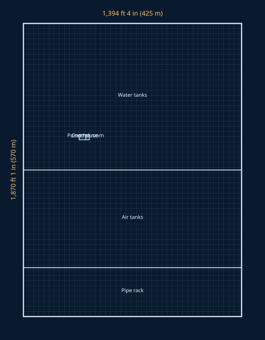

# P4-10 Water and Air Tanks: plan

Footprint 1,394 ft 4 in (425 m) × 1,870 ft 1 in (570 m) · structural grid 32 ft 10 in (10 m)

## Levels

| Level | Floor above deck | Height | Floor area |
|---|---|---|---|
| Level 1 · Tank floor | 0 ft (0 mm) | 13 ft 1 in (4,000 mm) | 2,153 sq ft (200 m²) |

## Elements

| ID | Designation | Type | Name | Level(s) | Size / length | Area | Status |
|---|---|---|---|---|---|---|---|
| E001 | D5F4P4B16A1R1 | zone | Water tanks | L1 | 1,394 ft 4 in (425 m) × 935 ft (285 m) | 1,303,779 sq ft (121,125 m²) | proposed |
| E002 | D5F4P4B16A1R2 | room | Pump house | L1 | 43 ft 8 in (13 m) × 32 ft 10 in (10 m) | 1,432 sq ft (133 m²) | proposed |
| E003 | D5F4P4B16A1R3 | room | Control room | L1 | 22 ft (6,700 mm) × 32 ft 10 in (10 m) | 721 sq ft (67 m²) | proposed |
| E004 | D5F4P4B16A1R4 | zone | Air tanks | L1 | 1,394 ft 4 in (425 m) × 623 ft 4 in (190 m) | 869,186 sq ft (80,750 m²) | proposed |
| E005 | D5F4P4B16A1R5 | zone | Pipe rack | L1 | 1,394 ft 4 in (425 m) × 311 ft 8 in (95 m) | 434,593 sq ft (40,375 m²) | proposed |

## Drawings

### Level 1 · Tank floor

