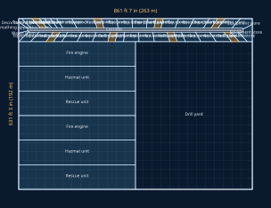
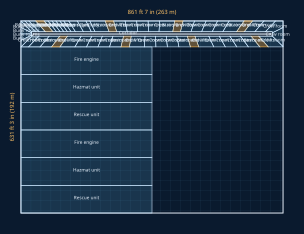
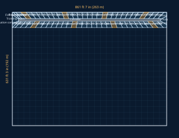

# P4-11 Dock Freight Fire Station: plan

Footprint 861 ft 7 in (263 m) × 631 ft 3 in (192 m) · structural grid 32 ft 10 in (10 m)

## Levels

| Level | Floor above deck | Height | Floor area |
|---|---|---|---|
| Level 1 · Appliance floor | 0 ft (0 mm) | 23 ft (7,000 mm) | 289,776 sq ft (26,921 m²) |
| Level 2 · Crew floor | 23 ft (7,000 mm) | 13 ft 9 in (4,200 mm) | 289,776 sq ft (26,921 m²) |
| Level 3 · Training floor | 36 ft 9 in (11 m) | 13 ft 9 in (4,200 mm) | 54,550 sq ft (5,068 m²) |

## Elements

| ID | Designation | Type | Name | Level(s) | Size / length | Area | Status |
|---|---|---|---|---|---|---|---|
| E001 | D5F4P4B17A1L1R1, D5F4P4B17A1L2R1 | room | Fire engine | L1, L2 | 430 ft 9 in (131 m) × 90 ft 11 in (28 m) | 39,148 sq ft (3,637 m²) | proposed |
| E002 | D5F4P4B17A1L1R2, D5F4P4B17A1L2R2 | room | Hazmat unit | L1, L2 | 430 ft 9 in (131 m) × 91 ft 2 in (28 m) | 39,290 sq ft (3,650 m²) | proposed |
| E003 | D5F4P4B17A1L1R3, D5F4P4B17A1L2R3 | room | Rescue unit | L1, L2 | 430 ft 9 in (131 m) × 90 ft 11 in (28 m) | 39,148 sq ft (3,637 m²) | proposed |
| E004 | D5F4P4B17A1L1R4, D5F4P4B17A1L2R4 | room | Fire engine | L1, L2 | 430 ft 9 in (131 m) × 90 ft 11 in (28 m) | 39,148 sq ft (3,637 m²) | proposed |
| E005 | D5F4P4B17A1L1R5, D5F4P4B17A1L2R5 | room | Hazmat unit | L1, L2 | 430 ft 9 in (131 m) × 91 ft 2 in (28 m) | 39,290 sq ft (3,650 m²) | proposed |
| E006 | D5F4P4B17A1L1R6, D5F4P4B17A1L2R6 | room | Rescue unit | L1, L2 | 430 ft 9 in (131 m) × 90 ft 11 in (28 m) | 39,148 sq ft (3,637 m²) | proposed |
| E007 | D5F4P4B17A1L1R7 | zone | Drill yard | L1 | 430 ft 9 in (131 m) × 545 ft 11 in (166 m) | 235,173 sq ft (21,848 m²) | proposed |
| E008 | D5F4P4B17A1L1R8, D5F4P4B17A1L2R7, D5F4P4B17A1L3R1 | core | Stairs and lifts | L1, L2, L3 | 56 ft 9 in (17 m) × 35 ft 5 in (11 m) | 936 sq ft (87 m²) | proposed |
| E009 | D5F4P4B17A1L1R9, D5F4P4B17A1L2R8, D5F4P4B17A1L3R2 | core | Stairs and lifts | L1, L2, L3 | 37 ft 9 in (12 m) × 35 ft 5 in (11 m) | 930 sq ft (86 m²) | proposed |
| E010 | D5F4P4B17A1L1R10, D5F4P4B17A1L2R9, D5F4P4B17A1L3R3 | core | Stairs and lifts | L1, L2, L3 | 33 ft 10 in (10 m) × 35 ft 5 in (11 m) | 936 sq ft (87 m²) | proposed |
| E011 | D5F4P4B17A1L1R11, D5F4P4B17A1L2R10, D5F4P4B17A1L3R4 | core | Stairs and lifts | L1, L2, L3 | 52 ft 6 in (16 m) × 35 ft 5 in (11 m) | 936 sq ft (87 m²) | proposed |
| E012 | D5F4P4B17A1L1R12, D5F4P4B17A1L2R11, D5F4P4B17A1L3R5 | core | Stairs and lifts | L1, L2, L3 | 56 ft 9 in (17 m) × 35 ft 5 in (11 m) | 936 sq ft (87 m²) | proposed |
| E013 | D5F4P4B17A1L1R13, D5F4P4B17A1L2R12, D5F4P4B17A1L3R6 | core | Stairs and lifts | L1, L2, L3 | 37 ft 9 in (12 m) × 35 ft 5 in (11 m) | 930 sq ft (86 m²) | proposed |
| E014 | D5F4P4B17A1L1R14, D5F4P4B17A1L2R13, D5F4P4B17A1L3R7 | core | Stairs and lifts | L1, L2, L3 | 33 ft 10 in (10 m) × 35 ft 5 in (11 m) | 936 sq ft (87 m²) | proposed |
| E015 | D5F4P4B17A1L1R15, D5F4P4B17A1L2R14, D5F4P4B17A1L3R8 | core | Stairs and lifts | L1, L2, L3 | 52 ft 6 in (16 m) × 35 ft 5 in (11 m) | 936 sq ft (87 m²) | proposed |
| E016 | D5F4P4B17A1L1R16 | zone | Corridor | L1 | 790 ft 8 in (241 m) × 14 ft 5 in (4,400 mm) | 7,828 sq ft (727 m²) | proposed |
| E017 | D5F4P4B17A1L1R17 | room | Watch room | L1 | 35 ft 5 in (11 m) × 40 ft 8 in (12 m) | 645 sq ft (60 m²) | proposed |
| E018 | D5F4P4B17A1L1R18 | room | Breathing apparatus room | L1 | 35 ft 5 in (11 m) × 41 ft 8 in (13 m) | 860 sq ft (80 m²) | proposed |
| E019 | D5F4P4B17A1L1R19 | room | Decontamination room | L1 | 45 ft 11 in (14 m) × 37 ft 9 in (12 m) | 645 sq ft (60 m²) | proposed |
| E020 | D5F4P4B17A1L1R20 | room | Turnout gear room | L1 | 68 ft 11 in (21 m) × 35 ft 5 in (11 m) | 1,267 sq ft (118 m²) | proposed |
| E021 | D5F4P4B17A1L1R21 | room | Hazmat kit room | L1 | 46 ft 7 in (14 m) × 35 ft 5 in (11 m) | 639 sq ft (59 m²) | proposed |
| E022 | D5F4P4B17A1L1R22 | room | Hose store | L1 | 48 ft 3 in (15 m) × 35 ft 5 in (11 m) | 756 sq ft (70 m²) | proposed |
| E023 | D5F4P4B17A1L1R23 | room | Staff toilets and showers | L1 | 45 ft 11 in (14 m) × 35 ft 5 in (11 m) | 744 sq ft (69 m²) | proposed |
| E024 | D5F4P4B17A1L1R24 | room | Equipment store | L1 | 76 ft 1 in (23 m) × 35 ft 5 in (11 m) | 1,930 sq ft (179 m²) | proposed |
| E025 | D5F4P4B17A1L1R25 | room | Equipment store | L1 | 93 ft 10 in (29 m) × 35 ft 5 in (11 m) | 2,755 sq ft (256 m²) | proposed |
| E026 | D5F4P4B17A1L1R26 | room | Equipment store | L1 | 62 ft 4 in (19 m) × 35 ft 5 in (11 m) | 1,930 sq ft (179 m²) | proposed |
| E027 | D5F4P4B17A1L1R27 | room | Equipment store | L1 | 57 ft 9 in (18 m) × 35 ft 5 in (11 m) | 1,930 sq ft (179 m²) | proposed |
| E028 | D5F4P4B17A1L1R28 | room | Equipment store | L1 | 56 ft 9 in (17 m) × 35 ft 5 in (11 m) | 1,930 sq ft (179 m²) | proposed |
| E029 | D5F4P4B17A1L1R29 | room | Equipment store | L1 | 34 ft 1 in (10 m) × 35 ft 5 in (11 m) | 1,035 sq ft (96 m²) | proposed |
| E030 | D5F4P4B17A1L1R30 | room | Equipment store | L1 | 65 ft 3 in (20 m) × 35 ft 5 in (11 m) | 1,930 sq ft (179 m²) | proposed |
| E031 | D5F4P4B17A1L1R31 | room | Equipment store | L1 | 69 ft 11 in (21 m) × 35 ft 5 in (11 m) | 1,930 sq ft (179 m²) | proposed |
| E032 | D5F4P4B17A1L1R32 | room | Equipment store | L1 | 74 ft 6 in (23 m) × 35 ft 5 in (11 m) | 1,930 sq ft (179 m²) | proposed |
| E033 | D5F4P4B17A1L1R33 | room | Equipment store | L1 | 52 ft 10 in (16 m) × 35 ft 5 in (11 m) | 1,035 sq ft (96 m²) | proposed |
| E034 | D5F4P4B17A1L1R34 | room | Equipment store | L1 | 84 ft (26 m) × 35 ft 5 in (11 m) | 1,930 sq ft (179 m²) | proposed |
| E035 | D5F4P4B17A1L1R35 | room | Equipment store | L1 | 75 ft 6 in (23 m) × 39 ft 1 in (12 m) | 1,930 sq ft (179 m²) | proposed |
| E036 | D5F4P4B17A1L1R36 | room | Equipment store | L1 | 52 ft 2 in (16 m) × 63 ft 8 in (19 m) | 1,936 sq ft (180 m²) | proposed |
| E037 | D5F4P4B17A1L1R37 | room | Equipment store | L1 | 62 ft (19 m) × 35 ft 5 in (11 m) | 1,035 sq ft (96 m²) | proposed |
| E038 | D5F4P4B17A1L1R38 | room | Equipment store | L1 | 81 ft 4 in (25 m) × 35 ft 5 in (11 m) | 1,930 sq ft (179 m²) | proposed |
| E039 | D5F4P4B17A1L1R39 | room | Equipment store | L1 | 76 ft 9 in (23 m) × 35 ft 5 in (11 m) | 1,930 sq ft (179 m²) | proposed |
| E040 | D5F4P4B17A1L1R40 | room | Equipment store | L1 | 72 ft 2 in (22 m) × 35 ft 5 in (11 m) | 1,930 sq ft (179 m²) | proposed |
| E041 | D5F4P4B17A1L1R41 | room | Equipment store | L1 | 43 ft 4 in (13 m) × 35 ft 5 in (11 m) | 1,035 sq ft (96 m²) | proposed |
| E042 | D5F4P4B17A1L1R42 | room | Equipment store | L1 | 62 ft 4 in (19 m) × 35 ft 5 in (11 m) | 1,930 sq ft (179 m²) | proposed |
| E043 | D5F4P4B17A1L1R43 | room | Equipment store | L1 | 57 ft 9 in (18 m) × 35 ft 5 in (11 m) | 1,930 sq ft (179 m²) | proposed |
| E044 | D5F4P4B17A1L1R44 | room | Equipment store | L1 | 56 ft 9 in (17 m) × 35 ft 5 in (11 m) | 1,930 sq ft (179 m²) | proposed |
| E045 | D5F4P4B17A1L1R45 | room | Equipment store | L1 | 34 ft 1 in (10 m) × 35 ft 5 in (11 m) | 1,035 sq ft (96 m²) | proposed |
| E046 | D5F4P4B17A1L1R46 | room | Equipment store | L1 | 65 ft 3 in (20 m) × 35 ft 5 in (11 m) | 1,930 sq ft (179 m²) | proposed |
| E047 | D5F4P4B17A1L1R47 | room | Equipment store | L1 | 69 ft 11 in (21 m) × 35 ft 5 in (11 m) | 1,930 sq ft (179 m²) | proposed |
| E048 | D5F4P4B17A1L1R48 | room | Equipment store | L1 | 74 ft 6 in (23 m) × 35 ft 5 in (11 m) | 1,930 sq ft (179 m²) | proposed |
| E049 | D5F4P4B17A1L1R49 | room | Equipment store | L1 | 52 ft 10 in (16 m) × 35 ft 5 in (11 m) | 1,035 sq ft (96 m²) | proposed |
| E050 | D5F4P4B17A1L1R50 | room | Equipment store | L1 | 84 ft (26 m) × 35 ft 5 in (11 m) | 1,930 sq ft (179 m²) | proposed |
| E051 | D5F4P4B17A1L1R51 | room | Equipment store | L1 | 75 ft 6 in (23 m) × 35 ft 5 in (11 m) | 1,482 sq ft (138 m²) | proposed |
| E052 | D5F4P4B17A1L2R15 | zone | Corridor | L2 | 790 ft 8 in (241 m) × 14 ft 5 in (4,400 mm) | 7,828 sq ft (727 m²) | proposed |
| E053 | D5F4P4B17A1L2R16 | room | Bunk rooms | L2 | 35 ft 5 in (11 m) × 39 ft 1 in (12 m) | 442 sq ft (41 m²) | proposed |
| E054 | D5F4P4B17A1L2R17 | room | Bunk rooms | L2 | 35 ft 5 in (11 m) × 21 ft 4 in (6,500 mm) | 442 sq ft (41 m²) | proposed |
| E055 | D5F4P4B17A1L2R18 | room | Bunk rooms | L2 | 35 ft 5 in (11 m) × 21 ft 4 in (6,500 mm) | 442 sq ft (41 m²) | proposed |
| E056 | D5F4P4B17A1L2R19 | room | Bunk rooms | L2 | 35 ft 5 in (11 m) × 39 ft 1 in (12 m) | 442 sq ft (41 m²) | proposed |
| E057 | D5F4P4B17A1L2R20 | room | Bunk rooms | L2 | 47 ft 7 in (14 m) × 35 ft 5 in (11 m) | 448 sq ft (42 m²) | proposed |
| E058 | D5F4P4B17A1L2R21 | room | Bunk rooms | L2 | 46 ft 3 in (14 m) × 35 ft 5 in (11 m) | 436 sq ft (40 m²) | proposed |
| E059 | D5F4P4B17A1L2R22 | room | Bunk rooms | L2 | 54 ft 2 in (16 m) × 35 ft 5 in (11 m) | 767 sq ft (71 m²) | proposed |
| E060 | D5F4P4B17A1L2R23 | room | Bunk rooms | L2 | 41 ft (13 m) × 35 ft 5 in (11 m) | 436 sq ft (40 m²) | proposed |
| E061 | D5F4P4B17A1L2R24 | room | Bunk rooms | L2 | 40 ft (12 m) × 35 ft 5 in (11 m) | 442 sq ft (41 m²) | proposed |
| E062 | D5F4P4B17A1L2R25 | room | Bunk rooms | L2 | 39 ft 1 in (12 m) × 35 ft 5 in (11 m) | 442 sq ft (41 m²) | proposed |
| E063 | D5F4P4B17A1L2R26 | room | Bunk rooms | L2 | 38 ft 1 in (12 m) × 35 ft 5 in (11 m) | 442 sq ft (41 m²) | proposed |
| E064 | D5F4P4B17A1L2R27 | room | Bunk rooms | L2 | 36 ft 9 in (11 m) × 35 ft 5 in (11 m) | 436 sq ft (40 m²) | proposed |
| E065 | D5F4P4B17A1L2R28 | room | Kitchen | L2 | 38 ft 5 in (12 m) × 35 ft 5 in (11 m) | 541 sq ft (50 m²) | proposed |
| E066 | D5F4P4B17A1L2R29 | room | Mess room | L2 | 48 ft 7 in (15 m) × 35 ft 5 in (11 m) | 965 sq ft (90 m²) | proposed |
| E067 | D5F4P4B17A1L2R30 | room | Gym | L2 | 46 ft 3 in (14 m) × 35 ft 5 in (11 m) | 965 sq ft (90 m²) | proposed |
| E068 | D5F4P4B17A1L2R31 | room | Laundry | L2 | 29 ft 10 in (9,100 mm) × 35 ft 5 in (11 m) | 442 sq ft (41 m²) | proposed |
| E069 | D5F4P4B17A1L2R32 | room | Crew room | L2 | 63 ft 4 in (19 m) × 35 ft 5 in (11 m) | 1,715 sq ft (159 m²) | proposed |
| E070 | D5F4P4B17A1L2R33 | room | Crew room | L2 | 44 ft 11 in (14 m) × 35 ft 5 in (11 m) | 1,285 sq ft (119 m²) | proposed |
| E071 | D5F4P4B17A1L2R34 | room | Crew room | L2 | 42 ft (13 m) × 35 ft 5 in (11 m) | 1,290 sq ft (120 m²) | proposed |
| E072 | D5F4P4B17A1L2R35 | room | Crew room | L2 | 38 ft 9 in (12 m) × 35 ft 5 in (11 m) | 1,285 sq ft (119 m²) | proposed |
| E073 | D5F4P4B17A1L2R36 | room | Crew room | L2 | 38 ft 1 in (12 m) × 35 ft 5 in (11 m) | 1,290 sq ft (120 m²) | proposed |
| E074 | D5F4P4B17A1L2R37 | room | Crew room | L2 | 51 ft 6 in (16 m) × 35 ft 5 in (11 m) | 1,674 sq ft (156 m²) | proposed |
| E075 | D5F4P4B17A1L2R38 | room | Crew room | L2 | 46 ft 3 in (14 m) × 35 ft 5 in (11 m) | 1,285 sq ft (119 m²) | proposed |
| E076 | D5F4P4B17A1L2R39 | room | Crew room | L2 | 49 ft 6 in (15 m) × 35 ft 5 in (11 m) | 1,290 sq ft (120 m²) | proposed |
| E077 | D5F4P4B17A1L2R40 | room | Crew room | L2 | 52 ft 6 in (16 m) × 35 ft 5 in (11 m) | 1,285 sq ft (119 m²) | proposed |
| E078 | D5F4P4B17A1L2R41 | room | Crew room | L2 | 55 ft 9 in (17 m) × 35 ft 5 in (11 m) | 1,290 sq ft (120 m²) | proposed |
| E079 | D5F4P4B17A1L2R42 | room | Crew room | L2 | 70 ft 3 in (21 m) × 35 ft 5 in (11 m) | 1,674 sq ft (156 m²) | proposed |
| E080 | D5F4P4B17A1L2R43 | room | Crew room | L2 | 65 ft (20 m) × 35 ft 5 in (11 m) | 1,285 sq ft (119 m²) | proposed |
| E081 | D5F4P4B17A1L2R44 | room | Crew room | L2 | 68 ft 3 in (21 m) × 35 ft 5 in (11 m) | 1,290 sq ft (120 m²) | proposed |
| E082 | D5F4P4B17A1L2R45 | room | Crew room | L2 | 58 ft 1 in (18 m) × 39 ft 1 in (12 m) | 1,285 sq ft (119 m²) | proposed |
| E083 | D5F4P4B17A1L2R46 | room | Crew room | L2 | 35 ft 5 in (11 m) × 62 ft 4 in (19 m) | 1,290 sq ft (120 m²) | proposed |
| E084 | D5F4P4B17A1L2R47 | room | Crew room | L2 | 80 ft 1 in (24 m) × 35 ft 9 in (11 m) | 1,680 sq ft (156 m²) | proposed |
| E085 | D5F4P4B17A1L2R48 | room | Crew room | L2 | 64 ft (20 m) × 35 ft 5 in (11 m) | 1,285 sq ft (119 m²) | proposed |
| E086 | D5F4P4B17A1L2R49 | room | Crew room | L2 | 61 ft (19 m) × 35 ft 5 in (11 m) | 1,290 sq ft (120 m²) | proposed |
| E087 | D5F4P4B17A1L2R50 | room | Crew room | L2 | 57 ft 9 in (18 m) × 35 ft 5 in (11 m) | 1,285 sq ft (119 m²) | proposed |
| E088 | D5F4P4B17A1L2R51 | room | Crew room | L2 | 54 ft 9 in (17 m) × 35 ft 5 in (11 m) | 1,290 sq ft (120 m²) | proposed |
| E089 | D5F4P4B17A1L2R52 | room | Crew room | L2 | 62 ft (19 m) × 35 ft 5 in (11 m) | 1,674 sq ft (156 m²) | proposed |
| E090 | D5F4P4B17A1L2R53 | room | Crew room | L2 | 44 ft 11 in (14 m) × 35 ft 5 in (11 m) | 1,285 sq ft (119 m²) | proposed |
| E091 | D5F4P4B17A1L2R54 | room | Crew room | L2 | 42 ft (13 m) × 35 ft 5 in (11 m) | 1,290 sq ft (120 m²) | proposed |
| E092 | D5F4P4B17A1L2R55 | room | Crew room | L2 | 38 ft 9 in (12 m) × 35 ft 5 in (11 m) | 1,285 sq ft (119 m²) | proposed |
| E093 | D5F4P4B17A1L2R56 | room | Crew room | L2 | 38 ft 1 in (12 m) × 35 ft 5 in (11 m) | 1,290 sq ft (120 m²) | proposed |
| E094 | D5F4P4B17A1L2R57 | room | Crew room | L2 | 51 ft 6 in (16 m) × 35 ft 5 in (11 m) | 1,674 sq ft (156 m²) | proposed |
| E095 | D5F4P4B17A1L2R58 | room | Crew room | L2 | 46 ft 3 in (14 m) × 35 ft 5 in (11 m) | 1,285 sq ft (119 m²) | proposed |
| E096 | D5F4P4B17A1L2R59 | room | Crew room | L2 | 49 ft 6 in (15 m) × 35 ft 5 in (11 m) | 1,290 sq ft (120 m²) | proposed |
| E097 | D5F4P4B17A1L2R60 | room | Crew room | L2 | 52 ft 6 in (16 m) × 35 ft 5 in (11 m) | 1,285 sq ft (119 m²) | proposed |
| E098 | D5F4P4B17A1L2R61 | room | Crew room | L2 | 55 ft 9 in (17 m) × 35 ft 5 in (11 m) | 1,290 sq ft (120 m²) | proposed |
| E099 | D5F4P4B17A1L2R62 | room | Crew room | L2 | 70 ft 3 in (21 m) × 35 ft 5 in (11 m) | 1,674 sq ft (156 m²) | proposed |
| E100 | D5F4P4B17A1L2R63 | room | Crew room | L2 | 65 ft (20 m) × 35 ft 5 in (11 m) | 1,285 sq ft (119 m²) | proposed |
| E101 | D5F4P4B17A1L2R64 | room | Crew room | L2 | 68 ft 3 in (21 m) × 35 ft 5 in (11 m) | 1,290 sq ft (120 m²) | proposed |
| E102 | D5F4P4B17A1L2R65 | room | Crew room | L2 | 58 ft 1 in (18 m) × 35 ft 5 in (11 m) | 837 sq ft (78 m²) | proposed |
| E103 | D5F4P4B17A1L3R9 | zone | Corridor | L3 | 790 ft 8 in (241 m) × 14 ft 5 in (4,400 mm) | 7,828 sq ft (727 m²) | proposed |
| E104 | D5F4P4B17A1L3R10 | room | Station commander's office | L3 | 35 ft 5 in (11 m) × 39 ft 1 in (12 m) | 442 sq ft (41 m²) | proposed |
| E105 | D5F4P4B17A1L3R11 | room | Training room | L3 | 35 ft 5 in (11 m) × 51 ft 10 in (16 m) | 1,075 sq ft (100 m²) | proposed |
| E106 | D5F4P4B17A1L3R12 | room | Fire safety office | L3 | 40 ft 8 in (12 m) × 37 ft 5 in (11 m) | 442 sq ft (41 m²) | proposed |
| E107 | D5F4P4B17A1L3R13 | room | Records room | L3 | 46 ft 11 in (14 m) × 35 ft 5 in (11 m) | 442 sq ft (41 m²) | proposed |
| E108 | D5F4P4B17A1L3R14 | room | Offices | L3 | 60 ft (18 m) × 35 ft 5 in (11 m) | 965 sq ft (90 m²) | proposed |
| E109 | D5F4P4B17A1L3R15 | room | Offices | L3 | 55 ft 1 in (17 m) × 35 ft 5 in (11 m) | 959 sq ft (89 m²) | proposed |
| E110 | D5F4P4B17A1L3R16 | room | Offices | L3 | 53 ft 2 in (16 m) × 35 ft 5 in (11 m) | 971 sq ft (90 m²) | proposed |
| E111 | D5F4P4B17A1L3R17 | room | Offices | L3 | 50 ft 6 in (15 m) × 35 ft 5 in (11 m) | 959 sq ft (89 m²) | proposed |
| E112 | D5F4P4B17A1L3R18 | room | Offices | L3 | 48 ft 7 in (15 m) × 35 ft 5 in (11 m) | 971 sq ft (90 m²) | proposed |
| E113 | D5F4P4B17A1L3R19 | room | Offices | L3 | 45 ft 11 in (14 m) × 35 ft 5 in (11 m) | 965 sq ft (90 m²) | proposed |
| E114 | D5F4P4B17A1L3R20 | room | Offices | L3 | 43 ft 8 in (13 m) × 35 ft 5 in (11 m) | 965 sq ft (90 m²) | proposed |
| E115 | D5F4P4B17A1L3R21 | room | Offices | L3 | 43 ft 4 in (13 m) × 35 ft 5 in (11 m) | 1,035 sq ft (96 m²) | proposed |
| E116 | D5F4P4B17A1L3R22 | room | Offices | L3 | 36 ft 5 in (11 m) × 35 ft 5 in (11 m) | 965 sq ft (90 m²) | proposed |
| E117 | D5F4P4B17A1L3R23 | room | Offices | L3 | 34 ft 1 in (10 m) × 35 ft 5 in (11 m) | 965 sq ft (90 m²) | proposed |
| E118 | D5F4P4B17A1L3R24 | room | Offices | L3 | 31 ft 10 in (9,700 mm) × 35 ft 5 in (11 m) | 965 sq ft (90 m²) | proposed |
| E119 | D5F4P4B17A1L3R25 | room | Offices | L3 | 29 ft 6 in (9,000 mm) × 35 ft 5 in (11 m) | 965 sq ft (90 m²) | proposed |
| E120 | D5F4P4B17A1L3R26 | room | Offices | L3 | 28 ft 7 in (8,700 mm) × 35 ft 5 in (11 m) | 971 sq ft (90 m²) | proposed |
| E121 | D5F4P4B17A1L3R27 | room | Offices | L3 | 29 ft 6 in (9,000 mm) × 35 ft 5 in (11 m) | 959 sq ft (89 m²) | proposed |
| E122 | D5F4P4B17A1L3R28 | room | Offices | L3 | 34 ft 1 in (10 m) × 35 ft 5 in (11 m) | 1,035 sq ft (96 m²) | proposed |
| E123 | D5F4P4B17A1L3R29 | room | Offices | L3 | 36 ft 9 in (11 m) × 35 ft 5 in (11 m) | 959 sq ft (89 m²) | proposed |
| E124 | D5F4P4B17A1L3R30 | room | Offices | L3 | 39 ft 4 in (12 m) × 35 ft 5 in (11 m) | 971 sq ft (90 m²) | proposed |
| E125 | D5F4P4B17A1L3R31 | room | Offices | L3 | 41 ft 8 in (13 m) × 35 ft 5 in (11 m) | 965 sq ft (90 m²) | proposed |
| E126 | D5F4P4B17A1L3R32 | room | Offices | L3 | 44 ft (13 m) × 35 ft 5 in (11 m) | 965 sq ft (90 m²) | proposed |
| E127 | D5F4P4B17A1L3R33 | room | Offices | L3 | 46 ft 3 in (14 m) × 35 ft 5 in (11 m) | 965 sq ft (90 m²) | proposed |
| E128 | D5F4P4B17A1L3R34 | room | Offices | L3 | 48 ft 7 in (15 m) × 35 ft 5 in (11 m) | 965 sq ft (90 m²) | proposed |
| E129 | D5F4P4B17A1L3R35 | room | Offices | L3 | 52 ft 10 in (16 m) × 35 ft 5 in (11 m) | 1,035 sq ft (96 m²) | proposed |
| E130 | D5F4P4B17A1L3R36 | room | Offices | L3 | 55 ft 5 in (17 m) × 35 ft 5 in (11 m) | 959 sq ft (89 m²) | proposed |
| E131 | D5F4P4B17A1L3R37 | room | Offices | L3 | 58 ft 1 in (18 m) × 35 ft 5 in (11 m) | 971 sq ft (90 m²) | proposed |
| E132 | D5F4P4B17A1L3R38 | room | Offices | L3 | 60 ft 4 in (18 m) × 35 ft 5 in (11 m) | 965 sq ft (90 m²) | proposed |
| E133 | D5F4P4B17A1L3R39 | room | Offices | L3 | 49 ft 6 in (15 m) × 39 ft 1 in (12 m) | 965 sq ft (90 m²) | proposed |
| E134 | D5F4P4B17A1L3R40 | room | Offices | L3 | 35 ft 5 in (11 m) × 46 ft 7 in (14 m) | 965 sq ft (90 m²) | proposed |
| E135 | D5F4P4B17A1L3R41 | room | Offices | L3 | 52 ft 2 in (16 m) × 38 ft 5 in (12 m) | 971 sq ft (90 m²) | proposed |
| E136 | D5F4P4B17A1L3R42 | room | Offices | L3 | 62 ft (19 m) × 35 ft 5 in (11 m) | 1,035 sq ft (96 m²) | proposed |
| E137 | D5F4P4B17A1L3R43 | room | Offices | L3 | 55 ft 1 in (17 m) × 35 ft 5 in (11 m) | 959 sq ft (89 m²) | proposed |
| E138 | D5F4P4B17A1L3R44 | room | Offices | L3 | 53 ft 2 in (16 m) × 35 ft 5 in (11 m) | 971 sq ft (90 m²) | proposed |
| E139 | D5F4P4B17A1L3R45 | room | Offices | L3 | 50 ft 6 in (15 m) × 35 ft 5 in (11 m) | 959 sq ft (89 m²) | proposed |
| E140 | D5F4P4B17A1L3R46 | room | Offices | L3 | 48 ft 7 in (15 m) × 35 ft 5 in (11 m) | 971 sq ft (90 m²) | proposed |
| E141 | D5F4P4B17A1L3R47 | room | Offices | L3 | 45 ft 11 in (14 m) × 35 ft 5 in (11 m) | 965 sq ft (90 m²) | proposed |
| E142 | D5F4P4B17A1L3R48 | room | Offices | L3 | 43 ft 8 in (13 m) × 35 ft 5 in (11 m) | 965 sq ft (90 m²) | proposed |
| E143 | D5F4P4B17A1L3R49 | room | Offices | L3 | 43 ft 4 in (13 m) × 35 ft 5 in (11 m) | 1,035 sq ft (96 m²) | proposed |
| E144 | D5F4P4B17A1L3R50 | room | Offices | L3 | 36 ft 5 in (11 m) × 35 ft 5 in (11 m) | 965 sq ft (90 m²) | proposed |
| E145 | D5F4P4B17A1L3R51 | room | Offices | L3 | 34 ft 1 in (10 m) × 35 ft 5 in (11 m) | 965 sq ft (90 m²) | proposed |
| E146 | D5F4P4B17A1L3R52 | room | Offices | L3 | 31 ft 10 in (9,700 mm) × 35 ft 5 in (11 m) | 965 sq ft (90 m²) | proposed |
| E147 | D5F4P4B17A1L3R53 | room | Offices | L3 | 29 ft 6 in (9,000 mm) × 35 ft 5 in (11 m) | 965 sq ft (90 m²) | proposed |
| E148 | D5F4P4B17A1L3R54 | room | Offices | L3 | 28 ft 7 in (8,700 mm) × 35 ft 5 in (11 m) | 971 sq ft (90 m²) | proposed |
| E149 | D5F4P4B17A1L3R55 | room | Offices | L3 | 29 ft 6 in (9,000 mm) × 35 ft 5 in (11 m) | 959 sq ft (89 m²) | proposed |
| E150 | D5F4P4B17A1L3R56 | room | Offices | L3 | 34 ft 1 in (10 m) × 35 ft 5 in (11 m) | 1,035 sq ft (96 m²) | proposed |
| E151 | D5F4P4B17A1L3R57 | room | Offices | L3 | 36 ft 9 in (11 m) × 35 ft 5 in (11 m) | 959 sq ft (89 m²) | proposed |
| E152 | D5F4P4B17A1L3R58 | room | Offices | L3 | 39 ft 4 in (12 m) × 35 ft 5 in (11 m) | 971 sq ft (90 m²) | proposed |
| E153 | D5F4P4B17A1L3R59 | room | Offices | L3 | 41 ft 8 in (13 m) × 35 ft 5 in (11 m) | 965 sq ft (90 m²) | proposed |
| E154 | D5F4P4B17A1L3R60 | room | Offices | L3 | 44 ft (13 m) × 35 ft 5 in (11 m) | 965 sq ft (90 m²) | proposed |
| E155 | D5F4P4B17A1L3R61 | room | Offices | L3 | 46 ft 3 in (14 m) × 35 ft 5 in (11 m) | 965 sq ft (90 m²) | proposed |
| E156 | D5F4P4B17A1L3R62 | room | Offices | L3 | 48 ft 7 in (15 m) × 35 ft 5 in (11 m) | 965 sq ft (90 m²) | proposed |
| E157 | D5F4P4B17A1L3R63 | room | Offices | L3 | 52 ft 10 in (16 m) × 35 ft 5 in (11 m) | 1,035 sq ft (96 m²) | proposed |
| E158 | D5F4P4B17A1L3R64 | room | Offices | L3 | 55 ft 5 in (17 m) × 35 ft 5 in (11 m) | 959 sq ft (89 m²) | proposed |
| E159 | D5F4P4B17A1L3R65 | room | Offices | L3 | 58 ft 1 in (18 m) × 35 ft 5 in (11 m) | 971 sq ft (90 m²) | proposed |
| E160 | D5F4P4B17A1L3R66 | room | Offices | L3 | 60 ft 4 in (18 m) × 35 ft 5 in (11 m) | 965 sq ft (90 m²) | proposed |
| E161 | D5F4P4B17A1L3R67 | room | Offices | L3 | 49 ft 6 in (15 m) × 35 ft 5 in (11 m) | 517 sq ft (48 m²) | proposed |

## Drawings

### Level 1 · Appliance floor

### Level 2 · Crew floor

### Level 3 · Training floor

