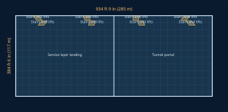
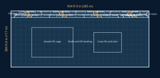
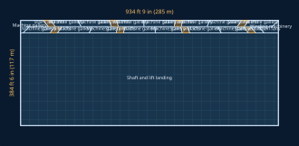

# P4-13 Dock Freight Service Shaft: plan

Footprint 934 ft 9 in (285 m) × 384 ft 6 in (117 m) · structural grid 32 ft 10 in (10 m)

## Levels

| Level | Floor above deck | Height | Floor area |
|---|---|---|---|
| Level B1 · Service layer landing | −19 ft 8 in (6,000 mm) | 19 ft 8 in (6,000 mm) | 359,410 sq ft (33,390 m²) |
| Level 1 · Lift landing | 0 ft (0 mm) | 29 ft 6 in (9,000 mm) | 352,531 sq ft (32,751 m²) |
| Level 2 · Winding room | 29 ft 6 in (9,000 mm) | 19 ft 8 in (6,000 mm) | 352,531 sq ft (32,751 m²) |

## Elements

| ID | Designation | Type | Name | Level(s) | Size / length | Area | Status |
|---|---|---|---|---|---|---|---|
| E001 | D5F4P4B21A1L1R1, D5F4P4B21A1L2R1 | room | Shaft and lift landing | L1, L2 | 934 ft 9 in (285 m) × 338 ft 7 in (103 m) | 316,477 sq ft (29,402 m²) | proposed |
| E002 |  | fixture | Goods lift cage | L1 | 280 ft 6 in (85 m) × 203 ft 5 in (62 m) | 57,059 sq ft (5,301 m²) | proposed |
| E003 |  | fixture | Crew lift and stair | L1 | 187 ft (57 m) × 135 ft 2 in (41 m) | 25,278 sq ft (2,348 m²) | proposed |
| E004 | D5F4P4B21A1LB1R1, D5F4P4B21A1L1R2, D5F4P4B21A1L2R2 | core | Stairs and lifts | LB1, L1, L2 | 43 ft 8 in (13 m) × 21 ft 8 in (6,600 mm) | 568 sq ft (53 m²) | proposed |
| E005 | D5F4P4B21A1LB1R2, D5F4P4B21A1L1R3, D5F4P4B21A1L2R3 | core | Stairs and lifts | LB1, L1, L2 | 32 ft 6 in (9,900 mm) × 21 ft 8 in (6,600 mm) | 568 sq ft (53 m²) | proposed |
| E006 | D5F4P4B21A1LB1R3, D5F4P4B21A1L1R4, D5F4P4B21A1L2R4 | core | Stairs and lifts | LB1, L1, L2 | 31 ft 2 in (9,500 mm) × 21 ft 8 in (6,600 mm) | 568 sq ft (53 m²) | proposed |
| E007 | D5F4P4B21A1LB1R4, D5F4P4B21A1L1R5, D5F4P4B21A1L2R5 | core | Stairs and lifts | LB1, L1, L2 | 42 ft 4 in (13 m) × 21 ft 8 in (6,600 mm) | 565 sq ft (52 m²) | proposed |
| E008 | D5F4P4B21A1LB1R5, D5F4P4B21A1L1R6, D5F4P4B21A1L2R6 | core | Stairs and lifts | LB1, L1, L2 | 43 ft 8 in (13 m) × 21 ft 8 in (6,600 mm) | 568 sq ft (53 m²) | proposed |
| E009 | D5F4P4B21A1LB1R6, D5F4P4B21A1L1R7, D5F4P4B21A1L2R7 | core | Stairs and lifts | LB1, L1, L2 | 32 ft 6 in (9,900 mm) × 21 ft 8 in (6,600 mm) | 568 sq ft (53 m²) | proposed |
| E010 | D5F4P4B21A1LB1R7, D5F4P4B21A1L1R8, D5F4P4B21A1L2R8 | core | Stairs and lifts | LB1, L1, L2 | 31 ft 2 in (9,500 mm) × 21 ft 8 in (6,600 mm) | 568 sq ft (53 m²) | proposed |
| E011 | D5F4P4B21A1LB1R8, D5F4P4B21A1L1R9, D5F4P4B21A1L2R9 | core | Stairs and lifts | LB1, L1, L2 | 42 ft 4 in (13 m) × 21 ft 8 in (6,600 mm) | 565 sq ft (52 m²) | proposed |
| E012 | D5F4P4B21A1L1R10 | room | Lift control room | L1 | 22 ft 4 in (6,800 mm) × 45 ft 11 in (14 m) | 540 sq ft (50 m²) | proposed |
| E013 | D5F4P4B21A1L1R11 | room | Loading bay | L1 | 99 ft 1 in (30 m) × 21 ft 8 in (6,600 mm) | 1,716 sq ft (159 m²) | proposed |
| E014 | D5F4P4B21A1L1R12 | room | Crew check-in | L1 | 36 ft 1 in (11 m) × 21 ft 8 in (6,600 mm) | 430 sq ft (40 m²) | proposed |
| E015 | D5F4P4B21A1L1R13 | room | Tool store | L1 | 54 ft 2 in (16 m) × 21 ft 8 in (6,600 mm) | 853 sq ft (79 m²) | proposed |
| E016 | D5F4P4B21A1L1R14 | room | Staff toilets and showers | L1 | 47 ft 7 in (14 m) × 21 ft 8 in (6,600 mm) | 749 sq ft (70 m²) | proposed |
| E017 | D5F4P4B21A1L1R15 | room | Holding store | L1 | 123 ft 8 in (38 m) × 21 ft 8 in (6,600 mm) | 2,472 sq ft (230 m²) | proposed |
| E018 | D5F4P4B21A1L1R16 | room | Holding store | L1 | 90 ft 11 in (28 m) × 21 ft 8 in (6,600 mm) | 1,893 sq ft (176 m²) | proposed |
| E019 | D5F4P4B21A1L1R17 | room | Holding store | L1 | 123 ft 4 in (38 m) × 21 ft 8 in (6,600 mm) | 2,611 sq ft (243 m²) | proposed |
| E020 | D5F4P4B21A1L1R18 | room | Holding store | L1 | 95 ft 2 in (29 m) × 21 ft 8 in (6,600 mm) | 1,893 sq ft (176 m²) | proposed |
| E021 | D5F4P4B21A1L1R19 | room | Holding store | L1 | 133 ft 6 in (41 m) × 21 ft 8 in (6,600 mm) | 2,614 sq ft (243 m²) | proposed |
| E022 | D5F4P4B21A1L1R20 | room | Holding store | L1 | 106 ft 4 in (32 m) × 21 ft 8 in (6,600 mm) | 1,893 sq ft (176 m²) | proposed |
| E023 | D5F4P4B21A1L1R21 | room | Holding store | L1 | 99 ft 9 in (30 m) × 45 ft 11 in (14 m) | 2,618 sq ft (243 m²) | proposed |
| E024 | D5F4P4B21A1L1R22 | room | Holding store | L1 | 102 ft (31 m) × 21 ft 8 in (6,600 mm) | 1,893 sq ft (176 m²) | proposed |
| E025 | D5F4P4B21A1L1R23 | room | Holding store | L1 | 130 ft 3 in (40 m) × 21 ft 8 in (6,600 mm) | 2,611 sq ft (243 m²) | proposed |
| E026 | D5F4P4B21A1L1R24 | room | Holding store | L1 | 90 ft 11 in (28 m) × 21 ft 8 in (6,600 mm) | 1,893 sq ft (176 m²) | proposed |
| E027 | D5F4P4B21A1L1R25 | room | Holding store | L1 | 123 ft 4 in (38 m) × 21 ft 8 in (6,600 mm) | 2,611 sq ft (243 m²) | proposed |
| E028 | D5F4P4B21A1L1R26 | room | Holding store | L1 | 95 ft 2 in (29 m) × 21 ft 8 in (6,600 mm) | 1,893 sq ft (176 m²) | proposed |
| E029 | D5F4P4B21A1L1R27 | room | Holding store | L1 | 133 ft 6 in (41 m) × 21 ft 8 in (6,600 mm) | 2,614 sq ft (243 m²) | proposed |
| E030 | D5F4P4B21A1L1R28 | room | Holding store | L1 | 123 ft 4 in (38 m) × 21 ft 8 in (6,600 mm) | 2,256 sq ft (210 m²) | proposed |
| E031 | D5F4P4B21A1L2R10 | room | Winding machinery | L2 | 70 ft 6 in (22 m) × 45 ft 11 in (14 m) | 1,609 sq ft (149 m²) | proposed |
| E032 | D5F4P4B21A1L2R11 | room | Shaft ventilation fans | L2 | 48 ft 7 in (15 m) × 21 ft 8 in (6,600 mm) | 646 sq ft (60 m²) | proposed |
| E033 | D5F4P4B21A1L2R12 | room | Machine gallery | L2 | 110 ft 3 in (34 m) × 21 ft 8 in (6,600 mm) | 2,074 sq ft (193 m²) | proposed |
| E034 | D5F4P4B21A1L2R13 | room | Machine gallery | L2 | 121 ft 9 in (37 m) × 21 ft 8 in (6,600 mm) | 2,430 sq ft (226 m²) | proposed |
| E035 | D5F4P4B21A1L2R14 | room | Machine gallery | L2 | 99 ft 1 in (30 m) × 21 ft 8 in (6,600 mm) | 2,074 sq ft (193 m²) | proposed |
| E036 | D5F4P4B21A1L2R15 | room | Machine gallery | L2 | 114 ft 10 in (35 m) × 21 ft 8 in (6,600 mm) | 2,430 sq ft (226 m²) | proposed |
| E037 | D5F4P4B21A1L2R16 | room | Machine gallery | L2 | 103 ft 8 in (32 m) × 21 ft 8 in (6,600 mm) | 2,074 sq ft (193 m²) | proposed |
| E038 | D5F4P4B21A1L2R17 | room | Machine gallery | L2 | 125 ft 4 in (38 m) × 21 ft 8 in (6,600 mm) | 2,433 sq ft (226 m²) | proposed |
| E039 | D5F4P4B21A1L2R18 | room | Machine gallery | L2 | 114 ft 10 in (35 m) × 21 ft 8 in (6,600 mm) | 2,074 sq ft (193 m²) | proposed |
| E040 | D5F4P4B21A1L2R19 | room | Machine gallery | L2 | 99 ft 9 in (30 m) × 45 ft 11 in (14 m) | 2,437 sq ft (226 m²) | proposed |
| E041 | D5F4P4B21A1L2R20 | room | Machine gallery | L2 | 110 ft 3 in (34 m) × 21 ft 8 in (6,600 mm) | 2,074 sq ft (193 m²) | proposed |
| E042 | D5F4P4B21A1L2R21 | room | Machine gallery | L2 | 121 ft 9 in (37 m) × 21 ft 8 in (6,600 mm) | 2,430 sq ft (226 m²) | proposed |
| E043 | D5F4P4B21A1L2R22 | room | Machine gallery | L2 | 99 ft 1 in (30 m) × 21 ft 8 in (6,600 mm) | 2,074 sq ft (193 m²) | proposed |
| E044 | D5F4P4B21A1L2R23 | room | Machine gallery | L2 | 114 ft 10 in (35 m) × 21 ft 8 in (6,600 mm) | 2,430 sq ft (226 m²) | proposed |
| E045 | D5F4P4B21A1L2R24 | room | Machine gallery | L2 | 103 ft 8 in (32 m) × 21 ft 8 in (6,600 mm) | 2,074 sq ft (193 m²) | proposed |
| E046 | D5F4P4B21A1L2R25 | room | Machine gallery | L2 | 125 ft 4 in (38 m) × 21 ft 8 in (6,600 mm) | 2,433 sq ft (226 m²) | proposed |
| E047 | D5F4P4B21A1L2R26 | room | Machine gallery | L2 | 123 ft 4 in (38 m) × 21 ft 8 in (6,600 mm) | 2,256 sq ft (210 m²) | proposed |
| E048 | D5F4P4B21A1LB1R9 | room | Service layer landing | LB1 | 467 ft 2 in (142 m) × 384 ft 6 in (117 m) | 179,642 sq ft (16,689 m²) | proposed |
| E049 | D5F4P4B21A1LB1R10 | room | Tunnel portal | LB1 | 467 ft 6 in (142 m) × 384 ft 6 in (117 m) | 179,768 sq ft (16,701 m²) | proposed |

## Drawings

### Level B1 · Service layer landing

### Level 1 · Lift landing

### Level 2 · Winding room

