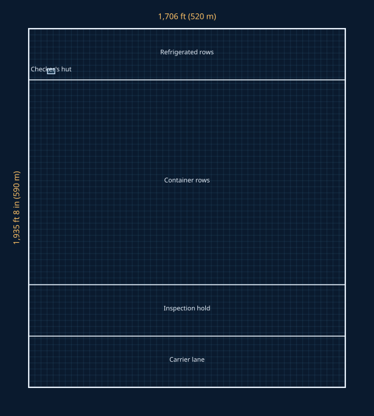

# P4-14 Container Stacks 1: plan

Footprint 1,706 ft (520 m) × 1,935 ft 8 in (590 m) · structural grid 32 ft 10 in (10 m)

## Levels

| Level | Floor above deck | Height | Floor area |
|---|---|---|---|
| Level 1 · Yard | 0 ft (0 mm) | 13 ft 1 in (4,000 mm) | 1,033 sq ft (96 m²) |

## Elements

| ID | Designation | Type | Name | Level(s) | Size / length | Area | Status |
|---|---|---|---|---|---|---|---|
| E001 | D5F4P4B1A1R1 | zone | Refrigerated rows | L1 | 1,706 ft (520 m) × 276 ft 7 in (84 m) | 471,847 sq ft (43,836 m²) | proposed |
| E002 | D5F4P4B1A1R2 | room | Checker's hut | L1 | 39 ft 4 in (12 m) × 26 ft 3 in (8,000 mm) | 1,033 sq ft (96 m²) | proposed |
| E003 | D5F4P4B1A1R3 | zone | Container rows | L1 | 1,706 ft (520 m) × 1,106 ft (337 m) | 1,886,828 sq ft (175,292 m²) | proposed |
| E004 | D5F4P4B1A1R4 | zone | Inspection hold | L1 | 1,706 ft (520 m) × 276 ft 7 in (84 m) | 471,847 sq ft (43,836 m²) | proposed |
| E005 | D5F4P4B1A1R5 | zone | Carrier lane | L1 | 1,706 ft (520 m) × 276 ft 7 in (84 m) | 471,847 sq ft (43,836 m²) | proposed |

## Drawings

### Level 1 · Yard

