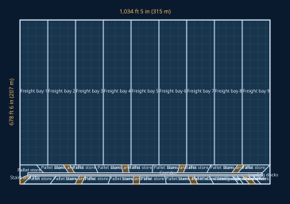
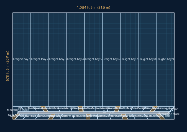

# P4-19 Freight Shed 3: plan

Footprint 1,034 ft 5 in (315 m) × 678 ft 6 in (207 m) · structural grid 32 ft 10 in (10 m)

## Levels

| Level | Floor above deck | Height | Floor area |
|---|---|---|---|
| Level 1 · Hall floor | 0 ft (0 mm) | 39 ft 4 in (12 m) | 680,819 sq ft (63,250 m²) |
| Level 2 · Gallery floor | 39 ft 4 in (12 m) | 14 ft 9 in (4,500 mm) | 680,819 sq ft (63,250 m²) |

## Elements

| ID | Designation | Type | Name | Level(s) | Size / length | Area | Status |
|---|---|---|---|---|---|---|---|
| E001 | D5F4P4B12A2L1R1, D5F4P4B12A2L2R1 | room | Freight bay 1 | L1, L2 | 114 ft 10 in (35 m) × 599 ft 9 in (183 m) | 68,868 sq ft (6,398 m²) | proposed |
| E002 | D5F4P4B12A2L1R2, D5F4P4B12A2L2R2 | room | Freight bay 2 | L1, L2 | 115 ft 2 in (35 m) × 599 ft 9 in (183 m) | 69,064 sq ft (6,416 m²) | proposed |
| E003 | D5F4P4B12A2L1R3, D5F4P4B12A2L2R3 | room | Freight bay 3 | L1, L2 | 114 ft 10 in (35 m) × 599 ft 9 in (183 m) | 68,868 sq ft (6,398 m²) | proposed |
| E004 | D5F4P4B12A2L1R4, D5F4P4B12A2L2R4 | room | Freight bay 4 | L1, L2 | 114 ft 10 in (35 m) × 599 ft 9 in (183 m) | 68,868 sq ft (6,398 m²) | proposed |
| E005 | D5F4P4B12A2L1R5, D5F4P4B12A2L2R5 | room | Freight bay 5 | L1, L2 | 115 ft 2 in (35 m) × 599 ft 9 in (183 m) | 69,064 sq ft (6,416 m²) | proposed |
| E006 | D5F4P4B12A2L1R6, D5F4P4B12A2L2R6 | room | Freight bay 6 | L1, L2 | 114 ft 10 in (35 m) × 599 ft 9 in (183 m) | 68,868 sq ft (6,398 m²) | proposed |
| E007 | D5F4P4B12A2L1R7, D5F4P4B12A2L2R7 | room | Freight bay 7 | L1, L2 | 114 ft 10 in (35 m) × 599 ft 9 in (183 m) | 68,868 sq ft (6,398 m²) | proposed |
| E008 | D5F4P4B12A2L1R8, D5F4P4B12A2L2R8 | room | Freight bay 8 | L1, L2 | 115 ft 2 in (35 m) × 599 ft 9 in (183 m) | 69,064 sq ft (6,416 m²) | proposed |
| E009 | D5F4P4B12A2L1R9, D5F4P4B12A2L2R9 | room | Freight bay 9 | L1, L2 | 114 ft 10 in (35 m) × 599 ft 9 in (183 m) | 68,868 sq ft (6,398 m²) | proposed |
| E010 | D5F4P4B12A2L1R10, D5F4P4B12A2L2R10 | core | Stairs and lifts | L1, L2 | 54 ft 2 in (16 m) × 32 ft 6 in (9,900 mm) | 853 sq ft (79 m²) | proposed |
| E011 | D5F4P4B12A2L1R11, D5F4P4B12A2L2R11 | core | Stairs and lifts | L1, L2 | 39 ft 1 in (12 m) × 32 ft 6 in (9,900 mm) | 853 sq ft (79 m²) | proposed |
| E012 | D5F4P4B12A2L1R12, D5F4P4B12A2L2R12 | core | Stairs and lifts | L1, L2 | 28 ft 7 in (8,700 mm) × 32 ft 6 in (9,900 mm) | 853 sq ft (79 m²) | proposed |
| E013 | D5F4P4B12A2L1R13, D5F4P4B12A2L2R13 | core | Stairs and lifts | L1, L2 | 43 ft 8 in (13 m) × 32 ft 6 in (9,900 mm) | 853 sq ft (79 m²) | proposed |
| E014 | D5F4P4B12A2L1R14, D5F4P4B12A2L2R14 | core | Stairs and lifts | L1, L2 | 45 ft 3 in (14 m) × 36 ft 5 in (11 m) | 853 sq ft (79 m²) | proposed |
| E015 | D5F4P4B12A2L1R15, D5F4P4B12A2L2R15 | core | Stairs and lifts | L1, L2 | 46 ft 7 in (14 m) × 32 ft 6 in (9,900 mm) | 853 sq ft (79 m²) | proposed |
| E016 | D5F4P4B12A2L1R16, D5F4P4B12A2L2R16 | core | Stairs and lifts | L1, L2 | 31 ft 6 in (9,600 mm) × 32 ft 6 in (9,900 mm) | 853 sq ft (79 m²) | proposed |
| E017 | D5F4P4B12A2L1R17, D5F4P4B12A2L2R17 | core | Stairs and lifts | L1, L2 | 36 ft 1 in (11 m) × 32 ft 6 in (9,900 mm) | 853 sq ft (79 m²) | proposed |
| E018 | D5F4P4B12A2L1R18, D5F4P4B12A2L2R18 | core | Stairs and lifts | L1, L2 | 51 ft 2 in (16 m) × 32 ft 6 in (9,900 mm) | 853 sq ft (79 m²) | proposed |
| E019 | D5F4P4B12A2L1R19 | zone | Corridor | L1 | 969 ft 6 in (296 m) × 13 ft 9 in (4,200 mm) | 9,581 sq ft (890 m²) | proposed |
| E020 | D5F4P4B12A2L1R20 | room | Loading docks | L1 | 67 ft 11 in (21 m) × 78 ft 9 in (24 m) | 2,691 sq ft (250 m²) | proposed |
| E021 | D5F4P4B12A2L1R21 | room | Shed office | L1 | 49 ft 10 in (15 m) × 32 ft 6 in (9,900 mm) | 666 sq ft (62 m²) | proposed |
| E022 | D5F4P4B12A2L1R22 | room | Staff toilets and showers | L1 | 49 ft 6 in (15 m) × 32 ft 6 in (9,900 mm) | 751 sq ft (70 m²) | proposed |
| E023 | D5F4P4B12A2L1R23 | room | Damaged goods room | L1 | 44 ft 11 in (14 m) × 32 ft 6 in (9,900 mm) | 650 sq ft (60 m²) | proposed |
| E024 | D5F4P4B12A2L1R24 | room | Cross-dock area | L1 | 120 ft 5 in (37 m) × 32 ft 6 in (9,900 mm) | 3,229 sq ft (300 m²) | proposed |
| E025 | D5F4P4B12A2L1R25 | room | Pallet store | L1 | 79 ft 9 in (24 m) × 32 ft 6 in (9,900 mm) | 2,083 sq ft (194 m²) | proposed |
| E026 | D5F4P4B12A2L1R26 | room | Pallet store | L1 | 108 ft 3 in (33 m) × 32 ft 6 in (9,900 mm) | 3,229 sq ft (300 m²) | proposed |
| E027 | D5F4P4B12A2L1R27 | room | Pallet store | L1 | 110 ft 11 in (34 m) × 32 ft 6 in (9,900 mm) | 3,485 sq ft (324 m²) | proposed |
| E028 | D5F4P4B12A2L1R28 | room | Pallet store | L1 | 105 ft 8 in (32 m) × 32 ft 6 in (9,900 mm) | 3,229 sq ft (300 m²) | proposed |
| E029 | D5F4P4B12A2L1R29 | room | Pallet store | L1 | 120 ft 5 in (37 m) × 32 ft 6 in (9,900 mm) | 3,485 sq ft (324 m²) | proposed |
| E030 | D5F4P4B12A2L1R30 | room | Pallet store | L1 | 120 ft 9 in (37 m) × 32 ft 6 in (9,900 mm) | 3,229 sq ft (300 m²) | proposed |
| E031 | D5F4P4B12A2L1R31 | room | Pallet store | L1 | 135 ft 6 in (41 m) × 32 ft 6 in (9,900 mm) | 3,485 sq ft (324 m²) | proposed |
| E032 | D5F4P4B12A2L1R32 | room | Pallet store | L1 | 96 ft 9 in (30 m) × 56 ft 5 in (17 m) | 3,234 sq ft (300 m²) | proposed |
| E033 | D5F4P4B12A2L1R33 | room | Pallet store | L1 | 131 ft 11 in (40 m) × 32 ft 6 in (9,900 mm) | 3,479 sq ft (323 m²) | proposed |
| E034 | D5F4P4B12A2L1R34 | room | Pallet store | L1 | 115 ft 10 in (35 m) × 32 ft 6 in (9,900 mm) | 3,234 sq ft (300 m²) | proposed |
| E035 | D5F4P4B12A2L1R35 | room | Pallet store | L1 | 116 ft 10 in (36 m) × 32 ft 6 in (9,900 mm) | 3,479 sq ft (323 m²) | proposed |
| E036 | D5F4P4B12A2L1R36 | room | Pallet store | L1 | 102 ft 8 in (31 m) × 32 ft 6 in (9,900 mm) | 3,234 sq ft (300 m²) | proposed |
| E037 | D5F4P4B12A2L1R37 | room | Pallet store | L1 | 112 ft 6 in (34 m) × 32 ft 6 in (9,900 mm) | 3,479 sq ft (323 m²) | proposed |
| E038 | D5F4P4B12A2L1R38 | room | Pallet store | L1 | 113 ft 6 in (35 m) × 32 ft 6 in (9,900 mm) | 3,234 sq ft (300 m²) | proposed |
| E039 | D5F4P4B12A2L1R39 | room | Pallet store | L1 | 127 ft 7 in (39 m) × 32 ft 6 in (9,900 mm) | 3,479 sq ft (323 m²) | proposed |
| E040 | D5F4P4B12A2L1R40 | room | Pallet store | L1 | 132 ft 7 in (40 m) × 32 ft 6 in (9,900 mm) | 3,357 sq ft (312 m²) | proposed |
| E041 | D5F4P4B12A2L2R19 | zone | Corridor | L2 | 969 ft 6 in (296 m) × 13 ft 9 in (4,200 mm) | 9,581 sq ft (890 m²) | proposed |
| E042 | D5F4P4B12A2L2R20 | room | Tea point | L2 | 32 ft 6 in (9,900 mm) × 35 ft 9 in (11 m) | 368 sq ft (34 m²) | proposed |
| E043 | D5F4P4B12A2L2R21 | room | Mezzanine store | L2 | 87 ft 7 in (27 m) × 59 ft 5 in (18 m) | 2,989 sq ft (278 m²) | proposed |
| E044 | D5F4P4B12A2L2R22 | room | Mezzanine store | L2 | 104 ft (32 m) × 32 ft 6 in (9,900 mm) | 2,584 sq ft (240 m²) | proposed |
| E045 | D5F4P4B12A2L2R23 | room | Mezzanine store | L2 | 98 ft 9 in (30 m) × 32 ft 6 in (9,900 mm) | 2,584 sq ft (240 m²) | proposed |
| E046 | D5F4P4B12A2L2R24 | room | Mezzanine store | L2 | 62 ft 8 in (19 m) × 32 ft 6 in (9,900 mm) | 1,545 sq ft (144 m²) | proposed |
| E047 | D5F4P4B12A2L2R25 | room | Mezzanine store | L2 | 88 ft 11 in (27 m) × 32 ft 6 in (9,900 mm) | 2,584 sq ft (240 m²) | proposed |
| E048 | D5F4P4B12A2L2R26 | room | Mezzanine store | L2 | 83 ft 8 in (26 m) × 32 ft 6 in (9,900 mm) | 2,584 sq ft (240 m²) | proposed |
| E049 | D5F4P4B12A2L2R27 | room | Mezzanine store | L2 | 49 ft 3 in (15 m) × 32 ft 6 in (9,900 mm) | 1,545 sq ft (144 m²) | proposed |
| E050 | D5F4P4B12A2L2R28 | room | Mezzanine store | L2 | 85 ft 4 in (26 m) × 32 ft 6 in (9,900 mm) | 2,589 sq ft (241 m²) | proposed |
| E051 | D5F4P4B12A2L2R29 | room | Mezzanine store | L2 | 90 ft 3 in (28 m) × 32 ft 6 in (9,900 mm) | 2,579 sq ft (240 m²) | proposed |
| E052 | D5F4P4B12A2L2R30 | room | Mezzanine store | L2 | 62 ft 8 in (19 m) × 32 ft 6 in (9,900 mm) | 1,545 sq ft (144 m²) | proposed |
| E053 | D5F4P4B12A2L2R31 | room | Mezzanine store | L2 | 100 ft 5 in (31 m) × 32 ft 6 in (9,900 mm) | 2,589 sq ft (241 m²) | proposed |
| E054 | D5F4P4B12A2L2R32 | room | Mezzanine store | L2 | 105 ft 4 in (32 m) × 32 ft 6 in (9,900 mm) | 2,579 sq ft (240 m²) | proposed |
| E055 | D5F4P4B12A2L2R33 | room | Mezzanine store | L2 | 77 ft 9 in (24 m) × 32 ft 6 in (9,900 mm) | 1,545 sq ft (144 m²) | proposed |
| E056 | D5F4P4B12A2L2R34 | room | Mezzanine store | L2 | 77 ft 5 in (24 m) × 56 ft 5 in (17 m) | 2,584 sq ft (240 m²) | proposed |
| E057 | D5F4P4B12A2L2R35 | room | Mezzanine store | L2 | 106 ft 8 in (32 m) × 32 ft 6 in (9,900 mm) | 2,589 sq ft (241 m²) | proposed |
| E058 | D5F4P4B12A2L2R36 | room | Mezzanine store | L2 | 70 ft 3 in (21 m) × 32 ft 6 in (9,900 mm) | 1,540 sq ft (143 m²) | proposed |
| E059 | D5F4P4B12A2L2R37 | room | Mezzanine store | L2 | 96 ft 5 in (29 m) × 32 ft 6 in (9,900 mm) | 2,584 sq ft (240 m²) | proposed |
| E060 | D5F4P4B12A2L2R38 | room | Mezzanine store | L2 | 91 ft 6 in (28 m) × 32 ft 6 in (9,900 mm) | 2,589 sq ft (241 m²) | proposed |
| E061 | D5F4P4B12A2L2R39 | room | Mezzanine store | L2 | 55 ft 1 in (17 m) × 32 ft 6 in (9,900 mm) | 1,540 sq ft (143 m²) | proposed |
| E062 | D5F4P4B12A2L2R40 | room | Mezzanine store | L2 | 82 ft (25 m) × 32 ft 6 in (9,900 mm) | 2,584 sq ft (240 m²) | proposed |
| E063 | D5F4P4B12A2L2R41 | room | Mezzanine store | L2 | 83 ft (25 m) × 32 ft 6 in (9,900 mm) | 2,589 sq ft (241 m²) | proposed |
| E064 | D5F4P4B12A2L2R42 | room | Mezzanine store | L2 | 54 ft 9 in (17 m) × 32 ft 6 in (9,900 mm) | 1,540 sq ft (143 m²) | proposed |
| E065 | D5F4P4B12A2L2R43 | room | Mezzanine store | L2 | 92 ft 10 in (28 m) × 32 ft 6 in (9,900 mm) | 2,584 sq ft (240 m²) | proposed |
| E066 | D5F4P4B12A2L2R44 | room | Mezzanine store | L2 | 98 ft 1 in (30 m) × 32 ft 6 in (9,900 mm) | 2,589 sq ft (241 m²) | proposed |
| E067 | D5F4P4B12A2L2R45 | room | Mezzanine store | L2 | 69 ft 11 in (21 m) × 32 ft 6 in (9,900 mm) | 1,540 sq ft (143 m²) | proposed |
| E068 | D5F4P4B12A2L2R46 | room | Mezzanine store | L2 | 132 ft 7 in (40 m) × 32 ft 6 in (9,900 mm) | 3,357 sq ft (312 m²) | proposed |

## Drawings

### Level 1 · Hall floor

### Level 2 · Gallery floor

