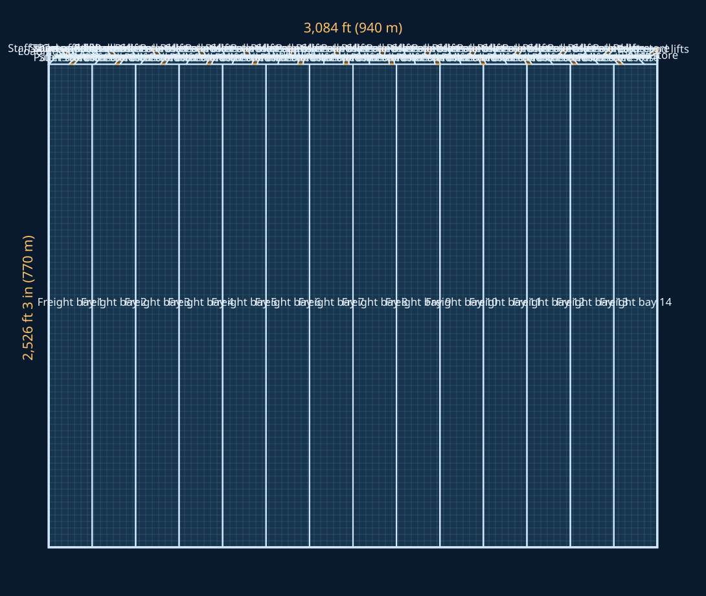
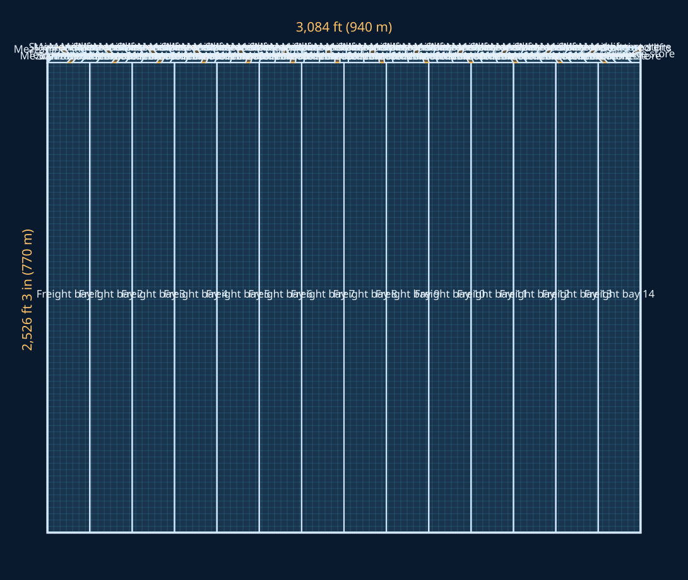

# P4-25 Freight Shed 6: plan

Footprint 3,084 ft (940 m) × 2,526 ft 3 in (770 m) · structural grid 32 ft 10 in (10 m)

## Levels

| Level | Floor above deck | Height | Floor area |
|---|---|---|---|
| Level 1 · Hall floor | 0 ft (0 mm) | 39 ft 4 in (12 m) | 7,726,322 sq ft (717,799 m²) |
| Level 2 · Gallery floor | 39 ft 4 in (12 m) | 14 ft 9 in (4,500 mm) | 7,726,322 sq ft (717,799 m²) |

## Elements

| ID | Designation | Type | Name | Level(s) | Size / length | Area | Status |
|---|---|---|---|---|---|---|---|
| E001 | D5F4P4B20A1L1R1, D5F4P4B20A1L2R1 | room | Freight bay 1 | L1, L2 | 220 ft 2 in (67 m) × 2,447 ft 6 in (746 m) | 538,805 sq ft (50,057 m²) | proposed |
| E002 | D5F4P4B20A1L1R2, D5F4P4B20A1L2R2 | room | Freight bay 2 | L1, L2 | 220 ft 6 in (67 m) × 2,447 ft 6 in (746 m) | 539,608 sq ft (50,131 m²) | proposed |
| E003 | D5F4P4B20A1L1R3, D5F4P4B20A1L2R3 | room | Freight bay 3 | L1, L2 | 220 ft 2 in (67 m) × 2,447 ft 6 in (746 m) | 538,805 sq ft (50,057 m²) | proposed |
| E004 | D5F4P4B20A1L1R4, D5F4P4B20A1L2R4 | room | Freight bay 4 | L1, L2 | 220 ft 6 in (67 m) × 2,447 ft 6 in (746 m) | 539,608 sq ft (50,131 m²) | proposed |
| E005 | D5F4P4B20A1L1R5, D5F4P4B20A1L2R5 | room | Freight bay 5 | L1, L2 | 220 ft 2 in (67 m) × 2,447 ft 6 in (746 m) | 538,805 sq ft (50,057 m²) | proposed |
| E006 | D5F4P4B20A1L1R6, D5F4P4B20A1L2R6 | room | Freight bay 6 | L1, L2 | 220 ft 6 in (67 m) × 2,447 ft 6 in (746 m) | 539,608 sq ft (50,131 m²) | proposed |
| E007 | D5F4P4B20A1L1R7, D5F4P4B20A1L2R7 | room | Freight bay 7 | L1, L2 | 220 ft 2 in (67 m) × 2,447 ft 6 in (746 m) | 538,805 sq ft (50,057 m²) | proposed |
| E008 | D5F4P4B20A1L1R8, D5F4P4B20A1L2R8 | room | Freight bay 8 | L1, L2 | 220 ft 2 in (67 m) × 2,447 ft 6 in (746 m) | 538,805 sq ft (50,057 m²) | proposed |
| E009 | D5F4P4B20A1L1R9, D5F4P4B20A1L2R9 | room | Freight bay 9 | L1, L2 | 220 ft 6 in (67 m) × 2,447 ft 6 in (746 m) | 539,608 sq ft (50,131 m²) | proposed |
| E010 | D5F4P4B20A1L1R10, D5F4P4B20A1L2R10 | room | Freight bay 10 | L1, L2 | 220 ft 2 in (67 m) × 2,447 ft 6 in (746 m) | 538,805 sq ft (50,057 m²) | proposed |
| E011 | D5F4P4B20A1L1R11, D5F4P4B20A1L2R11 | room | Freight bay 11 | L1, L2 | 220 ft 6 in (67 m) × 2,447 ft 6 in (746 m) | 539,608 sq ft (50,131 m²) | proposed |
| E012 | D5F4P4B20A1L1R12, D5F4P4B20A1L2R12 | room | Freight bay 12 | L1, L2 | 220 ft 2 in (67 m) × 2,447 ft 6 in (746 m) | 538,805 sq ft (50,057 m²) | proposed |
| E013 | D5F4P4B20A1L1R13, D5F4P4B20A1L2R13 | room | Freight bay 13 | L1, L2 | 220 ft 6 in (67 m) × 2,447 ft 6 in (746 m) | 539,608 sq ft (50,131 m²) | proposed |
| E014 | D5F4P4B20A1L1R14, D5F4P4B20A1L2R14 | room | Freight bay 14 | L1, L2 | 220 ft 2 in (67 m) × 2,447 ft 6 in (746 m) | 538,805 sq ft (50,057 m²) | proposed |
| E015 | D5F4P4B20A1L1R15, D5F4P4B20A1L2R15 | core | Stairs and lifts | L1, L2 | 57 ft 5 in (18 m) × 32 ft 6 in (9,900 mm) | 853 sq ft (79 m²) | proposed |
| E016 | D5F4P4B20A1L1R16, D5F4P4B20A1L2R16 | core | Stairs and lifts | L1, L2 | 52 ft 6 in (16 m) × 32 ft 6 in (9,900 mm) | 853 sq ft (79 m²) | proposed |
| E017 | D5F4P4B20A1L1R17, D5F4P4B20A1L2R17 | core | Stairs and lifts | L1, L2 | 47 ft 7 in (14 m) × 32 ft 6 in (9,900 mm) | 853 sq ft (79 m²) | proposed |
| E018 | D5F4P4B20A1L1R18, D5F4P4B20A1L2R18 | core | Stairs and lifts | L1, L2 | 42 ft 8 in (13 m) × 32 ft 6 in (9,900 mm) | 853 sq ft (79 m²) | proposed |
| E019 | D5F4P4B20A1L1R19, D5F4P4B20A1L2R19 | core | Stairs and lifts | L1, L2 | 37 ft 9 in (12 m) × 32 ft 6 in (9,900 mm) | 853 sq ft (79 m²) | proposed |
| E020 | D5F4P4B20A1L1R20, D5F4P4B20A1L2R20 | core | Stairs and lifts | L1, L2 | 32 ft 10 in (10 m) × 32 ft 6 in (9,900 mm) | 853 sq ft (79 m²) | proposed |
| E021 | D5F4P4B20A1L1R21, D5F4P4B20A1L2R21 | core | Stairs and lifts | L1, L2 | 27 ft 11 in (8,500 mm) × 32 ft 6 in (9,900 mm) | 847 sq ft (79 m²) | proposed |
| E022 | D5F4P4B20A1L1R22, D5F4P4B20A1L2R22 | core | Stairs and lifts | L1, L2 | 29 ft 2 in (8,900 mm) × 32 ft 6 in (9,900 mm) | 853 sq ft (79 m²) | proposed |
| E023 | D5F4P4B20A1L1R23, D5F4P4B20A1L2R23 | core | Stairs and lifts | L1, L2 | 34 ft 1 in (10 m) × 32 ft 6 in (9,900 mm) | 853 sq ft (79 m²) | proposed |
| E024 | D5F4P4B20A1L1R24, D5F4P4B20A1L2R24 | core | Stairs and lifts | L1, L2 | 39 ft 1 in (12 m) × 32 ft 6 in (9,900 mm) | 853 sq ft (79 m²) | proposed |
| E025 | D5F4P4B20A1L1R25, D5F4P4B20A1L2R25 | core | Stairs and lifts | L1, L2 | 44 ft (13 m) × 32 ft 6 in (9,900 mm) | 853 sq ft (79 m²) | proposed |
| E026 | D5F4P4B20A1L1R26, D5F4P4B20A1L2R26 | core | Stairs and lifts | L1, L2 | 48 ft 11 in (15 m) × 32 ft 6 in (9,900 mm) | 853 sq ft (79 m²) | proposed |
| E027 | D5F4P4B20A1L1R27, D5F4P4B20A1L2R27 | core | Stairs and lifts | L1, L2 | 53 ft 10 in (16 m) × 32 ft 6 in (9,900 mm) | 853 sq ft (79 m²) | proposed |
| E028 | D5F4P4B20A1L1R28, D5F4P4B20A1L2R28 | core | Stairs and lifts | L1, L2 | 45 ft 3 in (14 m) × 36 ft 5 in (11 m) | 847 sq ft (79 m²) | proposed |
| E029 | D5F4P4B20A1L1R29, D5F4P4B20A1L2R29 | core | Stairs and lifts | L1, L2 | 54 ft 9 in (17 m) × 32 ft 6 in (9,900 mm) | 853 sq ft (79 m²) | proposed |
| E030 | D5F4P4B20A1L1R30, D5F4P4B20A1L2R30 | core | Stairs and lifts | L1, L2 | 49 ft 10 in (15 m) × 32 ft 6 in (9,900 mm) | 853 sq ft (79 m²) | proposed |
| E031 | D5F4P4B20A1L1R31, D5F4P4B20A1L2R31 | core | Stairs and lifts | L1, L2 | 44 ft 11 in (14 m) × 32 ft 6 in (9,900 mm) | 847 sq ft (79 m²) | proposed |
| E032 | D5F4P4B20A1L1R32, D5F4P4B20A1L2R32 | core | Stairs and lifts | L1, L2 | 40 ft 4 in (12 m) × 32 ft 6 in (9,900 mm) | 853 sq ft (79 m²) | proposed |
| E033 | D5F4P4B20A1L1R33, D5F4P4B20A1L2R33 | core | Stairs and lifts | L1, L2 | 35 ft 5 in (11 m) × 32 ft 6 in (9,900 mm) | 853 sq ft (79 m²) | proposed |
| E034 | D5F4P4B20A1L1R34, D5F4P4B20A1L2R34 | core | Stairs and lifts | L1, L2 | 30 ft 6 in (9,300 mm) × 32 ft 6 in (9,900 mm) | 853 sq ft (79 m²) | proposed |
| E035 | D5F4P4B20A1L1R35, D5F4P4B20A1L2R35 | core | Stairs and lifts | L1, L2 | 26 ft 11 in (8,200 mm) × 32 ft 6 in (9,900 mm) | 853 sq ft (79 m²) | proposed |
| E036 | D5F4P4B20A1L1R36, D5F4P4B20A1L2R36 | core | Stairs and lifts | L1, L2 | 31 ft 10 in (9,700 mm) × 32 ft 6 in (9,900 mm) | 853 sq ft (79 m²) | proposed |
| E037 | D5F4P4B20A1L1R37, D5F4P4B20A1L2R37 | core | Stairs and lifts | L1, L2 | 36 ft 9 in (11 m) × 32 ft 6 in (9,900 mm) | 853 sq ft (79 m²) | proposed |
| E038 | D5F4P4B20A1L1R38, D5F4P4B20A1L2R38 | core | Stairs and lifts | L1, L2 | 41 ft 4 in (13 m) × 32 ft 6 in (9,900 mm) | 847 sq ft (79 m²) | proposed |
| E039 | D5F4P4B20A1L1R39, D5F4P4B20A1L2R39 | core | Stairs and lifts | L1, L2 | 46 ft 3 in (14 m) × 32 ft 6 in (9,900 mm) | 853 sq ft (79 m²) | proposed |
| E040 | D5F4P4B20A1L1R40, D5F4P4B20A1L2R40 | core | Stairs and lifts | L1, L2 | 51 ft 2 in (16 m) × 32 ft 6 in (9,900 mm) | 853 sq ft (79 m²) | proposed |
| E041 | D5F4P4B20A1L1R41, D5F4P4B20A1L2R41 | core | Stairs and lifts | L1, L2 | 56 ft 1 in (17 m) × 32 ft 6 in (9,900 mm) | 853 sq ft (79 m²) | proposed |
| E042 | D5F4P4B20A1L1R42 | zone | Corridor | L1 | 3,019 ft (920 m) × 13 ft 9 in (4,200 mm) | 29,754 sq ft (2,764 m²) | proposed |
| E043 | D5F4P4B20A1L1R43 | room | Loading docks | L1 | 68 ft 7 in (21 m) × 78 ft 9 in (24 m) | 2,691 sq ft (250 m²) | proposed |
| E044 | D5F4P4B20A1L1R44 | room | Shed office | L1 | 50 ft 2 in (15 m) × 32 ft 6 in (9,900 mm) | 607 sq ft (56 m²) | proposed |
| E045 | D5F4P4B20A1L1R45 | room | Staff toilets and showers | L1 | 53 ft 10 in (16 m) × 32 ft 6 in (9,900 mm) | 757 sq ft (70 m²) | proposed |
| E046 | D5F4P4B20A1L1R46 | room | Cross-dock area | L1 | 128 ft 7 in (39 m) × 32 ft 6 in (9,900 mm) | 3,229 sq ft (300 m²) | proposed |
| E047 | D5F4P4B20A1L1R47 | room | Damaged goods room | L1 | 47 ft 11 in (15 m) × 32 ft 6 in (9,900 mm) | 650 sq ft (60 m²) | proposed |
| E048 | D5F4P4B20A1L1R48 | room | Pallet store | L1 | 87 ft 7 in (27 m) × 32 ft 6 in (9,900 mm) | 1,966 sq ft (183 m²) | proposed |
| E049 | D5F4P4B20A1L1R49 | room | Pallet store | L1 | 124 ft 4 in (38 m) × 32 ft 6 in (9,900 mm) | 3,234 sq ft (300 m²) | proposed |
| E050 | D5F4P4B20A1L1R50 | room | Pallet store | L1 | 126 ft 4 in (38 m) × 32 ft 6 in (9,900 mm) | 3,367 sq ft (313 m²) | proposed |
| E051 | D5F4P4B20A1L1R51 | room | Pallet store | L1 | 119 ft 5 in (36 m) × 32 ft 6 in (9,900 mm) | 3,234 sq ft (300 m²) | proposed |
| E052 | D5F4P4B20A1L1R52 | room | Pallet store | L1 | 121 ft 5 in (37 m) × 32 ft 6 in (9,900 mm) | 3,367 sq ft (313 m²) | proposed |
| E053 | D5F4P4B20A1L1R53 | room | Pallet store | L1 | 114 ft 6 in (35 m) × 32 ft 6 in (9,900 mm) | 3,229 sq ft (300 m²) | proposed |
| E054 | D5F4P4B20A1L1R54 | room | Pallet store | L1 | 116 ft 10 in (36 m) × 32 ft 6 in (9,900 mm) | 3,373 sq ft (313 m²) | proposed |
| E055 | D5F4P4B20A1L1R55 | room | Pallet store | L1 | 109 ft 7 in (33 m) × 32 ft 6 in (9,900 mm) | 3,229 sq ft (300 m²) | proposed |
| E056 | D5F4P4B20A1L1R56 | room | Pallet store | L1 | 111 ft 11 in (34 m) × 32 ft 6 in (9,900 mm) | 3,373 sq ft (313 m²) | proposed |
| E057 | D5F4P4B20A1L1R57 | room | Pallet store | L1 | 104 ft 8 in (32 m) × 32 ft 6 in (9,900 mm) | 3,229 sq ft (300 m²) | proposed |
| E058 | D5F4P4B20A1L1R58 | room | Pallet store | L1 | 106 ft 11 in (33 m) × 32 ft 6 in (9,900 mm) | 3,373 sq ft (313 m²) | proposed |
| E059 | D5F4P4B20A1L1R59 | room | Pallet store | L1 | 100 ft 9 in (31 m) × 32 ft 6 in (9,900 mm) | 3,234 sq ft (300 m²) | proposed |
| E060 | D5F4P4B20A1L1R60 | room | Pallet store | L1 | 105 ft 4 in (32 m) × 32 ft 6 in (9,900 mm) | 3,367 sq ft (313 m²) | proposed |
| E061 | D5F4P4B20A1L1R61 | room | Pallet store | L1 | 104 ft (32 m) × 32 ft 6 in (9,900 mm) | 3,234 sq ft (300 m²) | proposed |
| E062 | D5F4P4B20A1L1R62 | room | Pallet store | L1 | 110 ft 3 in (34 m) × 32 ft 6 in (9,900 mm) | 3,367 sq ft (313 m²) | proposed |
| E063 | D5F4P4B20A1L1R63 | room | Pallet store | L1 | 108 ft 11 in (33 m) × 32 ft 6 in (9,900 mm) | 3,234 sq ft (300 m²) | proposed |
| E064 | D5F4P4B20A1L1R64 | room | Pallet store | L1 | 115 ft 2 in (35 m) × 32 ft 6 in (9,900 mm) | 3,367 sq ft (313 m²) | proposed |
| E065 | D5F4P4B20A1L1R65 | room | Pallet store | L1 | 113 ft 10 in (35 m) × 32 ft 6 in (9,900 mm) | 3,234 sq ft (300 m²) | proposed |
| E066 | D5F4P4B20A1L1R66 | room | Pallet store | L1 | 120 ft 1 in (37 m) × 32 ft 6 in (9,900 mm) | 3,367 sq ft (313 m²) | proposed |
| E067 | D5F4P4B20A1L1R67 | room | Pallet store | L1 | 118 ft 5 in (36 m) × 32 ft 6 in (9,900 mm) | 3,229 sq ft (300 m²) | proposed |
| E068 | D5F4P4B20A1L1R68 | room | Pallet store | L1 | 125 ft (38 m) × 32 ft 6 in (9,900 mm) | 3,373 sq ft (313 m²) | proposed |
| E069 | D5F4P4B20A1L1R69 | room | Pallet store | L1 | 123 ft 4 in (38 m) × 32 ft 6 in (9,900 mm) | 3,229 sq ft (300 m²) | proposed |
| E070 | D5F4P4B20A1L1R70 | room | Pallet store | L1 | 129 ft 11 in (40 m) × 32 ft 6 in (9,900 mm) | 3,373 sq ft (313 m²) | proposed |
| E071 | D5F4P4B20A1L1R71 | room | Pallet store | L1 | 128 ft 3 in (39 m) × 32 ft 6 in (9,900 mm) | 3,229 sq ft (300 m²) | proposed |
| E072 | D5F4P4B20A1L1R72 | room | Pallet store | L1 | 134 ft 10 in (41 m) × 32 ft 6 in (9,900 mm) | 3,373 sq ft (313 m²) | proposed |
| E073 | D5F4P4B20A1L1R73 | room | Pallet store | L1 | 98 ft 1 in (30 m) × 56 ft 5 in (17 m) | 3,229 sq ft (300 m²) | proposed |
| E074 | D5F4P4B20A1L1R74 | room | Pallet store | L1 | 133 ft 10 in (41 m) × 32 ft 6 in (9,900 mm) | 3,373 sq ft (313 m²) | proposed |
| E075 | D5F4P4B20A1L1R75 | room | Pallet store | L1 | 126 ft 8 in (39 m) × 32 ft 6 in (9,900 mm) | 3,229 sq ft (300 m²) | proposed |
| E076 | D5F4P4B20A1L1R76 | room | Pallet store | L1 | 128 ft 11 in (39 m) × 32 ft 6 in (9,900 mm) | 3,373 sq ft (313 m²) | proposed |
| E077 | D5F4P4B20A1L1R77 | room | Pallet store | L1 | 121 ft 9 in (37 m) × 32 ft 6 in (9,900 mm) | 3,229 sq ft (300 m²) | proposed |
| E078 | D5F4P4B20A1L1R78 | room | Pallet store | L1 | 124 ft (38 m) × 32 ft 6 in (9,900 mm) | 3,373 sq ft (313 m²) | proposed |
| E079 | D5F4P4B20A1L1R79 | room | Pallet store | L1 | 117 ft 2 in (36 m) × 32 ft 6 in (9,900 mm) | 3,234 sq ft (300 m²) | proposed |
| E080 | D5F4P4B20A1L1R80 | room | Pallet store | L1 | 119 ft 1 in (36 m) × 32 ft 6 in (9,900 mm) | 3,367 sq ft (313 m²) | proposed |
| E081 | D5F4P4B20A1L1R81 | room | Pallet store | L1 | 112 ft 2 in (34 m) × 32 ft 6 in (9,900 mm) | 3,234 sq ft (300 m²) | proposed |
| E082 | D5F4P4B20A1L1R82 | room | Pallet store | L1 | 114 ft 2 in (35 m) × 32 ft 6 in (9,900 mm) | 3,367 sq ft (313 m²) | proposed |
| E083 | D5F4P4B20A1L1R83 | room | Pallet store | L1 | 107 ft 3 in (33 m) × 32 ft 6 in (9,900 mm) | 3,234 sq ft (300 m²) | proposed |
| E084 | D5F4P4B20A1L1R84 | room | Pallet store | L1 | 109 ft 3 in (33 m) × 32 ft 6 in (9,900 mm) | 3,367 sq ft (313 m²) | proposed |
| E085 | D5F4P4B20A1L1R85 | room | Pallet store | L1 | 102 ft 4 in (31 m) × 32 ft 6 in (9,900 mm) | 3,234 sq ft (300 m²) | proposed |
| E086 | D5F4P4B20A1L1R86 | room | Pallet store | L1 | 104 ft 8 in (32 m) × 32 ft 6 in (9,900 mm) | 3,367 sq ft (313 m²) | proposed |
| E087 | D5F4P4B20A1L1R87 | room | Pallet store | L1 | 101 ft 5 in (31 m) × 32 ft 6 in (9,900 mm) | 3,229 sq ft (300 m²) | proposed |
| E088 | D5F4P4B20A1L1R88 | room | Pallet store | L1 | 107 ft 11 in (33 m) × 32 ft 6 in (9,900 mm) | 3,373 sq ft (313 m²) | proposed |
| E089 | D5F4P4B20A1L1R89 | room | Pallet store | L1 | 106 ft 4 in (32 m) × 32 ft 6 in (9,900 mm) | 3,229 sq ft (300 m²) | proposed |
| E090 | D5F4P4B20A1L1R90 | room | Pallet store | L1 | 112 ft 10 in (34 m) × 32 ft 6 in (9,900 mm) | 3,373 sq ft (313 m²) | proposed |
| E091 | D5F4P4B20A1L1R91 | room | Pallet store | L1 | 111 ft 3 in (34 m) × 32 ft 6 in (9,900 mm) | 3,229 sq ft (300 m²) | proposed |
| E092 | D5F4P4B20A1L1R92 | room | Pallet store | L1 | 117 ft 9 in (36 m) × 32 ft 6 in (9,900 mm) | 3,373 sq ft (313 m²) | proposed |
| E093 | D5F4P4B20A1L1R93 | room | Pallet store | L1 | 116 ft 2 in (35 m) × 32 ft 6 in (9,900 mm) | 3,234 sq ft (300 m²) | proposed |
| E094 | D5F4P4B20A1L1R94 | room | Pallet store | L1 | 122 ft 5 in (37 m) × 32 ft 6 in (9,900 mm) | 3,367 sq ft (313 m²) | proposed |
| E095 | D5F4P4B20A1L1R95 | room | Pallet store | L1 | 121 ft 1 in (37 m) × 32 ft 6 in (9,900 mm) | 3,234 sq ft (300 m²) | proposed |
| E096 | D5F4P4B20A1L1R96 | room | Pallet store | L1 | 127 ft 4 in (39 m) × 32 ft 6 in (9,900 mm) | 3,367 sq ft (313 m²) | proposed |
| E097 | D5F4P4B20A1L1R97 | room | Pallet store | L1 | 126 ft (38 m) × 32 ft 6 in (9,900 mm) | 3,234 sq ft (300 m²) | proposed |
| E098 | D5F4P4B20A1L1R98 | room | Pallet store | L1 | 132 ft 3 in (40 m) × 32 ft 6 in (9,900 mm) | 3,367 sq ft (313 m²) | proposed |
| E099 | D5F4P4B20A1L1R99 | room | Pallet store | L1 | 132 ft 10 in (40 m) × 32 ft 6 in (9,900 mm) | 3,298 sq ft (306 m²) | proposed |
| E100 | D5F4P4B20A1L2R42 | zone | Corridor | L2 | 3,019 ft (920 m) × 13 ft 9 in (4,200 mm) | 29,754 sq ft (2,764 m²) | proposed |
| E101 | D5F4P4B20A1L2R43 | room | Tea point | L2 | 32 ft 6 in (9,900 mm) × 35 ft 9 in (11 m) | 368 sq ft (34 m²) | proposed |
| E102 | D5F4P4B20A1L2R44 | room | Mezzanine store | L2 | 87 ft 3 in (27 m) × 59 ft 5 in (18 m) | 2,930 sq ft (272 m²) | proposed |
| E103 | D5F4P4B20A1L2R45 | room | Mezzanine store | L2 | 109 ft 7 in (33 m) × 32 ft 6 in (9,900 mm) | 2,589 sq ft (241 m²) | proposed |
| E104 | D5F4P4B20A1L2R46 | room | Mezzanine store | L2 | 107 ft 7 in (33 m) × 32 ft 6 in (9,900 mm) | 2,584 sq ft (240 m²) | proposed |
| E105 | D5F4P4B20A1L2R47 | room | Mezzanine store | L2 | 70 ft 10 in (22 m) × 32 ft 6 in (9,900 mm) | 1,428 sq ft (133 m²) | proposed |
| E106 | D5F4P4B20A1L2R48 | room | Mezzanine store | L2 | 104 ft 8 in (32 m) × 32 ft 6 in (9,900 mm) | 2,584 sq ft (240 m²) | proposed |
| E107 | D5F4P4B20A1L2R49 | room | Mezzanine store | L2 | 103 ft (31 m) × 32 ft 6 in (9,900 mm) | 2,589 sq ft (241 m²) | proposed |
| E108 | D5F4P4B20A1L2R50 | room | Mezzanine store | L2 | 65 ft 11 in (20 m) × 32 ft 6 in (9,900 mm) | 1,428 sq ft (133 m²) | proposed |
| E109 | D5F4P4B20A1L2R51 | room | Mezzanine store | L2 | 99 ft 9 in (30 m) × 32 ft 6 in (9,900 mm) | 2,584 sq ft (240 m²) | proposed |
| E110 | D5F4P4B20A1L2R52 | room | Mezzanine store | L2 | 98 ft 1 in (30 m) × 32 ft 6 in (9,900 mm) | 2,589 sq ft (241 m²) | proposed |
| E111 | D5F4P4B20A1L2R53 | room | Mezzanine store | L2 | 61 ft (19 m) × 32 ft 6 in (9,900 mm) | 1,428 sq ft (133 m²) | proposed |
| E112 | D5F4P4B20A1L2R54 | room | Mezzanine store | L2 | 94 ft 10 in (29 m) × 32 ft 6 in (9,900 mm) | 2,584 sq ft (240 m²) | proposed |
| E113 | D5F4P4B20A1L2R55 | room | Mezzanine store | L2 | 93 ft 2 in (28 m) × 32 ft 6 in (9,900 mm) | 2,584 sq ft (240 m²) | proposed |
| E114 | D5F4P4B20A1L2R56 | room | Mezzanine store | L2 | 56 ft 5 in (17 m) × 32 ft 6 in (9,900 mm) | 1,433 sq ft (133 m²) | proposed |
| E115 | D5F4P4B20A1L2R57 | room | Mezzanine store | L2 | 89 ft 11 in (27 m) × 32 ft 6 in (9,900 mm) | 2,584 sq ft (240 m²) | proposed |
| E116 | D5F4P4B20A1L2R58 | room | Mezzanine store | L2 | 88 ft 3 in (27 m) × 32 ft 6 in (9,900 mm) | 2,584 sq ft (240 m²) | proposed |
| E117 | D5F4P4B20A1L2R59 | room | Mezzanine store | L2 | 51 ft 6 in (16 m) × 32 ft 6 in (9,900 mm) | 1,433 sq ft (133 m²) | proposed |
| E118 | D5F4P4B20A1L2R60 | room | Mezzanine store | L2 | 85 ft (26 m) × 32 ft 6 in (9,900 mm) | 2,584 sq ft (240 m²) | proposed |
| E119 | D5F4P4B20A1L2R61 | room | Mezzanine store | L2 | 83 ft 4 in (25 m) × 32 ft 6 in (9,900 mm) | 2,584 sq ft (240 m²) | proposed |
| E120 | D5F4P4B20A1L2R62 | room | Mezzanine store | L2 | 46 ft 7 in (14 m) × 32 ft 6 in (9,900 mm) | 1,433 sq ft (133 m²) | proposed |
| E121 | D5F4P4B20A1L2R63 | room | Mezzanine store | L2 | 80 ft 9 in (25 m) × 32 ft 6 in (9,900 mm) | 2,589 sq ft (241 m²) | proposed |
| E122 | D5F4P4B20A1L2R64 | room | Mezzanine store | L2 | 80 ft 9 in (25 m) × 32 ft 6 in (9,900 mm) | 2,584 sq ft (240 m²) | proposed |
| E123 | D5F4P4B20A1L2R65 | room | Mezzanine store | L2 | 46 ft 3 in (14 m) × 32 ft 6 in (9,900 mm) | 1,428 sq ft (133 m²) | proposed |
| E124 | D5F4P4B20A1L2R66 | room | Mezzanine store | L2 | 84 ft (26 m) × 32 ft 6 in (9,900 mm) | 2,589 sq ft (241 m²) | proposed |
| E125 | D5F4P4B20A1L2R67 | room | Mezzanine store | L2 | 85 ft 8 in (26 m) × 32 ft 6 in (9,900 mm) | 2,584 sq ft (240 m²) | proposed |
| E126 | D5F4P4B20A1L2R68 | room | Mezzanine store | L2 | 51 ft 2 in (16 m) × 32 ft 6 in (9,900 mm) | 1,428 sq ft (133 m²) | proposed |
| E127 | D5F4P4B20A1L2R69 | room | Mezzanine store | L2 | 88 ft 7 in (27 m) × 32 ft 6 in (9,900 mm) | 2,584 sq ft (240 m²) | proposed |
| E128 | D5F4P4B20A1L2R70 | room | Mezzanine store | L2 | 90 ft 7 in (28 m) × 32 ft 6 in (9,900 mm) | 2,589 sq ft (241 m²) | proposed |
| E129 | D5F4P4B20A1L2R71 | room | Mezzanine store | L2 | 56 ft 1 in (17 m) × 32 ft 6 in (9,900 mm) | 1,428 sq ft (133 m²) | proposed |
| E130 | D5F4P4B20A1L2R72 | room | Mezzanine store | L2 | 93 ft 6 in (28 m) × 32 ft 6 in (9,900 mm) | 2,584 sq ft (240 m²) | proposed |
| E131 | D5F4P4B20A1L2R73 | room | Mezzanine store | L2 | 95 ft 6 in (29 m) × 32 ft 6 in (9,900 mm) | 2,589 sq ft (241 m²) | proposed |
| E132 | D5F4P4B20A1L2R74 | room | Mezzanine store | L2 | 61 ft (19 m) × 32 ft 6 in (9,900 mm) | 1,428 sq ft (133 m²) | proposed |
| E133 | D5F4P4B20A1L2R75 | room | Mezzanine store | L2 | 98 ft 5 in (30 m) × 32 ft 6 in (9,900 mm) | 2,584 sq ft (240 m²) | proposed |
| E134 | D5F4P4B20A1L2R76 | room | Mezzanine store | L2 | 100 ft 1 in (30 m) × 32 ft 6 in (9,900 mm) | 2,584 sq ft (240 m²) | proposed |
| E135 | D5F4P4B20A1L2R77 | room | Mezzanine store | L2 | 65 ft 11 in (20 m) × 32 ft 6 in (9,900 mm) | 1,433 sq ft (133 m²) | proposed |
| E136 | D5F4P4B20A1L2R78 | room | Mezzanine store | L2 | 103 ft 4 in (32 m) × 32 ft 6 in (9,900 mm) | 2,584 sq ft (240 m²) | proposed |
| E137 | D5F4P4B20A1L2R79 | room | Mezzanine store | L2 | 105 ft (32 m) × 32 ft 6 in (9,900 mm) | 2,584 sq ft (240 m²) | proposed |
| E138 | D5F4P4B20A1L2R80 | room | Mezzanine store | L2 | 70 ft 10 in (22 m) × 32 ft 6 in (9,900 mm) | 1,433 sq ft (133 m²) | proposed |
| E139 | D5F4P4B20A1L2R81 | room | Mezzanine store | L2 | 108 ft 3 in (33 m) × 32 ft 6 in (9,900 mm) | 2,584 sq ft (240 m²) | proposed |
| E140 | D5F4P4B20A1L2R82 | room | Mezzanine store | L2 | 109 ft 11 in (34 m) × 32 ft 6 in (9,900 mm) | 2,584 sq ft (240 m²) | proposed |
| E141 | D5F4P4B20A1L2R83 | room | Mezzanine store | L2 | 75 ft 9 in (23 m) × 32 ft 6 in (9,900 mm) | 1,433 sq ft (133 m²) | proposed |
| E142 | D5F4P4B20A1L2R84 | room | Mezzanine store | L2 | 78 ft 5 in (24 m) × 56 ft 5 in (17 m) | 2,584 sq ft (240 m²) | proposed |
| E143 | D5F4P4B20A1L2R85 | room | Mezzanine store | L2 | 110 ft 3 in (34 m) × 32 ft 6 in (9,900 mm) | 2,584 sq ft (240 m²) | proposed |
| E144 | D5F4P4B20A1L2R86 | room | Mezzanine store | L2 | 73 ft 6 in (22 m) × 32 ft 6 in (9,900 mm) | 1,433 sq ft (133 m²) | proposed |
| E145 | D5F4P4B20A1L2R87 | room | Mezzanine store | L2 | 106 ft 11 in (33 m) × 32 ft 6 in (9,900 mm) | 2,584 sq ft (240 m²) | proposed |
| E146 | D5F4P4B20A1L2R88 | room | Mezzanine store | L2 | 105 ft 4 in (32 m) × 32 ft 6 in (9,900 mm) | 2,584 sq ft (240 m²) | proposed |
| E147 | D5F4P4B20A1L2R89 | room | Mezzanine store | L2 | 68 ft 7 in (21 m) × 32 ft 6 in (9,900 mm) | 1,433 sq ft (133 m²) | proposed |
| E148 | D5F4P4B20A1L2R90 | room | Mezzanine store | L2 | 102 ft (31 m) × 32 ft 6 in (9,900 mm) | 2,584 sq ft (240 m²) | proposed |
| E149 | D5F4P4B20A1L2R91 | room | Mezzanine store | L2 | 100 ft 5 in (31 m) × 32 ft 6 in (9,900 mm) | 2,584 sq ft (240 m²) | proposed |
| E150 | D5F4P4B20A1L2R92 | room | Mezzanine store | L2 | 63 ft 8 in (19 m) × 32 ft 6 in (9,900 mm) | 1,433 sq ft (133 m²) | proposed |
| E151 | D5F4P4B20A1L2R93 | room | Mezzanine store | L2 | 97 ft 5 in (30 m) × 32 ft 6 in (9,900 mm) | 2,589 sq ft (241 m²) | proposed |
| E152 | D5F4P4B20A1L2R94 | room | Mezzanine store | L2 | 95 ft 6 in (29 m) × 32 ft 6 in (9,900 mm) | 2,584 sq ft (240 m²) | proposed |
| E153 | D5F4P4B20A1L2R95 | room | Mezzanine store | L2 | 58 ft 9 in (18 m) × 32 ft 6 in (9,900 mm) | 1,428 sq ft (133 m²) | proposed |
| E154 | D5F4P4B20A1L2R96 | room | Mezzanine store | L2 | 92 ft 6 in (28 m) × 32 ft 6 in (9,900 mm) | 2,589 sq ft (241 m²) | proposed |
| E155 | D5F4P4B20A1L2R97 | room | Mezzanine store | L2 | 90 ft 7 in (28 m) × 32 ft 6 in (9,900 mm) | 2,584 sq ft (240 m²) | proposed |
| E156 | D5F4P4B20A1L2R98 | room | Mezzanine store | L2 | 53 ft 10 in (16 m) × 32 ft 6 in (9,900 mm) | 1,428 sq ft (133 m²) | proposed |
| E157 | D5F4P4B20A1L2R99 | room | Mezzanine store | L2 | 87 ft 7 in (27 m) × 32 ft 6 in (9,900 mm) | 2,584 sq ft (240 m²) | proposed |
| E158 | D5F4P4B20A1L2R100 | room | Mezzanine store | L2 | 85 ft 11 in (26 m) × 32 ft 6 in (9,900 mm) | 2,589 sq ft (241 m²) | proposed |
| E159 | D5F4P4B20A1L2R101 | room | Mezzanine store | L2 | 48 ft 11 in (15 m) × 32 ft 6 in (9,900 mm) | 1,428 sq ft (133 m²) | proposed |
| E160 | D5F4P4B20A1L2R102 | room | Mezzanine store | L2 | 82 ft 8 in (25 m) × 32 ft 6 in (9,900 mm) | 2,584 sq ft (240 m²) | proposed |
| E161 | D5F4P4B20A1L2R103 | room | Mezzanine store | L2 | 81 ft (25 m) × 32 ft 6 in (9,900 mm) | 2,589 sq ft (241 m²) | proposed |
| E162 | D5F4P4B20A1L2R104 | room | Mezzanine store | L2 | 44 ft 3 in (14 m) × 32 ft 6 in (9,900 mm) | 1,428 sq ft (133 m²) | proposed |
| E163 | D5F4P4B20A1L2R105 | room | Mezzanine store | L2 | 81 ft 4 in (25 m) × 32 ft 6 in (9,900 mm) | 2,584 sq ft (240 m²) | proposed |
| E164 | D5F4P4B20A1L2R106 | room | Mezzanine store | L2 | 83 ft (25 m) × 32 ft 6 in (9,900 mm) | 2,584 sq ft (240 m²) | proposed |
| E165 | D5F4P4B20A1L2R107 | room | Mezzanine store | L2 | 48 ft 11 in (15 m) × 32 ft 6 in (9,900 mm) | 1,433 sq ft (133 m²) | proposed |
| E166 | D5F4P4B20A1L2R108 | room | Mezzanine store | L2 | 86 ft 3 in (26 m) × 32 ft 6 in (9,900 mm) | 2,584 sq ft (240 m²) | proposed |
| E167 | D5F4P4B20A1L2R109 | room | Mezzanine store | L2 | 87 ft 11 in (27 m) × 32 ft 6 in (9,900 mm) | 2,584 sq ft (240 m²) | proposed |
| E168 | D5F4P4B20A1L2R110 | room | Mezzanine store | L2 | 53 ft 10 in (16 m) × 32 ft 6 in (9,900 mm) | 1,433 sq ft (133 m²) | proposed |
| E169 | D5F4P4B20A1L2R111 | room | Mezzanine store | L2 | 91 ft 2 in (28 m) × 32 ft 6 in (9,900 mm) | 2,584 sq ft (240 m²) | proposed |
| E170 | D5F4P4B20A1L2R112 | room | Mezzanine store | L2 | 92 ft 10 in (28 m) × 32 ft 6 in (9,900 mm) | 2,584 sq ft (240 m²) | proposed |
| E171 | D5F4P4B20A1L2R113 | room | Mezzanine store | L2 | 58 ft 9 in (18 m) × 32 ft 6 in (9,900 mm) | 1,433 sq ft (133 m²) | proposed |
| E172 | D5F4P4B20A1L2R114 | room | Mezzanine store | L2 | 96 ft 2 in (29 m) × 32 ft 6 in (9,900 mm) | 2,589 sq ft (241 m²) | proposed |
| E173 | D5F4P4B20A1L2R115 | room | Mezzanine store | L2 | 97 ft 9 in (30 m) × 32 ft 6 in (9,900 mm) | 2,584 sq ft (240 m²) | proposed |
| E174 | D5F4P4B20A1L2R116 | room | Mezzanine store | L2 | 63 ft 4 in (19 m) × 32 ft 6 in (9,900 mm) | 1,428 sq ft (133 m²) | proposed |
| E175 | D5F4P4B20A1L2R117 | room | Mezzanine store | L2 | 101 ft 1 in (31 m) × 32 ft 6 in (9,900 mm) | 2,589 sq ft (241 m²) | proposed |
| E176 | D5F4P4B20A1L2R118 | room | Mezzanine store | L2 | 102 ft 8 in (31 m) × 32 ft 6 in (9,900 mm) | 2,584 sq ft (240 m²) | proposed |
| E177 | D5F4P4B20A1L2R119 | room | Mezzanine store | L2 | 68 ft 3 in (21 m) × 32 ft 6 in (9,900 mm) | 1,428 sq ft (133 m²) | proposed |
| E178 | D5F4P4B20A1L2R120 | room | Mezzanine store | L2 | 105 ft 8 in (32 m) × 32 ft 6 in (9,900 mm) | 2,584 sq ft (240 m²) | proposed |
| E179 | D5F4P4B20A1L2R121 | room | Mezzanine store | L2 | 107 ft 7 in (33 m) × 32 ft 6 in (9,900 mm) | 2,589 sq ft (241 m²) | proposed |
| E180 | D5F4P4B20A1L2R122 | room | Mezzanine store | L2 | 73 ft 2 in (22 m) × 32 ft 6 in (9,900 mm) | 1,428 sq ft (133 m²) | proposed |
| E181 | D5F4P4B20A1L2R123 | room | Mezzanine store | L2 | 132 ft 10 in (40 m) × 32 ft 6 in (9,900 mm) | 3,298 sq ft (306 m²) | proposed |

## Drawings

### Level 1 · Hall floor

### Level 2 · Gallery floor

