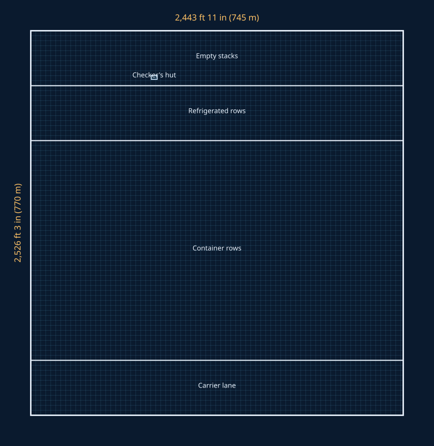

# P4-30 Container Stacks 9: plan

Footprint 2,443 ft 11 in (745 m) × 2,526 ft 3 in (770 m) · structural grid 32 ft 10 in (10 m)

## Levels

| Level | Floor above deck | Height | Floor area |
|---|---|---|---|
| Level 1 · Yard | 0 ft (0 mm) | 13 ft 1 in (4,000 mm) | 1,033 sq ft (96 m²) |

## Elements

| ID | Designation | Type | Name | Level(s) | Size / length | Area | Status |
|---|---|---|---|---|---|---|---|
| E001 | D5F4P4B11A3R1 | zone | Empty stacks | L1 | 2,443 ft 11 in (745 m) × 360 ft 11 in (110 m) | 881,984 sq ft (81,939 m²) | proposed |
| E002 | D5F4P4B11A3R2 | room | Checker's hut | L1 | 39 ft 4 in (12 m) × 26 ft 3 in (8,000 mm) | 1,033 sq ft (96 m²) | proposed |
| E003 | D5F4P4B11A3R3 | zone | Refrigerated rows | L1 | 2,443 ft 11 in (745 m) × 360 ft 11 in (110 m) | 881,984 sq ft (81,939 m²) | proposed |
| E004 | D5F4P4B11A3R4 | zone | Container rows | L1 | 2,443 ft 11 in (745 m) × 1,443 ft 7 in (440 m) | 3,527,936 sq ft (327,756 m²) | proposed |
| E005 | D5F4P4B11A3R5 | zone | Carrier lane | L1 | 2,443 ft 11 in (745 m) × 360 ft 11 in (110 m) | 881,984 sq ft (81,939 m²) | proposed |

## Drawings

### Level 1 · Yard

