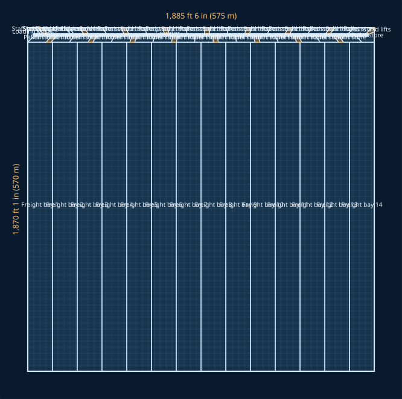
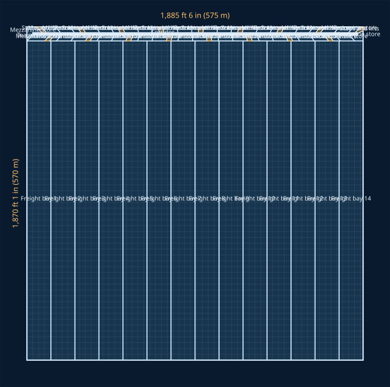

# P4-31 Freight Shed 9: plan

Footprint 1,885 ft 6 in (575 m) × 1,870 ft 1 in (570 m) · structural grid 32 ft 10 in (10 m)

## Levels

| Level | Floor above deck | Height | Floor area |
|---|---|---|---|
| Level 1 · Hall floor | 0 ft (0 mm) | 39 ft 4 in (12 m) | 3,486,442 sq ft (323,901 m²) |
| Level 2 · Gallery floor | 39 ft 4 in (12 m) | 14 ft 9 in (4,500 mm) | 3,486,442 sq ft (323,901 m²) |

## Elements

| ID | Designation | Type | Name | Level(s) | Size / length | Area | Status |
|---|---|---|---|---|---|---|---|
| E001 | D5F4P4B12A3L1R1, D5F4P4B12A3L2R1 | room | Freight bay 1 | L1, L2 | 134 ft 6 in (41 m) × 1,791 ft 4 in (546 m) | 240,961 sq ft (22,386 m²) | proposed |
| E002 | D5F4P4B12A3L1R2, D5F4P4B12A3L2R2 | room | Freight bay 2 | L1, L2 | 134 ft 10 in (41 m) × 1,791 ft 4 in (546 m) | 241,549 sq ft (22,441 m²) | proposed |
| E003 | D5F4P4B12A3L1R3, D5F4P4B12A3L2R3 | room | Freight bay 3 | L1, L2 | 134 ft 6 in (41 m) × 1,791 ft 4 in (546 m) | 240,961 sq ft (22,386 m²) | proposed |
| E004 | D5F4P4B12A3L1R4, D5F4P4B12A3L2R4 | room | Freight bay 4 | L1, L2 | 134 ft 10 in (41 m) × 1,791 ft 4 in (546 m) | 241,549 sq ft (22,441 m²) | proposed |
| E005 | D5F4P4B12A3L1R5, D5F4P4B12A3L2R5 | room | Freight bay 5 | L1, L2 | 134 ft 10 in (41 m) × 1,791 ft 4 in (546 m) | 241,549 sq ft (22,441 m²) | proposed |
| E006 | D5F4P4B12A3L1R6, D5F4P4B12A3L2R6 | room | Freight bay 6 | L1, L2 | 134 ft 6 in (41 m) × 1,791 ft 4 in (546 m) | 240,961 sq ft (22,386 m²) | proposed |
| E007 | D5F4P4B12A3L1R7, D5F4P4B12A3L2R7 | room | Freight bay 7 | L1, L2 | 134 ft 10 in (41 m) × 1,791 ft 4 in (546 m) | 241,549 sq ft (22,441 m²) | proposed |
| E008 | D5F4P4B12A3L1R8, D5F4P4B12A3L2R8 | room | Freight bay 8 | L1, L2 | 134 ft 6 in (41 m) × 1,791 ft 4 in (546 m) | 240,961 sq ft (22,386 m²) | proposed |
| E009 | D5F4P4B12A3L1R9, D5F4P4B12A3L2R9 | room | Freight bay 9 | L1, L2 | 134 ft 10 in (41 m) × 1,791 ft 4 in (546 m) | 241,549 sq ft (22,441 m²) | proposed |
| E010 | D5F4P4B12A3L1R10, D5F4P4B12A3L2R10 | room | Freight bay 10 | L1, L2 | 134 ft 6 in (41 m) × 1,791 ft 4 in (546 m) | 240,961 sq ft (22,386 m²) | proposed |
| E011 | D5F4P4B12A3L1R11, D5F4P4B12A3L2R11 | room | Freight bay 11 | L1, L2 | 134 ft 10 in (41 m) × 1,791 ft 4 in (546 m) | 241,549 sq ft (22,441 m²) | proposed |
| E012 | D5F4P4B12A3L1R12, D5F4P4B12A3L2R12 | room | Freight bay 12 | L1, L2 | 134 ft 6 in (41 m) × 1,791 ft 4 in (546 m) | 240,961 sq ft (22,386 m²) | proposed |
| E013 | D5F4P4B12A3L1R13, D5F4P4B12A3L2R13 | room | Freight bay 13 | L1, L2 | 134 ft 10 in (41 m) × 1,791 ft 4 in (546 m) | 241,549 sq ft (22,441 m²) | proposed |
| E014 | D5F4P4B12A3L1R14, D5F4P4B12A3L2R14 | room | Freight bay 14 | L1, L2 | 134 ft 6 in (41 m) × 1,791 ft 4 in (546 m) | 240,961 sq ft (22,386 m²) | proposed |
| E015 | D5F4P4B12A3L1R15, D5F4P4B12A3L2R15 | core | Stairs and lifts | L1, L2 | 56 ft 5 in (17 m) × 32 ft 6 in (9,900 mm) | 853 sq ft (79 m²) | proposed |
| E016 | D5F4P4B12A3L1R16, D5F4P4B12A3L2R16 | core | Stairs and lifts | L1, L2 | 48 ft 7 in (15 m) × 32 ft 6 in (9,900 mm) | 853 sq ft (79 m²) | proposed |
| E017 | D5F4P4B12A3L1R17, D5F4P4B12A3L2R17 | core | Stairs and lifts | L1, L2 | 40 ft 8 in (12 m) × 32 ft 6 in (9,900 mm) | 853 sq ft (79 m²) | proposed |
| E018 | D5F4P4B12A3L1R18, D5F4P4B12A3L2R18 | core | Stairs and lifts | L1, L2 | 33 ft 2 in (10 m) × 32 ft 6 in (9,900 mm) | 858 sq ft (80 m²) | proposed |
| E019 | D5F4P4B12A3L1R19, D5F4P4B12A3L2R19 | core | Stairs and lifts | L1, L2 | 27 ft 7 in (8,400 mm) × 32 ft 6 in (9,900 mm) | 858 sq ft (80 m²) | proposed |
| E020 | D5F4P4B12A3L1R20, D5F4P4B12A3L2R20 | core | Stairs and lifts | L1, L2 | 35 ft 5 in (11 m) × 32 ft 6 in (9,900 mm) | 858 sq ft (80 m²) | proposed |
| E021 | D5F4P4B12A3L1R21, D5F4P4B12A3L2R21 | core | Stairs and lifts | L1, L2 | 43 ft 4 in (13 m) × 32 ft 6 in (9,900 mm) | 858 sq ft (80 m²) | proposed |
| E022 | D5F4P4B12A3L1R22, D5F4P4B12A3L2R22 | core | Stairs and lifts | L1, L2 | 50 ft 10 in (16 m) × 32 ft 6 in (9,900 mm) | 853 sq ft (79 m²) | proposed |
| E023 | D5F4P4B12A3L1R23, D5F4P4B12A3L2R23 | core | Stairs and lifts | L1, L2 | 45 ft 3 in (14 m) × 36 ft 5 in (11 m) | 853 sq ft (79 m²) | proposed |
| E024 | D5F4P4B12A3L1R24, D5F4P4B12A3L2R24 | core | Stairs and lifts | L1, L2 | 52 ft 6 in (16 m) × 32 ft 6 in (9,900 mm) | 853 sq ft (79 m²) | proposed |
| E025 | D5F4P4B12A3L1R25, D5F4P4B12A3L2R25 | core | Stairs and lifts | L1, L2 | 44 ft 7 in (14 m) × 32 ft 6 in (9,900 mm) | 853 sq ft (79 m²) | proposed |
| E026 | D5F4P4B12A3L1R26, D5F4P4B12A3L2R26 | core | Stairs and lifts | L1, L2 | 36 ft 9 in (11 m) × 32 ft 6 in (9,900 mm) | 853 sq ft (79 m²) | proposed |
| E027 | D5F4P4B12A3L1R27, D5F4P4B12A3L2R27 | core | Stairs and lifts | L1, L2 | 28 ft 10 in (8,800 mm) × 32 ft 6 in (9,900 mm) | 847 sq ft (79 m²) | proposed |
| E028 | D5F4P4B12A3L1R28, D5F4P4B12A3L2R28 | core | Stairs and lifts | L1, L2 | 31 ft 2 in (9,500 mm) × 32 ft 6 in (9,900 mm) | 847 sq ft (79 m²) | proposed |
| E029 | D5F4P4B12A3L1R29, D5F4P4B12A3L2R29 | core | Stairs and lifts | L1, L2 | 39 ft 1 in (12 m) × 32 ft 6 in (9,900 mm) | 853 sq ft (79 m²) | proposed |
| E030 | D5F4P4B12A3L1R30, D5F4P4B12A3L2R30 | core | Stairs and lifts | L1, L2 | 46 ft 11 in (14 m) × 32 ft 6 in (9,900 mm) | 853 sq ft (79 m²) | proposed |
| E031 | D5F4P4B12A3L1R31, D5F4P4B12A3L2R31 | core | Stairs and lifts | L1, L2 | 54 ft 9 in (17 m) × 32 ft 6 in (9,900 mm) | 853 sq ft (79 m²) | proposed |
| E032 | D5F4P4B12A3L1R32 | zone | Corridor | L1 | 1,820 ft 6 in (555 m) × 13 ft 9 in (4,200 mm) | 17,957 sq ft (1,668 m²) | proposed |
| E033 | D5F4P4B12A3L1R33 | room | Loading docks | L1 | 68 ft 7 in (21 m) × 78 ft 9 in (24 m) | 2,696 sq ft (250 m²) | proposed |
| E034 | D5F4P4B12A3L1R34 | room | Shed office | L1 | 46 ft 7 in (14 m) × 32 ft 6 in (9,900 mm) | 506 sq ft (47 m²) | proposed |
| E035 | D5F4P4B12A3L1R35 | room | Staff toilets and showers | L1 | 52 ft 6 in (16 m) × 32 ft 6 in (9,900 mm) | 757 sq ft (70 m²) | proposed |
| E036 | D5F4P4B12A3L1R36 | room | Cross-dock area | L1 | 126 ft 8 in (39 m) × 32 ft 6 in (9,900 mm) | 3,229 sq ft (300 m²) | proposed |
| E037 | D5F4P4B12A3L1R37 | room | Damaged goods room | L1 | 44 ft 11 in (14 m) × 32 ft 6 in (9,900 mm) | 645 sq ft (60 m²) | proposed |
| E038 | D5F4P4B12A3L1R38 | room | Pallet store | L1 | 78 ft 5 in (24 m) × 32 ft 6 in (9,900 mm) | 1,774 sq ft (165 m²) | proposed |
| E039 | D5F4P4B12A3L1R39 | room | Pallet store | L1 | 119 ft 5 in (36 m) × 32 ft 6 in (9,900 mm) | 3,229 sq ft (300 m²) | proposed |
| E040 | D5F4P4B12A3L1R40 | room | Pallet store | L1 | 114 ft 6 in (35 m) × 32 ft 6 in (9,900 mm) | 3,176 sq ft (295 m²) | proposed |
| E041 | D5F4P4B12A3L1R41 | room | Pallet store | L1 | 111 ft 11 in (34 m) × 32 ft 6 in (9,900 mm) | 3,234 sq ft (300 m²) | proposed |
| E042 | D5F4P4B12A3L1R42 | room | Pallet store | L1 | 106 ft 8 in (32 m) × 32 ft 6 in (9,900 mm) | 3,170 sq ft (295 m²) | proposed |
| E043 | D5F4P4B12A3L1R43 | room | Pallet store | L1 | 104 ft (32 m) × 32 ft 6 in (9,900 mm) | 3,229 sq ft (300 m²) | proposed |
| E044 | D5F4P4B12A3L1R44 | room | Pallet store | L1 | 99 ft 5 in (30 m) × 32 ft 6 in (9,900 mm) | 3,170 sq ft (295 m²) | proposed |
| E045 | D5F4P4B12A3L1R45 | room | Pallet store | L1 | 102 ft 8 in (31 m) × 32 ft 6 in (9,900 mm) | 3,229 sq ft (300 m²) | proposed |
| E046 | D5F4P4B12A3L1R46 | room | Pallet store | L1 | 104 ft 4 in (32 m) × 32 ft 6 in (9,900 mm) | 3,170 sq ft (295 m²) | proposed |
| E047 | D5F4P4B12A3L1R47 | room | Pallet store | L1 | 110 ft 7 in (34 m) × 32 ft 6 in (9,900 mm) | 3,229 sq ft (300 m²) | proposed |
| E048 | D5F4P4B12A3L1R48 | room | Pallet store | L1 | 112 ft 2 in (34 m) × 32 ft 6 in (9,900 mm) | 3,170 sq ft (295 m²) | proposed |
| E049 | D5F4P4B12A3L1R49 | room | Pallet store | L1 | 118 ft 5 in (36 m) × 32 ft 6 in (9,900 mm) | 3,229 sq ft (300 m²) | proposed |
| E050 | D5F4P4B12A3L1R50 | room | Pallet store | L1 | 120 ft 1 in (37 m) × 32 ft 6 in (9,900 mm) | 3,176 sq ft (295 m²) | proposed |
| E051 | D5F4P4B12A3L1R51 | room | Pallet store | L1 | 126 ft 4 in (38 m) × 32 ft 6 in (9,900 mm) | 3,229 sq ft (300 m²) | proposed |
| E052 | D5F4P4B12A3L1R52 | room | Pallet store | L1 | 127 ft 11 in (39 m) × 32 ft 6 in (9,900 mm) | 3,176 sq ft (295 m²) | proposed |
| E053 | D5F4P4B12A3L1R53 | room | Pallet store | L1 | 97 ft 9 in (30 m) × 56 ft 5 in (17 m) | 3,234 sq ft (300 m²) | proposed |
| E054 | D5F4P4B12A3L1R54 | room | Pallet store | L1 | 126 ft (38 m) × 32 ft 6 in (9,900 mm) | 3,170 sq ft (295 m²) | proposed |
| E055 | D5F4P4B12A3L1R55 | room | Pallet store | L1 | 123 ft 8 in (38 m) × 32 ft 6 in (9,900 mm) | 3,234 sq ft (300 m²) | proposed |
| E056 | D5F4P4B12A3L1R56 | room | Pallet store | L1 | 118 ft 1 in (36 m) × 32 ft 6 in (9,900 mm) | 3,170 sq ft (295 m²) | proposed |
| E057 | D5F4P4B12A3L1R57 | room | Pallet store | L1 | 115 ft 10 in (35 m) × 32 ft 6 in (9,900 mm) | 3,234 sq ft (300 m²) | proposed |
| E058 | D5F4P4B12A3L1R58 | room | Pallet store | L1 | 110 ft 3 in (34 m) × 32 ft 6 in (9,900 mm) | 3,170 sq ft (295 m²) | proposed |
| E059 | D5F4P4B12A3L1R59 | room | Pallet store | L1 | 107 ft 11 in (33 m) × 32 ft 6 in (9,900 mm) | 3,234 sq ft (300 m²) | proposed |
| E060 | D5F4P4B12A3L1R60 | room | Pallet store | L1 | 102 ft 8 in (31 m) × 32 ft 6 in (9,900 mm) | 3,176 sq ft (295 m²) | proposed |
| E061 | D5F4P4B12A3L1R61 | room | Pallet store | L1 | 101 ft 5 in (31 m) × 32 ft 6 in (9,900 mm) | 3,234 sq ft (300 m²) | proposed |
| E062 | D5F4P4B12A3L1R62 | room | Pallet store | L1 | 100 ft 9 in (31 m) × 32 ft 6 in (9,900 mm) | 3,176 sq ft (295 m²) | proposed |
| E063 | D5F4P4B12A3L1R63 | room | Pallet store | L1 | 106 ft 11 in (33 m) × 32 ft 6 in (9,900 mm) | 3,234 sq ft (300 m²) | proposed |
| E064 | D5F4P4B12A3L1R64 | room | Pallet store | L1 | 108 ft 7 in (33 m) × 32 ft 6 in (9,900 mm) | 3,176 sq ft (295 m²) | proposed |
| E065 | D5F4P4B12A3L1R65 | room | Pallet store | L1 | 114 ft 6 in (35 m) × 32 ft 6 in (9,900 mm) | 3,234 sq ft (300 m²) | proposed |
| E066 | D5F4P4B12A3L1R66 | room | Pallet store | L1 | 116 ft 2 in (35 m) × 32 ft 6 in (9,900 mm) | 3,170 sq ft (295 m²) | proposed |
| E067 | D5F4P4B12A3L1R67 | room | Pallet store | L1 | 122 ft 5 in (37 m) × 32 ft 6 in (9,900 mm) | 3,234 sq ft (300 m²) | proposed |
| E068 | D5F4P4B12A3L1R68 | room | Pallet store | L1 | 124 ft (38 m) × 32 ft 6 in (9,900 mm) | 3,170 sq ft (295 m²) | proposed |
| E069 | D5F4P4B12A3L1R69 | room | Pallet store | L1 | 129 ft 3 in (39 m) × 32 ft 6 in (9,900 mm) | 3,202 sq ft (297 m²) | proposed |
| E070 | D5F4P4B12A3L2R32 | zone | Corridor | L2 | 1,820 ft 6 in (555 m) × 13 ft 9 in (4,200 mm) | 17,957 sq ft (1,668 m²) | proposed |
| E071 | D5F4P4B12A3L2R33 | room | Tea point | L2 | 32 ft 6 in (9,900 mm) × 35 ft 9 in (11 m) | 368 sq ft (34 m²) | proposed |
| E072 | D5F4P4B12A3L2R34 | room | Mezzanine store | L2 | 84 ft (26 m) × 59 ft 5 in (18 m) | 2,835 sq ft (263 m²) | proposed |
| E073 | D5F4P4B12A3L2R35 | room | Mezzanine store | L2 | 107 ft 11 in (33 m) × 32 ft 6 in (9,900 mm) | 2,589 sq ft (241 m²) | proposed |
| E074 | D5F4P4B12A3L2R36 | room | Mezzanine store | L2 | 105 ft (32 m) × 32 ft 6 in (9,900 mm) | 2,584 sq ft (240 m²) | proposed |
| E075 | D5F4P4B12A3L2R37 | room | Mezzanine store | L2 | 61 ft 4 in (19 m) × 32 ft 6 in (9,900 mm) | 1,231 sq ft (114 m²) | proposed |
| E076 | D5F4P4B12A3L2R38 | room | Mezzanine store | L2 | 100 ft 1 in (30 m) × 32 ft 6 in (9,900 mm) | 2,589 sq ft (241 m²) | proposed |
| E077 | D5F4P4B12A3L2R39 | room | Mezzanine store | L2 | 97 ft 1 in (30 m) × 32 ft 6 in (9,900 mm) | 2,584 sq ft (240 m²) | proposed |
| E078 | D5F4P4B12A3L2R40 | room | Mezzanine store | L2 | 53 ft 6 in (16 m) × 32 ft 6 in (9,900 mm) | 1,231 sq ft (114 m²) | proposed |
| E079 | D5F4P4B12A3L2R41 | room | Mezzanine store | L2 | 92 ft 2 in (28 m) × 32 ft 6 in (9,900 mm) | 2,589 sq ft (241 m²) | proposed |
| E080 | D5F4P4B12A3L2R42 | room | Mezzanine store | L2 | 89 ft 3 in (27 m) × 32 ft 6 in (9,900 mm) | 2,584 sq ft (240 m²) | proposed |
| E081 | D5F4P4B12A3L2R43 | room | Mezzanine store | L2 | 45 ft 7 in (14 m) × 32 ft 6 in (9,900 mm) | 1,231 sq ft (114 m²) | proposed |
| E082 | D5F4P4B12A3L2R44 | room | Mezzanine store | L2 | 84 ft 4 in (26 m) × 32 ft 6 in (9,900 mm) | 2,584 sq ft (240 m²) | proposed |
| E083 | D5F4P4B12A3L2R45 | room | Mezzanine store | L2 | 81 ft 8 in (25 m) × 32 ft 6 in (9,900 mm) | 2,589 sq ft (241 m²) | proposed |
| E084 | D5F4P4B12A3L2R46 | room | Mezzanine store | L2 | 38 ft 5 in (12 m) × 32 ft 6 in (9,900 mm) | 1,225 sq ft (114 m²) | proposed |
| E085 | D5F4P4B12A3L2R47 | room | Mezzanine store | L2 | 82 ft 8 in (25 m) × 32 ft 6 in (9,900 mm) | 2,584 sq ft (240 m²) | proposed |
| E086 | D5F4P4B12A3L2R48 | room | Mezzanine store | L2 | 85 ft 8 in (26 m) × 32 ft 6 in (9,900 mm) | 2,589 sq ft (241 m²) | proposed |
| E087 | D5F4P4B12A3L2R49 | room | Mezzanine store | L2 | 45 ft 7 in (14 m) × 32 ft 6 in (9,900 mm) | 1,225 sq ft (114 m²) | proposed |
| E088 | D5F4P4B12A3L2R50 | room | Mezzanine store | L2 | 90 ft 7 in (28 m) × 32 ft 6 in (9,900 mm) | 2,584 sq ft (240 m²) | proposed |
| E089 | D5F4P4B12A3L2R51 | room | Mezzanine store | L2 | 93 ft 6 in (28 m) × 32 ft 6 in (9,900 mm) | 2,589 sq ft (241 m²) | proposed |
| E090 | D5F4P4B12A3L2R52 | room | Mezzanine store | L2 | 53 ft 6 in (16 m) × 32 ft 6 in (9,900 mm) | 1,225 sq ft (114 m²) | proposed |
| E091 | D5F4P4B12A3L2R53 | room | Mezzanine store | L2 | 98 ft 5 in (30 m) × 32 ft 6 in (9,900 mm) | 2,589 sq ft (241 m²) | proposed |
| E092 | D5F4P4B12A3L2R54 | room | Mezzanine store | L2 | 101 ft 1 in (31 m) × 32 ft 6 in (9,900 mm) | 2,584 sq ft (240 m²) | proposed |
| E093 | D5F4P4B12A3L2R55 | room | Mezzanine store | L2 | 61 ft 4 in (19 m) × 32 ft 6 in (9,900 mm) | 1,231 sq ft (114 m²) | proposed |
| E094 | D5F4P4B12A3L2R56 | room | Mezzanine store | L2 | 106 ft 4 in (32 m) × 32 ft 6 in (9,900 mm) | 2,589 sq ft (241 m²) | proposed |
| E095 | D5F4P4B12A3L2R57 | room | Mezzanine store | L2 | 108 ft 11 in (33 m) × 32 ft 6 in (9,900 mm) | 2,584 sq ft (240 m²) | proposed |
| E096 | D5F4P4B12A3L2R58 | room | Mezzanine store | L2 | 69 ft 3 in (21 m) × 32 ft 6 in (9,900 mm) | 1,231 sq ft (114 m²) | proposed |
| E097 | D5F4P4B12A3L2R59 | room | Mezzanine store | L2 | 78 ft 1 in (24 m) × 56 ft 5 in (17 m) | 2,584 sq ft (240 m²) | proposed |
| E098 | D5F4P4B12A3L2R60 | room | Mezzanine store | L2 | 108 ft 11 in (33 m) × 32 ft 6 in (9,900 mm) | 2,584 sq ft (240 m²) | proposed |
| E099 | D5F4P4B12A3L2R61 | room | Mezzanine store | L2 | 65 ft 3 in (20 m) × 32 ft 6 in (9,900 mm) | 1,236 sq ft (115 m²) | proposed |
| E100 | D5F4P4B12A3L2R62 | room | Mezzanine store | L2 | 104 ft (32 m) × 32 ft 6 in (9,900 mm) | 2,584 sq ft (240 m²) | proposed |
| E101 | D5F4P4B12A3L2R63 | room | Mezzanine store | L2 | 101 ft 5 in (31 m) × 32 ft 6 in (9,900 mm) | 2,589 sq ft (241 m²) | proposed |
| E102 | D5F4P4B12A3L2R64 | room | Mezzanine store | L2 | 57 ft 5 in (18 m) × 32 ft 6 in (9,900 mm) | 1,231 sq ft (114 m²) | proposed |
| E103 | D5F4P4B12A3L2R65 | room | Mezzanine store | L2 | 96 ft 2 in (29 m) × 32 ft 6 in (9,900 mm) | 2,584 sq ft (240 m²) | proposed |
| E104 | D5F4P4B12A3L2R66 | room | Mezzanine store | L2 | 93 ft 6 in (28 m) × 32 ft 6 in (9,900 mm) | 2,589 sq ft (241 m²) | proposed |
| E105 | D5F4P4B12A3L2R67 | room | Mezzanine store | L2 | 49 ft 6 in (15 m) × 32 ft 6 in (9,900 mm) | 1,231 sq ft (114 m²) | proposed |
| E106 | D5F4P4B12A3L2R68 | room | Mezzanine store | L2 | 88 ft 3 in (27 m) × 32 ft 6 in (9,900 mm) | 2,584 sq ft (240 m²) | proposed |
| E107 | D5F4P4B12A3L2R69 | room | Mezzanine store | L2 | 85 ft 8 in (26 m) × 32 ft 6 in (9,900 mm) | 2,589 sq ft (241 m²) | proposed |
| E108 | D5F4P4B12A3L2R70 | room | Mezzanine store | L2 | 42 ft (13 m) × 32 ft 6 in (9,900 mm) | 1,236 sq ft (115 m²) | proposed |
| E109 | D5F4P4B12A3L2R71 | room | Mezzanine store | L2 | 81 ft (25 m) × 32 ft 6 in (9,900 mm) | 2,589 sq ft (241 m²) | proposed |
| E110 | D5F4P4B12A3L2R72 | room | Mezzanine store | L2 | 81 ft 4 in (25 m) × 32 ft 6 in (9,900 mm) | 2,584 sq ft (240 m²) | proposed |
| E111 | D5F4P4B12A3L2R73 | room | Mezzanine store | L2 | 42 ft (13 m) × 32 ft 6 in (9,900 mm) | 1,236 sq ft (115 m²) | proposed |
| E112 | D5F4P4B12A3L2R74 | room | Mezzanine store | L2 | 86 ft 7 in (26 m) × 32 ft 6 in (9,900 mm) | 2,589 sq ft (241 m²) | proposed |
| E113 | D5F4P4B12A3L2R75 | room | Mezzanine store | L2 | 89 ft 3 in (27 m) × 32 ft 6 in (9,900 mm) | 2,584 sq ft (240 m²) | proposed |
| E114 | D5F4P4B12A3L2R76 | room | Mezzanine store | L2 | 49 ft 10 in (15 m) × 32 ft 6 in (9,900 mm) | 1,236 sq ft (115 m²) | proposed |
| E115 | D5F4P4B12A3L2R77 | room | Mezzanine store | L2 | 94 ft 2 in (29 m) × 32 ft 6 in (9,900 mm) | 2,584 sq ft (240 m²) | proposed |
| E116 | D5F4P4B12A3L2R78 | room | Mezzanine store | L2 | 97 ft 1 in (30 m) × 32 ft 6 in (9,900 mm) | 2,584 sq ft (240 m²) | proposed |
| E117 | D5F4P4B12A3L2R79 | room | Mezzanine store | L2 | 57 ft 9 in (18 m) × 32 ft 6 in (9,900 mm) | 1,236 sq ft (115 m²) | proposed |
| E118 | D5F4P4B12A3L2R80 | room | Mezzanine store | L2 | 102 ft (31 m) × 32 ft 6 in (9,900 mm) | 2,584 sq ft (240 m²) | proposed |
| E119 | D5F4P4B12A3L2R81 | room | Mezzanine store | L2 | 105 ft (32 m) × 32 ft 6 in (9,900 mm) | 2,589 sq ft (241 m²) | proposed |
| E120 | D5F4P4B12A3L2R82 | room | Mezzanine store | L2 | 65 ft 3 in (20 m) × 32 ft 6 in (9,900 mm) | 1,231 sq ft (114 m²) | proposed |
| E121 | D5F4P4B12A3L2R83 | room | Mezzanine store | L2 | 129 ft 3 in (39 m) × 32 ft 6 in (9,900 mm) | 3,202 sq ft (297 m²) | proposed |

## Drawings

### Level 1 · Hall floor

### Level 2 · Gallery floor

