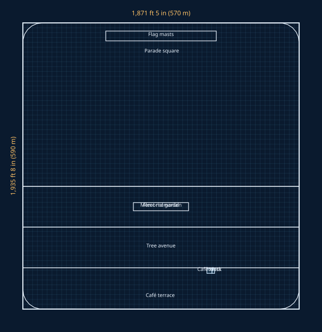

# P5-05 Fleet Plaza: plan

Footprint 1,871 ft 5 in (570 m) × 1,935 ft 8 in (590 m) · structural grid 32 ft 10 in (10 m)

## Levels

| Level | Floor above deck | Height | Floor area |
|---|---|---|---|
| Level 1 · Ground | 0 ft (0 mm) | 13 ft 1 in (4,000 mm) | 1,722 sq ft (160 m²) |

## Elements

| ID | Designation | Type | Name | Level(s) | Size / length | Area | Status |
|---|---|---|---|---|---|---|---|
| E001 | D5F4P5B5A1R1 | zone | Parade square | L1 | 1,870 ft 9 in (570 m) × 1,105 ft 4 in (337 m) | 2,058,394 sq ft (191,231 m²) | proposed |
| E002 |  | fixture | Flag masts | L1 | 748 ft 4 in (228 m) × 66 ft 7 in (20 m) | 49,842 sq ft (4,630 m²) | proposed |
| E003 | D5F4P5B5A1R2 | zone | Memorial garden | L1 | 1,870 ft 5 in (570 m) × 275 ft 3 in (84 m) | 514,763 sq ft (47,823 m²) | proposed |
| E004 |  | fixture | Fleet memorial | L1 | 374 ft (114 m) × 55 ft 1 in (17 m) | 20,615 sq ft (1,915 m²) | proposed |
| E005 | D5F4P5B5A1R3 | zone | Tree avenue | L1 | 1,870 ft 5 in (570 m) × 275 ft 3 in (84 m) | 514,763 sq ft (47,823 m²) | proposed |
| E006 | D5F4P5B5A1R4 | zone | Café terrace | L1 | 1,870 ft 1 in (570 m) × 279 ft 10 in (85 m) | 514,732 sq ft (47,820 m²) | proposed |
| E007 | D5F4P5B5A1R5 | room | Café kiosk | L1 | 35 ft 1 in (11 m) × 32 ft 10 in (10,000 mm) | 1,152 sq ft (107 m²) | proposed |
| E008 | D5F4P5B5A1R6 | room | Toilets | L1 | 17 ft 5 in (5,300 mm) × 32 ft 10 in (10,000 mm) | 570 sq ft (53 m²) | proposed |

## Drawings

### Level 1 · Ground

