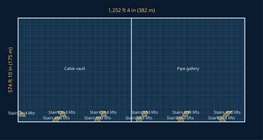
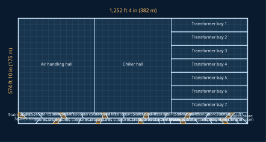
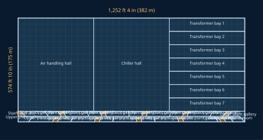

# P5-12 Fleet Quarter Utility Plant: plan

Footprint 1,252 ft 4 in (382 m) × 574 ft 10 in (175 m) · structural grid 32 ft 10 in (10 m)

## Levels

| Level | Floor above deck | Height | Floor area |
|---|---|---|---|
| Level B1 · Pipe and cable basement | −16 ft 5 in (5,000 mm) | 16 ft 5 in (5,000 mm) | 719,824 sq ft (66,874 m²) |
| Level 1 · Plant floor | 0 ft (0 mm) | 26 ft 3 in (8,000 mm) | 707,847 sq ft (65,761 m²) |
| Level 2 · Upper plant deck | 26 ft 3 in (8,000 mm) | 19 ft 8 in (6,000 mm) | 707,847 sq ft (65,761 m²) |

## Elements

| ID | Designation | Type | Name | Level(s) | Size / length | Area | Status |
|---|---|---|---|---|---|---|---|
| E001 | D5F4P5B14A1L1R1, D5F4P5B14A1L2R1 | room | Transformer bay 1 | L1, L2 | 417 ft 4 in (127 m) × 73 ft 10 in (22 m) | 30,806 sq ft (2,862 m²) | proposed |
| E002 | D5F4P5B14A1L1R2, D5F4P5B14A1L2R2 | room | Transformer bay 2 | L1, L2 | 417 ft 4 in (127 m) × 73 ft 6 in (22 m) | 30,669 sq ft (2,849 m²) | proposed |
| E003 | D5F4P5B14A1L1R3, D5F4P5B14A1L2R3 | room | Transformer bay 3 | L1, L2 | 417 ft 4 in (127 m) × 73 ft 10 in (23 m) | 30,806 sq ft (2,862 m²) | proposed |
| E004 | D5F4P5B14A1L1R4, D5F4P5B14A1L2R4 | room | Transformer bay 4 | L1, L2 | 417 ft 4 in (127 m) × 73 ft 6 in (22 m) | 30,669 sq ft (2,849 m²) | proposed |
| E005 | D5F4P5B14A1L1R5, D5F4P5B14A1L2R5 | room | Transformer bay 5 | L1, L2 | 417 ft 4 in (127 m) × 73 ft 10 in (22 m) | 30,806 sq ft (2,862 m²) | proposed |
| E006 | D5F4P5B14A1L1R6, D5F4P5B14A1L2R6 | room | Transformer bay 6 | L1, L2 | 417 ft 4 in (127 m) × 73 ft 6 in (22 m) | 30,669 sq ft (2,849 m²) | proposed |
| E007 | D5F4P5B14A1L1R7, D5F4P5B14A1L2R7 | room | Transformer bay 7 | L1, L2 | 417 ft 4 in (127 m) × 73 ft 10 in (22 m) | 30,806 sq ft (2,862 m²) | proposed |
| E008 | D5F4P5B14A1L1R8, D5F4P5B14A1L2R8 | room | Chiller hall | L1, L2 | 417 ft 8 in (127 m) × 515 ft 9 in (157 m) | 215,403 sq ft (20,012 m²) | proposed |
| E009 | D5F4P5B14A1L1R9, D5F4P5B14A1L2R9 | room | Air handling hall | L1, L2 | 417 ft 4 in (127 m) × 515 ft 9 in (157 m) | 215,233 sq ft (19,996 m²) | proposed |
| E010 | D5F4P5B14A1LB1R1, D5F4P5B14A1L1R10, D5F4P5B14A1L2R10 | core | Stairs and lifts | LB1, L1, L2 | 48 ft 11 in (15 m) × 27 ft 11 in (8,500 mm) | 732 sq ft (68 m²) | proposed |
| E011 | D5F4P5B14A1LB1R2, D5F4P5B14A1L1R11, D5F4P5B14A1L2R11 | core | Stairs and lifts | LB1, L1, L2 | 38 ft 9 in (12 m) × 27 ft 11 in (8,500 mm) | 732 sq ft (68 m²) | proposed |
| E012 | D5F4P5B14A1LB1R3, D5F4P5B14A1L1R12, D5F4P5B14A1L2R12 | core | Stairs and lifts | LB1, L1, L2 | 28 ft 3 in (8,600 mm) × 27 ft 11 in (8,500 mm) | 732 sq ft (68 m²) | proposed |
| E013 | D5F4P5B14A1LB1R4, D5F4P5B14A1L1R13, D5F4P5B14A1L2R13 | core | Stairs and lifts | LB1, L1, L2 | 34 ft 9 in (11 m) × 27 ft 11 in (8,500 mm) | 732 sq ft (68 m²) | proposed |
| E014 | D5F4P5B14A1LB1R5, D5F4P5B14A1L1R14, D5F4P5B14A1L2R14 | core | Stairs and lifts | LB1, L1, L2 | 45 ft 3 in (14 m) × 27 ft 11 in (8,500 mm) | 732 sq ft (68 m²) | proposed |
| E015 | D5F4P5B14A1LB1R6, D5F4P5B14A1L1R15, D5F4P5B14A1L2R15 | core | Stairs and lifts | LB1, L1, L2 | 40 ft 8 in (12 m) × 29 ft 2 in (8,900 mm) | 732 sq ft (68 m²) | proposed |
| E016 | D5F4P5B14A1LB1R7, D5F4P5B14A1L1R16, D5F4P5B14A1L2R16 | core | Stairs and lifts | LB1, L1, L2 | 43 ft 8 in (13 m) × 27 ft 11 in (8,500 mm) | 732 sq ft (68 m²) | proposed |
| E017 | D5F4P5B14A1LB1R8, D5F4P5B14A1L1R17, D5F4P5B14A1L2R17 | core | Stairs and lifts | LB1, L1, L2 | 33 ft 6 in (10 m) × 27 ft 11 in (8,500 mm) | 732 sq ft (68 m²) | proposed |
| E018 | D5F4P5B14A1LB1R9, D5F4P5B14A1L1R18, D5F4P5B14A1L2R18 | core | Stairs and lifts | LB1, L1, L2 | 29 ft 6 in (9,000 mm) × 27 ft 11 in (8,500 mm) | 732 sq ft (68 m²) | proposed |
| E019 | D5F4P5B14A1LB1R10, D5F4P5B14A1L1R19, D5F4P5B14A1L2R19 | core | Stairs and lifts | LB1, L1, L2 | 40 ft (12 m) × 27 ft 11 in (8,500 mm) | 732 sq ft (68 m²) | proposed |
| E020 | D5F4P5B14A1LB1R11, D5F4P5B14A1L1R20, D5F4P5B14A1L2R20 | core | Stairs and lifts | LB1, L1, L2 | 50 ft 6 in (15 m) × 27 ft 11 in (8,500 mm) | 732 sq ft (68 m²) | proposed |
| E021 | D5F4P5B14A1L1R21 | room | Control room | L1 | 73 ft 2 in (22 m) × 27 ft 11 in (8,500 mm) | 1,290 sq ft (120 m²) | proposed |
| E022 | D5F4P5B14A1L1R22 | room | Switch room | L1 | 79 ft 5 in (24 m) × 27 ft 11 in (8,500 mm) | 1,528 sq ft (142 m²) | proposed |
| E023 | D5F4P5B14A1L1R23 | room | Battery room | L1 | 82 ft (25 m) × 27 ft 11 in (8,500 mm) | 1,711 sq ft (159 m²) | proposed |
| E024 | D5F4P5B14A1L1R24 | room | Water pump room | L1 | 94 ft 6 in (29 m) × 27 ft 11 in (8,500 mm) | 2,146 sq ft (199 m²) | proposed |
| E025 | D5F4P5B14A1L1R25 | room | Water treatment room | L1 | 78 ft 1 in (24 m) × 27 ft 11 in (8,500 mm) | 1,775 sq ft (165 m²) | proposed |
| E026 | D5F4P5B14A1L1R26 | room | Workshop | L1 | 64 ft 4 in (20 m) × 27 ft 11 in (8,500 mm) | 1,500 sq ft (139 m²) | proposed |
| E027 | D5F4P5B14A1L1R27 | room | Locker room | L1 | 43 ft (13 m) × 27 ft 11 in (8,500 mm) | 965 sq ft (90 m²) | proposed |
| E028 | D5F4P5B14A1L1R28 | room | Staff toilets and showers | L1 | 33 ft 10 in (10 m) × 27 ft 11 in (8,500 mm) | 750 sq ft (70 m²) | proposed |
| E029 | D5F4P5B14A1L1R29 | room | Spares store | L1 | 91 ft 2 in (28 m) × 27 ft 11 in (8,500 mm) | 2,420 sq ft (225 m²) | proposed |
| E030 | D5F4P5B14A1L1R30 | room | Spares store | L1 | 94 ft 2 in (29 m) × 27 ft 11 in (8,500 mm) | 2,566 sq ft (238 m²) | proposed |
| E031 | D5F4P5B14A1L1R31 | room | Spares store | L1 | 115 ft 6 in (35 m) × 27 ft 11 in (8,500 mm) | 3,065 sq ft (285 m²) | proposed |
| E032 | D5F4P5B14A1L1R32 | room | Spares store | L1 | 103 ft 4 in (32 m) × 27 ft 11 in (8,500 mm) | 2,571 sq ft (239 m²) | proposed |
| E033 | D5F4P5B14A1L1R33 | room | Spares store | L1 | 125 ft 8 in (38 m) × 27 ft 11 in (8,500 mm) | 3,060 sq ft (284 m²) | proposed |
| E034 | D5F4P5B14A1L1R34 | room | Spares store | L1 | 113 ft 10 in (35 m) × 27 ft 11 in (8,500 mm) | 2,571 sq ft (239 m²) | proposed |
| E035 | D5F4P5B14A1L1R35 | room | Spares store | L1 | 117 ft 9 in (36 m) × 34 ft 1 in (10 m) | 3,070 sq ft (285 m²) | proposed |
| E036 | D5F4P5B14A1L1R36 | room | Spares store | L1 | 117 ft 5 in (36 m) × 27 ft 11 in (8,500 mm) | 2,571 sq ft (239 m²) | proposed |
| E037 | D5F4P5B14A1L1R37 | room | Spares store | L1 | 130 ft 7 in (40 m) × 27 ft 11 in (8,500 mm) | 3,065 sq ft (285 m²) | proposed |
| E038 | D5F4P5B14A1L1R38 | room | Spares store | L1 | 106 ft 11 in (33 m) × 27 ft 11 in (8,500 mm) | 2,571 sq ft (239 m²) | proposed |
| E039 | D5F4P5B14A1L1R39 | room | Spares store | L1 | 120 ft 1 in (37 m) × 27 ft 11 in (8,500 mm) | 3,060 sq ft (284 m²) | proposed |
| E040 | D5F4P5B14A1L1R40 | room | Spares store | L1 | 96 ft 9 in (30 m) × 27 ft 11 in (8,500 mm) | 2,576 sq ft (239 m²) | proposed |
| E041 | D5F4P5B14A1L1R41 | room | Spares store | L1 | 112 ft 2 in (34 m) × 27 ft 11 in (8,500 mm) | 3,060 sq ft (284 m²) | proposed |
| E042 | D5F4P5B14A1L1R42 | room | Spares store | L1 | 98 ft 1 in (30 m) × 27 ft 11 in (8,500 mm) | 2,566 sq ft (238 m²) | proposed |
| E043 | D5F4P5B14A1L1R43 | room | Spares store | L1 | 120 ft 5 in (37 m) × 27 ft 11 in (8,500 mm) | 3,060 sq ft (284 m²) | proposed |
| E044 | D5F4P5B14A1L1R44 | room | Spares store | L1 | 108 ft 11 in (33 m) × 27 ft 11 in (8,500 mm) | 2,576 sq ft (239 m²) | proposed |
| E045 | D5F4P5B14A1L1R45 | room | Spares store | L1 | 130 ft 11 in (40 m) × 27 ft 11 in (8,500 mm) | 3,060 sq ft (284 m²) | proposed |
| E046 | D5F4P5B14A1L1R46 | room | Spares store | L1 | 96 ft 5 in (29 m) × 59 ft 1 in (18 m) | 2,823 sq ft (262 m²) | proposed |
| E047 | D5F4P5B14A1L2R21 | room | Filter bank room | L2 | 87 ft 11 in (27 m) × 27 ft 11 in (8,500 mm) | 1,715 sq ft (159 m²) | proposed |
| E048 | D5F4P5B14A1L2R22 | room | Ductwork gallery | L2 | 63 ft 8 in (19 m) × 27 ft 11 in (8,500 mm) | 1,102 sq ft (102 m²) | proposed |
| E049 | D5F4P5B14A1L2R23 | room | Crew rest room | L2 | 37 ft 1 in (11 m) × 27 ft 11 in (8,500 mm) | 430 sq ft (40 m²) | proposed |
| E050 | D5F4P5B14A1L2R24 | room | Upper plant gallery | L2 | 203 ft 9 in (62 m) × 27 ft 11 in (8,500 mm) | 5,201 sq ft (483 m²) | proposed |
| E051 | D5F4P5B14A1L2R25 | room | Upper plant gallery | L2 | 138 ft 1 in (42 m) × 27 ft 11 in (8,500 mm) | 3,605 sq ft (335 m²) | proposed |
| E052 | D5F4P5B14A1L2R26 | room | Upper plant gallery | L2 | 77 ft 1 in (24 m) × 27 ft 11 in (8,500 mm) | 2,031 sq ft (189 m²) | proposed |
| E053 | D5F4P5B14A1L2R27 | room | Upper plant gallery | L2 | 132 ft 3 in (40 m) × 27 ft 11 in (8,500 mm) | 3,605 sq ft (335 m²) | proposed |
| E054 | D5F4P5B14A1L2R28 | room | Upper plant gallery | L2 | 79 ft 1 in (24 m) × 27 ft 11 in (8,500 mm) | 2,027 sq ft (188 m²) | proposed |
| E055 | D5F4P5B14A1L2R29 | room | Upper plant gallery | L2 | 141 ft 5 in (43 m) × 27 ft 11 in (8,500 mm) | 3,609 sq ft (335 m²) | proposed |
| E056 | D5F4P5B14A1L2R30 | room | Upper plant gallery | L2 | 89 ft 3 in (27 m) × 27 ft 11 in (8,500 mm) | 2,022 sq ft (188 m²) | proposed |
| E057 | D5F4P5B14A1L2R31 | room | Upper plant gallery | L2 | 151 ft 11 in (46 m) × 27 ft 11 in (8,500 mm) | 3,605 sq ft (335 m²) | proposed |
| E058 | D5F4P5B14A1L2R32 | room | Upper plant gallery | L2 | 81 ft 8 in (25 m) × 34 ft 1 in (10 m) | 2,036 sq ft (189 m²) | proposed |
| E059 | D5F4P5B14A1L2R33 | room | Upper plant gallery | L2 | 153 ft 7 in (47 m) × 27 ft 11 in (8,500 mm) | 3,605 sq ft (335 m²) | proposed |
| E060 | D5F4P5B14A1L2R34 | room | Upper plant gallery | L2 | 92 ft 6 in (28 m) × 27 ft 11 in (8,500 mm) | 2,031 sq ft (189 m²) | proposed |
| E061 | D5F4P5B14A1L2R35 | room | Upper plant gallery | L2 | 143 ft 1 in (44 m) × 27 ft 11 in (8,500 mm) | 3,605 sq ft (335 m²) | proposed |
| E062 | D5F4P5B14A1L2R36 | room | Upper plant gallery | L2 | 82 ft (25 m) × 27 ft 11 in (8,500 mm) | 2,027 sq ft (188 m²) | proposed |
| E063 | D5F4P5B14A1L2R37 | room | Upper plant gallery | L2 | 132 ft 10 in (40 m) × 27 ft 11 in (8,500 mm) | 3,605 sq ft (335 m²) | proposed |
| E064 | D5F4P5B14A1L2R38 | room | Upper plant gallery | L2 | 74 ft 6 in (23 m) × 27 ft 11 in (8,500 mm) | 2,031 sq ft (189 m²) | proposed |
| E065 | D5F4P5B14A1L2R39 | room | Upper plant gallery | L2 | 136 ft 2 in (41 m) × 27 ft 11 in (8,500 mm) | 3,605 sq ft (335 m²) | proposed |
| E066 | D5F4P5B14A1L2R40 | room | Upper plant gallery | L2 | 84 ft (26 m) × 27 ft 11 in (8,500 mm) | 2,022 sq ft (188 m²) | proposed |
| E067 | D5F4P5B14A1L2R41 | room | Upper plant gallery | L2 | 146 ft 8 in (45 m) × 27 ft 11 in (8,500 mm) | 3,605 sq ft (335 m²) | proposed |
| E068 | D5F4P5B14A1L2R42 | room | Upper plant gallery | L2 | 94 ft 10 in (29 m) × 27 ft 11 in (8,500 mm) | 2,031 sq ft (189 m²) | proposed |
| E069 | D5F4P5B14A1L2R43 | room | Upper plant gallery | L2 | 96 ft 5 in (29 m) × 59 ft 1 in (18 m) | 2,823 sq ft (262 m²) | proposed |
| E070 | D5F4P5B14A1LB1R12 | room | Cable vault | LB1 | 626 ft (191 m) × 574 ft 10 in (175 m) | 359,818 sq ft (33,428 m²) | proposed |
| E071 | D5F4P5B14A1LB1R13 | room | Pipe gallery | LB1 | 626 ft 4 in (191 m) × 574 ft 10 in (175 m) | 360,006 sq ft (33,446 m²) | proposed |

## Drawings

### Level B1 · Pipe and cable basement

### Level 1 · Plant floor

### Level 2 · Upper plant deck

