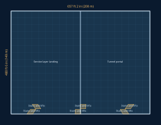
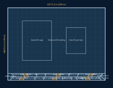
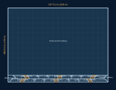

# P5-13 Fleet Quarter Service Shaft: plan

Footprint 657 ft 2 in (200 m) × 488 ft 6 in (149 m) · structural grid 32 ft 10 in (10 m)

## Levels

| Level | Floor above deck | Height | Floor area |
|---|---|---|---|
| Level B1 · Service layer landing | −19 ft 8 in (6,000 mm) | 19 ft 8 in (6,000 mm) | 321,030 sq ft (29,825 m²) |
| Level 1 · Lift landing | 0 ft (0 mm) | 29 ft 6 in (9,000 mm) | 315,988 sq ft (29,356 m²) |
| Level 2 · Winding room | 29 ft 6 in (9,000 mm) | 19 ft 8 in (6,000 mm) | 315,931 sq ft (29,351 m²) |

## Elements

| ID | Designation | Type | Name | Level(s) | Size / length | Area | Status |
|---|---|---|---|---|---|---|---|
| E001 | D5F4P5B15A1L1R1, D5F4P5B15A1L2R1 | room | Shaft and lift landing | L1, L2 | 657 ft 2 in (200 m) × 442 ft 7 in (135 m) | 290,846 sq ft (27,020 m²) | proposed |
| E002 |  | fixture | Goods lift cage | L1 | 197 ft 2 in (60 m) × 265 ft 5 in (81 m) | 52,335 sq ft (4,862 m²) | proposed |
| E003 |  | fixture | Crew lift and stair | L1 | 131 ft 3 in (40 m) × 176 ft 10 in (54 m) | 23,207 sq ft (2,156 m²) | proposed |
| E004 | D5F4P5B15A1LB1R1, D5F4P5B15A1L1R2, D5F4P5B15A1L2R2 | core | Stairs and lifts | LB1, L1, L2 | 40 ft 8 in (12 m) × 21 ft 8 in (6,600 mm) | 572 sq ft (53 m²) | proposed |
| E005 | D5F4P5B15A1LB1R2, D5F4P5B15A1L1R3, D5F4P5B15A1L2R3 | core | Stairs and lifts | LB1, L1, L2 | 27 ft 3 in (8,300 mm) × 21 ft 8 in (6,600 mm) | 572 sq ft (53 m²) | proposed |
| E006 | D5F4P5B15A1LB1R3, D5F4P5B15A1L1R4, D5F4P5B15A1L2R4 | core | Stairs and lifts | LB1, L1, L2 | 42 ft 4 in (13 m) × 21 ft 8 in (6,600 mm) | 572 sq ft (53 m²) | proposed |
| E007 | D5F4P5B15A1LB1R4, D5F4P5B15A1L1R5, D5F4P5B15A1L2R5 | core | Stairs and lifts | LB1, L1, L2 | 40 ft 8 in (12 m) × 21 ft 8 in (6,600 mm) | 572 sq ft (53 m²) | proposed |
| E008 | D5F4P5B15A1LB1R5, D5F4P5B15A1L1R6, D5F4P5B15A1L2R6 | core | Stairs and lifts | LB1, L1, L2 | 27 ft 3 in (8,300 mm) × 21 ft 8 in (6,600 mm) | 572 sq ft (53 m²) | proposed |
| E009 | D5F4P5B15A1LB1R6, D5F4P5B15A1L1R7, D5F4P5B15A1L2R7 | core | Stairs and lifts | LB1, L1, L2 | 42 ft 4 in (13 m) × 21 ft 8 in (6,600 mm) | 572 sq ft (53 m²) | proposed |
| E010 | D5F4P5B15A1L1R8 | room | Lift control room | L1 | 45 ft 7 in (14 m) × 21 ft 8 in (6,600 mm) | 536 sq ft (50 m²) | proposed |
| E011 | D5F4P5B15A1L1R9 | room | Loading bay | L1 | 89 ft 7 in (27 m) × 21 ft 8 in (6,600 mm) | 1,559 sq ft (145 m²) | proposed |
| E012 | D5F4P5B15A1L1R10 | room | Crew check-in | L1 | 32 ft 6 in (9,900 mm) × 21 ft 8 in (6,600 mm) | 426 sq ft (40 m²) | proposed |
| E013 | D5F4P5B15A1L1R11 | room | Tool store | L1 | 50 ft 2 in (15 m) × 21 ft 8 in (6,600 mm) | 856 sq ft (80 m²) | proposed |
| E014 | D5F4P5B15A1L1R12 | room | Staff toilets and showers | L1 | 42 ft 8 in (13 m) × 21 ft 8 in (6,600 mm) | 749 sq ft (70 m²) | proposed |
| E015 | D5F4P5B15A1L1R13 | room | Holding store | L1 | 64 ft (20 m) × 21 ft 8 in (6,600 mm) | 1,282 sq ft (119 m²) | proposed |
| E016 | D5F4P5B15A1L1R14 | room | Holding store | L1 | 41 ft 8 in (13 m) × 21 ft 8 in (6,600 mm) | 874 sq ft (81 m²) | proposed |
| E017 | D5F4P5B15A1L1R15 | room | Holding store | L1 | 63 ft (19 m) × 21 ft 8 in (6,600 mm) | 1,282 sq ft (119 m²) | proposed |
| E018 | D5F4P5B15A1L1R16 | room | Holding store | L1 | 67 ft 3 in (20 m) × 21 ft 8 in (6,600 mm) | 1,286 sq ft (119 m²) | proposed |
| E019 | D5F4P5B15A1L1R17 | room | Holding store | L1 | 87 ft 3 in (27 m) × 21 ft 8 in (6,600 mm) | 1,620 sq ft (150 m²) | proposed |
| E020 | D5F4P5B15A1L1R18 | room | Holding store | L1 | 78 ft 1 in (24 m) × 21 ft 8 in (6,600 mm) | 1,282 sq ft (119 m²) | proposed |
| E021 | D5F4P5B15A1L1R19 | room | Holding store | L1 | 42 ft 8 in (13 m) × 45 ft 11 in (14 m) | 1,289 sq ft (120 m²) | proposed |
| E022 | D5F4P5B15A1L1R20 | room | Holding store | L1 | 92 ft 6 in (28 m) × 21 ft 8 in (6,600 mm) | 1,623 sq ft (151 m²) | proposed |
| E023 | D5F4P5B15A1L1R21 | room | Holding store | L1 | 70 ft 6 in (22 m) × 21 ft 8 in (6,600 mm) | 1,282 sq ft (119 m²) | proposed |
| E024 | D5F4P5B15A1L1R22 | room | Holding store | L1 | 66 ft 3 in (20 m) × 21 ft 8 in (6,600 mm) | 1,282 sq ft (119 m²) | proposed |
| E025 | D5F4P5B15A1L1R23 | room | Holding store | L1 | 77 ft 5 in (24 m) × 21 ft 8 in (6,600 mm) | 1,623 sq ft (151 m²) | proposed |
| E026 | D5F4P5B15A1L1R24 | room | Holding store | L1 | 63 ft (19 m) × 21 ft 8 in (6,600 mm) | 1,282 sq ft (119 m²) | proposed |
| E027 | D5F4P5B15A1L1R25 | room | Holding store | L1 | 67 ft 3 in (20 m) × 21 ft 8 in (6,600 mm) | 1,286 sq ft (119 m²) | proposed |
| E028 | D5F4P5B15A1L1R26 | room | Holding store | L1 | 87 ft 3 in (27 m) × 21 ft 8 in (6,600 mm) | 1,620 sq ft (150 m²) | proposed |
| E029 | D5F4P5B15A1L1R27 | room | Holding store | L1 | 78 ft 1 in (24 m) × 21 ft 8 in (6,600 mm) | 1,282 sq ft (119 m²) | proposed |
| E030 | D5F4P5B15A1L1R28 | room | Holding store | L1 | 34 ft 9 in (11 m) × 45 ft 11 in (14 m) | 817 sq ft (76 m²) | proposed |
| E031 | D5F4P5B15A1L2R8 | room | Winding machinery | L2 | 115 ft 2 in (35 m) × 21 ft 8 in (6,600 mm) | 2,096 sq ft (195 m²) | proposed |
| E032 | D5F4P5B15A1L2R9 | room | Shaft ventilation fans | L2 | 70 ft 6 in (22 m) × 21 ft 8 in (6,600 mm) | 1,282 sq ft (119 m²) | proposed |
| E033 | D5F4P5B15A1L2R10 | room | Machine gallery | L2 | 71 ft 2 in (22 m) × 21 ft 8 in (6,600 mm) | 1,389 sq ft (129 m²) | proposed |
| E034 | D5F4P5B15A1L2R11 | room | Machine gallery | L2 | 72 ft 6 in (22 m) × 21 ft 8 in (6,600 mm) | 1,517 sq ft (141 m²) | proposed |
| E035 | D5F4P5B15A1L2R12 | room | Machine gallery | L2 | 68 ft 3 in (21 m) × 21 ft 8 in (6,600 mm) | 1,392 sq ft (129 m²) | proposed |
| E036 | D5F4P5B15A1L2R13 | room | Machine gallery | L2 | 72 ft 6 in (22 m) × 21 ft 8 in (6,600 mm) | 1,389 sq ft (129 m²) | proposed |
| E037 | D5F4P5B15A1L2R14 | room | Machine gallery | L2 | 77 ft 1 in (24 m) × 21 ft 8 in (6,600 mm) | 1,392 sq ft (129 m²) | proposed |
| E038 | D5F4P5B15A1L2R15 | room | Machine gallery | L2 | 83 ft 4 in (25 m) × 21 ft 8 in (6,600 mm) | 1,392 sq ft (129 m²) | proposed |
| E039 | D5F4P5B15A1L2R16 | room | Machine gallery | L2 | 52 ft 6 in (16 m) × 45 ft 11 in (14 m) | 1,396 sq ft (130 m²) | proposed |
| E040 | D5F4P5B15A1L2R17 | room | Machine gallery | L2 | 81 ft 8 in (25 m) × 21 ft 8 in (6,600 mm) | 1,392 sq ft (129 m²) | proposed |
| E041 | D5F4P5B15A1L2R18 | room | Machine gallery | L2 | 75 ft 6 in (23 m) × 21 ft 8 in (6,600 mm) | 1,389 sq ft (129 m²) | proposed |
| E042 | D5F4P5B15A1L2R19 | room | Machine gallery | L2 | 71 ft 2 in (22 m) × 21 ft 8 in (6,600 mm) | 1,392 sq ft (129 m²) | proposed |
| E043 | D5F4P5B15A1L2R20 | room | Machine gallery | L2 | 66 ft 7 in (20 m) × 21 ft 8 in (6,600 mm) | 1,392 sq ft (129 m²) | proposed |
| E044 | D5F4P5B15A1L2R21 | room | Machine gallery | L2 | 68 ft 3 in (21 m) × 21 ft 8 in (6,600 mm) | 1,392 sq ft (129 m²) | proposed |
| E045 | D5F4P5B15A1L2R22 | room | Machine gallery | L2 | 72 ft 6 in (22 m) × 21 ft 8 in (6,600 mm) | 1,389 sq ft (129 m²) | proposed |
| E046 | D5F4P5B15A1L2R23 | room | Machine gallery | L2 | 77 ft 1 in (24 m) × 21 ft 8 in (6,600 mm) | 1,392 sq ft (129 m²) | proposed |
| E047 | D5F4P5B15A1L2R24 | room | Machine gallery | L2 | 83 ft 4 in (25 m) × 21 ft 8 in (6,600 mm) | 1,392 sq ft (129 m²) | proposed |
| E048 | D5F4P5B15A1L2R25 | room | Machine gallery | L2 | 29 ft 10 in (9,100 mm) × 45 ft 11 in (14 m) | 707 sq ft (66 m²) | proposed |
| E049 | D5F4P5B15A1LB1R7 | room | Service layer landing | LB1 | 328 ft 5 in (100 m) × 488 ft 6 in (149 m) | 160,435 sq ft (14,905 m²) | proposed |
| E050 | D5F4P5B15A1LB1R8 | room | Tunnel portal | LB1 | 328 ft 9 in (100 m) × 488 ft 6 in (149 m) | 160,595 sq ft (14,920 m²) | proposed |

## Drawings

### Level B1 · Service layer landing

### Level 1 · Lift landing

### Level 2 · Winding room

