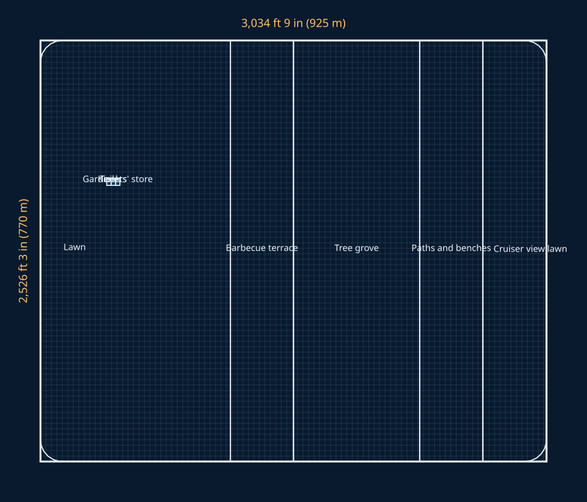

# P5-15 Crew Garden 1: plan

Footprint 3,034 ft 9 in (925 m) × 2,526 ft 3 in (770 m) · structural grid 32 ft 10 in (10 m)

## Levels

| Level | Floor above deck | Height | Floor area |
|---|---|---|---|
| Level 1 · Ground | 0 ft (0 mm) | 13 ft 1 in (4,000 mm) | 3,100 sq ft (288 m²) |

## Elements

| ID | Designation | Type | Name | Level(s) | Size / length | Area | Status |
|---|---|---|---|---|---|---|---|
| E001 | D5F4P5B6A1R1 | zone | Lawn | L1 | 1,138 ft 9 in (347 m) × 2,525 ft 3 in (770 m) | 2,866,300 sq ft (266,288 m²) | proposed |
| E002 | D5F4P5B6A1R2 | room | Kiosk | L1 | 26 ft 3 in (8,000 mm) × 39 ft 4 in (12 m) | 1,033 sq ft (96 m²) | proposed |
| E003 | D5F4P5B6A1R3 | room | Toilets | L1 | 26 ft 3 in (8,000 mm) × 39 ft 4 in (12 m) | 1,033 sq ft (96 m²) | proposed |
| E004 | D5F4P5B6A1R4 | room | Gardeners' store | L1 | 26 ft 3 in (8,000 mm) × 39 ft 4 in (12 m) | 1,033 sq ft (96 m²) | proposed |
| E005 | D5F4P5B6A1R5 | zone | Barbecue terrace | L1 | 378 ft 7 in (115 m) × 2,525 ft 3 in (770 m) | 955,963 sq ft (88,812 m²) | proposed |
| E006 | D5F4P5B6A1R6 | zone | Tree grove | L1 | 756 ft 11 in (231 m) × 2,525 ft 3 in (770 m) | 1,911,097 sq ft (177,547 m²) | proposed |
| E007 | D5F4P5B6A1R7 | zone | Paths and benches | L1 | 378 ft 7 in (115 m) × 2,525 ft 3 in (770 m) | 955,963 sq ft (88,812 m²) | proposed |
| E008 | D5F4P5B6A1R8 | zone | Cruiser view lawn | L1 | 381 ft 11 in (116 m) × 2,524 ft 11 in (770 m) | 955,200 sq ft (88,741 m²) | proposed |

## Drawings

### Level 1 · Ground

