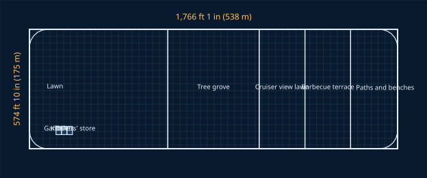

# P5-19 Crew Garden 3: plan

Footprint 1,766 ft 1 in (538 m) × 574 ft 10 in (175 m) · structural grid 32 ft 10 in (10 m)

## Levels

| Level | Floor above deck | Height | Floor area |
|---|---|---|---|
| Level 1 · Ground | 0 ft (0 mm) | 13 ft 1 in (4,000 mm) | 3,100 sq ft (288 m²) |

## Elements

| ID | Designation | Type | Name | Level(s) | Size / length | Area | Status |
|---|---|---|---|---|---|---|---|
| E001 | D5F4P5B14A2R1 | zone | Lawn | L1 | 663 ft 9 in (202 m) × 574 ft 6 in (175 m) | 377,694 sq ft (35,089 m²) | proposed |
| E002 | D5F4P5B14A2R2 | room | Kiosk | L1 | 26 ft 3 in (8,000 mm) × 39 ft 4 in (12 m) | 1,033 sq ft (96 m²) | proposed |
| E003 | D5F4P5B14A2R3 | room | Toilets | L1 | 26 ft 3 in (8,000 mm) × 39 ft 4 in (12 m) | 1,033 sq ft (96 m²) | proposed |
| E004 | D5F4P5B14A2R4 | room | Gardeners' store | L1 | 26 ft 3 in (8,000 mm) × 39 ft 4 in (12 m) | 1,033 sq ft (96 m²) | proposed |
| E005 | D5F4P5B14A2R5 | zone | Tree grove | L1 | 438 ft 4 in (134 m) × 574 ft 2 in (175 m) | 251,588 sq ft (23,373 m²) | proposed |
| E006 | D5F4P5B14A2R6 | zone | Cruiser view lawn | L1 | 219 ft 6 in (67 m) × 574 ft 2 in (175 m) | 125,982 sq ft (11,704 m²) | proposed |
| E007 | D5F4P5B14A2R7 | zone | Barbecue terrace | L1 | 219 ft 2 in (67 m) × 574 ft 2 in (175 m) | 125,794 sq ft (11,687 m²) | proposed |
| E008 | D5F4P5B14A2R8 | zone | Paths and benches | L1 | 225 ft 5 in (69 m) × 573 ft 10 in (175 m) | 125,878 sq ft (11,694 m²) | proposed |

## Drawings

### Level 1 · Ground

