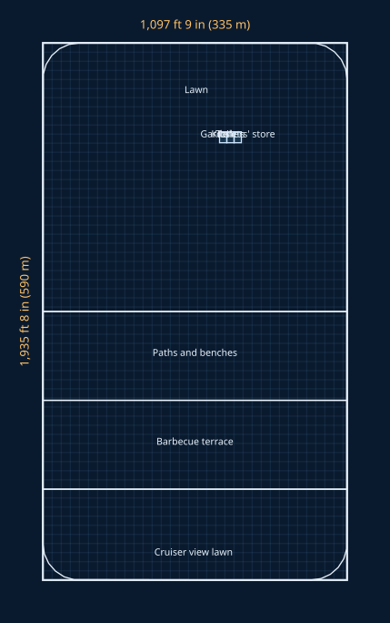

# P5-24 Crew Garden 6: plan

Footprint 1,097 ft 9 in (335 m) × 1,935 ft 8 in (590 m) · structural grid 32 ft 10 in (10 m)

## Levels

| Level | Floor above deck | Height | Floor area |
|---|---|---|---|
| Level 1 · Ground | 0 ft (0 mm) | 13 ft 1 in (4,000 mm) | 3,100 sq ft (288 m²) |

## Elements

| ID | Designation | Type | Name | Level(s) | Size / length | Area | Status |
|---|---|---|---|---|---|---|---|
| E001 | D5F4P5B5A2R1 | zone | Lawn | L1 | 1,097 ft 1 in (334 m) × 967 ft 10 in (295 m) | 1,053,116 sq ft (97,838 m²) | proposed |
| E002 | D5F4P5B5A2R2 | room | Kiosk | L1 | 26 ft 3 in (8,000 mm) × 39 ft 4 in (12 m) | 1,033 sq ft (96 m²) | proposed |
| E003 | D5F4P5B5A2R3 | room | Toilets | L1 | 26 ft 3 in (8,000 mm) × 39 ft 4 in (12 m) | 1,033 sq ft (96 m²) | proposed |
| E004 | D5F4P5B5A2R4 | room | Gardeners' store | L1 | 26 ft 3 in (8,000 mm) × 39 ft 4 in (12 m) | 1,033 sq ft (96 m²) | proposed |
| E005 | D5F4P5B5A2R5 | zone | Paths and benches | L1 | 1,096 ft 9 in (334 m) × 320 ft 3 in (98 m) | 351,096 sq ft (32,618 m²) | proposed |
| E006 | D5F4P5B5A2R6 | zone | Barbecue terrace | L1 | 1,096 ft 9 in (334 m) × 320 ft 3 in (98 m) | 351,149 sq ft (32,623 m²) | proposed |
| E007 | D5F4P5B5A2R7 | zone | Cruiser view lawn | L1 | 1,096 ft 9 in (334 m) × 327 ft 5 in (100 m) | 350,942 sq ft (32,604 m²) | proposed |

## Drawings

### Level 1 · Ground

