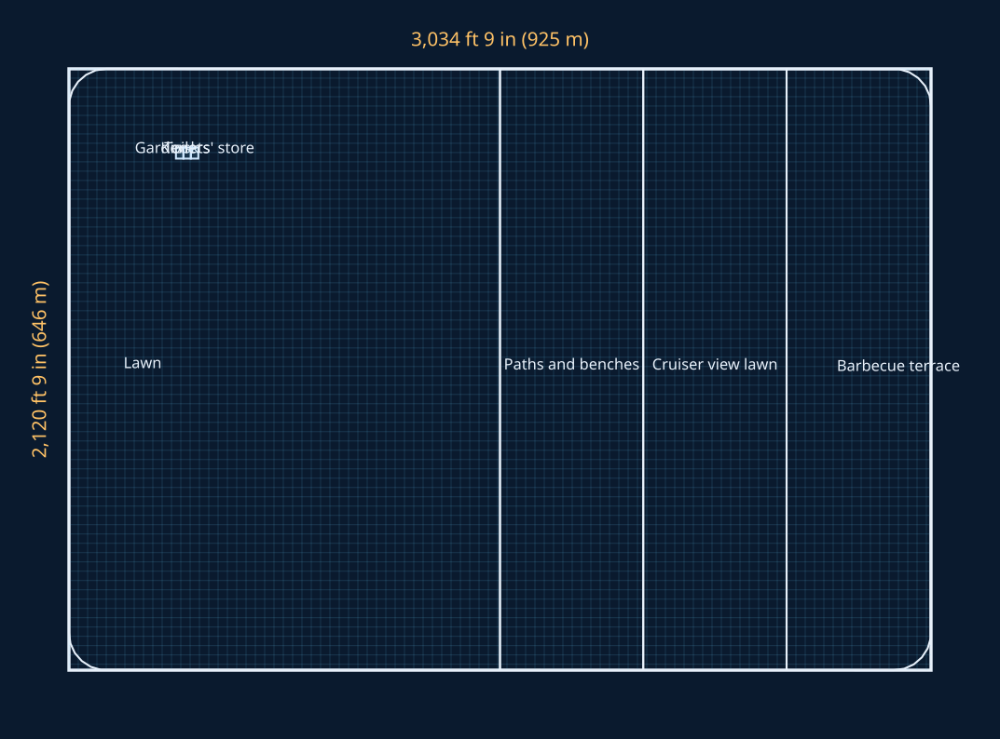

# P5-26 Crew Garden 7: plan

Footprint 3,034 ft 9 in (925 m) × 2,120 ft 9 in (646 m) · structural grid 32 ft 10 in (10 m)

## Levels

| Level | Floor above deck | Height | Floor area |
|---|---|---|---|
| Level 1 · Ground | 0 ft (0 mm) | 13 ft 1 in (4,000 mm) | 3,100 sq ft (288 m²) |

## Elements

| ID | Designation | Type | Name | Level(s) | Size / length | Area | Status |
|---|---|---|---|---|---|---|---|
| E001 | D5F4P5B8A3R1 | zone | Lawn | L1 | 1,517 ft 5 in (462 m) × 2,120 ft 1 in (646 m) | 3,207,203 sq ft (297,959 m²) | proposed |
| E002 | D5F4P5B8A3R2 | room | Kiosk | L1 | 26 ft 3 in (8,000 mm) × 39 ft 4 in (12 m) | 1,033 sq ft (96 m²) | proposed |
| E003 | D5F4P5B8A3R3 | room | Toilets | L1 | 26 ft 3 in (8,000 mm) × 39 ft 4 in (12 m) | 1,033 sq ft (96 m²) | proposed |
| E004 | D5F4P5B8A3R4 | room | Gardeners' store | L1 | 26 ft 3 in (8,000 mm) × 39 ft 4 in (12 m) | 1,033 sq ft (96 m²) | proposed |
| E005 | D5F4P5B8A3R5 | zone | Paths and benches | L1 | 504 ft 3 in (154 m) × 2,119 ft 9 in (646 m) | 1,068,751 sq ft (99,290 m²) | proposed |
| E006 | D5F4P5B8A3R6 | zone | Cruiser view lawn | L1 | 504 ft 7 in (154 m) × 2,119 ft 5 in (646 m) | 1,069,446 sq ft (99,355 m²) | proposed |
| E007 | D5F4P5B8A3R7 | zone | Barbecue terrace | L1 | 508 ft 6 in (155 m) × 2,119 ft 9 in (646 m) | 1,069,013 sq ft (99,315 m²) | proposed |

## Drawings

### Level 1 · Ground

