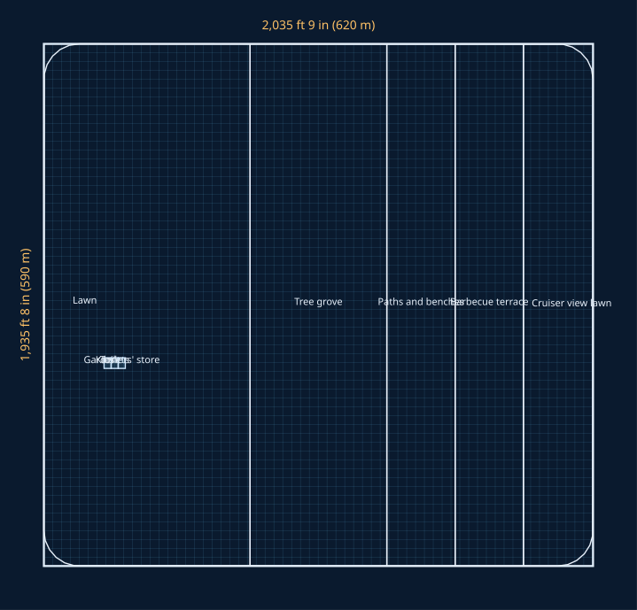

# P5-28 Crew Garden 8: plan

Footprint 2,035 ft 9 in (620 m) × 1,935 ft 8 in (590 m) · structural grid 32 ft 10 in (10 m)

## Levels

| Level | Floor above deck | Height | Floor area |
|---|---|---|---|
| Level 1 · Ground | 0 ft (0 mm) | 13 ft 1 in (4,000 mm) | 3,100 sq ft (288 m²) |

## Elements

| ID | Designation | Type | Name | Level(s) | Size / length | Area | Status |
|---|---|---|---|---|---|---|---|
| E001 | D5F4P5B10A2R1 | zone | Lawn | L1 | 764 ft 5 in (233 m) × 1,934 ft 9 in (590 m) | 1,470,046 sq ft (136,572 m²) | proposed |
| E002 | D5F4P5B10A2R2 | room | Kiosk | L1 | 26 ft 3 in (8,000 mm) × 39 ft 4 in (12 m) | 1,033 sq ft (96 m²) | proposed |
| E003 | D5F4P5B10A2R3 | room | Toilets | L1 | 26 ft 3 in (8,000 mm) × 39 ft 4 in (12 m) | 1,033 sq ft (96 m²) | proposed |
| E004 | D5F4P5B10A2R4 | room | Gardeners' store | L1 | 26 ft 3 in (8,000 mm) × 39 ft 4 in (12 m) | 1,033 sq ft (96 m²) | proposed |
| E005 | D5F4P5B10A2R5 | zone | Tree grove | L1 | 506 ft 11 in (154 m) × 1,935 ft (590 m) | 980,519 sq ft (91,093 m²) | proposed |
| E006 | D5F4P5B10A2R6 | zone | Paths and benches | L1 | 253 ft 3 in (77 m) × 1,934 ft 5 in (590 m) | 489,942 sq ft (45,517 m²) | proposed |
| E007 | D5F4P5B10A2R7 | zone | Barbecue terrace | L1 | 253 ft 3 in (77 m) × 1,934 ft 9 in (590 m) | 489,942 sq ft (45,517 m²) | proposed |
| E008 | D5F4P5B10A2R8 | zone | Cruiser view lawn | L1 | 257 ft 10 in (79 m) × 1,934 ft 5 in (590 m) | 490,168 sq ft (45,538 m²) | proposed |

## Drawings

### Level 1 · Ground

