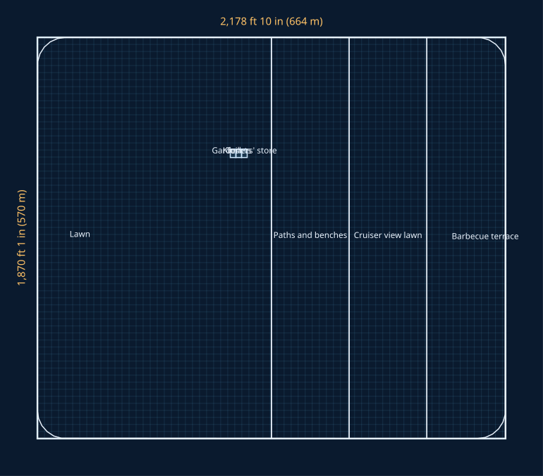

# P5-30 Crew Garden 9: plan

Footprint 2,178 ft 10 in (664 m) × 1,870 ft 1 in (570 m) · structural grid 32 ft 10 in (10 m)

## Levels

| Level | Floor above deck | Height | Floor area |
|---|---|---|---|
| Level 1 · Ground | 0 ft (0 mm) | 13 ft 1 in (4,000 mm) | 3,100 sq ft (288 m²) |

## Elements

| ID | Designation | Type | Name | Level(s) | Size / length | Area | Status |
|---|---|---|---|---|---|---|---|
| E001 | D5F4P5B13A3R1 | zone | Lawn | L1 | 1,089 ft 3 in (332 m) × 1,869 ft 5 in (570 m) | 2,026,944 sq ft (188,309 m²) | proposed |
| E002 | D5F4P5B13A3R2 | room | Kiosk | L1 | 26 ft 3 in (8,000 mm) × 39 ft 4 in (12 m) | 1,033 sq ft (96 m²) | proposed |
| E003 | D5F4P5B13A3R3 | room | Toilets | L1 | 26 ft 3 in (8,000 mm) × 39 ft 4 in (12 m) | 1,033 sq ft (96 m²) | proposed |
| E004 | D5F4P5B13A3R4 | room | Gardeners' store | L1 | 26 ft 3 in (8,000 mm) × 39 ft 4 in (12 m) | 1,033 sq ft (96 m²) | proposed |
| E005 | D5F4P5B13A3R5 | zone | Paths and benches | L1 | 361 ft 11 in (110 m) × 1,869 ft 1 in (570 m) | 676,263 sq ft (62,827 m²) | proposed |
| E006 | D5F4P5B13A3R6 | zone | Cruiser view lawn | L1 | 361 ft 7 in (110 m) × 1,869 ft 1 in (570 m) | 675,709 sq ft (62,775 m²) | proposed |
| E007 | D5F4P5B13A3R7 | zone | Barbecue terrace | L1 | 366 ft 2 in (112 m) × 1,869 ft 1 in (570 m) | 675,659 sq ft (62,771 m²) | proposed |

## Drawings

### Level 1 · Ground

