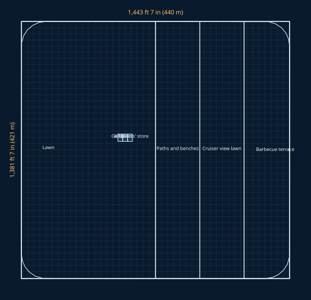

# P5-32 Crew Garden 10: plan

Footprint 1,443 ft 7 in (440 m) × 1,381 ft 7 in (421 m) · structural grid 32 ft 10 in (10 m)

## Levels

| Level | Floor above deck | Height | Floor area |
|---|---|---|---|
| Level 1 · Ground | 0 ft (0 mm) | 13 ft 1 in (4,000 mm) | 3,100 sq ft (288 m²) |

## Elements

| ID | Designation | Type | Name | Level(s) | Size / length | Area | Status |
|---|---|---|---|---|---|---|---|
| E001 | D5F4P5B15A3R1 | zone | Lawn | L1 | 721 ft 9 in (220 m) × 1,380 ft 11 in (421 m) | 987,944 sq ft (91,783 m²) | proposed |
| E002 | D5F4P5B15A3R2 | room | Kiosk | L1 | 26 ft 3 in (8,000 mm) × 39 ft 4 in (12 m) | 1,033 sq ft (96 m²) | proposed |
| E003 | D5F4P5B15A3R3 | room | Toilets | L1 | 26 ft 3 in (8,000 mm) × 39 ft 4 in (12 m) | 1,033 sq ft (96 m²) | proposed |
| E004 | D5F4P5B15A3R4 | room | Gardeners' store | L1 | 26 ft 3 in (8,000 mm) × 39 ft 4 in (12 m) | 1,033 sq ft (96 m²) | proposed |
| E005 | D5F4P5B15A3R5 | zone | Paths and benches | L1 | 238 ft 6 in (73 m) × 1,380 ft 7 in (421 m) | 329,213 sq ft (30,585 m²) | proposed |
| E006 | D5F4P5B15A3R6 | zone | Cruiser view lawn | L1 | 238 ft 6 in (73 m) × 1,380 ft 7 in (421 m) | 329,213 sq ft (30,585 m²) | proposed |
| E007 | D5F4P5B15A3R7 | zone | Barbecue terrace | L1 | 244 ft 9 in (75 m) × 1,380 ft 3 in (421 m) | 329,522 sq ft (30,614 m²) | proposed |

## Drawings

### Level 1 · Ground

